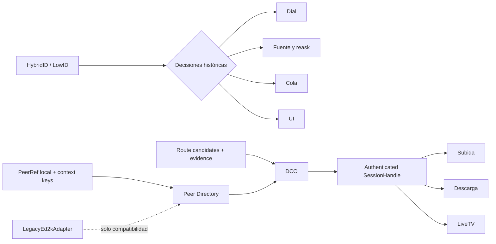
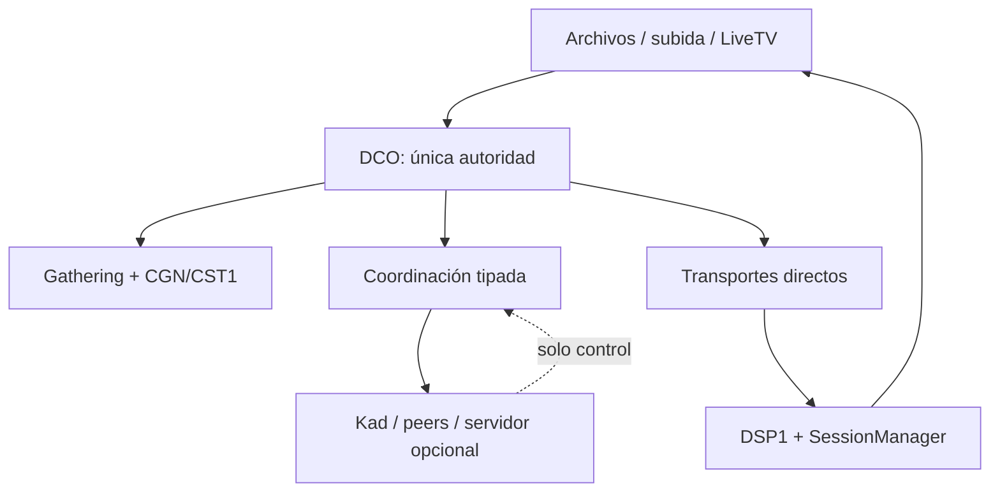
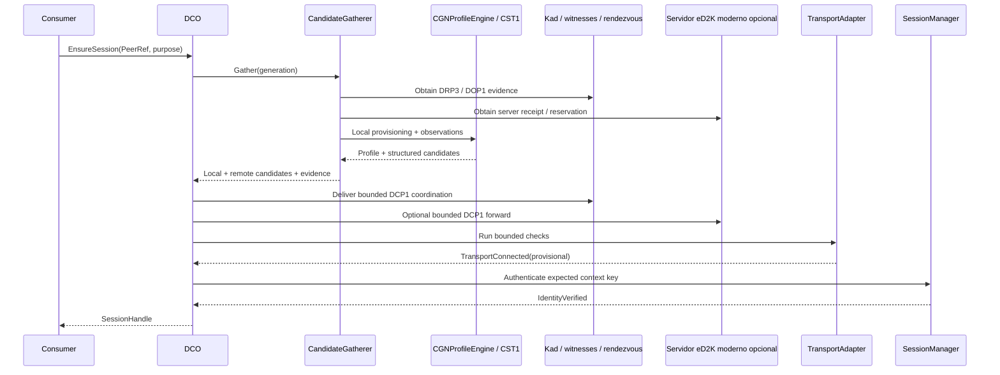
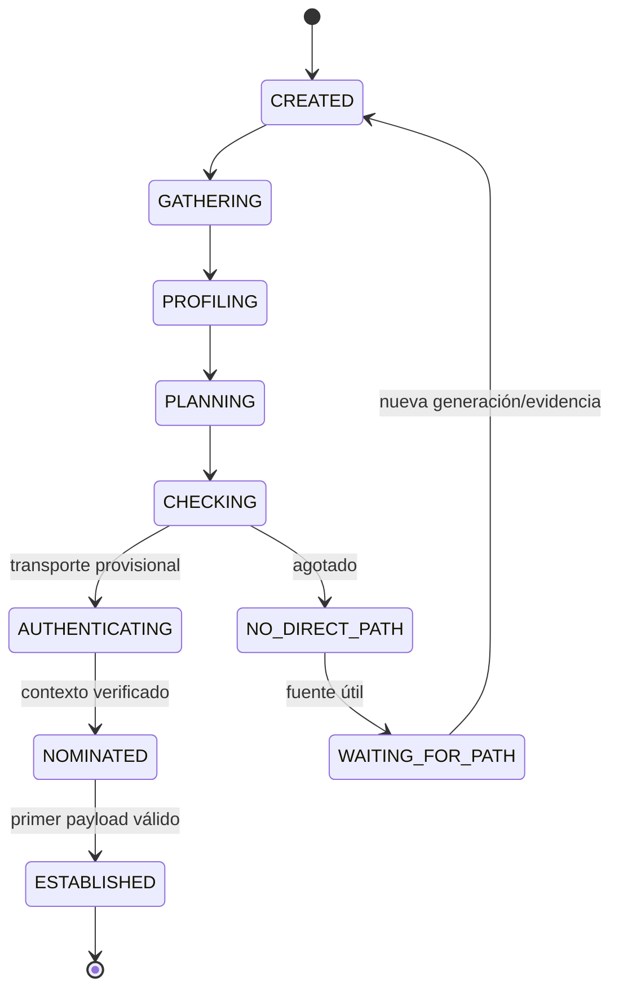
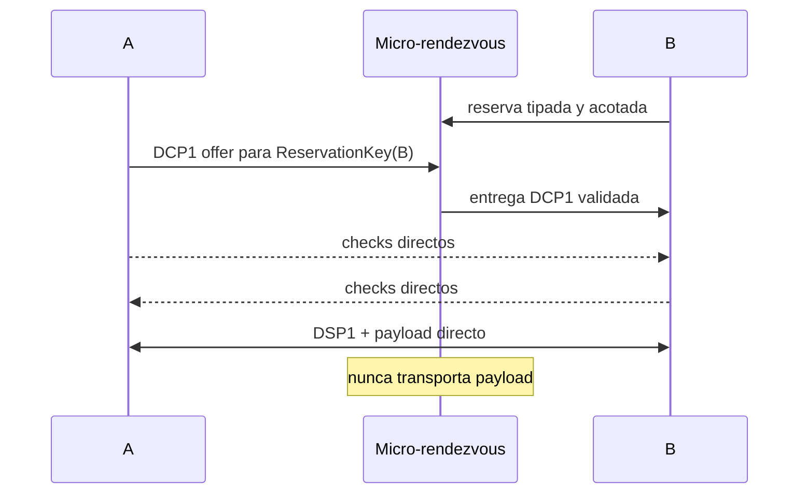
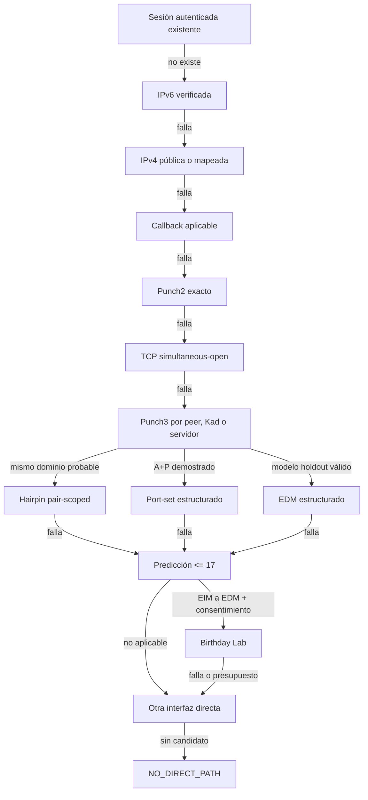
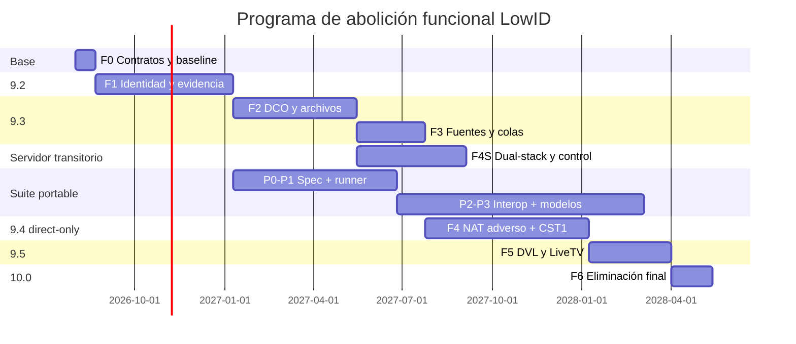

# TESIS TÉCNICA 3.8

# Abolición funcional de LowID en eMule

## Identidades contextuales, conectividad por capacidades, resiliencia de enjambre y sesiones P2P directas independientes del ID histórico

**Arquitectura, protocolos, migración, seguridad y programa de implementación sobre eMule eSE 9.1**

- **Revisión:** 3.8 · 26 de julio de 2026
- **Base auditada:** eMule 0.70b / eSE 9.1.0-beta.2
- **Política de red:** malla descentralizada y servidores dual-stack opcionales para coordinación; cero relay de datos
- **Documento antecedente:** *Tesis técnica consolidada de conectividad directa LowID↔LowID, revisión 2.0*

> **Proposición central.** LowID no debe seguir siendo una identidad, una clase de peer ni una variable de decisión. En el núcleo moderno será únicamente un dato de compatibilidad recibido del protocolo histórico. Dos peers con la misma identidad, candidatos y evidencia deberán recibir exactamente la misma decisión, posición de cola y tratamiento de transferencia aunque se altere su antiguo valor HighID/LowID.

---

# Nota metodológica y estado de la base

Esta tesis parte de la revisión 2.0, conserva su análisis de NAT, mapeos, Punch2, Punch3, uTP, witnesses, DVL y límites físicos, y eleva su objetivo. La revisión anterior proponía convertir LowID en una observación temporal. La presente revisión propone una frontera más fuerte: **LowID queda prohibido como entrada del dominio moderno**. La conectividad se decide mediante identidad, candidatos verificables, capacidades, generación de topología y estado de sesión.

La revisión 3.3 profundiza específicamente en el residuo CGN. Sustituye la categoría imprecisa “CGNAT/simétrico” por un perfil multidimensional y generacional que separa arquitectura de acceso, mapping, filtering, estabilidad del asignador, conjuntos A+P, hairpinning, control explícito, vida de bindings y presupuesto de puertos. Este cambio evita declarar imposible todo EDM↔EDM: distingue el EDM estructurado o aprendible, que admite experimentación acotada, del EDM bilateral aleatorio o de una política de filtrado sin par aceptable, que conserva el límite físico.

La revisión 3.4 audita además la capa de red completa a partir del artefacto de contraste *Elevando la tesis eMule/eD2K/Kad de la capa de conectividad de pareja a la capa de RED*. Acepta tres aportaciones que sobreviven al contraste: distinguir éxito de pareja y resiliencia del enjambre; clasificar los nodos Kad por capacidad de servicio verificada; y diseñar el despliegue por beneficios unilaterales, cliente-servidor y bilaterales. Rechaza o acota tres afirmaciones: una componente gigante no demuestra que un archivo pueda completarse; BEP 55 no define reservas persistentes; y una clave pública estable y global produce una regresión de linkability incompatible con privacidad por diseño.

La revisión 3.5 corrige el modelo de enjambre de la 3.4. La alcanzabilidad base es un atributo de nodo, no una moneda independiente por arista: los peers alcanzables forman un clique, los cerrados un conjunto independiente y todas las aristas entre ambos conjuntos existen. El resultado es un *complete split graph* conectado exactamente cuando existe al menos un peer alcanzable. La teoría Erdős–Rényi se reserva para los enlaces U↔U recuperados por traversal. Esta formulación permite cuantificar por separado conectividad, ganancia marginal y descarga de capacidad de la minoría alcanzable. La misma revisión eleva la identidad Kad6 de “deuda” a gate bloqueante y nombra `WAITING_FOR_PATH` como estado operativo explícito.

La revisión 3.6 contrasta la propuesta de extraer la solución como protocolo reutilizable. La acepta, pero descubre que la extracción no parte de cero: el workspace ya contiene `libreach`, una biblioteca C++17 sin MFC, sockets ni hilos y con ABI C. La auditoría de su superficie encuentra cuatro incompatibilidades bloqueantes con la tesis: identifica intentos por Kad NodeID global, conserva rendezvous IPv4-only, permite reenviar señalización opaca y mantiene `REACH_LAYER_RELAY` y capabilities de circuito de datos. La 3.6 convierte ese hallazgo en un perfil portable `DRF-Core/1`, separa mecanismo, adaptadores y perfil eD2K, sustituye bytes opacos por mensajes de control tipados, elimina el relay de payload del tipo de ruta, endurece negociación/downgrade y añade interoperabilidad multi-implementación, modelos formales y revisión de propiedad intelectual como gates de madurez.

La revisión 3.7 somete esa arquitectura a una pregunta distinta: qué evidencia permite llamar *release candidate* o `1.0` a la suite sin confundir intención, cobertura de tests y experiencia real. Acepta del nuevo contraste la necesidad de puertas binarias, corpus negativo, auditoría con alcance fijado, wire candidato identificable y datos de campo. Corrige, sin embargo, tres atajos: dos bindings del mismo núcleo no son implementaciones independientes; 140 o 385 intentos solo tienen el significado estadístico anunciado bajo muestreo Bernoulli aproximadamente independiente; y ninguna duración, coste de auditoría o cifra de éxito ajena constituye por sí sola un criterio universal. La 3.7 introduce un manifiesto de evidencia firmado, una matriz de NAT por comportamiento —no por etiquetas “cone”—, pruebas GREASE compatibles con `ZERO_PAYLOAD`, denominadores end-to-end y condicionados separados, e intervalos ajustados por clustering de red.

La revisión 3.8 convierte quince objeciones de tutoría en contratos ejecutables y separa las que descubren deuda real de las que contradicen el modelo. Introduce `KeyEpochRecovery/1`, que rota claves de sesión por derivación y confirmación sin reiniciar discovery; `ResourceBudgetController/1`, autoridad global de puertos, mappings, sockets, paquetes, energía y cleanup; un scheduler de técnicas probabilísticas por valor esperado y límite inferior; una barrera DVL exactly-once para migración entre caminos directos; y un modelo heterogéneo `qᵢⱼ` condicionado por acceso, NAT, ASN, CPE, versión y tiempo. La misma revisión define el adapter monohilo para MFC, endurece la cuarentena LowID mediante defensa estática en profundidad, acota GREASE a extensibilidad —no a sondas aleatorias—, declara que un observador global de tráfico queda fuera de la promesa de no-linkability criptográfica y mantiene cualquier relay de payload fuera del perfil conforme `ZERO_PAYLOAD`.

En consecuencia, esta revisión sustituye la identidad pública global de la 3.3 por una raíz secreta local, un `PeerRef` únicamente interno y claves públicas contextuales y rotatorias. **Regla de supremacía 3.6:** cualquier aparición histórica de `PeerKey`, `peer_key`, Kad `NodeID` o `node_pub` como identidad de un usuario en un esquema conceptual anterior se interpreta como una clave de contexto adecuada al mensaje —nunca como una clave mundial estable— hasta que el wire se renombre y congele. Ningún protocolo puede publicar, transmitir ni demostrar la relación entre dos claves contextuales distintas. Las referencias normativas nuevas usan nombres explícitos y prevalecen sobre ejemplos residuales de revisiones anteriores.

El workspace auditado identifica el producto como `9.1.0-beta.2` en `srchybrid/Version.h`; por tanto, no se atribuye a una RC1 evidencia inexistente. Antes de implementar el programa se deberá congelar un commit reproducible y volver a ejecutar los gates. El árbol contiene cambios de usuario y documentos aún no versionados; esta tesis describe su fotografía técnica sin convertir ese estado de trabajo en una release aprobada.

La repetición reproducible de la búsqueda sobre esta fotografía localiza 79 llamadas o declaraciones `HasLowID(`/`IsLowID(` en 33 archivos de `srchybrid`, `libkad6` y `libreach`; la búsqueda léxica `LowID|HighID` alcanza 345 apariciones en 88 archivos de esos árboles. El número no es una métrica de complejidad: una referencia en `TryToConnect` puede ser más decisiva que decenas de cadenas o comentarios. Sí demuestra que la abolición no puede resolverse cambiando un icono o eliminando un `if`; exige una migración transversal y verificable. Estos conteos pertenecen al árbol del 26 de julio de 2026 y deberán regenerarse en el commit congelado.

La investigación aplica cinco filtros:

1. Compatibilidad con la física de NAT, firewall y routing.
2. Encaje con el código y los contratos ya existentes.
3. Seguridad frente a reflexión, escaneo, replay y agotamiento.
4. Compatibilidad gradual con eMule 0.70b y eSE anteriores.
5. Existencia de una prueba capaz de refutar cada afirmación.

Los terceros pueden observar endpoints, conservar reservas efímeras o reenviar mensajes de coordinación. Cualquier peer moderno puede ofrecer voluntariamente esta función de **micro-rendezvous**, sin adquirir un rol permanente ni autoridad sobre los participantes. Un servidor eD2K actualizado puede prestar exactamente el mismo servicio como infraestructura transitoria de alta disponibilidad, además de aceptar clientes y fuentes IPv4/IPv6. Ninguno puede transportar bloques de archivo, frames LiveTV ni un stream opaco que materialmente actúe como relay. Cuando la red no ofrece ningún par de endpoints mutuamente alcanzable, la salida correcta será `NO_DIRECT_PATH`.

# Resumen

LowID nació como una codificación práctica de la alcanzabilidad IPv4/TCP observada por un servidor eD2K. Con el tiempo se convirtió en algo mucho mayor: identidad sintética, bifurcación de conexión, criterio de conservación de fuentes, modificador de colas, disparador de callbacks, etiqueta de interfaz y explicación genérica de fallos. Esta expansión semántica hace que dos clientes con capacidades reales equivalentes reciban tratamientos distintos por un valor histórico que no describe IPv6, mapeos explícitos, UDP, uTP, múltiples interfaces ni rutas verificadas en la generación actual.

La tesis propone abolir funcionalmente LowID mediante cuatro separaciones. Primero, `PeerRef` representa una entidad solo dentro de la base local; en red se usan `ContentContextKey`, `RelationshipKey`, `ReservationKey` y `SessionKey`, sin identificador público universal. UserHash, Kad NodeID, HybridID, IP y buddy ID son aliases de alcance y evidencia limitados. Segundo, `RouteCandidate` representa un camino posible con familia, transporte, endpoint, procedencia, evidencia, TTL y generación. Tercero, `DirectConnectionOrchestrator` es la única autoridad para reunir, comprobar, nominar y cancelar rutas. Cuarto, `SessionHandle` entrega a colas, descargas, subidas y LiveTV una sesión autenticada independiente de la dirección que la sostiene.

El programa crea una suite de siete módulos compatibles y acotados: DRP3 publica reachability y reservas efímeras; DOP1 obtiene observaciones distribuidas; DCP1 coordina checks y hole punching mediante micro-rendezvous ofrecidos por usuarios o servidores eD2K dual-stack; DSP1 autentica y adopta un transporte directo; DVL1 cifra, multiplexa y migra una sesión después de existir un camino; CST1 planifica traversal CGN estructurado; y KCP1 adapta Kad al servicio de señalización. `DRF-Core/1` extrae reducers, codecs canónicos y contratos sin depender de eMule, Kad, sockets o un sistema de señalización concreto; `DRF-eD2K/1` define los adapters legacy. Los servidores modernos actúan como puente de transición: mantienen el canal saliente que permite avisar a dos peers cerrados, indexan candidatos IPv4/IPv6, firman observaciones y sincronizan intentos, mientras Kad evita que sean obligatorios. La escalera directa incluye sesión existente, IPv6, IPv4 pública, mappings PCP/NAT-PMP/UPnP, callback, Punch2, TCP simultaneous-open, Punch3 distribuido de control, predicción limitada, birthday punching EIM↔EDM e interfaces alternativas. La coordinación mejora descubrimiento y signalability, pero no altera la condición física: dos extremos sin familia ni par de endpoints compatible pueden seguir sin camino directo.

Sobre ese núcleo se incorpora `CGNAccessProfile`: detecta NAT444, DS-Lite, MAP-E/MAP-T, lw4o6, 464XLAT y acceso desconocido; clasifica mapping y filtering con múltiples destinos; mide estabilidad y vida de bindings; descubre PCP local o aprovisionado; representa conjuntos de puertos únicamente con evidencia local; y habilita candidatos `SameCgnScoped` solo dentro de una pareja autenticada. La nueva escalera prueba IPv6 agresivo, hairpinning dentro del mismo CGN, port-sets estructurados y modelos de asignación con validación holdout antes de recurrir a predicción o birthday. Las técnicas costosas respetan el margen de recursos del CGN y permanecen desactivadas si no pueden demostrar beneficio neto sin apariencia de escaneo.

La conectividad de pareja sigue siendo necesaria, pero ya no es la única unidad de evaluación. Para cada archivo se mide si el solicitante alcanza una componente que contiene la unión completa de bloques, al menos una fuente completa o redundancia suficiente de las partes raras. En el modelo base, la alcanzabilidad pública es atributo de nodo y produce un *complete split graph*; la probabilidad exacta de conectividad es `1-(1-r)^N`. `G(U,q)` se conserva como baseline de sensibilidad bajo independencia; la evaluación productiva usa una matriz heterogénea `Q=(qᵢⱼ)` con efectos de mapping, filtering, IPv6, acceso, ASN/CPE, versión, hora y generación. La red real sigue siendo temporal, dirigida, correlacionada, limitada por colas y etiquetada por bloques. La tesis prioriza la larga cola de enjambres pequeños y, en swarms grandes, la descarga de capacidad y concentración sobre la minoría alcanzable.

La abolición no se declara por compilar. Se demuestra mediante una propiedad metamórfica: para un peer moderno y un conjunto idéntico de candidatos, cambiar únicamente el ID legacy no puede modificar plan de conexión, puntuación, reask, retención de fuente, créditos, UI ni resultado. Un gate estático prohíbe `HasLowID()` e `IsLowID()` fuera del adaptador histórico. La validación final exige identidad correcta, primer bloque válido, hash de 4 GiB, exactly-once, una sola ruta ganadora, cero recursos huérfanos y cero bytes de datos en terceros. La suite portable añade una prueba más fuerte: dos implementaciones independientes deben producir el mismo transcript, aceptar/rechazar los mismos vectores y no disponer de ninguna API capaz de convertir coordinación en transporte.

**Resultado perseguido:** HighID y LowID dejan de existir en la experiencia y en el motor moderno. Lo que puede existir es una ruta directa disponible, una ruta aún no verificada o la ausencia demostrada de un camino físico.

# Abstract

This thesis specifies the functional abolition of LowID in eMule. LowID becomes legacy input confined to a compatibility adapter and is forbidden as a decision variable in the modern core. A local opaque peer reference, unlinkable scoped keys, evidence-bound route candidates, a single connection orchestrator and path-independent authenticated sessions replace the historical binary without introducing a global tracking identifier. Revision 3.8 defines the portable `DRF-Core/1` suite and the `DRF-eD2K/1` application profile after auditing the existing standalone C ABI in `libreach`. It makes removal of global Kad NodeID correlation, IPv4-only rendezvous records, opaque forwarding and payload-relay route types blocking extraction gates. The revision retains the exact complete-split swarm baseline while replacing homogeneous production assumptions with a clustered, time-varying pair matrix. It specifies acknowledged key epochs, global resource arbitration, expected-value gating for costly traversal, exactly-once direct-path migration, a single-threaded host adapter, and defence-in-depth LowID quarantine. RC and 1.0 promotion remain evidence-bound through a signed release manifest, behaviourally accurate NAT matrices, negative and GREASE vectors, commit-pinned security audits, and clustered field estimates. A distributed control mesh and optional dual-stack eD2K servers may deliver bounded typed signalling, but never application payload. Physically impossible direct topologies enter an inspectable `WAITING_FOR_PATH` state after a typed `NO_DIRECT_*` result.

## Palabras clave

eMule; eD2K; Kad; LowID; HighID; identidad P2P; NAT traversal; CGNAT; NAT444; DS-Lite; MAP-E; lw4o6; A+P; PSID; IPv6; dual-stack; hairpinning; servidor eD2K; PCP; NAT-PMP; UPnP; uTP; hole punching; DCO; reachability; micro-rendezvous; relay de control; key epoch; resource budget; migración exactly-once; grafo inhomogéneo; sesión autenticada; mini-VPN; direct-only.

# Índice

1. Planteamiento, hipótesis y contribuciones.
2. Definición formal de la abolición.
3. Límites físicos y semántica correcta del fallo.
4. Auditoría de la base eSE 9.1.
5. Requisitos, invariantes y modelo de éxito.
6. Identidad contextual y aliases históricos.
7. Frontera de compatibilidad legacy.
8. Candidatos, evidencia y generación.
9. Arquitectura Direct Reachability Fabric.
10. DRP3: publicación de reachability.
11. DOP1: observación descentralizada.
12. DCP1: coordinación y apertura de caminos.
13. DSP1: sesión directa sobre uTP.
14. Escalera definitiva de rutas.
15. Abolición en fuentes, colas y créditos.
16. Transferencia de archivos.
17. DVL1 y LiveTV.
18. Seguridad, privacidad y abuso.
19. Compatibilidad, UI y API.
20. Programa de implementación.
21. Verificación y falsación.
22. Observabilidad y evaluación estadística.
23. Viabilidad, riesgos y gobernanza.
24. Conclusiones.
25. Apéndices normativos.

# Glosario normativo

| Término | Definición en esta tesis |
|---|---|
| LowID | Dato legacy asignado o inferido por protocolos históricos; nunca identidad ni entrada del selector moderno. |
| IdentityRoot | Secreto maestro local, protegido y no exportable; deriva claves contextuales con separación de dominio. |
| PeerRef | Handle opaco y estable solo dentro de una instalación; nunca aparece en el wire, Kad, servidores ni telemetría compartida. |
| PeerKey | Nombre heredado de la 3.3; en 3.4 significa la familia de claves públicas contextuales, no una clave global. |
| ContentContextKey | Seudónimo público rotatorio limitado a un archivo/colección y época. |
| RelationshipKey | Seudónimo bilateral para continuidad, créditos y amistad; solo lo conocen las dos partes. |
| ReservationKey | Seudónimo efímero para una reserva concreta de control. |
| SessionKey | Clave efímera de una sesión autenticada. |
| Key epoch | Fase monotónica de claves de tráfico derivada y confirmada dentro de una sesión; no es identidad ni generación de topología. |
| Alias | Identificador contextual asociado localmente a un `PeerRef` mediante evidencia; nunca unión pública universal. |
| Candidato | Endpoint y transporte potencial con procedencia, evidencia, expiración y generación. |
| Ruta | Par compatible de candidatos locales y remotos sometido a checks. |
| Transporte | Socket TCP, UDP/uTP u otro adaptador directo ya conectado. |
| Sesión | Relación autenticada con una clave contextual esperada que puede sobrevivir a cambios de ruta. |
| Generación | Época monotónica de la topología; invalida evidencia y callbacks anteriores. |
| DCO | Autoridad única de conexión: `DirectConnectionOrchestrator`. |
| Witness | Peer que firma lo que observa de una petición; no decide identidad ni transporta datos. |
| Rendezvous | Peer que entrega señalización acotada a un target que mantiene salida; no reenvía payload. |
| Micro-rendezvous | Rol efímero que cualquier peer capaz puede ofrecer para conservar una reserva y reenviar mensajes DCP1 tipados; nunca crea un transporte de aplicación. |
| Relay de control | Sinónimo funcional de micro-rendezvous; el término `relay` no autoriza payload, store-and-forward de archivos ni túneles opacos. |
| Servidor moderno | Servidor eD2K dual-stack que negocia capacidades, indexa candidatos por contexto y puede actuar como witness/micro-rendezvous de control sin transportar datos. |
| Componente portadora | Subgrafo alcanzable cuya unión de bloques permite completar el contenido; es más fuerte que pertenecer a una componente gigante. |
| Signalability | Capacidad de entregar a un peer la coordinación necesaria para que origine un intento; no demuestra que exista ruta directa. |
| Perfil CGN | Observación efímera y multidimensional de la arquitectura, mappings, filtros y recursos de una generación; no es identidad ni promesa de éxito. |
| ResourceBudgetController | Autoridad local que admite, reserva, contabiliza y recupera puertos, mappings, sockets, paquetes, CPU y energía sin aceptar ampliación remota. |
| EVI | Valor esperado de información/éxito de un escalón después de restar costes y riesgos; usa límite inferior conservador para admisión. |
| PrivacyDomain | Política local que separa interfaces, candidatos, claves y permisos para impedir migraciones o fugas entre redes no equivalentes. |
| `qᵢⱼ(t)` | Probabilidad condicional, heterogénea y temporal de rescatar directamente el par cerrado `i,j` bajo una cohorte y generación definidas. |
| Port-set | Subconjunto de puertos IPv4 asignado a un abonado por una arquitectura A+P; solo es utilizable cuando el propio extremo obtiene evidencia local vigente. |
| EDM estructurado | Mapping dependiente del destino cuyo asignador exhibe una estructura estable y validada fuera de muestra; no equivale a predecible para siempre. |
| EDM aleatorio bilateral | Ambos extremos crean mappings dependientes del destino sin estructura utilizable dentro del presupuesto; constituye el residuo económico principal cuando tampoco existe otra familia o mapping. |
| `NO_DIRECT_PATH` | Terminal que indica ausencia o agotamiento seguro de caminos directos aplicables. |
| `WAITING_FOR_PATH` | Estado durable de una fuente conservada después de drenar un intento `NO_DIRECT_*`; solo despierta por nueva evidencia o generación. |
| DRF-Core/1 | Perfil portable de reducers, codecs, FSM e interfaces host para conectividad directa; no conoce eMule, Kad, archivos, sockets concretos ni relay de payload. |
| DRF-eD2K/1 | Perfil de integración que adapta eD2K/Kad, aliases legacy y opcodes al núcleo portable sin contaminarlo. |
| Mensaje de control tipado | Unión cerrada de mensajes DCP1 con tamaño, campos, destino y coste validables; nunca un blob opaco reenviable. |
| Peer moderno | Cliente que negocia identidad y protocolos DRP3/DCP1/DSP1. |
| Peer legacy | Cliente que solo conoce semántica eD2K/Kad histórica. |

**Tabla 1. Vocabulario que reemplaza la dicotomía HighID/LowID.**

---

# 1. Planteamiento, hipótesis y contribuciones

## 1.1. Problema de investigación

El problema no es que eMule muestre una etiqueta desagradable. El problema es que un entero cuyo significado original era “un servidor no verificó esta entrada IPv4/TCP” se utiliza como sustituto de al menos siete preguntas distintas:

- ¿Quién es el peer?
- ¿Qué direcciones posee?
- ¿Qué rutas puede originar?
- ¿Qué rutas puede recibir?
- ¿Existe un mecanismo de callback?
- ¿Está conectada y autenticada una sesión?
- ¿Cómo debe tratarlo la cola?

La respuesta binaria pierde información y provoca falsos negativos. Un peer clasificado LowID puede tener IPv6 global, mapping PCP, UDP endpoint-independent, una conexión saliente reutilizable o una interfaz móvil alternativa. Un peer clasificado HighID puede conservar un ID obsoleto tras cambiar de red, tener el firewall cerrado o anunciar un puerto cuyo lease ha caducado. Por ello ni LowID prueba inaccesibilidad ni HighID prueba una ruta actual.

La pregunta de investigación es:

> ¿Cómo rediseñar eMule para que ningún comportamiento de transferencia dependa del estado HighID/LowID, manteniendo compatibilidad gradual, seguridad, descentralización y cero relay de datos?

## 1.2. Hipótesis

Si eMule separa identidad, candidatos, transporte y sesión; si reúne evidencia vigente de cada ruta; si una única autoridad coordina los intentos; y si fuentes y colas consumen identidad y estado de sesión en vez de HybridID, entonces LowID puede eliminarse de todas las decisiones entre peers modernos.

La hipótesis no afirma conectividad universal. La ausencia de camino directo es una propiedad de una topología y una política, no de una clase de usuario. La abolición se cumple aunque exista `NO_DIRECT_PATH`, siempre que:

1. se prueben todas las rutas aplicables dentro de presupuesto;
2. el ID histórico no cambie el resultado;
3. el peer no sea penalizado más allá de la ruta y generación fallidas;
4. ningún tercero transporte los datos.

## 1.3. Contribuciones

Esta revisión aporta:

- una definición formal y comprobable de “abolir LowID”;
- un modelo de identidad independiente de direcciones y redes;
- una frontera legacy que impide contaminar el núcleo moderno;
- una suite de siete módulos versionados para reachability, observación, coordinación, sesión, continuidad, traversal estructurado y adaptación Kad;
- un núcleo portable `DRF-Core/1` con ABI C, efectos inyectados y un perfil `DRF-eD2K/1`, sometido a conformance multi-implementación;
- una malla Kad de micro-rendezvous reemplazables, redundantes y exclusivamente de control;
- un contrato transitorio para servidores eD2K dual-stack como índice, witness, verificador y micro-rendezvous opcional;
- un perfil CGN multidimensional que evita colapsar NAT444, A+P, mapping, filtering y asignación aleatoria en una etiqueta;
- una rama de traversal estructurado para hairpinning, port-sets y funciones de asignación validadas;
- una única máquina de conexión para descargas, subidas y LiveTV;
- una migración de fuentes, dead-source, reask, colas y créditos;
- un programa de pruebas metamórficas, físicas y de seguridad;
- un roadmap que sustituye la futura ampliación con relay por técnicas directas y un terminal honesto.

## 1.4. Alcance

Incluido:

- peers modernos sobre eD2K/Kad;
- interoperabilidad con eMule 0.70b y eSE anteriores;
- IPv4, IPv6, TCP y UDP/uTP;
- mappings explícitos y pinholes;
- descubrimiento descentralizado de endpoints;
- callbacks históricos como una ruta más;
- Punch2 y Punch3 de control;
- reservas distribuidas ofrecidas por cualquier peer con capacidad verificable;
- servidores modernos IPv4/IPv6 sin dependencia obligatoria ni relay de payload;
- TCP simultaneous-open;
- predicción y birthday bajo gate;
- detección generacional de arquitectura CGN, same-CGN y conjuntos A+P;
- PCP local y upstream descubierto de forma estándar, siempre oportunista;
- archivos y, posteriormente, LiveTV;
- UI, Web API, métricas y herramientas de migración.

Excluido:

- TURN, KRP, buddy relay, Tor, I2P o proxy de payload;
- DHT con bloques store-and-forward;
- evasión mediante DNS, ICMP, fragmentación o suplantación;
- una VPN general accesible por el sistema operativo;
- garantía directa para EDM aleatorio bilateral, sin IPv6, mapping explícito, familia alternativa ni par aceptado por ambos filtros;
- equivalencia completa cuando el peer remoto es legacy y no entiende los protocolos nuevos.

# 2. Definición formal de la abolición

## 2.1. Invariante de independencia

Sea `M` un peer moderno, `I` su identidad, `C` el conjunto de candidatos, `E` la evidencia, `Q` su historial de cola y `L` el valor legacy HighID/LowID. Para toda operación moderna `F`:

```text
F(I, C, E, Q, L=HighID) = F(I, C, E, Q, L=LowID)
```

La igualdad debe observarse en:

- candidatos seleccionados;
- orden y presupuesto de checks;
- puntuación de subida;
- conservación de la fuente;
- intervalo de reask;
- asociación de créditos;
- transporte nominado;
- resultado de archivo o LiveTV;
- estado mostrado al usuario.

La propiedad no se aplica al adaptador legacy cuando habla con un cliente antiguo: ese protocolo exige interpretar su ID para callbacks. El límite se comprueba por capability y tipo de peer, no por una preferencia visual.

## 2.2. Invariante de cuarentena

El núcleo moderno no puede enlazar contra una API llamada `HasLowID`, `IsLowID` o equivalente. Se crea un gate estático cuya whitelist contiene exclusivamente:

- `LegacyEd2kAdapter`;
- parsing de servidor y source exchange legacy;
- fixtures de compatibilidad;
- migración temporal de UI/API.

Cualquier referencia nueva fuera de esa lista rompe CI. Al final del programa, `CUpDownClient::HasLowID()` desaparece del header público.

## 2.3. Invariante de no penalización

Un fallo pertenece a:

```text
(PeerRef, RouteKind, LocalGeneration, RemoteGeneration)
```

No convierte al peer entero en “muerto”. Un cambio de generación, una ruta nueva o una sesión entrante invalidan el bloqueo correspondiente. La duración depende de la razón observada —timeout, filtro, mapping expirado, auth fallida—, nunca de LowID.

## 2.4. Invariante de igualdad en la cola

Para dos peers con espera, créditos, prioridad y estado de sesión equivalentes:

```text
QueueScore(peerA) = QueueScore(peerB)
```

aunque uno haya recibido HighID y el otro LowID. Si un slot está próximo y falta sesión, ambos reciben el mismo intervalo de preparación mediante DCO. El coste de abrir ruta se limita por presupuestos, pero no se traduce en una puntuación inferior.

## 2.5. Qué significa “dejar de existir”

LowID puede permanecer transitoriamente:

- como campo decodificado dentro del adaptador histórico;
- como contador recibido de servidores antiguos;
- como campo API deprecated durante una release;
- como dato de fixtures que demuestran compatibilidad.

No puede permanecer:

- en el objeto de identidad moderno;
- en un `if` de conexión, cola, fuente o transporte;
- como reason code;
- como etiqueta principal de estado;
- como métrica de éxito de la red moderna.

**Tabla 2. Frontera entre persistencia wire y abolición funcional.**

# 3. Límites físicos y semántica correcta del fallo

## 3.1. Condición de posibilidad

Una transferencia directa requiere al menos un par de candidatos `(a,b)` tal que ambos extremos puedan originar tráfico, los filtros acepten el retorno, la evidencia pertenezca a la misma generación y el transporte pueda autenticarse:

```text
DIRECT_PATH(A,B) =
  exists (a,b):
    compatible(a,b)
    and outbound_A_to_b
    and outbound_B_to_a
    and filter_A_accepts_b
    and filter_B_accepts_a
    and current_generation(a,b)
```

Una LAN virtual o DVL necesita primero que `DIRECT_PATH` sea verdadera. El overlay estabiliza la sesión; no crea el primer datagrama.

## 3.2. Mapping y filtering

“NAT simétrico” mezcla comportamientos distintos. Esta tesis registra al menos:

- EIM: endpoint-independent mapping;
- ADM: address-dependent mapping;
- APDM/EDM: address-and-port-dependent mapping;
- EIF: endpoint-independent filtering;
- ADF/APDF: filtrado dependiente del destino.

Mapping y filtering son ejes independientes. Un mapping EIM no garantiza entrada si el filtro descarta al remoto; un mapping EDM no demuestra que el puerto sea aleatorio. Para EDM se registra además:

- `allocation_model = PRESERVING | SEQUENTIAL | STRIDED | PORT_SET | RANDOM | UNKNOWN`;
- estabilidad por destino, tiempo y carga;
- error de predicción sobre muestras no usadas para ajustar el modelo;
- tamaño y procedencia del port-set, si existe;
- presupuesto de mappings y evidencia de throttling.

La clasificación caduca con la generación y se deriva de observaciones multi-destino. Nunca se infiere por cuatro timeouts contra el mismo endpoint. RFC 5780 advierte que mapping, filtering y lifetime pueden variar por puerto, carga y tiempo; por ello el resultado es una cota de comportamiento observado, no un certificado permanente.

## 3.3. Arquitectura de acceso y perfil CGN

La aplicación separa el comportamiento observable del mecanismo de acceso:

```text
AccessTransitionKind =
  NATIVE_V4
  NAT444
  DS_LITE
  MAP_E
  MAP_T
  LW4O6
  CLAT_464
  V6_ONLY
  UNKNOWN
```

Esta taxonomía es operativa, no comercial. La presencia de `100.64/10` es un indicio de espacio compartido, no prueba por sí sola el número de NAT ni su política. DS-Lite y MAP dependen de IPv6 en la red del operador; NAT444 no. 464XLAT puede dar salida IPv4 sintetizada sin proporcionar una entrada IPv4 utilizable. La app puede conocer parte del mecanismo por configuración local, opciones DHCP/S46, rutas, direcciones y receipts, pero conserva `UNKNOWN` cuando no puede demostrarlo.

`CGNAccessProfile` pertenece a una interfaz y generación. Contiene observación, confianza, expiración y contradicciones; nunca se publica como “tipo de usuario”. Dos interfaces del mismo peer pueden tener perfiles distintos y una red puede degradarse bajo carga.

## 3.4. Matriz física

| Topología | Ruta razonable | Resultado esperado |
|---|---|---|
| IPv6 global bilateral y pinhole | TCP/UDP IPv6 | Directo |
| IPv4 pública o mapping verificado | TCP/uTP | Directo |
| EIM↔EIM con UDP | Punch2 | Alta aplicabilidad |
| EIM↔EDM | Punch2, predicción o birthday | Aplicabilidad condicionada |
| mismo dominio CGN con hairpin | candidato pair-scoped interno o reflexivo | Directo condicionado |
| A+P/MAP con port-set local conocido | checks dentro del conjunto firmado | Aplicabilidad condicionada |
| EDM estructurado↔EDM estructurado | modelo mutuo con holdout y presupuesto | Experimental |
| EDM aleatorio↔EDM aleatorio sin mapping | birthday bilateral acotado o ninguna práctica | Residuo económico / `NO_DIRECT_PATH` |
| filtros bilaterales sin ningún par aceptable | ninguna directa | `NO_DIRECT_PATH` físico |
| UDP bloqueado, TCP saliente permitido | TCP simultaneous-open | Condicionado |
| Todo entrante y UDP saliente bloqueados | Otra interfaz autorizada | Si existe |
| Dos peers en la misma LAN | candidato host/LAN | Directo local |

**Tabla 3. Resultado por topología, independiente del ID histórico.**

La fila EDM estructurado no promete que el modelo aprendido contra witnesses prediga el mapping A↔B. Solo autoriza un experimento si cada lado observa estabilidad por destino, valida fuera de muestra y puede explicar el rango de puertos. Si el modelo cambia al variar la carga o el destino, se degrada a `RANDOM/UNKNOWN` en esa generación.

El birthday bilateral sobre dos asignadores aleatorios no es imposible en teoría probabilística, pero puede ser inviable como producto: su coste crece, consume mappings escasos y puede parecer un escaneo. La tesis distingue por ello imposibilidad física de inviabilidad económica. Ambas pueden terminar la generación, pero con reason codes y política de reintento diferentes.

## 3.5. Taxonomía de terminales

`NO_DIRECT_PATH` se acompaña de una cadena de evidencia:

```text
NO_CANDIDATES
NO_COMPATIBLE_PAIR
IPV6_FILTERED
MAPPING_UNAVAILABLE
CGN_PROFILE_INSUFFICIENT
SAME_CGN_HAIRPIN_FAILED
PORT_SET_UNAVAILABLE
PORT_SET_CONTRADICTED
ALLOCATION_MODEL_UNSTABLE
PORT_BUDGET_EXHAUSTED
UDP_BLOCKED
PUNCH2_FILTERED
TCP_SIMOPEN_FAILED
PUNCH3_SIGNAL_UNAVAILABLE
PREDICTION_NOT_JUSTIFIED
BIRTHDAY_NOT_APPLICABLE
AUTH_FAILED
TOPOLOGY_CHANGED
POLICY_DISABLED
```

`AUTH_FAILED` no equivale a falta de ruta: existe transporte, pero no pertenece al peer esperado. `TOPOLOGY_CHANGED` tampoco es una derrota permanente: ordena reunir candidatos de una nueva generación.

`PORT_BUDGET_EXHAUSTED` tampoco significa imposibilidad matemática. Declara que continuar violaría el presupuesto de seguridad o recursos de esa red. Su reintento exige nueva generación, mayor evidencia o política explícita; nunca un bucle automático de fuerza bruta.

# 4. Auditoría de la base eSE 9.1

## 4.1. Activos reutilizables

| Activo | Valor | Brecha |
|---|---|---|
| `CDirectReachabilityManager` | snapshot local, generación y leases | verificación y eventos completos |
| `libnatmap` | contratos PCP/NAT-PMP, ownership y policy | integración productiva |
| `libreach` | codec y cascada portable | autoridad host y perfil sin relay |
| `TAG_ESE_REACH` v2 | capabilities y anchors | candidatos, identidad y generación |
| Punch2/cookies | señalización y return-routability | estado por intento y éxito correcto |
| Punch3 | rendezvous experimental | reservas, autoridad y no-payload |
| `CClientUDPSocket`/uTP | transporte UDP existente | misma socket y adopción provisional |
| Hello/SecureIdent | autenticación histórica | binding moderno con clave contextual/RelationshipKey |
| Kad | DHT y mensajería distribuida | receipts y descriptor moderno |

**Tabla 4. La abolición integra activos existentes; no comienza desde cero.**

## 4.2. Conexión

`CUpDownClient::TryToConnect` mantiene la cascada histórica. Aunque ya prueba IPv6 y Punch2, contiene un hard-fail `LowID->LowID`, ramas `No Callback Option` y la condición de TCP directo `!HasLowID()`. También conserva contadores, cooldown y una inferencia de NAT simétrico local al cliente. El flujo puede iniciar Punch2 y continuar hacia callbacks, mientras otros subsistemas ejecutan selectores propios.

El cambio decisivo no es añadir otra condición antes del hard-fail. Es retirar la autoridad de `TryToConnect`: el método solicitará una sesión al DCO y recibirá un handle. Los adapters ejecutarán las acciones; `CUpDownClient` conservará semántica de aplicación.

## 4.3. Fuentes y dead-source

`DeadSourceList`, `DownloadClient`, `DownloadQueue`, `PartFile` y `SearchList` usan LowID para deduplicar, retener, bloquear o elegir identificadores. Esto confunde peer con ruta. La sustitución será:

- identidad local: `PeerRef`; autenticación wire: clave contextual;
- alias legacy: scoped y no autoritativo;
- fallo: por route kind y generación;
- fuente: permanece mientras aporte el archivo y exista posibilidad de nueva ruta;
- duplicado: prueba de identidad o aliases enlazados, no IP pequeña.

## 4.4. Cola de subida

`UploadQueue` documenta que un LowID no conectado se clasifica como el peor candidato, admite un slot adicional y mantiene callbacks especiales. `UploadClient` y las listas visuales también ramifican. El nuevo modelo separa score y readiness:

- `QueueScore` usa espera, créditos, prioridad y fairness;
- `SessionReadiness` indica conectada, preparando, reintentable o sin ruta actual;
- el scheduler puede preparar una sesión antes del turno;
- no modifica el score por la forma de reachability.

## 4.5. LiveTV y relay residual

LiveTV conserva lógica de reachability propia y rutas relay. Esto contradice la autoridad única y el perfil direct-only. LiveTV será consumidor posterior de `SessionHandle`; no podrá nominar rutas, abrir relay ni atribuir identidad por `CUpDownClient*`.

## 4.6. Servidor, UI y API

`ServerConnect`, `ServerSocket`, `NetworkInfoDlg`, listas, estadísticas y Web API exponen HighID/LowID. En la transición, el adaptador seguirá decodificando el valor para interoperar, pero el producto mostrará estados de ruta y sesión. Los campos API se deprecian con compatibilidad temporal derivada.

La base contiene ya tres piezas aditivas que un servidor nuevo puede aprovechar: `CT_FORK_CAPABILITIES` en `OP_LOGINREQUEST`, `OP_FOUNDSOURCES_V6` para respuestas de fuentes nativas y `ST_IPV6` para representar servidores IPv6 en `server.met`. El cliente anuncia la capability y posee parsers defensivos, pero esto no convierte por sí mismo al protocolo servidor en family-neutral: `OP_CALLBACKREQUEST`, `OP_IDCHANGE` y las fuentes históricas continúan modeladas alrededor de campos IPv4 de 32 bits.

La ampliación no reutilizará esos cuatro bytes para codificar IPv6 ni declarará “HighID por IPv6”. El servidor moderno conserva el ID histórico como alias de compatibilidad y negocia en paralelo claves contextuales, candidatos y reservas de control mediante mensajes versionados.

## 4.7. Diagrama del cambio



La flecha legacy termina en el directorio de aliases; no llega al selector moderno.

# 5. Requisitos, invariantes y modelo de éxito

## 5.1. Requisitos funcionales

| ID | Requisito |
|---|---|
| AL-F01 | Un peer moderno se representa localmente por `PeerRef` y en red por claves limitadas al contexto. |
| AL-F02 | LowID no entra en decisiones modernas. |
| AL-F03 | Todos los candidatos poseen TTL y generación. |
| AL-F04 | DCO es la única autoridad de rutas. |
| AL-F05 | IPv6, mappings, callback y punching son rutas equivalentes en interfaz. |
| AL-F06 | Fuentes y dead-source se asocian a peer y ruta por separado. |
| AL-F07 | La cola no penaliza reachability histórica. |
| AL-F08 | Un transporte se autentica antes de entregar datos. |
| AL-F09 | Archivos conservan hashes, AICH, créditos y reanudación. |
| AL-F10 | LiveTV reutiliza la sesión sin selector propio. |
| AL-F11 | Ningún tercero transporta datos. |
| AL-F12 | Peers legacy conservan interoperabilidad clásica. |
| AL-F13 | La UI no presenta HighID/LowID como estado de usuario. |
| AL-F14 | Un fallo se explica por ruta, evidencia y generación. |
| AL-F15 | Cualquier peer elegible puede ofrecer coordinación efímera sin convertirse en transporte de datos. |
| AL-F16 | Un servidor dual-stack puede ofrecer índice, observación y coordinación modernas sin ser obligatorio ni transportar payload. |
| AL-F17 | IPv4-only↔IPv6-only sin traducción o familia común no se contabiliza como ruta directa. |
| AL-F18 | EDM se clasifica por estabilidad y estructura antes de descartarse o autorizar predicción. |
| AL-F19 | Los candidatos same-CGN y A+P son pair-scoped, efímeros y respaldados por evidencia local. |
| AL-F20 | Toda técnica intensiva respeta un presupuesto estimado de mappings, puertos, paquetes, tiempo y batería. |
| AL-F21 | Ningún identificador público permite correlacionar por diseño archivos, servidores, reservas y sesiones de un mismo usuario. |
| AL-F22 | Kad solo asigna servicio WAN a endpoints que superen verificación de entrada vigente; los demás operan como clientes/orígenes. |
| AL-F23 | La evaluación de un archivo mide cobertura de bloques y fuentes completas, no solo tamaño de la componente de peers. |
| AL-F24 | Cada feature declara si su beneficio es unilateral, cliente-servidor o bilateral y conserva downgrade legacy. |

**Tabla 5. Requisitos de abolición funcional.**

## 5.2. Invariantes no negociables

- `legacy_id_independence == true` para peers modernos.
- `winner_count <= 1` por intento.
- `third_party_file_payload_bytes == 0`.
- `third_party_livetv_payload_bytes == 0`.
- `coordination_transport_adoptable_as_session == false`.
- todo forward de tercero pertenece a un tipo DCP1 cerrado, posee límite de bytes y carece de campo opaco de aplicación.
- una observación de servidor conserva familia, transporte, destino observado, TTL y generación; nunca se convierte en verdad global.
- conectar al servidor por IPv6 no implica reachability entrante IPv6.
- `authenticated_peer == expected_peer` antes del primer bloque.
- ningún evento de generación antigua cambia estado.
- ningún candidato no verificado se anuncia como entrante.
- ninguna capability remota eleva presupuestos locales.
- ninguna dirección privada se publica globalmente.
- ninguna dirección RFC 1918, ULA o `100.64/10` se distribuye globalmente; un candidato interno solo viaja en un envelope tipado, firmado y dirigido a la pareja consentida.
- ningún port-set remoto se deriva de una base comunitaria o del prefijo IPv6 como hecho; el propietario debe anunciar evidencia local firmada y vigente.
- ningún perfil CGN modifica identidad, cola, créditos o conservación de fuente.
- ningún modelo de puertos se usa en producción sin validación holdout en la generación actual.
- no existe estado persistente caro antes de return-routability.
- desactivar una feature retira su capability y drena recursos.
- `IdentityRoot` y `PeerRef` nunca salen del proceso o del almacenamiento local protegido.
- una prueba de continuidad entre claves contextuales solo se entrega al contraparte o contexto autorizado; jamás se inserta en Kad o en un servidor global.
- conocer un hash eD2K público no se presenta como secreto criptográfico ni convierte por sí solo un descriptor en confidencial.
- ninguna métrica de componente gigante se interpreta como disponibilidad completa sin comprobar la unión de bloques.
- un nodo Kad no verificable puede buscar y publicar dentro de cuota, pero no se anuncia como router/witness/rendezvous WAN.

## 5.3. Definición de éxito

Hay tres niveles:

1. **Ruta:** checks correlacionados prueban retorno A↔B.
2. **Sesión:** transporte conectado y clave contextual esperada autenticada.
3. **Transferencia:** primer bloque válido; para aceptación final, hash completo.

Solo el tercero demuestra el objetivo de usuario. Los contadores no podrán llamar “conectado” a un ACK o a una socket provisional.

## 5.4. Criterio de abolición

La release pasa el gate cuando:

- cambiar únicamente el valor legacy produce trazas modernas idénticas;
- la búsqueda estática no encuentra LowID fuera de la whitelist;
- UI y API modernas no lo presentan;
- todas las rutas se explican con candidatos y evidence;
- todas las colas se explican con score y session readiness;
- todas las transferencias se explican con SessionHandle.

# 6. Identidad contextual y aliases históricos

## 6.1. Por qué se retira la PeerKey global

Una clave estable resuelve deduplicación, sesiones y créditos, pero si la misma huella aparece en Kad, servidores, listas de fuentes, reservas y handshakes también crea un índice mundial de actividad. Un observador puede unir archivos distintos, cambios de IP y servidores visitados sin romper el cifrado. La autenticidad no justifica esa linkability.

La revisión 3.4 separa tres propiedades que la 3.3 había unido:

1. **continuidad local:** reconocer que varios encuentros pertenecen al mismo peer dentro de la base propia;
2. **autenticidad contextual:** probar que quien publicó un descriptor controla la clave esperada para ese archivo, reserva o relación;
3. **identidad pública global:** innecesaria y, por tanto, prohibida.

## 6.2. IdentityRoot y PeerRef

```cpp
struct SelfIdentityStateV2 {
    Secret<32> identity_root;      // jamás se publica
    PeerRef self_ref;              // handle local del propio nodo
    uint64 root_epoch;
};
```

`IdentityRoot` se crea en el primer arranque moderno, se guarda con ACL restrictiva y puede protegerse mediante DPAPI. No es una clave Ed25519 reutilizada: es material de derivación. Cada entidad remota obtiene además un `PeerRef` aleatorio dentro de la base local; `self_ref` aplica la misma disciplina al propio nodo. `PeerRef` no tiene serializador de red. Copiarlo a un packet, log compartido o métrica es un fallo de tipo y de privacidad.

Las claves hijas se derivan mediante HKDF con separación de dominio:

```text
seed = HKDF-Expand(
  IdentityRoot,
  "eMule-Identity-v2" || scope_kind || scope_id || epoch || rotation_salt,
  32)

(sk_context, pk_context) = Ed25519-KeyGen(seed)
```

La derivación determinista facilita recuperación local, pero no se publica ninguna prueba de que dos claves hijas proceden de la misma raíz. `rotation_salt` permite cortar continuidad incluso ante igualdad de contexto.

## 6.3. Familia de claves contextuales

| Clave | Alcance | Vida típica | Uso permitido |
|---|---|---:|---|
| `ContentContextKey` | hash/colección + época | horas o días | fuente, disponibilidad y primer contacto |
| `ServerContextKey` | servidor + época | una conexión/época | login moderno, receipt y callback |
| `ReservationKey` | rendezvous + reserva | minutos | localizar y autenticar control |
| `RelationshipKey` | pareja A↔B | hasta rotación | créditos, amistad y continuidad bilateral |
| `SessionKey` | sesión | conexión | cifrado, transcript y migración de path |

Una `ContentContextKey` puede aparecer en los registros del contenido al que pertenece, pero no en otro archivo. Una `ServerContextKey` no puede reutilizarse en dos servidores. Una `ReservationKey` no indexa fuentes. Una `RelationshipKey` nunca se publica. Una `SessionKey` no se persiste una vez drenada la sesión.

Los campos residuales llamados `peer_key_hash` en borradores 3.3 se renombran antes del wire freeze a `subject_context_key_hash`, `source_context_key_hash`, `target_reservation_key_hash` o `relationship_key_hash`, según corresponda. No se crea un alias de compatibilidad que vuelva a introducir una huella global.

## 6.4. Binding progresivo sin grafo público

El primer contacto conoce una clave de contenido o reserva. DSP1 autentica esa clave y el transcript. Dentro del canal ya autenticado, ambos peers pueden intercambiar claves bilaterales y una prueba de posesión:

```text
A -> B: RelationshipKey_A_to_B, proof(transcript, context_key, relationship_key)
B -> A: RelationshipKey_B_to_A, proof(transcript, context_key, relationship_key)
```

La prueba no demuestra una raíz global; solo enlaza esa sesión con esa relación. Cada cliente asocia localmente las claves verificadas a un `PeerRef`. Ningún tercero recibe ese mapa. Para encuentros posteriores, una prueba de continuidad firmada con la RelationshipKey anterior se envía exclusivamente al mismo contraparte.

Una IP nunca enlaza identidades por sí sola. Dos peers tras el mismo CGNAT comparten IP pública y un peer móvil cambia de IP. UserHash, Kad NodeID, HybridID y buddy ID mantienen su función legacy o de routing, pero solo se vinculan localmente cuando el handshake aporta evidencia.

## 6.5. Rotación, pérdida y revocación

- claves de contenido, servidor y reserva rotan automáticamente por época;
- la RelationshipKey rota mediante una declaración bilateral enviada por una sesión autenticada;
- perder `IdentityRoot` crea un perfil moderno nuevo;
- no existe anuncio global de “old key → new key”;
- una revocación urgente se conserva en la base de cada relación y no revela el resto del grafo;
- los créditos no se heredan mediante IP, UserHash sin verificar ni una declaración pública autocertificada.

La renuncia a recuperación global es deliberada: impide convertir una infraestructura de conectividad en un directorio permanente de usuarios.

Una rotación tampoco se hace efectiva por recibir un único datagrama. Toda declaración posee `key_epoch`, `previous_key_hash`, `new_key_hash`, transcript y nonce; se retransmite idempotentemente y solo se confirma cuando ambas partes han demostrado posesión dentro de una sesión autenticada. Durante la transición se aceptan exactamente las épocas anterior y actual bajo límites temporales. Una pérdida UDP no adelanta el estado durable de ninguno de los extremos. Si expira el protocolo de rotación, se conserva la última RelationshipKey confirmada o se exige nueva aprobación bilateral; nunca se publica un vínculo de recuperación.

Esta regla no debe confundirse con el rekey frecuente de `SessionKey`, que se deriva dentro de la sesión y se especifica en `KeyEpochRecovery/1` (§13.6). RelationshipKey aporta continuidad bilateral de larga duración; SessionKey protege tráfico efímero. Perder la segunda no revoca ni revela la primera.

## 6.6. Créditos

Durante la migración:

- peer legacy: créditos por UserHash y SecureIdent, comportamiento clásico;
- peer moderno: créditos por `RelationshipKey` verificada;
- historial legacy: migración únicamente al probar UserHash/SecureIdent y RelationshipKey dentro de la misma sesión autenticada;
- conflicto: no fusionar y registrar `CREDIT_IDENTITY_CONFLICT`;
- servicio como witness o rendezvous no otorga créditos de archivo ni modifica la cola.

Los créditos son locales y bilaterales. No se publican reputaciones, saldos ni recibos de subida en Kad. Esta decisión evita Sybil de reputación y hace que servir señalización no permita comprar prioridad de descarga.

## 6.7. PeerDirectory

`PeerDirectory` mantiene:

```text
PeerRef
verified scoped aliases
relationship keys
active sessions
remote reach snapshots by context
route failure memory
queue/accounting references
last authenticated activity
```

No almacena `low_id` como propiedad de dominio ni exporta el grafo de aliases. El adaptador puede conservar `LegacyNetworkHints` separado y con TTL. La deduplicación entre dos fuentes de contextos diferentes es conservadora hasta que una sesión directa aporte binding bilateral; aceptar duplicados temporales es preferible a crear correlación global.

## 6.8. Límite de confidencialidad del hash de archivo

El hash eD2K de un archivo público suele ser conocido o adivinable. Cifrar un descriptor con una clave derivada únicamente de ese hash no ofrece confidencialidad frente a quien conoce el enlace: como máximo frena recolección indiscriminada. Para contenido público, la defensa es minimización, claves contextuales, TTL corto y respuesta bajo return-routability. Para una colección privada se requiere una `ContentDiscoveryCapability` aleatoria compartida fuera de banda; el hash por sí solo no es esa capability.

## 6.9. Gate bloqueante de identidad Kad6

### 6.9.1. Hallazgo exacto en la base

Kad6 separa parcialmente routing y fuente, pero todavía permite correlación:

- `K6RouterRecord` lleva `node_pub` y firma el endpoint set;
- `K6RouteHeaderV2`, usado por `STORE_SOURCE`, contiene obligatoriamente el `sender_record`;
- `K6SourceRecord` posee su propio `pub_key`, del que deriva `source_pseudonym`;
- `K6SourceRecordTable` usa `object_hash || H(pub_key)` para ownership.

El tercer y cuarto punto son favorables: `pub_key` ya puede ser `ContentContextKey` y su rotación cambia el seudónimo; no es obligatorio cambiar el formato de `K6SourceRecord` para obtener ownership por contenido. El bloqueo aparece en el envelope: el custodio recibe en el mismo `STORE` el `sender_record.node_pub` del transporte y el `record.pub_key` del contenido. Si `node_pub` es persistente, puede unir publicaciones aunque el record sea contextual. Si ambos campos reutilizan la misma clave, la correlación es pública y trivial.

Por ello Identity v2 no pasa Fase 1 mientras un flujo de publicación moderno reutilice o exponga una identidad de routing de usuario estable. No se clasifica como deuda posponible.

### 6.9.2. Tres dominios de clave sin continuidad pública

```text
RouterServiceKey
  alcance: servicio WAN Router/ControlService
  raíz: RouterServiceRoot independiente
  linkability: aceptada solo para la infraestructura voluntaria

KadRpcContextKey
  alcance: operación + custodio + objeto + época
  raíz: IdentityRoot
  linkability: únicamente dentro de ese contexto

ContentContextKey
  alcance: objeto/colección + época
  función: firma y ownership de K6SourceRecord
```

`RouterServiceRoot` se genera independientemente de `IdentityRoot`; no se deriva de ella, no se cruza-firma y puede residir en un perfil de servicio separado. Un router es públicamente observable como infraestructura, pero su clave no representa al usuario, sus créditos ni los archivos que comparte. Desactivar el servicio elimina esa identidad sin afectar relaciones.

Un peer `OriginOnly` no necesita identidad pública de router. Sus operaciones STORE/FIND usan `KadRpcContextKey` distinta por objeto, custodio y época. Dos custodios no reciben la misma clave RPC. Dentro de `K6SourceRecord`, `pub_key=ContentContextKey`.

### 6.9.3. K6RouteHeaderV3 para orígenes

El header v2 con `sender_record` continúa para RPC entre routers. Los orígenes negocian:

```text
K6OriginRouteHeaderV3 {
  version = 3
  rpc_context_key
  rpc_scope_hash
  epoch
  expires_at
  quota_presentation
  request_nonce
  signature
}
```

No contiene Kad NodeID estable, RouterServiceKey, PeerRef, RelationshipKey ni prueba de derivación. `rpc_scope_hash` compromete opcode, custodio, objeto y época. La firma autentica la petición actual; no reclama reputación global.

La base ya posee principales de cuota guard-locales y primitivas de tokens ciegos en `kad6_quota.*`. KCP1 los reutiliza para limitar emisión y consumo sin convertir una clave mundial en identidad de cuota. El custodio sigue observando el endpoint de red directo; la tesis elimina linkability criptográfica global, no promete ocultación frente al custodio o un observador de tráfico.

### 6.9.4. Update, erase y rotación de ownership

El ownership sigue siendo:

```text
object_hash || H(ContentContextKey)
```

Actualizar durante una época usa la misma clave y `source_epoch` monotónico. Al rotar:

1. el cliente emite un tombstone acotado, firmado por la clave de contenido anterior;
2. publica el nuevo record con nueva ContentContextKey;
3. ambos solo pueden enlazarse dentro del mismo objeto y custodio;
4. si el tombstone no llega, el record anterior expira por TTL.

No existe continuidad entre objetos. Esta pérdida deliberada de ownership global es compatible con store: una fuente necesita sustituir su record dentro de un archivo, no demostrar que comparte otros archivos.

### 6.9.5. Gates de aceptación

- ningún `K6SourceRecord.pub_key` de producción usa RouterServiceKey;
- ningún STORE de origen moderno incluye `K6RouteHeaderV2.sender_record`;
- `KadRpcContextKey(custodian A) != KadRpcContextKey(custodian B)`;
- rotar ContentContextKey no rompe update/expiry dentro del objeto;
- PCAP y vista de dos custodios no contienen una clave común del usuario;
- RouterServiceKey no firma source, créditos, reservas de usuario ni DSP1;
- desactivar `Router/ControlService` no cambia PeerRef, RelationshipKey o créditos;
- si no existe `K6OriginRouteHeaderV3` interoperable, la feature contextual Kad6 permanece desactivada y no puede anunciar cumplimiento de privacidad 3.6.

# 7. Frontera de compatibilidad legacy

## 7.1. LegacyEd2kAdapter

El adaptador histórico tiene cuatro responsabilidades y ninguna más:

1. Decodificar server ID, HybridID, callbacks, buddy y source exchange antiguos.
2. Traducirlos a `LegacyNetworkHints` con procedencia y caducidad.
3. Ejecutar el comportamiento clásico cuando el remoto no negocia protocolos modernos.
4. Codificar respuestas legacy sin exponer sus reglas al núcleo.

No decide colas, identidad, dead-source ni rutas modernas. Su salida nunca incluye “este peer es LowID”; incluye hechos como:

```text
server_callback_id = 12345
server_endpoint = x
buddy_endpoint = y
observed_ipv4 = z
supports_direct_udp_callback = true
```

## 7.2. Clasificación del remoto

El modo se decide por negociación:

| Remoto | Modo | Autoridad |
|---|---|---|
| Sin capability moderna | Legacy | Adapter + comportamiento 0.70b |
| DRP3 sin DSP1 | Descubrimiento moderno, sesión legacy | DCO con rutas comunes |
| DRP3 + DCP1 + DSP1 | Moderno completo | DCO |
| Capability desconocida | No habilita nada | Decoder compatible |

**Tabla 6. Selección de modo por protocolo, no por LowID.**

## 7.3. Regla anti-contaminación

Una función moderna puede recibir `LegacyNetworkHints`, pero no un booleano LowID. El compilador y los tests hacen visible cualquier intento de reintroducir la dicotomía. La interfaz permite preguntar:

```text
has_server_callback_route()
has_kad_callback_route()
has_observed_ipv4()
```

No permite preguntar:

```text
is_low_id()
is_high_id()
```

## 7.4. Compatibilidad degradada

La abolición completa se garantiza entre peers modernos. Frente a un peer 0.70b:

- se conserva TCP directo y callbacks históricos;
- no se envían DRP3/DCP1/DSP1;
- no se exige identidad contextual moderna;
- las limitaciones de ese remoto siguen existiendo;
- la UI explica “protocolo legacy” en vez de convertirlo en una identidad LowID.

Esto no es una excepción oculta: es una frontera de versión explícita y medible.

# 8. Candidatos, evidencia y generación

## 8.1. RouteCandidate

```cpp
enum class CandidateKind {
    HostV6,
    PublicV4,
    MappedV4,
    ServerObserved,
    WitnessObserved,
    LegacyCallback,
    LanScoped,
    SameCgnScoped,
    StructuredPortSetV4
};

struct RouteCandidate {
    CandidateId id;
    CandidateKind kind;
    AddressFamily family;
    TransportKind transport;
    Endpoint endpoint;
    EvidenceRef evidence;
    InterfaceId interface_id;
    TopologyGeneration generation;
    uint64 expires_at_ms;
    uint32 priority;
};
```

El candidato describe dónde intentar; no concede confianza al payload remoto. La identidad se autentica después.

## 8.2. Evidencia

| Evidencia | Prueba | Limitación |
|---|---|---|
| Inbound accept | una entrada real llegó al listener | ligada a endpoint y generación |
| Legacy server observation | servidor observó IP/ID histórico | semántica legacy, IPv4 y sin autoridad moderna |
| Modern server receipt | servidor firmó el endpoint IPv4/IPv6 que observó | válido para ese transporte, socket, destino y generación |
| Mapper lease | gateway concedió puerto | no prueba extremo exterior |
| External verify | witness alcanzó el endpoint | debe enlazar nonce/generación |
| Native IPv6 | dirección global local | no prueba firewall |
| Punch response | retorno correlacionado | no prueba identidad final |
| Local port-set evidence | SO/CPE aprovisionó PSID, rango o regla A+P | prueba solo el conjunto propio y su lifetime |
| Pair-scoped internal candidate | endpoint interno intercambiado dentro de un intento autenticado | solo se prueba si existe indicio same-CGN; nunca publicación global |
| Allocation-model holdout | el modelo predijo observaciones no usadas para ajustarlo | autoriza un rango acotado, no una predicción perpetua |

**Tabla 7. Evidencia necesaria para evitar falsos HighID modernos.**

## 8.3. Generación de topología

Incrementan generación:

- cambio de interfaz o ruta por defecto;
- dirección, prefijo o scope nuevo;
- gateway distinto;
- cambio de IP pública confirmado;
- mapping nuevo o incompatible;
- lease expirado;
- reset de epoch PCP;
- cambio de perfil, PSID, BMR o port-set;
- contradicción de un modelo de asignación;
- cambio de puertos de escucha;
- reanudación desde suspensión cuando el snapshot no puede validarse.

Los intentos portan generación local y remota. Un callback tardío se registra como `STALE_EVENT` y no reabre la sesión.

## 8.4. CandidateGatherer

El gatherer reúne en paralelo:

- interfaces y direcciones host;
- snapshot de `DirectReachabilityManager`;
- mappings válidos de `libnatmap`;
- observaciones DOP1;
- conexiones entrantes recientes;
- callbacks legacy aplicables;
- descriptor remoto DRP3;
- perfil CGN local y remoto resumido;
- reglas A+P obtenidas localmente por el propietario;
- candidatos same-CGN entregados mediante esquema cerrado y pair-scoped;
- candidatos LAN solo con scope local.

Deduplica por familia, transporte, endpoint, scope, generación y evidencia. Aplica límites por peer y no publica topología privada en Kad. Las direcciones internas no forman parte del descriptor público: se entregan dentro de `PairScopedCandidateEnvelopeV1` después de enlazar target, attempt, claves contextuales y consentimiento.

## 8.5. Prioridad

La prioridad combina:

```text
coste de apertura
probabilidad histórica local
latencia estimada
privacidad
vigencia de evidencia
estabilidad de interfaz
```

No contiene ningún término HighID/LowID. La memoria de éxito puede ajustar el ranking, pero caduca y nunca habilita una ruta incompatible.

## 8.6. CGNAccessProfile

El perfil se calcula por interfaz y generación:

```cpp
enum class AccessTransitionKind {
    NativeV4,
    Nat444,
    DsLite,
    MapE,
    MapT,
    Lw4o6,
    Clat464,
    V6Only,
    Unknown
};

enum class AllocationModelKind {
    Preserving,
    Sequential,
    Strided,
    StructuredPortSet,
    Random,
    Unknown
};

struct CGNAccessProfile {
    InterfaceId interface_id;
    TopologyGeneration generation;
    AccessTransitionKind access;
    NatMappingBehavior mapping;
    NatFilteringBehavior filtering;
    AllocationModelKind allocator;
    Optional<PortSetEvidenceRef> local_port_set;
    bool global_v6_present;
    bool global_v6_return_routable;
    bool same_cgn_hairpin_observed;
    PcpScope pcp_scope;
    uint32 udp_binding_lifetime_lower_ms;
    uint32 safe_mapping_budget;
    Confidence confidence;
    uint64 expires_at_ms;
};
```

### 8.6.1. Fuentes de clasificación

El classifier consume, en orden de autoridad:

1. configuración local expuesta por el SO, CPE o API de red;
2. leases PCP/NAT-PMP/UPnP y sus epochs;
3. opciones DHCP/S46 y parámetros MAP/lw4o6 disponibles legítimamente al host;
4. varias observaciones RFC 5780-like desde la misma socket y destinos diversos;
5. receipts de servidores y witnesses en IP, puerto y, preferentemente, prefijo/ASN distintos;
6. resultados reales de checks A↔B;
7. indicadores débiles como `100.64/10`, rutas o traceroute autorizado.

Los indicadores débiles nunca elevan `confidence` a `VERIFIED`. El servidor eD2K puede proporcionar destinos y receipts, pero no decide el tipo de acceso del cliente. La inferencia final es local, reproducible y conserva las muestras que la justifican.

### 8.6.2. Modelo de asignación

Para decidir si un EDM es estructurado se separan muestras de entrenamiento y holdout:

```text
observations = {(destination, local_port, external_ip, external_port, time)}
train        = stratified_subset(observations)
holdout      = observations - train
model        = fit(preserving | sequential | stride | port_set, train)

usable(model) =
  same_generation
  and destination_diversity >= 3
  and holdout_count >= 2
  and exact_or_bounded_error(model, holdout)
  and no_load_contradiction
  and predicted_range <= local_policy.max_predicted_ports
```

No se aprende una función secreta del operador ni se presupone que el destino peer seguirá el patrón de los witnesses. El resultado únicamente produce un rango candidato y una confianza. La primera contradicción invalida el modelo para esa generación.

### 8.6.3. PortSetEvidence

MAP-E, MAP-T y lw4o6 pueden asignar un conjunto de puertos al abonado. El propietario lo anuncia así:

```text
PortSetEvidence {
  public_ipv4
  psid
  psid_length
  psid_offset
  ranges_digest
  provenance
  interface_id
  topology_generation
  issued_at
  expires_at
  signature
}
```

`provenance` diferencia DHCP/S46, API local, PCP PORT_SET, configuración del CE y mera inferencia. Solo las procedencias verificables autorizan `StructuredPortSetV4`; la inferencia se conserva como hint de laboratorio. Un BMR comunitario puede orientar una prueba local, pero nunca suplanta PSID, lifetime ni firma del propietario, porque RFC 7597 permite que esos datos sean aprovisionados separadamente.

### 8.6.4. Binding lifetime y keepalive

El intervalo no se fija globalmente en 15, 20 o 25 segundos. Se obtiene una cota inferior conservadora por interfaz y socket:

```text
keepalive_interval =
  clamp(
    safety_factor * measured_binding_lifetime_lower_bound,
    policy.min_keepalive,
    policy.max_keepalive)
```

La medición usa búsqueda acotada, se suspende con batería o red medida según política, y no prolonga mappings que no pertenecen a una sesión o reserva útil. Los valores históricos publicados —incluidos timeouts CGN de 2016— sirven para elegir límites de laboratorio, no para hardcodear producción en 2026.

### 8.6.5. Presupuesto de mappings

El cliente no conoce necesariamente el límite real del CGN. Estima un presupuesto seguro a partir de errores, throttling, sockets activos propios y una reserva de margen:

```text
safe_mapping_budget =
  min(local_cap,
      observed_non_throttled_cap,
      user_policy_cap)
  - active_application_mappings
  - safety_reserve
```

Si el resultado no es positivo, predicción multi-socket y birthday quedan deshabilitados. Nunca se “mide” el límite agotándolo deliberadamente.

# 9. Arquitectura Direct Reachability Fabric

## 9.1. Componentes

| Componente | Responsabilidad | Prohibición |
|---|---|---|
| PeerDirectory | identidad y aliases | decidir rutas |
| CandidateGatherer | reunir y validar candidatos | abrir transportes |
| CGNProfileEngine | clasificar acceso, mapping, filtering, allocator y recursos | declarar identidad o certeza permanente |
| StructuredTraversalEngine | convertir evidencia CGN en checks CST1 acotados | devolver transportes o ampliar budgets |
| DCO | checks, estados, winner y budgets | transferir bloques |
| ReachabilityWire | codecs DRP3/DOP1/DCP1 | política host |
| CoordinationMesh | reservas y forwards DCP1 entre peers | exponer una API de stream o entregar `SessionHandle` |
| ServerControlAdapter | traduce servidor moderno/legacy a receipts y envelopes | convertir el ID del servidor en identidad o path |
| TransportAdapters | TCP, uTP y callback | nominar sesión |
| SessionManager | auth, reuse y lifecycle | reinterpretar LowID |
| Consumers | archivos y LiveTV | crear cascadas paralelas |

**Tabla 8. Ownership del nuevo dominio.**



**Figura 1. Separación de aplicaciones, autoridad de conexión, control distribuido y datos directos.**

## 9.2. Flujo



## 9.3. Máquina del intento

```text
CREATED
  -> GATHERING
  -> PROFILING
  -> PLANNING
  -> CHECKING
  -> TRANSPORT_PROVISIONAL
  -> AUTHENTICATING
  -> NOMINATED
  -> FIRST_PAYLOAD_VERIFIED
  -> ESTABLISHED
```

Terminales:

```text
NO_DIRECT_PATH(
  NO_DIRECT_PHYSICAL |
  NO_DIRECT_WITHIN_BUDGET |
  NO_DIRECT_BY_POLICY |
  NO_DIRECT_EVIDENCE_INSUFFICIENT)
AUTH_FAILED
CANCELLED
TOPOLOGY_CHANGED
POLICY_DISABLED
```

`NO_DIRECT_PATH` termina y drena el intento actual; no deja sockets, timers o mappings vivos. Si la fuente sigue siendo útil, el dominio de fuentes crea después un estado durable distinto:

```text
WAITING_FOR_PATH
  on topology_generation_changed -> CREATED(new attempt)
  on new_descriptor              -> CREATED(new attempt)
  on explicit_mapping_available  -> CREATED(new attempt)
  on source_expired/user_remove  -> REMOVED
```

`WAITING_FOR_PATH` no es un intento bloqueado ni un quinto terminal físico. Es la representación inspeccionable de “fuente conservada, sin trabajo de red hasta nueva evidencia”.



**Figura 2. Ciclo de vida generacional; los callbacks tardíos son no-ops.**

## 9.4. Single-winner

La primera ruta que completa return-routability no gana todavía. Solo puede nominarse tras autenticar la clave contextual esperada:

```cpp
bool TryNominate(Attempt& a, Transport& t) {
    if (a.generation != topology.current())
        return reject(STALE);
    if (!t.connected || !t.identity_verified)
        return reject(NOT_AUTHENTICATED);
    if (!a.winner.compare_exchange_strong(NONE, t.id))
        return close_loser(t);
    cancel_all_except(a, t.id);
    return publish_session(a, t);
}
```

Una conexión entrante y una saliente simultáneas usan un tie-break determinista sobre las claves de sesión y transport ID. No se atribuyen por “primera IP parecida”.

## 9.5. API del consumidor

```cpp
SessionRequest EnsureSession(
    const PeerRef& peer,
    ConnectionPurpose purpose,
    Deadline deadline);

void AttachConsumer(
    SessionHandle session,
    ConsumerHandle consumer);

void ReleaseConsumer(
    SessionHandle session,
    ConsumerHandle consumer);
```

Varias descargas del mismo peer comparten sesión. El cierre de una parte no cancela una sesión usada por subida o LiveTV.

## 9.6. DRF-Core/1: frontera portable

La conectividad no se publicará como “el protocolo nuevo de eMule” ni como una VPN completa. Se extrae el mecanismo mínimo bajo el nombre de trabajo **Direct Reachability Fabric Core, perfil 1** (`DRF-Core/1`). El perfil no incluye DHT, índice de archivos, sistema de créditos, UI, servidor eD2K ni un transporte concreto. Tampoco exige que la señalización viaje por Internet: una aplicación puede entregarla por Kad, servidor, QR, LAN o cualquier canal autenticado que satisfaga el contrato.

La división normativa es:

| Capa | Incluye | Excluye |
|---|---|---|
| `drf-types` | candidatos, evidencia, generaciones, terminales, budgets | sockets, persistencia, reloj global |
| `drf-wire` | encoding canónico DRP3/DOP1/DCP1/DSP1 y transcript digests | opcodes eD2K y blobs desconocidos |
| `drf-orchestrator` | reducer determinista, single-winner, cleanup, cancelación | threads y callbacks de objetos host |
| `drf-identity` | derivación contextual, binding de transcript y rotación | identidad pública universal y reputación global |
| `drf-cgn` | perfil y planes CST1 acotados | configurar un router sin consentimiento |
| `drf-session` | autenticación y adopción de un path directo | framing de bloques eD2K |
| adapters host | reloj, RNG, datagramas, dial, señalización, mappings, storage | decisión de ruta |
| `DRF-eD2K/1` | tags/opcodes, Kad, servidores, aliases y fallback legacy | cambiar semántica de `DRF-Core/1` |

El grafo de dependencias es unidireccional:

```text
eMule / otra aplicación
        |
        v
perfil de aplicación (DRF-eD2K/1)
        |
        +--> adapters de señalización / discovery / transporte / mappings
        |
        v
DRF-Core/1 = tipos + wire + reducer + identidad + sesión
```

`DRF-Core/1` nunca enlaza contra MFC ni incluye headers Kad/eD2K. Un adapter puede depender del núcleo; el núcleo no puede depender del adapter. Esta regla se comprueba en CI inspeccionando includes, símbolos importados y dependencias del binario.

## 9.7. Auditoría de la `libreach` existente

El workspace ya contiene una extracción parcial valiosa:

- `libreach/README.md` declara C++17, ausencia de MFC/Kad/sockets y efectos inyectados;
- `libreach/include/reach/reach.h` expone una ABI C opaca con reloj, CSPRNG, envío UDP y apertura de transporte inyectados;
- los handles incluyen generación y la destrucción diferida evita referencias colgantes;
- `reach_codec`, `reach_cascade` y sus tests son una buena semilla para reducers y vectores.

No obstante, la superficie actual **no satisface** el contrato 3.6:

| Hallazgo de código | Conflicto | Migración obligatoria |
|---|---|---|
| `reach_connect(... nodeid[16] ...)` y mapas por `KadId` | introduce identidad Kad global en el núcleo | aceptar `peer_scope_id`/clave contextual opaca suministrada por el host |
| `RdvEntry = NodeID + IPv4 + puerto` | enlazable, IPv4-only y soldado a Kad | `ControlReservationRef` family-neutral con ReservationKey, endpoint y expiración |
| `signal_via_rdv(... payload, len)` reenvía bytes opacos | impide verificar cero payload | unión cerrada `drf_control_message`; encoder en el núcleo |
| `REACH_LAYER_RELAY` y `KAD_CAP_RELAY_*` | el tipo autoriza circuito de datos | retirar del perfil direct-only; cuarentena legacy sin API de sesión |
| unknown TLV preservado y reenviado | canal encubierto y downgrade ambiguo | extensiones con bit critical, schema y política explícita |
| `CLASSIC` como resultado genérico | puede reintroducir decisiones LowID fuera del adapter | terminal tipado; solo `DRF-eD2K/1` decide fallback legacy |

La existencia de MIT en los ficheros nuevos facilita la reutilización técnica, pero no demuestra por sí sola titularidad completa, compatibilidad de distribución ni permiso para relicenciar. La extracción conserva avisos y exige inventario de procedencia antes de publicación.

## 9.8. ABI C v2 orientativa

La ABI mantiene inversión de control y handles opacos, pero reemplaza identidad global, blobs y relay:

```c
#define DRF_ABI_VERSION 2u

typedef uint64_t drf_attempt;

typedef struct drf_peer_scope {
    uint8_t bytes[32]; /* hash opaco del contexto; no Kad NodeID */
} drf_peer_scope;

typedef enum drf_control_kind {
    DRF_CTRL_CHECK_OFFER = 1,
    DRF_CTRL_CHECK_ANSWER = 2,
    DRF_CTRL_SYNC = 3,
    DRF_CTRL_COOKIE = 4,
    DRF_CTRL_CANCEL = 5
} drf_control_kind;

typedef struct drf_host_v2 {
    uint32_t abi_version;
    uint64_t (*clock_monotonic_ms)(void*);
    int (*random_bytes)(void*, uint8_t*, size_t);
    int (*send_datagram)(void*, drf_attempt,
                         const drf_endpoint*, const uint8_t*, size_t);
    int (*dial_direct)(void*, drf_attempt,
                       const drf_route_plan*);
    int (*deliver_control)(void*, drf_attempt,
                           const drf_control_destination*,
                           const drf_control_message*);
    void (*cancel_io)(void*, drf_attempt, uint64_t operation_id);
} drf_host_v2;
```

`deliver_control` recibe una estructura validada, no un buffer arbitrario. El núcleo calcula su tamaño canónico, rechaza campos no permitidos y entrega al adapter únicamente una representación que este puede serializar sin añadir bytes. `dial_direct` solo acepta un `drf_route_plan` cuyo extremo de datos sea uno de los dos peers; un rendezvous nunca puede aparecer como destination de datos. No existen `read_stream`, `write_stream`, `relay_open`, `adopt_control_transport` ni equivalentes.

La ABI promete estabilidad de layout solo para una major. Toda estructura lleva `struct_size` o una versión de ABI; los campos reservados se emiten a cero. Los callbacks son síncronos salvo que devuelvan un `operation_id`; toda finalización tardía incluye attempt y generación, por lo que se vuelve no-op después de cancelar.

## 9.9. Negociación, extensiones y anti-downgrade

Una capability binaria mezcla tres hechos distintos. La suite separa:

```text
implemented(feature)   /* el binario conoce el wire */
policy_allowed(feature)/* el usuario/administrador lo permite */
operational(feature)   /* hay evidencia y recursos en esta generación */
```

Solo la intersección permite planificar. Un peer no puede activar birthday, mappings, servicio de rendezvous ni telemetría mediante un bit remoto.

Todo transcript comienza con:

```text
protocol_id = "DRF"
wire_major
wire_minor
profile_id
role
attempt_tag
topology_generation
offered_features_hash
selected_features_hash
policy_profile = ZERO_PAYLOAD
```

Las firmas y el KDF cubren esos campos, el digest de candidatos nominados y la ruta de señalización. Si el atacante elimina IPv6, identidad contextual o un algoritmo soportado, los hashes dejan de coincidir. No se negocia “el máximo número”; se selecciona un conjunto exacto permitido por una tabla de compatibilidad.

Reglas de extensión:

1. una major desconocida se rechaza;
2. una extensión marcada `critical` desconocida se rechaza;
3. una extensión no crítica desconocida puede ignorarse localmente, pero **no se firma, copia ni reenvía como blob opaco**;
4. cualquier mensaje reenviable tiene schema cerrado, coste computable y tamaño máximo por kind;
5. una semántica wire congelada nunca cambia; una corrección incompatible crea nueva major;
6. los identificadores de protocolo, perfiles, tipos y suites viven en un registro público con política de asignación.

Esto sustituye la aplicación indiscriminada de la “ley de Postel”. En una frontera autenticada y reenviable, ser liberal con bytes desconocidos aumenta superficie de confusión, covert channels y request smuggling.

## 9.10. Señalización como interfaz, no como dependencia

El núcleo emite una intención tipada:

```text
ControlIntent {
  destination: ReservationKeyHash
  kind: DCP1_KIND
  canonical_message
  expires_at
  max_deliveries
  cost_units
}
```

El host elige uno o varios `SignalAdapter`: Kad/KCP1, servidor eD2K, peer rendezvous, conexión existente o intercambio fuera de banda. La recepción entrega el mismo mensaje canónico al reducer. Cambiar el canal no cambia claves de sesión, algoritmo de checks ni resultado; solo añade evidencia de entrega. Esta propiedad permite un segundo consumidor que no use Kad y prueba que la suite no es eMule con nombres nuevos.

Un adapter debe declarar sus propiedades:

```text
authenticated_source
return_routable_source
max_message_size
store_and_forward_ttl
observable_fields
delivery_semantics = at_most_once | at_least_once
```

DCP1 tolera duplicados mediante nonce y replay cache. Nunca presupone exactly-once del canal. Un adapter que no pueda limitar tamaño, destino o TTL queda fuera del perfil `ZERO_PAYLOAD`.

## 9.11. Madurez de cada módulo

Cada especificación tiene estado independiente:

| Estado | Significado |
|---|---|
| `EXPERIMENTAL` | wire mutable, kill switch, sin promesa de interop duradera |
| `DRAFT` | wire explícito, vectores y una implementación; aún puede romperse |
| `STABLE` | dos implementaciones independientes interoperan y pasan seguridad |
| `FROZEN` | semántica inmutable; cambios incompatibles requieren nueva major |
| `RETIRED` | no se anuncia; decoder defensivo opcional durante transición |

`DRF-Core/1` no se declara `STABLE` porque `libreach` compile o porque dos wrappers enlacen el mismo codec. La segunda implementación debe proceder de otra base de código y derivarse de la especificación y los vectores, no copiar la implementación de referencia. La matriz exige ambos roles, pérdida/reordenación, IPv4/IPv6, cambio de generación, downgrade, mensajes desconocidos, cancelación, timeouts y limpieza.

## 9.12. Madurez de módulos y release de la suite son ejes distintos

Los estados anteriores pertenecen a revisiones concretas de cada módulo. `RC` y `1.0` pertenecen al producto compuesto y no se obtienen promediando madurez:

```text
SuiteReleaseCandidate {
  exact_module_set
  exact_wire_registry_hash
  exact_profile_set
  exact_implementation_commits
  exact_evidence_manifest
}
```

Una RC puede contener módulos `DRAFT` y `STABLE`, pero fija una fotografía completa que no se modifica silenciosamente. Si cambia cualquier byte normativo del wire, la codificación canónica, el transcript, la semántica de una extensión critical o el comportamiento de downgrade, nace otra RC y se reinicia su ventana de observación. `1.0` exige que todos los módulos obligatorios estén al menos `STABLE`; `FROZEN` se reserva para semántica que el proyecto se compromete a no romper dentro de la major.

Dos programas que llaman al mismo `DRF-Core` mediante bindings C, C++, Rust o Python cuentan como **una** implementación del protocolo. Comparten parser, reducer, errores y supuestos. La independencia mínima exige otro parser y otra máquina de estados, desarrollados desde la especificación y los vectores, sin enlazar ni traducir mecánicamente la referencia. Se auditan procedencia y solapamiento; una implementación parcial que solo decodifica mensajes tampoco satisface el gate bilateral.

## 9.13. Extensibilidad sin osificación ni forwarding opaco

DRF adopta una variante restringida de GREASE inspirada en RFC 8701 y en la negociación compatible de versiones QUIC de RFC 9368/9369. El objetivo es comprobar que implementaciones y middleboxes toleran valores futuros sin crear un canal opaco:

1. el registro reserva identificadores GREASE reconocibles y sintácticamente válidos;
2. solo pueden aparecer como extensiones **no críticas, offer-only y de longitud acotada**;
3. el receptor debe ignorarlas localmente;
4. nunca se seleccionan, firman como feature acordada, reenvían ni preservan byte a byte;
5. si una GREASE aparece como seleccionada, critical, obligatoria o dentro del transcript negociado, el handshake falla;
6. cada ejecución del runner inserta combinaciones distintas y verifica que el resultado funcional no cambia.

Así se compatibiliza extensibilidad con el invariante de control tipado: “desconocida no crítica” significa ignorar localmente, no transportar un blob para otro. Los valores critical desconocidos siguen fallando *closed*. La matriz publica por separado tolerancia GREASE, negociación de versión, downgrade y rechazo de selección inválida.

# 10. DRP3: publicación de reachability

## 10.1. Objetivo

DRP3 reemplaza la interpretación de un ID pequeño por una descripción firmada de lo que el peer puede intentar ahora. No promete reachability; publica candidatos y evidencia suficiente para iniciar checks.

## 10.2. Descriptor

```text
ReachabilityDescriptorV3 {
  version = 3
  scope_kind = CONTENT | RESERVATION
  scope_id_hash
  subject_context_key
  scope_epoch
  topology_generation
  issued_at
  expires_at
  capabilities
  candidate_count
  candidates[]
  rendezvous_count
  rendezvous_reservations[]
  extension_tlvs[]
  signature
}
```

No existe un descriptor universal del peer. Una instancia `CONTENT` se publica bajo el índice de ese contenido y una `RESERVATION` bajo su clave salteada de control; reutilizar `subject_context_key` entre scopes es inválido. El descriptor Kad se mantiene compacto. Si no caben todos los detalles en el límite BSOB, publica un resumen firmado y un `descriptor_digest`; el remoto solicita la extensión mediante un mensaje Kad directo autenticable. Nunca se trunca silenciosamente una firma o un candidato.

## 10.3. Capabilities

```text
CAP_DRP3
CAP_DOP1
CAP_DCP1
CAP_DSP1
CAP_PUNCH2_EXACT
CAP_PUNCH3_SIGNAL
CAP_CONTROL_RENDEZVOUS
CAP_K6_ORIGIN_HEADER_V3
CAP_TCP_SIMOPEN
CAP_MAPPING_PROFILE
CAP_CGN_PROFILE_V1
CAP_SAME_CGN_PAIR_SCOPE
CAP_PORT_SET_V1
CAP_EDM_MODEL_LAB
CAP_BIRTHDAY_LAB
CAP_BILATERAL_BIRTHDAY_LAB
CAP_DVL1
```

Una capability describe disponibilidad operativa. `CAP_PUNCH2_EXACT` solo se emite con socket UDP/uTP activa, cookie, identidad y kill switch. `CAP_CONTROL_RENDEZVOUS` indica que el peer acepta reservas DCP1 dentro de su presupuesto local; no afirma que sea alcanzable desde todas las redes ni lo convierte en servidor privilegiado. `CAP_PORT_SET_V1` se acompaña de evidencia local vigente; no anuncia el conjunto completo globalmente. `CAP_EDM_MODEL_LAB`, `CAP_BIRTHDAY_LAB` y `CAP_BILATERAL_BIRTHDAY_LAB` requieren consentimiento local independiente; el remoto no puede encenderlos ni sustituir el presupuesto.

## 10.4. Compatibilidad

- v1/v2 se decodifican en DTO completos.
- v3 se emite solo cuando se negocia soporte.
- una versión desconocida no se interpreta parcialmente como v3.
- caps desconocidas se preservan, pero no habilitan acciones.
- peers legacy reciben tags históricos sin descriptor moderno.
- el adaptador evita publicar una clave contextual en canales que no ofrecen el ámbito esperado.

# 11. DOP1: observación descentralizada

## 11.1. Necesidad

Un nodo tras NAT no puede conocer desde dentro qué endpoint asignó el traductor. DOP1 usa peers Kad como witnesses distribuidos sin convertirlos en servidores centrales.

## 11.2. Receipt

```text
ObservationReceiptV1 {
  version
  witness_context_key
  subject_context_key_hash
  transport
  observed_endpoint
  witness_destination_endpoint
  socket_binding_id
  request_nonce
  topology_generation
  issued_at
  expires_at
  witness_signature
}
```

El subject envía desde la misma socket UDP que usará para punching. El witness firma exactamente el endpoint de origen que observó, el destino local que recibió el request y el identificador lógico de socket; no acepta que el subject le indique qué IP debe firmar. Conservar el destino evita reutilizar una observación EDM como si fuera EIM y permite comparar receipts sin que el witness emita una clasificación autoritativa.

## 11.3. Diversidad

Para clasificar mapping se solicitan observaciones a peers:

- de prefijos públicos distintos;
- sin relación de identidad;
- con RTT y rutas razonablemente diferentes;
- elegidos de forma rotatoria y limitada.

Varios witnesses tras el mismo NAT o ASN no cuentan como diversidad plena. La clasificación incluye confianza y expiración.

## 11.4. Privacidad

- receipts de vida corta;
- no se publican IP privadas;
- el descriptor puede incluir digest en vez del recibo completo;
- logs exportables truncan IP;
- una solicitud no revela lista de archivos;
- witnesses limitan frecuencia por clave contextual, endpoint y prefijo.

## 11.5. Resistencia a mentira

Una firma prueba qué dijo el witness, no que sea honesto. La política exige consistencia entre varios observadores y checks directos posteriores. Un recibo discrepante reduce confianza; no crea por sí solo una ruta.

## 11.6. Churn de dirección y confianza por generación

DOP1 separa dos objetos que no pueden mezclarse:

```text
CurrentGenerationEvidence {
  interface_id
  topology_generation
  base_address_fingerprint
  receipts[]
  confidence
  expires_at
}

PopulationCohortEstimate {
  coarse_access_features
  route_kind
  successes
  failures
  cluster_count
  time_window
}
```

Un evento de interfaz, IP exterior, prefijo IPv6, gateway, PCP epoch, PSID/BMR o NAT rebinding contradictorio incrementa `topology_generation`, cancela checks y hace inaplicables todos los receipts/candidatos anteriores. No “reduce un poco” su confianza: para decisiones actuales vale cero. Las estadísticas agregadas pueden conservarse como prior de cohorte, nunca como endpoint ni prueba de mapping.

En accesos móviles o con churn se estima hazard de cambio y se acorta TTL:

```text
effective_ttl =
  min(protocol_ttl,
      quantile_05(observed_generation_lifetime),
      policy_max_ttl)

confidence_now =
  calibrated_confidence_at_issue
  * exp(-hazard_rate * evidence_age)
```

La fórmula orienta; sus parámetros se calibran por cohorte y holdout. Si cambia el endpoint durante una campaña, los intentos pertenecen a generaciones/clusters distintos para causalidad operativa, pero no se consideran usuarios independientes en estadística. ICE aporta el precedente operativo correcto: vigilar interfaces, invalidar candidatos cuya base desaparece y reunir nuevos; DRF añade scope criptográfico y no-linkability.

# 12. DCP1: coordinación y apertura de caminos

## 12.1. Mensajes comunes

```text
DCP_CHECK
DCP_CHALLENGE
DCP_RESPONSE
DCP_NOMINATE
DCP_CANCEL
DCP_PUNCH2_OFFER
DCP_RENDEZVOUS_RESERVE
DCP_RENDEZVOUS_REFRESH
DCP_RENDEZVOUS_RELEASE
DCP_PUNCH3_FORWARD
DCP_PUNCH3_PROCEED
DCP_TCP_SIMOPEN_SYNC
```

Todos incluyen versión, attempt tag, hashes de claves contextuales, generación, nonce, expiración y autenticación apropiada. Los campos de endpoint se enlazan al token para impedir convertir el protocolo en escáner.

### 12.1.1. Autoridad del rendezvous y candidato inyectado

El originador firma la codificación canónica de:

```text
profile || role || attempt_id || generations ||
target_reservation_key_hash || candidate_set_digest ||
nonce || expiry || feature_offer
```

El rendezvous comprueba clase, longitud, cuota, token y return-routability, pero no sustituye endpoints ni firma en nombre del originador. El receptor reconstruye el digest, exige ReservationKey esperada y verifica la firma antes de cualquier check. DSP1 vuelve a enlazar candidatos nominados y clave contextual al transcript.

Por ello R puede observar, retrasar, duplicar, censurar o descartar control; no puede transformar un candidato legítimo en una sesión con su propio puerto. Replay falla por attempt/generación/nonce/TTL; sustitución falla por firma; redirección sin posesión falla en `DCP_CHALLENGE` y DSP1. Varios adapters/réplicas reducen censura, pero ninguna mayoría decide identidad.

## 12.2. Cookie stateless

```text
cookie = Trunc128(HMAC-SHA256(
  rotating_secret,
  version || role || source_endpoint ||
  target_reservation_key_hash || attempt_nonce ||
  topology_generation || time_bucket
))
```

La cookie permite return-routability antes de reservar estado caro. Los secretos rotan; se acepta una ventana pequeña para tolerar tránsito.

## 12.3. Punch2 exacto

**Figura 3. Punch2 no termina en ACK; termina en sesión autenticada.**

```text
A -> B : PUNCH2_OFFER(attempt, nonceA, endpointA)
B -> A : CHALLENGE(cookieB, nonceA)
A -> B : RESPONSE(cookieB, nonceA)
A <-> B: checks desde la misma socket UDP
A <-> B: uTP provisional
A <-> B: DSP1 identity handshake
DCO     : nomina un único transporte
```

No se hace spray por defecto. La expectativa uTP es exacta y está ligada al intento. La pérdida, duplicación o reorder no crea sesiones duplicadas.

## 12.4. Punch3 y malla distribuida de micro-rendezvous



**Figura 4. Punch3 mejora signalability mediante peers reemplazables; no crea un relay de datos.**

### 12.4.1. Rol y elegibilidad

Todo peer moderno puede ofrecer una cuota pequeña de coordinación mediante `CAP_CONTROL_RENDEZVOUS`. No se consulta HighID/LowID para decidirlo. La elegibilidad deriva de hechos actuales:

- al menos una ruta verificada por la que pueda recibir o mantener el canal de control;
- clave de reserva autenticada y software compatible;
- presupuesto local disponible;
- kill switch inactivo;
- ausencia de rate-limit o abuso reciente.

Un peer tras NAT también puede actuar como micro-rendezvous para vecinos que ya mantienen una sesión saliente con él. Por tanto, “cualquier usuario puede ser mini relay” significa capacidad universal del protocolo, no alcanzabilidad universal de cada instancia.

### 12.4.2. Descubrimiento y reservas

Los ofertantes publican en Kad un anuncio efímero de capacidad sin lista de clientes. El peer B selecciona hasta tres micro-rendezvous por rutas, prefijos y AS diversos, abre hacia ellos canales salientes autenticados y recibe reservas opacas a terceros. B incorpora en DRP3 únicamente los descriptores de reserva necesarios para alcanzarlo:

```text
B -> R1,R2 : DCP_RENDEZVOUS_RESERVE(B, generation, quota)
R1,R2 -> B : reservation_id, token, expiry
B -> Kad   : DRP3(signed reservations)
A -> Kad   : obtain B descriptor
A -> R1    : DCP_PUNCH3_FORWARD(token, typed offer)
R1 -> B    : deliver typed offer on B's outbound channel
B -> R1    : typed proceed/answer
R1 -> A    : deliver answer on A's return-routable association
A <-> B   : direct checks, uTP/TCP and DSP1
```

El relay de control no elige candidatos, no autentica la sesión final y no puede nominar una ruta. Si R1 cae o censura, A prueba R2 dentro del mismo intento. Las reservas expiran y se renuevan con jitter; Kad no contiene una asignación permanente de usuarios a servidores.

### 12.4.3. Qué aporta

La malla permite que dos peers incapaces de recibir el primer mensaje:

- descubran sus candidatos actuales;
- intercambien recibos DOP1 y ofertas DCP1;
- conozcan que el otro está en línea;
- acuerden socket, transporte y generación;
- estimen RTT mediante el rendezvous;
- programen una ventana simultánea;
- repitan el control si se pierde el primer intento.

Esto elimina el problema de **signalability** que históricamente resolvían los servidores y buddies. No altera el mapping creado hacia el peer remoto y no fabrica una ruta si los filtros descartan todos los pares.

### 12.4.4. Contrato de cero payload

Los mensajes reenviables forman una allowlist cerrada y canónica. No contienen `blob`, fragmentación de aplicación, compresión, padding libre, URL, chunk ni extensión desconocida. El límite inicial es 768 bytes por envelope, cuatro forwards por token y 8 KiB acumulados por intento y rendezvous. La vida de un envelope no supera 15 segundos.

El canal pertenece a `CoordinationMesh`, no a `TransportAdapters`; su tipo no implementa la interfaz capaz de producir `SessionHandle`. Recibir un opcode de archivos, DVL, eD2K o un tamaño no canónico cierra la reserva y registra abuso. R puede contabilizar y validar el esquema completo:

```text
control_bytes > 0
file_payload_bytes == 0
livetv_payload_bytes == 0
coordination_session_adoptions == 0
```

Los nonces, tiempos y selección de campos siempre permiten algún canal encubierto de capacidad mínima; eliminarlo matemáticamente es imposible. La combinación de formatos canónicos, campos determinados por transcript, cuotas y rate-limit hace que su capacidad sea inútil para transferir archivos y detectable como abuso.

Punch3 no vuelve predecible doble EDM. Si tras la sincronización no existe par compatible, termina sin reenviar el payload por R.

## 12.5. Servidores eD2K dual-stack como infraestructura transitoria

### 12.5.1. Propósito

Los servidores eD2K modernos constituyen una ayuda especialmente valiosa durante la coexistencia prolongada de IPv4, CGNAT e IPv6. Ambos peers cerrados ya originan una conexión hacia un servidor; por tanto, el servidor puede entregarles coordinación aun cuando ninguno acepte el primer paquete procedente del otro.

El servidor moderno desempeña cinco roles acotados:

1. **Índice family-neutral:** asocia cada archivo y `ContentContextKey` con candidatos IPv4/IPv6 de vida corta.
2. **Witness:** firma el endpoint que observa en una conexión o datagrama.
3. **Verificador:** comprueba return-routability de un candidato con challenge y consentimiento.
4. **Micro-rendezvous:** entrega envelopes DCP1 y sincroniza el comienzo de checks.
5. **Punto de medición:** emite receipts destino-específicos que el cliente puede combinar localmente para caracterizar su generación.

No es gateway IP, NAT64 de payload, TURN, proxy, buddy de bloques ni VPN. Kad y los micro-rendezvous de usuarios proporcionan caminos de control alternativos para que ningún servidor sea obligatorio.

### 12.5.2. Dual-stack real

Un servidor compatible escucha mediante sockets separados:

```text
TCP/IPv4   UDP/IPv4
TCP/IPv6   UDP/IPv6
```

Publica A y AAAA, conserva direcciones IPv6 en `server.met` y normaliza explícitamente IPv4-mapped IPv6. Debe funcionar como IPv4-only, IPv6-only o dual-stack sin que el modo de transporte cambie la identidad del servidor.

El cliente aplica una carrera tipo Happy Eyeballs con stagger y memoria de fallo por generación; no bloquea durante segundos esperando una familia rota ni fija permanentemente IPv4 por un fallo transitorio. La conexión ganadora al servidor es solo un canal de control y no determina qué familia utilizará después A↔B.

Escuchar en `[::]` no basta. El protocolo completo debe dejar de asumir que una dirección cabe en 32 bits:

- login y respuesta modernos usan `CAddress`;
- fuentes modernas contienen familia y longitud;
- filtros, bans y cuotas aceptan prefijos IPv4/IPv6;
- logs y estadísticas no truncan direcciones;
- el servidor conserva varios candidatos por clave de contenido o reserva;
- la dirección de la conexión al servidor no se reutiliza automáticamente como listener P2P.

### 12.5.3. Identidad, capacidades y registro

El login legacy continúa intacto para eMule 0.70b y Lugdunum. Si cliente y servidor negocian la extensión, intercambian además:

```text
ServerReachabilityCapsV1 {
  CAP_SERVER_DUALSTACK
  CAP_SERVER_IPV6_SOURCES
  CAP_SERVER_DOP_WITNESS
  CAP_SERVER_V6_VERIFY
  CAP_SERVER_DCP_FORWARD
  CAP_SERVER_MULTI_DEST_RECEIPT
  CAP_SERVER_CGN_METRICS_V1
  CAP_SERVER_ZERO_PAYLOAD
}
```

Cada implementación moderna posee una `ServerKey` Ed25519 distinta de las claves contextuales del cliente y del hash histórico del servidor. Firma capabilities, receipts y reservas. La lista de servidores puede distribuir la clave o su huella; la primera conexión no autenticada usa TOFU con aviso, y una rotación posterior exige prueba firmada por la clave anterior o nueva aprobación. Esta identidad no convierte al servidor en autoridad de peers: únicamente permite atribuir sus propias afirmaciones y aplicar reputación local.

El cliente registra un resumen firmado:

```text
ServerReachRegisterV1 {
  server_context_key
  identity_epoch
  topology_generation
  capabilities
  candidate_digest
  candidates[]
  requested_control_quota
  issued_at
  expires_at
  signature
}
```

El servidor indexa la sesión por `ServerContextKey` y cada fuente por `ContentContextKey`. Ambas rotan y no se enlazan públicamente. UserHash, HybridID, IP de la conexión y client ID del servidor permanecen aliases de ámbito legacy. Ni un ID grande prueba entrada ni uno pequeño la niega. El servidor puede seguir devolviendo `OP_IDCHANGE` a clientes antiguos sin que ese valor entre en DRP3, DCO, fuentes, cola o créditos modernos.

### 12.5.4. Fuentes IPv4/IPv6

Un servidor nuevo responde según las capacidades negociadas:

```text
cliente legacy:
    OP_FOUNDSOURCES / OP_GLOBFOUNDSOURCES IPv4

cliente moderno:
    respuesta legacy compatible
    + OP_FOUNDSOURCES_V6
    + descriptor moderno o digest DRP3
```

Una fuente moderna no es una dirección, sino una `ContentContextKey` con cero o más candidatos vigentes. El servidor no anuncia como entrada verificada la dirección desde la que recibió el login: esa dirección solo demuestra que el cliente pudo originar una conexión hacia el servidor.

La indexación limita número de candidatos, tamaño, TTL y frecuencia. Las direcciones link-local, ULA, privadas y de documentación no se publican globalmente. Una dirección temporal IPv6 expira con la generación que la anunció.

### 12.5.5. Observación y verificación

El servidor puede emitir un `ModernServerReceipt` sobre el endpoint de origen observado. Para UDP, el cliente envía desde la misma socket que pretende usar en punching. El recibo declara:

- familia y transporte;
- endpoint observado;
- endpoint del servidor que actuó como destino;
- hash de ServerContextKey, nonce y generación;
- tiempo y expiración;
- identidad y firma del servidor.

En IPv4 EDM, el mapping observado hacia el servidor puede diferir del mapping hacia el peer; por eso el recibo está limitado al destino. En IPv6, conocer una dirección global tampoco demuestra que el firewall permita entrada.

Con consentimiento, el servidor ejecuta verificación exterior:

```text
B -> S : VERIFY_CANDIDATE(candidate, nonce, generation)
S -> B : PATH_CHALLENGE por el candidato declarado
B -> S : VERIFY_RESPONSE enlazada al challenge
S -> B : VERIFIED | FILTERED | INCONCLUSIVE
```

La verificación nunca se dirige a una IP elegida libremente por un tercero. El candidato debe pertenecer a un descriptor firmado, y una cookie de return-routability precede a todo estado caro. Servidores o witnesses de redes distintas aportan mayor confianza que repetir desde la misma dirección.

### 12.5.6. Callback moderno y coordinación entre servidores distintos

El callback histórico de cuatro bytes suele exigir que ambos clientes compartan servidor. El callback moderno se dirige por ReservationKey y reserva, no por HybridID:

```text
B -> S_B : SERVER_CONTROL_RESERVE
S_B -> B : reservation_id, token, expiry
B -> Kad : DRP3(ReservationKey B, S_B, reservation, token)

A -> S_B : SERVER_DCP_FORWARD(token, ControlRelayEnvelopeV1)
S_B -> B : SERVER_DCP_DELIVER(envelope)
S_B -> A : receipt / bounded response
A <-> B : checks y sesión directos
```

A no necesita estar registrado permanentemente en `S_B`; demuestra return-routability y autenticidad mediante el token del intento. Si A solo puede hablar con su servidor `S_A`, una federación S_A↔S_B puede reenviar el mismo envelope tipado, pero no es requisito de funcionamiento ni permite payload. La ruta preferida sigue siendo contactar directamente con la reserva anunciada o usar Kad.

La reserva de servidor y las reservas de peers comparten `CoordinationMesh`. DCO no distingue su valor por prestigio: puntúa entrega, RTT, expiración y diversidad. Un servidor caído o censor invalida una reserva, no la identidad ni la fuente.

### 12.5.7. Sincronización

El servidor estima RTT de sus canales con A y B y entrega una ventana relativa:

```text
attempt_id
generation_A
generation_B
candidate_pair_digest
prepare_deadline
start_after_ms
check_window_ms
tie_break
```

No se requiere NTP de milisegundo. Ambos clientes confirman `READY`; el servidor remite `PROCEED`, y A y B originan checks UDP/TCP desde las sockets nominadas. La primera ruta con return-routability y DSP1 puede ganar. El servidor solo conoce el resultado agregado que los clientes decidan reportar.

### 12.5.8. Transición y límite

La evolución prevista es:

```text
Etapa actual:
  servidor = índice IPv4 + callback histórico

Etapa de transición:
  servidor = índice IPv4/IPv6 + witness + verificación + DCP1
  Kad       = identidad, descriptor y rendezvous alternativo

Etapa IPv6 predominante:
  servidor = índice + coordinación ocasional
  IPv6     = ruta directa preferida

Etapa final:
  servidor opcional
  Kad/micro-rendezvous ofrecen funciones equivalentes de control
```

La actualización puede abolir prácticamente la **inalcanzabilidad de señalización** mientras ambos peers conserven algún canal de control. No puede abolir una incompatibilidad física. Un servidor dual-stack puede coordinar a un peer IPv4-only y otro IPv6-only, pero no crea una ruta de datos entre ellos si no existe traducción o familia común. Tampoco abre un firewall cuya política rechaza todos los pares. Esos casos terminan con evidencia, no con una clasificación LowID.

La migración no espera a que “todo Internet” sea IPv6. Cada pareja utiliza IPv6 en cuanto ambos extremos demuestran un candidato compatible; el resto conserva IPv4 y traversal. La proporción global de acceso IPv6 sirve únicamente como señal de oportunidad. La métrica de producto es la fracción de peers eMule con IPv6 bilateral verificada y no la dirección usada para visitar un servicio web.

### 12.5.9. Medición CGN asistida sin autoridad

Un servidor con varias direcciones o puertos puede emitir receipts sobre requests enviados desde la misma socket. Varios servidores independientes pueden hacer lo mismo. El cliente combina esas observaciones para responder preguntas limitadas:

- ¿se conservó el endpoint externo entre destinos?
- ¿cambió solo el puerto o también la IP pública?
- ¿existe una secuencia o conjunto estable?
- ¿cuánto tiempo permaneció utilizable el binding observado?
- ¿la conexión de control IPv6 coincide con una dirección global local?

El servidor no devuelve una etiqueta “symmetric NAT” definitiva. Devuelve muestras firmadas con destino, socket lógico, tiempo, nonce y generación. El classifier local conserva posibles contradicciones y puede rebajar su confianza.

La telemetría agregada del servidor separa:

```text
access_transition_observed
mapping_observation_class
filtering_observation_class
allocator_model_validated
same_cgn_attempted
same_cgn_succeeded
port_set_locally_proven
pcp_scope_reached
binding_lifetime_bucket
```

No incluye clave contextual completa, IP completa, puerto exacto, hash de archivo ni relación entre fuente y búsqueda. Las métricas de distintos servidores no se unen a nivel de usuario. Su misión es saldar deuda de evidencia contemporánea, no reconstruir la actividad de la red.

## 12.6. CST1: CGN Structured Traversal

### 12.6.1. Objetivo

CST1 convierte el perfil CGN en intentos directos reproducibles. No es un nuevo transporte ni un protocolo de relay: produce candidatos y planes que DCO somete a DCP1, checks y DSP1.

Su principio es:

> Antes de gastar aleatoriedad, explotar estructura demostrada; antes de explotar estructura, probar IPv6 y control explícito; antes de declarar imposibilidad, distinguir física de presupuesto.

### 12.6.2. Orden interno

Para cada pareja e interfaz:

```text
1. reunir IPv6 global y verificar pinhole/return-routability;
2. solicitar mapping explícito local;
3. descubrir PCP aprovisionado por DHCP y, si la política lo permite, probar upstream;
4. comprobar indicios same-CGN y ejecutar hairpin pair-scoped;
5. usar port-set A+P anunciado por su propietario;
6. ejecutar Punch2 con mapping/filtering observados;
7. probar modelo EDM estructurado validado;
8. predicción acotada;
9. birthday compatible con presupuesto y capability;
10. terminar o esperar un evento de topología.
```

Los pasos pueden solaparse cuando no compiten por sockets ni recursos. IPv6 no espera a que finalice el diagnóstico IPv4. El mapping explícito no espera a completar un modelo estadístico.

### 12.6.3. IPv6 agresivo, no optimista

`CandidateGatherer` enumera todas las interfaces autorizadas y distingue:

- global unicast estable;
- dirección temporal global;
- ULA;
- link-local;
- dirección de túnel o mecanismo de transición;
- dirección sintetizada que no prueba entrada nativa.

Para cada global:

1. abre listener TCP y socket UDP en el puerto previsto;
2. aplica firewall local según política;
3. intenta pinhole IPv6 mediante PCP o IGD2 cuando esté disponible;
4. solicita verification desde al menos un exterior;
5. publica solo el candidato que supere evidencia suficiente;
6. ejecuta carrera dual-stack con memoria por generación.

Una dirección global filtrada continúa siendo útil como diagnóstico, nunca como ruta anunciada `VERIFIED`. Que DS-Lite o MAP utilicen IPv6 en el acceso no significa automáticamente que el host posea entrada IPv6; debe medirse.

### 12.6.4. PCP local y upstream

El resolver PCP prueba fuentes estandarizadas y conserva scope:

```text
PCP_LOCAL_GATEWAY
PCP_DHCP_PROVISIONED
PCP_ANYCAST_DISCOVERED
PCP_OPERATOR_CONFIRMED
PCP_UNAVAILABLE
```

Orden:

1. gateway por interfaz;
2. opciones DHCPv4/DHCPv6 de RFC 7291;
3. ANNOUNCE a anycast PCP de RFC 7723, con TTL/hop-limit conservador y política de privacidad;
4. MAP o PEER de vida corta;
5. verificación exterior del endpoint concedido.

El cliente no recorre direcciones ni fuerza rutas. Un timeout no se interpreta como firewall hostil; produce `INCONCLUSIVE`. PCP es oportunista porque la norma de CGN recomienda control explícito, pero la tesis no presupone despliegue real.

### 12.6.5. Same-CGN hairpin

Dos peers pueden compartir dominio privado del operador aunque se observen mediante una misma o distintas IPv4 públicas. La coincidencia de IP pública, ASN, prefijo, transición o espacio `100.64/10` solo habilita una prueba; no demuestra proximidad.

Protocolo:

```text
A -> R -> B : SAME_CGN_OFFER(
  attempt,
  pair_scoped_candidates_A,
  public_observation_digest_A,
  generation_A)

B -> R -> A : SAME_CGN_ANSWER(
  attempt,
  pair_scoped_candidates_B,
  public_observation_digest_B,
  generation_B)

A <-> B     : checks limitados a candidatos consentidos
A <-> B     : DSP1 si existe retorno
```

Los candidatos internos usan un esquema cerrado, canónico y firmado para la ReservationKey remota, duran segundos y no se insertan en Kad global, servidores de fuentes o logs persistentes de rendezvous. La primera versión no promete confidencialidad frente al rendezvous: esta decisión mantiene auditable el contrato de cero payload y evita introducir un blob opaco. Una versión cifrada exigiría un wire de tamaño fijo y una prueba equivalente de capacidad acotada antes de activarse. El check nunca alcanza localhost, link-local ajeno, multicast ni un puerto no anunciado. Si falla, esa combinación queda bloqueada hasta nueva generación o evidencia.

El hairpin no es un relay de aplicación. El gateway reenvía paquetes según su función de red, pero el payload continúa entre las tuplas de A y B y ningún tercer proceso eMule lo recibe.

### 12.6.6. Port-set estructurado

Cuando B demuestra su conjunto A+P:

1. B elige una socket cuyo puerto externo pertenece al conjunto;
2. B anuncia `PortSetEvidence` y un subconjunto priorizado, no todos los puertos;
3. A prueba únicamente ese subconjunto de la IPv4 consentida;
4. B origina checks simultáneos hacia el endpoint observado de A;
5. el primer par autenticable gana y el resto se cancela.

La selección prioriza:

```text
puerto preservado
puertos usados con éxito en esa generación
rango contiguo pequeño asignado
subconjunto seudoaleatorio derivado de attempt_secret
```

`attempt_secret` impide que terceros predigan la secuencia, pero ambos peers pueden reconstruirla desde su transcript autenticado. El conjunto anunciado queda limitado por digest, TTL, claves contextuales y generación.

Si ambos lados poseen port-set, CST1 calcula el producto de candidatos y aplica un techo:

```text
checks = min(
  cartesian_product_size,
  local_budget,
  remote_budget,
  policy.max_structured_checks)
```

No se explora el producto completo si excede el presupuesto. El resultado se clasifica `STRUCTURED_BUDGET_EXHAUSTED`, no `RANDOM_EDM`.

### 12.6.7. Predicción mutua de EDM

Para dos EDM estructurados, DCP1 intercambia únicamente el resumen necesario:

```text
AllocatorModelOffer {
  attempt
  model_kind
  model_commitment
  predicted_range_for_remote
  confidence
  holdout_count
  error_bound
  generation
  expires_at
  signature
}
```

No se transmite la historia completa de destinos ni puertos. Cada extremo compromete su rango antes de conocer el del otro para impedir adaptación maliciosa. Tras abrir las sockets nominadas:

1. ambos revelan los commitments;
2. validan límites y generación;
3. coordinan una ventana relativa;
4. prueban el producto acotado;
5. cancelan en el primer hit autenticable;
6. invalidan el modelo ante contradicción.

La capability inicial es `CAP_EDM_MODEL_LAB`. Solo podrá convertirse en `CAP_EDM_MODEL_BOUNDED` si la cohorte demuestra mejora frente a Punch2, falso positivo despreciable, cleanup completo y ausencia de alertas de abuso.

### 12.6.8. Residuo aleatorio bilateral

Cuando ambos asignadores son aleatorios y ambos filtros exigen el endpoint exacto, la coordinación conoce la hora y las identidades, pero no las tuplas que producirán los NAT hacia el otro. El birthday bilateral puede aumentar la probabilidad creando múltiples mappings y sondas, pero su coste compite con límites reales del CGN.

CST1 lo modela como:

```text
ResidualClass =
  PHYSICAL_FILTER_IMPOSSIBLE
  ECONOMICALLY_INFEASIBLE
  POLICY_FORBIDDEN
  EVIDENCE_INSUFFICIENT
```

Solo `PHYSICAL_FILTER_IMPOSSIBLE` afirma que ningún par permitido existe con la evidencia disponible. `ECONOMICALLY_INFEASIBLE` afirma que el presupuesto requerido supera la política, el margen del CGN o el tiempo útil de transferencia. Ambos terminan el intento actual, pero el segundo puede reabrirse con una nueva interfaz, port-set, PCP, IPv6 o mejor evidencia.

### 12.6.9. Algoritmo de decisión

```text
function BuildStructuredPlan(local, remote, policy):
  require same_attempt_generation(local, remote)

  if verified_ipv6_pair(local, remote):
      return DIRECT_V6

  if verified_explicit_mapping_pair(local, remote):
      return DIRECT_MAPPED

  if same_cgn_hypothesis(local, remote)
     and pair_scoped_consent(local, remote):
      add BOUNDED_HAIRPIN

  if locally_proven_port_set(local) or locally_proven_port_set(remote):
      add STRUCTURED_PORT_SET within min_budgets

  if holdout_validated_allocator(local)
     and holdout_validated_allocator(remote):
      add MUTUAL_MODEL within min_budgets

  add PUNCH2 according to mapping/filtering evidence

  if policy.allows_prediction and predicted_range_is_bounded:
      add BOUNDED_PREDICTION

  if policy.allows_birthday and resource_margin_is_positive:
      add BIRTHDAY_LAB

  return ordered_unique_candidates_or_terminal
```

El orden real lo decide DCO por coste y puede iniciar rutas baratas en paralelo. Ninguna rama retorna una sesión; todas retornan checks candidatos.

## 12.7. TCP simultaneous-open

Cuando UDP está bloqueado pero TCP saliente funciona:

1. DCP1 intercambia candidatos TCP y una hora relativa.
2. Ambos reservan el mismo puerto local cuando el SO lo permita.
3. Ambos ejecutan `connect` simultáneo con `SO_REUSEADDR` bajo reglas seguras.
4. El SYN recibido solo se adopta si coincide con attempt y clave contextual esperada.
5. Si el NAT/firewall no soporta simultaneous-open, se cierra sin rotación agresiva.

TCP Fast Open no es requisito; enviar datos antes de autenticar complicaría la seguridad.

## 12.8. Cuotas

| Recurso | Límite inicial |
|---|---:|
| Intentos activos globales | 64 |
| Intentos activos por `PeerRef` local | 2 |
| Checks por intento normal | 24 |
| Checks same-CGN | 8 |
| Puertos estructurados por intento | 64 |
| Muestras para modelo EDM | 12 |
| Predicciones productivas | 17 |
| Reservas rendezvous por peer | 3 |
| Forwards por token | 4 |
| Envelope reenviado | 768 bytes |
| Control acumulado por intento y R | 8 KiB |
| TTL de un forward | 15 s |
| Estado pre-cookie | O(1) |
| Deadline core | 8 s orientativos |
| Deadline CST1 estructurado | 20 s orientativos |

**Tabla 9. Presupuestos iniciales, calibrables mediante laboratorio.**

### 12.8.1. `ResourceBudgetController/1`

Las cuotas dejan de ser comprobaciones dispersas. Una autoridad por proceso y una subautoridad por interfaz contabilizan recursos propios y estimados del acceso:

```text
ResourceBudgetController {
  interface_generation
  active_attempts
  active_sockets
  active_mappings
  observed_external_ports
  estimated_port_capacity
  protected_system_reserve
  packet_tokens
  control_byte_tokens
  cpu_time_budget
  energy_budget
  anomaly_score
  cleanup_debt
}
```

El presupuesto utilizable es conservador:

```text
usable_port_margin =
  lower_confidence_bound(estimated_port_capacity)
  - active_mappings
  - protected_system_reserve
  - cleanup_debt
```

Si no puede estimarse capacidad, se aplica el mínimo local seguro, no 65.535. PCP, A+P o una observación exterior pueden reducir incertidumbre, pero nunca autorizan agotar el bloque para medirlo. `protected_system_reserve` preserva navegación, DNS, mensajería y otras aplicaciones; DRF no reclama puertos que no creó.

La admisión usa token buckets global, por interfaz, técnica, attempt y destino. El scheduler reparte mediante weighted fair queuing: una fuente rara puede adelantar su intento, pero no ampliar su cuota. Un error de mapping, ICMP administrativo, rate-limit, aumento de pérdida, latencia anómala o fallo de cleanup activa descenso multiplicativo; el crecimiento tras éxitos es aditivo y lento. El backoff es exponencial con *full jitter* y queda ligado a causa y generación.

Invariantes:

```text
sum(child_reserved) <= parent_available
expensive_step => usable_port_margin > safety_floor
cleanup_debt > 0 => no_new_expensive_step
cancelled_attempt => eventually(all_owned_resources == 0)
remote_input cannot increase local_budget
```

El límite de investigación continúa siendo ≤10 % del presupuesto exterior estimado y ≤2.048 paquetes por attempt; producción empieza mucho por debajo y solo asciende mediante los gates de §14.6/§14.9. Crear una generación nueva invalida evidencia, pero no borra deuda de cleanup ni repone instantáneamente los buckets.

## 12.9. KCP1: plano Kad consciente de alcanzabilidad

### 12.9.1. No partir de una Kad inexistente

El código auditado ya contiene defensas que el artefacto de contraste trataba como propuestas generales. Kad2 limita contactos de una misma `/24` por bin y globalmente, conserva un bit de IP verificada y selecciona contactos verificados en rutas sensibles. `libkad6` ya define:

- `K6NodeRole::{Unavailable, OriginOnly, Router, Exit}`;
- verificación de endpoint y probes TCP/UDP desde al menos tres AS distintos antes de clasificar `Router`;
- `K6EndpointSet` firmado con candidatos IPv4/IPv6;
- carrera Happy Eyeballs con estado de salud local;
- `K6RendezvousDescriptor` firmado, acotado a diez minutos;
- límites por principal, prefijo IPv6 y ASN.

La 3.4 no duplica esos mecanismos. KCP1 es el adaptador que los conecta con DRP3/DCP1 y corrige dos deudas: servicio WAN por capacidad vigente y seudonimia contextual.

### 12.9.2. Roles efectivos

```text
UNAVAILABLE     no existe canal Kad moderno autenticado
ORIGIN_ONLY     busca, publica bajo cuota y mantiene reservas salientes
WAN_ROUTER      responde routing/store tras verificación de entrada vigente
CONTROL_SERVICE añade witness/rendezvous tipado dentro de presupuesto
```

Un peer no alcanzable no desaparece de Kad ni pierde derechos de búsqueda. Simplemente no ocupa una posición que obligaría a otros a marcarlo desde Internet. La promoción exige evidencia de la generación actual; la degradación por caducidad es automática. Tener IPv6 global, una conexión saliente o una firma válida no basta para ser router.

La separación de rol también es criptográfica. `WAN_ROUTER/CONTROL_SERVICE` usa RouterServiceKey públicamente observable; `ORIGIN_ONLY` usa K6OriginRouteHeaderV3 y claves RPC por custodio/objeto. Un mismo proceso puede ofrecer ambos roles, pero las raíces, codecs y stores son tipos incompatibles y no existe prueba pública que los una.

Kad2 conserva compatibilidad. KCP1 no cambia su wire congelado ni asume que todo contacto Kad2 acepta DCP1. En Kad6, `Router` se mapea a `WAN_ROUTER`; `CONTROL_SERVICE` exige además capability explícita, cuota local y contrato de cero payload.

### 12.9.3. Reservas persistentes de control

“Persistente” significa renovable mientras el peer está online, no permanente en identidad ni almacenamiento. Un `ORIGIN_ONLY` abre de dos a tres canales salientes hacia proveedores diversos y obtiene:

```text
ControlReservationV2 {
  reservation_key
  provider_context_key
  control_endpoints
  issued_at
  expires_at <= now + 10 min
  max_envelope_bytes
  max_forwards
  generation
  provider_signature
}
```

El cliente refresca con jitter antes de expirar. Si cae un proveedor, los otros mantienen signalability; si caen todos, el peer busca nuevos routers mediante Kad o su servidor conectado. La reserva solo permite entregar opcodes DCP1 canónicos. No puede abrir un stream arbitrario, transportar bloques, convertirse en `SessionHandle` ni encadenarse a otra reserva.

BEP 55 inspira el mensaje de introducción: requiere un peer común ya conectado y le pide enviar `connect` a ambos extremos. **No define una reserva persistente.** Circuit Relay v2 sí define reservas renovables, pero su protocolo termina puenteando una conexión y payload; KCP1 toma únicamente las ideas de lease, voucher y cuotas, y rechaza `CONNECT/STOP` como transporte. El parecido es de gestión de estado, no de semántica de red.

### 12.9.4. Publicación resistente a eclipse

Un descriptor de control se replica bajo varias claves derivadas de:

```text
H("DCP1-reservation" || reservation_key || epoch || replica_index)
```

Los `k` custodios se eligen únicamente entre `WAN_ROUTER/CONTROL_SERVICE` verificados y con diversidad de prefijo/ASN. El lector consulta varias réplicas, exige firma del proveedor y del target, y usa quorum solo para disponibilidad, nunca para decidir identidad o endpoint. Un único resultado puede ser válido criptográficamente, pero no elimina la búsqueda de alternativas.

Las réplicas llevan TTL corto, número de secuencia monotónico dentro de la reserva y un tamaño fijo. No contienen hash de archivo, `PeerRef`, RelationshipKey ni una clave reutilizada en otra reserva. Saltear las claves dificulta un eclipse dirigido, aunque no lo hace imposible: por ello se miden diversidad real, concentración de custodios y tasa de censura.

### 12.9.5. Bootstrap y paradoja de los dos cerrados

Dos peers `ORIGIN_ONLY` no pueden encontrarse si ambos carecen de cualquier canal saliente vivo hacia la red. KCP1 reduce esta paradoja manteniendo reservas antes de que exista una transferencia concreta. Los canales pueden estar en peers voluntarios o servidores eD2K modernos; son infraestructura de control distribuida, no ruta de datos. Al iniciar un archivo:

1. A encuentra una `ContentContextKey` de B.
2. Obtiene una o más reservas de B.
3. Entrega un `ConnectOffer` limitado al `ReservationKey`.
4. B origina checks hacia A.
5. A y B autentican la clave contextual y, solo si existe retorno directo, crean DSP1.

Si el paso 4 no encuentra ningún par aceptable, la reserva ha cumplido su función y el resultado sigue siendo `NO_DIRECT_PATH`.

### 12.9.6. Incentivo sin comprar cola

La red no presume que una cifra tomada de Gnutella, Tor o IPFS describa cuántos usuarios de eMule ofrecerán rendezvous. Se mide opt-in, uptime, entrega y coste. Un proveedor útil recibe únicamente ventajas dentro del plano de coordinación: mayor probabilidad local de selección, posibilidad de mantener más reservas recíprocas y diagnóstico de fiabilidad. No recibe créditos de archivo, mejor posición de cola, tokens transferibles ni reputación global. La fiabilidad es una observación local; nunca una moneda.

### 12.9.7. Registro de canales host-owned

No se incorpora un método normativo llamado `registerchannel`: no se ha identificado una fuente primaria de NAT traversal que defina esa semántica. El mecanismo necesario ya está abstraído por `SignalAdapter`. El host registra handles de capacidad, nunca file descriptors transferibles al core:

```text
SignalChannelRegistrationV1 {
  adapter_handle
  transport
  local_endpoint_scope
  authenticated_source
  return_routable_source
  max_message_size
  expiry
  delivery_semantics
  observable_fields
}
```

KCP1 puede reutilizar un canal Kad o de servidor que el host ya mantiene, pero no asume ownership del socket, no cambia sus opciones y no lo cierra. `DRF-Core` solicita `SEND_TYPED_CONTROL(adapter_handle, message)` y recibe un `operation_id`; el adapter serializa la operación en el hilo propietario. Al expirar o desconectarse el canal, el host emite `CHANNEL_REVOKED`, se cancelan solo los efectos dependientes y otro adapter puede continuar el mismo attempt.

# 13. DSP1: sesión directa sobre uTP

## 13.1. Objetivo

DSP1 convierte un transporte alcanzable en una sesión atribuible. Reutiliza uTP para la primera entrega y conserva el protocolo de archivos eD2K encima de un adapter.

## 13.2. Handshake

```text
SESSION_INIT {
  version
  attempt_id
  topology_generation
  initiator_context_key
  initiator_scope
  expected_responder_key_hash
  ephemeral_x25519
  supported_suites
  transcript_signature
}

SESSION_ACCEPT {
  responder_context_key
  responder_scope
  ephemeral_x25519
  selected_suite
  session_id
  transcript_signature
}

SESSION_CONFIRM {
  session_id
  transcript_mac
}
```

Las firmas enlazan scope, candidatos nominados y transcript DCP1. Un transporte conectado a otra clave contextual se cierra con `AUTH_FAILED`. Tras `SESSION_CONFIRM`, un submensaje cifrado opcional `RELATIONSHIP_BIND` intercambia las RelationshipKey bilaterales y pruebas limitadas a ese transcript; no altera el resultado criptográfico de la sesión si el usuario o la política decide no conservar relación.

## 13.3. Integración con SecureIdent

SecureIdent legacy se conserva para clientes antiguos y para migrar créditos cuando pueda demostrarse la asociación. DSP1 no asume que UserHash es una clave pública. La identidad moderna se autentica de forma independiente y luego declara aliases.

## 13.4. Adopción uTP

`CUtpSocket` entrega `TransportHandle` provisional al DCO. No busca un `CUpDownClient*` por IP. Tras DSP1:

- SessionManager crea o recupera la sesión;
- PeerDirectory enlaza aliases;
- DCO publica `SessionHandle`;
- los consumidores adoptan el stream;
- las rutas perdedoras se cierran.

## 13.5. Reutilización

Una sesión autenticada puede transportar:

- peticiones y respuestas eD2K;
- varios archivos;
- subida y descarga simultáneas;
- control;
- posteriormente streams DVL/LiveTV.

El scheduler respeta límites de congestión y fairness. Reutilizar no significa mezclar contabilidad.

## 13.6. `KeyEpochRecovery/1`

UDP puede perder o reordenar datagramas; ninguna transición criptográfica depende de que llegue “el paquete de rotación”. Tras confirmar DSP1, ambos extremos mantienen un estado por sentido:

```text
KeyEpochState {
  confirmed_epoch
  send_epoch
  previous_receive_key
  current_receive_key
  next_receive_key
  first_packet_number_in_epoch
  highest_acked_packet_number
  update_deadline
}

K[e+1] = HKDF-Expand(
  K[e],
  "DRF-KeyEpochRecovery/1" ||
  session_id ||
  transcript_hash ||
  direction ||
  uint64(e+1)
)
```

El secreto nuevo nunca viaja por Kad, DCP1 ni el transporte. El bit/campo de época permite derivarlo al recibir un frame auténtico. El iniciador:

1. deriva `K[e+1]` fuera del hot path;
2. envía el primer frame de la época con packet number monotónico;
3. conserva estado de recuperación hasta recibir un ACK protegido con `K[e+1]`;
4. no inicia `e+2` antes de esa confirmación.

El receptor prueba de forma constante y acotada `current/next` según época y packet number; tras autenticar `next`, actualiza su clave de envío antes de reconocer el frame. Conserva la anterior durante una ventana máxima relacionada con PTO/reordering y la destruye después. Nunca se aceptan saltos de más de una época, rollback, reutilización de packet number ni dos updates sin confirmación.

Si se pierde el primer frame, la recuperación normal lo retransmite semánticamente bajo la misma época. Antes de emitirlo, la política puede aplazar el cambio y continuar en la época confirmada. Después de emitir cualquier frame con `e+1`, el emisor nunca vuelve a proteger datos nuevos con `e`; si vence `update_deadline`, pausa payload, intenta migración autenticada o abre DSP1 nuevo. Si el transporte directo desaparece, DCO conserva discovery/candidatos aún vigentes; solo una generación inválida obliga a gathering. Así se evita tanto el rollback criptográfico como reiniciar destructivamente toda la escalera.

## 13.7. Política y coste de rotación

La rotación no usa una frecuencia universal. Se dispara por:

- límites de confidencialidad/integridad de la suite AEAD;
- bytes o packet numbers protegidos;
- cambio de path/interface/privacy domain;
- periodo máximo de privacidad configurable;
- suspensión prolongada y reanudación;
- señal local de posible compromiso.

Se aplica un intervalo mínimo para impedir ataques de CPU y un único update inflight. Un remoto no puede exigir una rotación más frecuente que la política local. El rekey simétrico usa HKDF/AEAD; un handshake asimétrico nuevo solo ocurre al crear una sesión o cuando la política exige nueva forward secrecy.

El benchmark de RC mide 1/10/100/500 sesiones sobre x86-64, ARM64 y una plataforma de baja potencia:

```text
cpu_ns_per_key_update
energy_mJ_per_key_update
peak_key_state_bytes
updates_per_hour
p95_event_loop_delay
battery_delta_24h
```

Los thresholds se fijan antes de medir y por clase de dispositivo. Si el presupuesto de CPU/energía se supera, se amplía el intervalo de privacidad sin vulnerar límites criptográficos o se reduce concurrencia; nunca se desactiva autenticación.

# 14. Escalera definitiva de rutas

## 14.1. Orden

**Figura 5. La escalera intenta caminos, no categorías de usuario.**



## 14.2. Paralelismo

IPv6, IPv4 directa y mapped pueden probarse en paralelo con un pequeño stagger. Perfil CGN, opciones S46, descubrimiento PCP y receipts se reúnen al mismo tiempo sin retrasar esas rutas. Las observaciones y reservas de servidor se combinan con Kad, pero no crean una ruta adicional: alimentan candidatos y coordinación. Los mecanismos costosos esperan a que fallen rutas baratas o exista evidencia específica. La nominación single-winner evita duplicados.

## 14.3. Hairpin same-CGN

Se activa únicamente si existe una hipótesis razonable de dominio compartido y ambos peers consienten el intercambio pair-scoped. Prueba como máximo los endpoints internos anunciados y los reflexivos vigentes. El éxito queda registrado por combinación de perfiles, no por ASN completo. El fracaso no bloquea Punch2 público, IPv6 ni otras interfaces.

No se publica un “directorio `100.64/10`” en Kad. La utilidad de una dirección interna depende del dominio de routing concreto y su divulgación global expone topología sin aportar reachability.

## 14.4. Port-set A+P

Esta ruta requiere `PortSetEvidence` local del propietario. El peer remoto usa un subconjunto determinista por attempt y nunca una base de datos comunitaria como autoridad. Los port-sets pueden reducir radicalmente el espacio de búsqueda, pero el tamaño real depende del mecanismo y aprovisionamiento del operador; no se fija en 240, 512 o 1008 puertos como constante universal.

La memoria de éxito puede priorizar un puerto dentro de la misma generación. Tras cambio de prefijo, lease, PSID, BMR o interfaz, todo el aprendizaje caduca.

## 14.5. Predicción acotada

Solo se activa si observaciones recientes muestran:

- delta o stride estable;
- mapping dependiente del destino clasificado;
- validación holdout con destinos distintos;
- confianza mínima;
- misma generación;
- target IP ligado a la ReservationKey;
- consentimiento bilateral.

El máximo productivo inicial es 17 endpoints. Un resultado caótico retira la capability hasta la próxima generación.

Para EDM↔EDM, los dos lados comprometen sus rangos antes de revelarlos y DCO limita el producto cartesiano. No basta con que cada lado prediga bien contra el mismo servidor: al menos una muestra de holdout debe usar otro destino y el intento real sigue tratándose como hipótesis.

## 14.6. Birthday punching

El motor experimental cubre exactamente EIM↔EDM:

- el lado duro abre `K` mappings hacia el endpoint fácil;
- el lado fácil prueba `B` puertos de la única IP consentida;
- el primer hit autenticable congela socket e intento;
- las demás sockets se cierran;
- solo entonces se registra una expectativa uTP exacta.

Niveles de laboratorio:

| Nivel | K | B | Probabilidad teórica aproximada | Política |
|---|---:|---:|---:|---|
| B0 | 1 | 1 | 0,0015 % | Punch2 |
| B1 | 64 | 256 | 22 % | ensayo barato |
| B2 | 128 | 512 | 63 % | clasificación estable |
| B3 | 256 | 1024 | 98 % | máximo de laboratorio |

**Tabla 10. La teoría guía el experimento; no garantiza aceptación por ISP o firewall.**

El motor comienza con `maxK=0` fuera de NetLab. No se promueve por probabilidad calculada, sino por mejora observada, ausencia de abuso y cleanup completo.

El birthday bilateral EDM aleatorio↔EDM aleatorio pertenece a una capability distinta, `CAP_BILATERAL_BIRTHDAY_LAB`, y no hereda los niveles anteriores. Exige modelo de coste que incluya producto de mappings, paquetes, tiempo, pérdida, binding lifetime y margen del CGN. Aunque la probabilidad matemática converja, el gate rechaza configuraciones que necesiten decenas de miles de sondas, minutos de apertura o un porcentaje material del port budget.

Promoción de cualquier nivel:

```text
promote =
  absolute_success_gain >= configured_min
  and lower_confidence_bound(gain) > 0
  and abuse_alert_rate <= threshold
  and p95_mapping_consumption <= safe_fraction
  and p99_cleanup_time <= 5s
  and third_party_payload_bytes == 0
  and opt_out_rate acceptable
```

Los umbrales se fijan antes del experimento y se publican con el informe. No se elige el resultado después de observar los datos.

Gates iniciales pre-registrados:

| Técnica | Ganancia mínima en cohorte aplicable | Coste p95 máximo | Tiempo p95 | Estado inicial |
|---|---:|---:|---:|---|
| same-CGN hairpin | +5 puntos porcentuales | 32 checks | 10 s | NetLab |
| port-set demostrado | +5 puntos porcentuales | 256 checks y ≤10 % del budget | 20 s | NetLab |
| EDM estructurado mutuo | +3 puntos porcentuales | 512 checks y ≤10 % del budget | 30 s | Lab |
| birthday EIM↔EDM B1 | +3 puntos porcentuales | 320 paquetes totales | 30 s | Lab |
| birthday B2/B3 | +5 puntos porcentuales | según budget predeclarado | 60 s | Lab |
| birthday bilateral aleatorio | +1 punto porcentual | nunca >10 % del budget ni 2.048 paquetes | 120 s | Investigación |

**Tabla 10A. Gates de promoción; el denominador es siempre la cohorte donde la técnica era aplicable.**

Todos exigen además límite inferior del intervalo de confianza del 95 % mayor que cero, cero objetivos no consentidos confirmados, `orphan_resources == 0` tras cien ciclos, cleanup p99 ≤5 s y `third_party_payload_bytes == 0`. En red medida o batería, birthday permanece opt-in incluso si supera el gate técnico.

## 14.7. Interfaces alternativas

CandidateGatherer puede incluir Ethernet, Wi-Fi, IPv6 y una conexión móvil ya autorizada. No activa tethering ni consume datos sin política del usuario. Cada interfaz produce candidatos independientes y presupuestos propios.

Cada interfaz pertenece a un `PrivacyDomain` local (`TRUSTED_HOME`, `PUBLIC`, `METERED`, `VPN`, `ENTERPRISE_MANAGED` o política personalizada). Cambiar de dominio incrementa generación y deriva nuevas claves de servidor, reserva y sesión; nunca copia candidatos privados, PSID, BMR, receipts ni puertos aprendidos. Una VPN no se trata como “más privada” automáticamente: solo se anuncia si el usuario autorizó que eMule revele su endpoint de salida y si su política permite P2P.

DCO no hace carreras desde interfaces deshabilitadas para ese contenido, no rompe un VPN kill switch y no conmuta a datos móviles por urgencia de una parte rara. Antes de transferir por un path alternativo exige return-routability, DSP1 y `InterfacePolicyDecision` registrada. Los logs explican qué interfaz se consideró sin exportar su IP.

## 14.8. Terminal

La escalera nunca termina en relay. `NO_DIRECT_PATH` conserva:

- reason chain;
- candidatos probados;
- tiempos;
- próxima condición de reintento;
- memoria por ruta;
- fuente asociada al `PeerRef` local y a su contexto de contenido.

Además selecciona una clase:

```text
NO_DIRECT_PHYSICAL
NO_DIRECT_WITHIN_BUDGET
NO_DIRECT_BY_POLICY
NO_DIRECT_EVIDENCE_INSUFFICIENT
```

La fuente permanece en cola persistente y se reintenta ante cambio de generación, nuevo descriptor, IPv6 verificada, mapping explícito, port-set o interfaz autorizada. No se repite por temporizador corto una técnica que ya agotó el mismo presupuesto en la misma generación.

Su estado visible es `WAITING_FOR_PATH(reason, generation, wake_conditions)`. Entrar en él exige que el intento `NO_DIRECT_*` haya drenado todos sus recursos. Salir crea un attempt nuevo con ID y presupuesto nuevos únicamente cuando se cumple una `wake_condition`; consultar la UI no despierta el intento.

## 14.9. Scheduler por valor esperado de información

El orden fijo es una prioridad inicial, no autorización automática. Antes de cada escalón costoso, DCO evalúa:

```text
EVI(step) =
  LCB95(P(success | cohort, evidence, generation))
  * Value(success)
  - NetworkCost(step)
  - EnergyCost(step)
  - PortRisk(step)
  - AbuseRisk(step)
  - OpportunityCost(step)
```

`Value(success)` puede aumentar si la fuente es única, contiene parte rara o desbloquea la unión completa, pero no modifica fairness de cola ni límites de seguridad. Los costes se normalizan a una política local; no constituyen una moneda transferible.

Un escalón se admite únicamente si:

```text
EVI(step) > configured_margin
and applicable_evidence_is_current
and ResourceBudgetController.reserve(step) == GRANTED
and anomaly_score < stop_threshold
and no_equal_or_cheaper_step_is_pending
and cohort_gate_for_step_is_enabled
```

Sin muestra suficiente, el LCB no se sustituye por la probabilidad teórica optimista. NetLab puede asignar un pequeño presupuesto de exploración separado mediante Thompson sampling o upper-confidence bounds, pero producción usa política conservadora y mata la técnica al primer indicio de scan/rate-limit. La decisión y sus componentes quedan en telemetría local para responder “por qué se intentó” o “por qué se saltó”.

Predicción y birthday devuelven `NO_DIRECT_WITHIN_BUDGET` cuando `EVI≤0`, el margen de puertos es insuficiente, la cohorte no pasó promoción, el modelo perdió holdout, la red es medida/batería sin opt-in o cleanup previo sigue pendiente. Esto convierte el terminal en una decisión reproducible y no en un timeout accidental.

# 15. Abolición en fuentes, colas y créditos

## 15.1. El error de mezclar peer y endpoint

El modelo histórico representa con frecuencia una fuente mediante ID, IP, puerto y servidor. Esa combinación era suficiente cuando una ruta TCP dominaba. En el modelo moderno, un peer puede cambiar de red, tener varios candidatos o mantener una sesión cuya ruta migra. La fuente debe responder “quién posee partes del archivo”; la ruta responde “cómo alcanzarlo ahora”.

## 15.2. SourceRecord

```cpp
struct SourceRecord {
    PeerRef peer;
    ContentContextKey content_identity;
    FileHash file;
    AvailabilityMap availability;
    SourceProtocolMode mode;
    RemoteReachSnapshot reach;
    SourceActivity activity;
};
```

`SourceRecord` no contiene LowID. Los aliases legacy permanecen en PeerDirectory y permiten encontrar o crear el registro cuando llega una fuente antigua.

## 15.3. Deduplicación

Orden de autoridad:

1. RelationshipKey autenticada y asociada localmente.
2. Descriptor firmado con ContentContextKey dentro del mismo archivo/época.
3. Binding previo de aliases.
4. UserHash legacy válido.
5. Tupla histórica como pista temporal, nunca fusión irreversible.

Dos peers bajo la misma IP pública no se fusionan. Un peer con dos interfaces no se duplica. Un cambio de servidor no crea una identidad nueva.

## 15.4. RouteFailureCache

```cpp
struct RouteFailureKey {
    PeerRef peer;
    RouteKind route;
    TopologyGeneration local_generation;
    TopologyGeneration remote_generation;
};
```

La política inicial:

| Fallo | Retención | Reintento |
|---|---|---|
| Timeout aislado | corto | backoff con jitter |
| UDP bloqueado probado | generación | probar TCP/IPv6/mapping |
| Mapping expirado | hasta snapshot nuevo | renovar y verificar |
| Auth fallida | largo y seguridad | no probar datos |
| Topología cambiada | ninguno | gather inmediato acotado |
| `NO_DIRECT_PATH` | hasta evento o backoff | conservar fuente |

**Tabla 11. Memoria por ruta en lugar de dead-source por LowID.**

## 15.5. Reask

El reask se calcula con:

```text
última respuesta útil
estado de sesión
razón de fallo
deadline de cola
caducidad del descriptor
presupuesto global
```

Un peer no espera veinte minutos “para darle oportunidad al LowID”. Espera el tiempo apropiado para su evidencia. Una sesión entrante satisface el objetivo sin importar quién inició el path.

## 15.6. Cola de subida

La cola se divide conceptualmente:

```text
QueueScore = waiting_time + credits + file_priority + fairness
Readiness  = connected | preparing | retryable | no_path_now
```

`Readiness` no modifica retroactivamente `QueueScore`. Cuando un peer entra en la ventana de próxima subida:

1. el scheduler solicita `EnsureSession`;
2. reserva el turno durante un plazo acotado;
3. si la sesión llega, inicia subida;
4. si falla por topología, conserva la posición según política general;
5. evita slots extra específicos de LowID.

Los límites de sockets se gestionan globalmente; no justifican discriminar identidad.

## 15.7. Créditos y espera

La espera pertenece al `PeerRef` local y los créditos a la RelationshipKey bilateral. La ruta puede caer y reaparecer sin reiniciar el contador legítimo. Para un peer legacy, el comportamiento sigue ligado a UserHash. Una migración autenticada evita perder créditos al actualizar.

## 15.8. AICH y metadatos auxiliares

La elección de clientes para hashes AICH, preview u otras peticiones se basa en sesión, disponibilidad y confianza. No se crean listas separadas “HighID clients” y “LowID clients”. El scheduler puede preferir una sesión ya abierta por coste, pero esa es una propiedad observable y temporal.

## 15.9. Prueba de igualdad de cola

El fixture duplica un peer moderno:

```text
A: PeerRef=P, relationship=R, candidates=C, legacy_id=HighID
B: PeerRef=P, relationship=R, candidates=C, legacy_id=LowID
```

Se ejecutan score, insert, reask, dead-source, slot preparation y reconexión. Los outputs deben ser byte-equivalentes salvo campos de tracing que reflejen el input legacy dentro del adaptador.

## 15.10. Resiliencia de enjambre y disponibilidad de contenido

### 15.10.1. Dos objetivos distintos

El traversal responde “¿puede A hablar directamente con B?”. La capa de enjambre responde “¿puede A completar el contenido con el conjunto de peers que alcanza?”. El segundo objetivo puede tolerar la pérdida de algunas parejas, pero no invalida el primero: los archivos raros, los swarms pequeños y una única fuente completa dependen precisamente de enlaces individuales.

Sea `R_i=1` cuando el peer `i` acepta una conexión iniciada por cualquier peer del enjambre en la generación observada. En el modelo base, una arista directa existe si:

```text
edge(i,j) iff R_i OR R_j
```

Las aristas no son independientes. Si `V={i:R_i=1}` y `U={i:R_i=0}`, `V` forma un clique, `U` es un conjunto independiente y toda arista `V–U` existe. Es un *complete split graph*. Para `N≥2`:

```text
connected iff |V| >= 1
P_base_connected(N,r) = 1 - (1-r)^N
```

No existe un umbral de percolación `k_mean=1` en el enjambre base. Con `r=0,10`, el valor marginal de aumentar `N` procede de elevar la probabilidad de incluir al menos un alcanzable:

| N | `G(N,0,19)` incorrecto: P conectividad | complete-split exacto |
|---:|---:|---:|
| 5 | 0,06995 | 0,40951 |
| 10 | 0,17882 | 0,65132 |
| 20 | 0,68900 | 0,87842 |

La primera columna es la probabilidad exacta de conectividad del Erdős–Rényi que usaba la revisión 3.4, no su fracción asintótica de componente gigante. Demuestra cuánto penalizaba el modelo equivocado a los swarms pequeños.

La teoría Erdős–Rényi sí resulta útil dentro de `U`. Si la escalera moderna rescata cada pareja cerrada con probabilidad condicional `q` de forma independiente, el subgrafo añadido es `G(|U|,q)`. El enjambre solo necesita ese grafo para estar conectado cuando `V=0`; por tanto:

```text
C_N(q) = P(G(N,q) is connected)

P_connected(N,r,q)
  = 1 - (1-r)^N * (1-C_N(q))

Delta_traversal(N,r,q)
  = (1-r)^N * C_N(q)
```

`C_N(q)` se calcula exactamente mediante la recurrencia de la componente que contiene a un nodo distinguido:

```text
C_1(q) = 1
C_N(q) = 1 - sum[k=1..N-1] (
  choose(N-1,k-1) * C_k(q) * (1-q)^(k*(N-k))
)
```

Para `q=0,70`, entendido como parámetro de sensibilidad y no como promesa de producción:

| N | ganancia con `r=0,10` | ganancia con `r=0,30` |
|---:|---:|---:|
| 2 | 0,567 | 0,343 |
| 5 | 0,565 | 0,161 |
| 10 | 0,349 | 0,0282 |
| 20 | 0,1216 | 0,000798 |
| 50 | 0,00515 | 0,000000018 |

La independencia de `q` tampoco se presume en la red real: dos intentos pueden compartir CPE, ISP, asignador, versión o presupuesto. La fórmula es una capa analítica falsable; la evaluación productiva estima `q` estratificado y correlación por cohorte.

### 15.10.2. Grafo real etiquetado por bloques

Para un archivo `f` y una ventana temporal `t`, se define:

```text
G_f(t) = (V_f, E_direct(t), B)
B(v)   = conjunto de partes verificadas que anuncia v
C_A    = componente alcanzable desde el solicitante A
```

La condición mínima de completitud es:

```text
file_completable(A,f,t) =
  A ∈ C_A
  AND union(B(v) for v in C_A) == all_parts(f)
```

En un grafo dirigido se usa alcanzabilidad temporal, no componente no dirigida. Además se exige que cada parte rara posea al menos una fuente con sesión o ruta razonablemente obtenible antes de caducar. La presencia de una fuente completa simplifica la condición, pero sigue dependiendo de su cola, uptime y capacidad.

### 15.10.3. Métricas correctas

`SwarmAvailabilityTracker` mantiene observación local y agregada:

```text
swarm_size_observed
modern_capable_sources
directly_session_ready_sources
content_component_fraction
complete_source_reachable
block_union_complete
rarest_part_replication_min
time_to_first_source
time_to_complete_block_union
source_churn
queue_adjusted_capacity
```

No publica el grafo de identidades. Los nodos se representan por `PeerRef` local o seudónimos del contenido. La métrica principal es `block_union_complete`, seguida por redundancia de la parte más rara; `giant_component_fraction` es diagnóstica.

### 15.10.4. Consecuencia para el plan de conectividad

El DCO mantiene prioridad por coste y probabilidad de ruta, pero el planificador de descargas puede elevar la urgencia —no la cuota de paquetes ni la prioridad de cola ajena— cuando una fuente posee una parte rara o es la única completa. Esto activa antes rutas todavía seguras y conserva la fuente más tiempo. No autoriza birthday agresivo, scanning ni relay.

La abolición aporta más valor marginal en:

- swarms de dos a cinco peers;
- archivos sin fuente completa permanente;
- última fuente de una parte rara;
- peers que solo coinciden durante ventanas cortas;
- contenido antiguo que depende de una pareja LowID↔LowID.

Los datos de BitTorrent de 2011 citados por el artefacto —58 % de swarms con menos de cinco peers y 73 % con menos de diez en aquella muestra— justifican estudiar la larga cola, pero no se importan como distribución de eD2K en 2026. El producto deberá medir sus propios denominadores sin hashes, IP o claves globales exportables.

### 15.10.5. Capacidad, concentración y descarga de la minoría

La conectividad lógica no mide capacidad. En el modelo base, la fracción esperada de parejas cerradas U–U es:

```text
E[blocked_UU_pairs] / choose(N,2) = (1-r)^2
ratio_of_expected_counts(U:V)    = (1-r) / r
```

| r | ratio de poblaciones U:V | parejas U–U sin enlace base |
|---:|---:|---:|
| 0,05 | 19:1 | 90,25 % |
| 0,10 | 9:1 | 81 % |
| 0,30 | 2,33:1 | 49 % |

Cuando `V` no está vacío, todos los cerrados alcanzan el enjambre, pero solo pueden intercambiar bloques con peers de `V` hasta que el traversal abra U–U. No hay relay de payload: un bloque que pasa de U1 a V y después de V a U2 son dos transferencias P2P ordinarias con almacenamiento y scheduling propios, no un circuito U1→V→U2. Aun así, la minoría `V` soporta una fracción desproporcionada de solicitudes, slots y redistribución de partes.

El valor de traversal en un swarm grande cambia de unidad: puede aportar poca probabilidad adicional de conectividad y, simultáneamente, mucha capacidad útil, menor espera y menor concentración de observación/censura. Bajo el modelo independiente, el número esperado de nuevas parejas directas U–U es:

```text
E[rescued_UU_edges] = q * choose(N,2) * (1-r)^2
```

Este conteo no predice bytes: una arista con la única parte rara vale más que cien aristas ociosas. Se añaden métricas de datos y scheduling:

```text
uu_direct_pairs_available
uu_pairs_offloaded
uu_direct_payload_bytes
reachable_minority_upload_share
reachable_minority_queue_pressure
load_concentration_hhi
load_concentration_gini
rarest_part_load_concentration
```

`load_concentration_hhi = Σ(bytes_i / total_bytes)^2` se calcula sobre uploaders activos dentro del contexto del archivo. `reachable_minority_queue_pressure` registra solicitudes activas, espera p50/p95 y saturación de slots de `V`. Las métricas nunca convierten a un peer alcanzable en relay ni alteran fairness; justifican priorizar rutas U–U seguras que descarguen la minoría.

## 15.11. Modelo heterogéneo y temporal de rescate U–U

El escalar `q` y `G(U,q)` permanecen como caso pedagógico y análisis de sensibilidad. No son el estimador de producción: pares que comparten operador, CPE, política móvil o versión están correlacionados, y `qᵢⱼ` puede ser dirigido y variar durante el attempt.

Para cada pareja elegible se estima:

```text
logit(q_ij(t)) =
    beta_0
  + beta_mapping_filtering(profile_i, profile_j)
  + beta_ipv6(family_i, family_j)
  + beta_access(access_i, access_j)
  + beta_route_kind
  + beta_version_pair
  + random_effect(asn_i, asn_j)
  + random_effect(cpe_class_i, cpe_class_j)
  + random_effect(region_pair)
  + temporal_effect(hour, generation_age, churn)
```

No se exportan ASN/IP/CPE individuales desde el cliente. Las categorías se calculan localmente o en un estudio consentido con umbrales de agregación. Los efectos raros se regularizan jerárquicamente hacia una media, evitando declarar 100 % tras dos éxitos. Para filtros/asimetrías se mantienen `q_ij` y `q_ji` separados hasta demostrar bidireccionalidad.

La matriz `Q_t=(qᵢⱼ(t))` alimenta una simulación de grafos inhomogéneos condicionada al swarm observado. Por cada draw se muestrean atributos de nodo/pareja y se calculan:

- componente temporal alcanzable por el requester;
- `block_union_complete` y acceso a parte rara;
- tiempo a primer bloque y capacidad queue-adjusted;
- carga HHI/Gini sobre `V`;
- pérdida de conectividad al retirar un ASN, CPE class o route kind;
- ganancia marginal de cada escalón y coste por éxito adicional.

Los intervalos se obtienen con bootstrap por clusters de pareja de accesos/ASN y bloques temporales, no por paquetes ni retries. Se valida por holdout temporal y geográfico, calibración Brier/log-loss y curvas reliability. Si el modelo sale de distribución, contradice observaciones actuales o posee `n_effective` insuficiente, el scheduler usa un prior conservador o `UNKNOWN`, nunca una tasa global.

El complete-split exacto no desaparece: sigue describiendo el baseline idealizado cuando `R_i` es una propiedad binaria vigente. El nuevo modelo solo sustituye la hipótesis uniforme e independiente de las aristas recuperadas dentro de `U`.

# 16. Transferencia de archivos

## 16.1. Integración

El consumidor de descarga solicita sesión y conserva el protocolo eD2K:

```text
SourceRecord
  -> EnsureSession(PeerRef, Download)
  -> SessionHandle
  -> Hello / file request
  -> block requests
  -> part verification
  -> AICH/hash
```

No cambia el formato de partes ni la lógica de hash por abolir LowID.

## 16.2. Primer bloque válido

Una sesión se marca útil para transferencia cuando:

- la clave contextual esperada coincide;
- el file hash solicitado coincide;
- la respuesta pertenece a una petición viva;
- longitud y offset son válidos;
- el bloque entra en el pipeline de verificación.

Esta condición evita contar una conexión que jamás puede servir el archivo.

## 16.3. Exactly-once

Cada request posee stream, rango y generation de aplicación. Una migración de path o sesión no duplica contabilidad:

```text
requested -> received -> validated -> committed
```

Un bloque repetido puede ayudar a recuperación de red, pero solo se contabiliza una vez. La cancelación de una ruta perdedora no cancela rangos ya adoptados por el ganador.

## 16.4. Reanudación

Si cae el transporte:

1. SessionManager marca streams suspendidos.
2. DCO prueba paths alternativos o nueva generación.
3. DSP1 autentica la nueva ruta.
4. el consumidor reemite solo rangos no comprometidos.
5. créditos y cola continúan por PeerRef/RelationshipKey.

## 16.5. Subida

Una petición entrante autenticada se asocia a la misma sesión, `PeerRef` local y RelationshipKey. El sentido de apertura no determina derechos. La subida conserva límites, ban, ratio y políticas existentes, pero sus claves dejan de depender de endpoint.

## 16.6. Aceptación

| Caso | PASS |
|---|---|
| 4 GiB sobre Punch2 | hash final correcto |
| cambio IPv6→IPv4 | reanudación sin doble commit |
| sesión simultánea | un ganador |
| dos archivos al mismo peer | una sesión, contabilidad separada |
| peer tras CGNAT compartido | identidad correcta |
| ID legacy alterado | resultado idéntico |

**Tabla 12. Casos mínimos de transferencia.**

# 17. DVL1 y LiveTV

## 17.1. Función de la mini-VPN

DVL1 no abre el NAT. Una vez que DSP1 dispone de una sesión directa, DVL proporciona:

- cifrado e integridad;
- streams multiplexados;
- IDs independientes de IP/puerto;
- replay protection;
- rekey;
- backpressure;
- migración entre paths directos verificados.

No crea una interfaz TUN/TAP ni expone SMB, broadcast, ARP o servicios LAN.

## 17.2. Handshake

```text
DVL_INIT {
  version, session_id, initiator_ephemeral,
  expected_context_key_hash, supported_suites,
  capabilities, signature
}

DVL_ACCEPT {
  responder_ephemeral, selected_suite,
  link_id, capabilities, signature
}

DVL_CONFIRM {
  link_id, transcript_mac
}
```

Las claves se derivan con X25519 y HKDF. El transcript incluye DSP1 para impedir desacoplar el link del peer autenticado.

## 17.3. Frame

```text
DvlFrameV1 {
  flags
  link_id
  packet_number
  path_epoch
  stream_id
  frame_type
  payload_length
  ciphertext
  auth_tag
}
```

`stream_id` no es un puerto virtual accesible por aplicaciones externas. El registro de servicios DVL es cerrado: eD2K control, bulk file y LiveTV.

La capa de archivo encapsula requests idempotentes:

```text
FileRangeEnvelopeV1 {
  stream_id
  request_id
  file_context_hash
  application_generation
  offset
  length
  range_digest
}
```

`request_id` identifica una operación lógica, no una transmisión. Reenviar el mismo rango por otro path no crea dos créditos, dos escrituras ni dos commits.

## 17.4. Migración de path

Un datagrama válido desde endpoint nuevo no basta. Se ejecuta:

```text
NEW_ENDPOINT -> PATH_CHALLENGE
NEW_ENDPOINT -> PATH_RESPONSE
POLICY_CHECK -> MIGRATE_PREPARE(new_path_epoch)
OLD_PATH -> MIGRATE_BARRIER(last_committed_request, receive_ranges)
NEW_PATH -> MIGRATE_COMMIT(barrier_digest)
OLD_PATH -> DRAIN -> RETIRE
```

La identidad de sesión no cambia, pero cada path deriva una `PathKey` separada:

```text
PathKey[p] = HKDF(
  SessionKey,
  "DVL-PathKey" || link_id || path_epoch || candidate_pair_digest
)
```

Hasta confirmar `MIGRATE_COMMIT`, el camino antiguo continúa enviando datos nuevos; el nuevo solo valida y puede retransmitir rangos explícitamente pedidos. Tras la barrera, el emisor envía datos nuevos únicamente por el path epoch superior. El receptor mantiene un mapa de rangos y una ventana de packet numbers por path; descarta duplicados después de autenticar, solicita huecos y entrega al archivo en offsets. Un bloque solo se acredita/commitea una vez y después de hash/AICH.

Si se pierde cualquier mensaje de migración, se retransmite idempotentemente con el mismo `barrier_digest`. Si el nuevo path falla antes del commit, se abandona sin tocar el antiguo. Si falla después, DCO puede regresar al último path validado o abrir DSP1 nuevo y reanudar desde rangos confirmados. Cambiar interfaz o `PrivacyDomain` obliga además a rekey (§13.6/§14.7); no se reutiliza una PathKey.

## 17.5. LiveTV

LiveTV deja de crear `CUpDownClient` efímeros y de mantener selector Direct→Punch→Relay. Su integración:

```text
ChannelContextKey
  -> EnsureSession(PeerRef, LiveTV)
  -> DVL interactive stream
  -> signed chunk validation
```

El scheduler asigna una clase interactiva limitada a LiveTV y una clase bulk a archivos. Ninguna puede agotar memoria o bloquear ACKs de la otra.

## 17.6. Eliminación de relay

El perfil direct-only:

- no registra `RelayTransportAdapter`;
- no contiene transición `REACH_RELAY`;
- no permite fallback KRP, buddy o túnel;
- aserta que los witnesses solo reciben control;
- mantiene `third_party_payload_bytes == 0`.

El código histórico puede conservarse en una rama o build distinto, pero no en la factory ejecutable de este producto.

Un futuro `DRF-RescueRelay/1` podría definirse como producto separado y opt-in para recuperar partes huérfanas, con cifrado extremo a extremo, cuotas y semántica visible. No sería conforme con `DRF-Core/1 ZERO_PAYLOAD`, no compartiría su manifest ni permitiría anunciar `third_party_payload_bytes == 0`. Tokens o incentivos económicos no se incorporan sin un threat model Sybil, contabilidad y análisis regulatorio propios. La muerte eventual de un archivo no autoriza a redefinir silenciosamente el axioma.

## 17.7. Política de interfaz y prevención de fugas

DVL recibe un `InterfacePolicyToken` emitido localmente; no enumera ni activa interfaces por sí mismo. El token fija interfaz, generación, `PrivacyDomain`, coste medido, permiso de endpoint público, validez y capacidad de migración. No puede ampliarse desde wire.

Una transición VPN→física, Wi-Fi→móvil o red doméstica→pública exige consentimiento/política previa, gathering nuevo, claves contextuales nuevas, path validation y rekey. Un VPN kill switch se trata como prohibición: no se “rescata” la sesión fuera del túnel. Los candidatos host, ULA, RFC1918, link-local, port-set y receipts de un dominio nunca se ofrecen en otro. Las pruebas verifican PCAP simultánea en todas las NIC para detectar cualquier datagrama fuera de la interfaz autorizada.

# 18. Seguridad, privacidad y abuso

## 18.1. Modelo de amenazas

| Amenaza | Impacto | Mitigación |
|---|---|---|
| Reflexión | atacar a tercera IP | cookie y target binding |
| Escaneo | probar rangos de puertos | endpoint consentido y cuotas |
| Replay | reabrir intentos | nonce, generación y expiración |
| Sybil witness | mentir sobre endpoint | diversidad y checks directos |
| Sybil rendezvous | censurar o correlacionar intentos | reservas redundantes y diversidad de ruta/ASN |
| Relay de control malicioso | alterar, omitir o reordenar | firma extremo a extremo, nonce, TTL y fallback |
| Servidor moderno malicioso | mentir sobre candidatos o correlacionar peers | receipts acotados, checks directos, Kad y servidores alternativos |
| Confusión IPv4/IPv6 | saltar filtros mediante mapped addresses | normalización canónica y cuotas por ambas representaciones |
| Filtración de topología CGN | publicar `100.64/10`, PSID o candidatos internos | esquema cerrado pair-scoped, TTL y minimización |
| Modelo de puertos envenenado | inducir sondas a puertos arbitrarios | receipts firmados, holdout, commitment y target binding |
| Agotamiento del CGN | consumir port-set o mappings del abonado | presupuesto conservador, reserva de margen y aborto por throttling |
| PCP secuestrado o inesperado | mapping en gateway incorrecto | asociar servidor a interfaz, epoch, ANNOUNCE y verificación exterior |
| Túnel encubierto | transportar datos en mensajes de control | esquema cerrado, canonicalización, cuota y separación de tipos |
| Identity swap | robar créditos/datos | clave contextual esperada, RelationshipKey y transcript firmado |
| Resource exhaustion | sockets/estado | O(1) pre-cookie y budgets |
| LAN exposure | alcanzar servicios privados | registry cerrado y scope |
| Path hijack | migrar a atacante | PATH_CHALLENGE/RESPONSE |
| Amplificación | respuesta mayor que solicitud | ratio y challenge pequeño |

**Tabla 13. Amenazas principales.**

## 18.2. SecurityBudget

```text
max_active_attempts
max_attempts_per_peer
max_attempts_per_source_prefix
max_candidates_per_descriptor
max_checks_per_attempt
max_rendezvous_reservations
max_forwards_per_token
max_control_envelope_bytes
max_control_bytes_per_attempt
max_reservations_per_source_prefix
max_server_receipts_per_generation
max_server_verifications_per_hour
max_server_candidates_per_peer
max_birthday_sockets
max_same_cgn_candidates
max_structured_port_checks
max_allocator_observations
max_allocator_product
max_pcp_discovery_hops
max_pcp_requests_per_generation
min_mapping_safety_reserve
max_dvl_streams
max_reassembly_bytes
```

Los valores remotos son sugerencias dentro del mínimo local. Ningún descriptor amplía límites.

## 18.3. Anti-scan

Predicción y birthday requieren:

- clave contextual esperada;
- descriptor firmado;
- IP objetivo enlazada;
- capability bilateral;
- token de intento;
- consentimiento local;
- rate limit;
- abortar ante ICMP, throttling o contradicción.

No se acepta una lista de terceros. El código no puede redirigir sondas a otra IP.

Hairpin y port-set aplican reglas adicionales:

- los endpoints internos provienen del propietario autenticado y solo para ese attempt;
- el remoto no puede solicitar enumeración de una subred;
- `100.64/10` no recibe tratamiento de “Internet pública” ni de LAN confiable;
- un port-set se expresa como regla/digest y subconjunto acotado, no como orden de escanear 65.535 puertos;
- el modelo EDM queda comprometido antes de revelar el modelo del otro;
- cada paquete incluye cookie o token que permita al receptor distinguirlo de tráfico no solicitado;
- cualquier respuesta desde un endpoint no nominado se somete a autenticación y no amplía el objetivo.

## 18.4. Privacidad

Los informes exportables:

- no incluyen `PeerRef`, IdentityRoot, RelationshipKey ni claves contextuales completas;
- usan un identificador aleatorio por lote que no puede cruzarse con otro informe;
- truncan IP;
- omiten tokens, claves y puertos históricos;
- agrupan ASN/topología cuando sea posible;
- requieren consentimiento;
- no centralizan listas de archivos.

También omiten direcciones internas, PSID exacto, BMR individual, muestras destino→puerto y cualquier combinación que permita reconstruir el conjunto de puertos de un abonado. Las métricas usan categorías amplias y umbrales mínimos de agregación cuando se publican desde un servidor.

La minimización comienza en el wire. DRP3 separa reachability de contenido; un descriptor público contiene solo la clave contextual necesaria y expira. Los witnesses no reciben una raíz estable. Los servidores no pueden correlacionar claves de otros servidores por construcción. Kad no almacena pruebas de rotación entre contextos.

Un sistema P2P público no puede prometer anonimato: un participante autorizado a descubrir una fuente puede observar su endpoint durante el intento directo. La meta es evitar correlación innecesaria y retrospectiva, no ocultar la dirección al contraparte con quien se transfiere. En el plano jurídico, la sentencia Breyer no convierte mecánicamente toda dirección dinámica en dato personal para cualquier actor; concluye que puede serlo para un responsable que disponga de medios legales razonables para obtener del ISP la información adicional. El proyecto tratará IP, puertos y grafo de contenidos como datos de alto riesgo sin presentar esta tesis como asesoramiento jurídico.

### 18.4.1. Correlación temporal y observador global

La no-linkability criptográfica no impide que un adversario que vea ambos extremos correlacione IP, tamaño, dirección y tiempo. DRF no promete anonimato frente a un observador global: eliminar esa señal requiere relay/mixnet o cover traffic comparable al payload, incompatible con direct-only y con el presupuesto de usuarios.

Mitigaciones opcionales y acotadas:

- claves, connection IDs y puertos diferentes por `PrivacyDomain`;
- batching de reservas y jitter limitado que no rompa el punch sincronizado;
- tamaños de control en buckets y padding con máximo explícito;
- evitar que todas las rotaciones ocurran en límites horarios públicos;
- separación de telemetría, contenido y control;
- nuevo session/path ID tras inactividad o cambio de interfaz.

No se añade cover traffic constante por defecto ni se afirma que jitter pequeño derrote análisis estadístico. Las pruebas de privacidad miden reducción de correlación frente a un adversario definido; un resultado negativo no se convierte en “anonimato parcial”.

## 18.5. Kill switch

Al activarse:

1. retira capabilities en el siguiente anuncio;
2. impide nuevos intentos;
3. cancela checks y drena sockets en menos de cinco segundos;
4. deja terminar sesiones autenticadas salvo orden explícita;
5. conserva compatibilidad legacy estable.

## 18.6. Fuzzing y model checking

Los codecs y reducers se mantienen fuera de MFC para permitir:

- fuzz de bytes;
- property tests;
- state exploration;
- fault injection;
- sanitizers;
- determinismo de relojes y RNG.

Una transición no especificada cierra el intento; no intenta “ser tolerante” en seguridad.

La verificación formal se divide porque una sola herramienta no cubre ambas clases de propiedad:

**Modelo temporal del orquestador, en TLA+/TLC o Quint.** Estados abstractos: generación, candidatos, operaciones inflight, transporte provisional, autenticación, winner, cancelación y recursos. Propiedades mínimas:

```text
WinnerUniqueness ==
  Cardinality({t : transport[t].state = NOMINATED}) <= 1

WinnerIsAuthenticated ==
  winner # NONE => transport[winner].context_verified

NoStaleCommit ==
  winner # NONE => transport[winner].generation = current_generation

TerminalDrains ==
  terminal => sockets = {} /\ timers = {} /\ mappings_owned = {}

ControlNeverBecomesData ==
  \A h \in control_handles : h \notin DOMAIN session_transports
```

Se comprueba además liveness bajo fairness explícita: si existe un candidato aplicable, sus callbacks terminan y no cambia la topología, el intento alcanza `NOMINATED` o un terminal. TLC explora instancias finitas; no se presenta como prueba universal ni como sustituto de tests de código.

**Modelo simbólico del handshake DSP1, en Tamarin o ProVerif.** Eventos: `Begin`, `CandidateCommit`, `ContextAuthenticated`, `SessionAccept`, `RelationshipBind` y `KeyReveal`. Objetivos:

- acuerdo inyectivo sobre claves contextuales, attempt, generación, candidatos y features;
- secreto de `SessionKey` salvo compromiso explícito de un extremo;
- forward secrecy cuando se usan efímeras;
- resistencia a replay entre contenidos, servidores, generaciones y profiles;
- imposibilidad de downgrade silencioso de `ZERO_PAYLOAD`, identidad o suite;
- no derivabilidad pública de la relación entre dos claves contextuales.

La última propiedad es limitada: el modelo puede demostrar ausencia de un enlace criptográfico publicado, no impedir correlación por IP, tiempo o volumen. Los modelos, supuestos y contraejemplos se versionan con la spec; una revisión de protocolo no está `STABLE` si el modelo diverge del wire congelado.

**Conexión con código.** Los modelos generan trazas y oráculos consumidos por el runner; no se reimplementa una FSM distinta “solo para verificar”. Cada transición del reducer posee un identificador estable compartido con logs y tests. Fuzzing diferencial alimenta el mismo mensaje a ambas implementaciones y compara aceptación, terminal, transcript digest y efectos solicitados.

## 18.7. Seguridad específica de la malla de coordinación

El micro-rendezvous autentica la reserva antes de conservar estado y exige return-routability al iniciador antes de reenviar. El `target_reservation_key_hash`, `reservation_id`, endpoint de origen observado, attempt, generaciones y expiración quedan cubiertos por token y firmas. R nunca acepta que A sustituya la IP objetivo ni que B convierta una reserva en amplificador.

El mensaje interior está firmado por la clave de contexto del originador y dirigido a la ReservationKey esperada. R puede validar su codificación canónica y límites, pero no puede fabricar una oferta aceptable ni cambiar un candidato sin invalidar la firma. La confidencialidad frente a R no se promete en la primera versión porque un contenedor cifrado y opaco dificultaría demostrar la ausencia de payload. Una versión posterior solo podrá cifrar campos si conserva validación estructural y el límite verificable de capacidad.

La reputación de un rendezvous nunca afecta créditos, cola ni identidad. Un relay útil puede desaparecer sin que el peer sea castigado; solo expira esa reserva. Ningún nodo obtiene autoridad por acumular reservas.

## 18.8. Seguridad específica de servidores modernos

La firma de un servidor prueba únicamente lo que ese servidor afirma haber observado. No prueba identidad del peer, accesibilidad desde Internet ni comportamiento futuro del NAT. DCO siempre exige checks directos y DSP1 antes de nominar. Dos receipts idénticos del mismo operador o prefijo no cuentan como diversidad independiente.

El servidor mantiene separación física o de tipos entre:

```text
LegacyServerSession
ModernControlReservation
FileTransport
```

No existe conversión de `ModernControlReservation` a `FileTransport`. Los opcodes de archivos son inválidos en la reserva y cierran el canal. Los envelopes reenviados respetan los mismos límites de `CoordinationMesh`; una federación entre servidores no amplía cuota, TTL ni tipos permitidos.

Las direcciones IPv4-mapped IPv6 se normalizan antes de aplicar filtros, bans y rate-limit, evitando que una misma fuente obtenga dos presupuestos. Los tokens quedan ligados al endpoint de origen observado, ServerContextKey, ReservationKey, generación y servidor. Un servidor no realiza verificación hacia direcciones privadas, multicast, link-local, documentación o targets no firmados.

La privacidad exige que el índice no publique la lista de archivos dentro del descriptor de reachability, que los receipts sean efímeros y que las métricas agregadas no relacionen claves contextuales, IP y hashes de contenido. Cada servidor ve una `ServerContextKey` distinta y solo una `ContentContextKey` cuando el cliente publica explícitamente ese contenido. El usuario puede desactivar la función de witness/rendezvous del servidor conservando el modo legacy.

## 18.9. Contrato de auditoría de seguridad

“Auditado” no es una propiedad flotante del nombre DRF. Todo informe queda ligado a:

```text
AuditScopeV1 {
  specification_hash
  wire_registry_hash
  implementation_commits[]
  build_recipe_hash
  enabled_profiles[]
  excluded_components[]
  threat_model_hash
  test_vector_corpus_hash
  audit_period
}
```

El alcance mínimo cubre derivación y separación de claves contextuales; transcript y KDF de DSP1; parsers y codificación canónica; negociación y downgrade; state machine y cancelación; autorización de mappings; reflexión, amplificación, replay y agotamiento; separación control/datos; límites de memoria y FFI; generación aleatoria; almacenamiento de secretos; y el camino de actualización/rollback. Se revisan diseño y código como trabajos distintos:

- **antes de publicar una RC:** revisión externa del diseño y del wire candidato terminada, sin hallazgos Critical/High abiertos; los Medium/Low poseen disposición, owner y fecha;
- **antes de `1.0`:** auditoría de implementación sobre los commits candidatos terminada; todo Critical/High corregido y retestado de forma independiente; las excepciones restantes son públicas y no contradicen los invariantes;
- **después de cambios materiales:** se reabre únicamente el alcance afectado, pero no se reutiliza un informe de otro commit como evidencia.

El auditor debe poder reproducir builds, runner, fuzzing y modelos desde el manifiesto. El proyecto publica alcance, versión, resumen, estado de remediación y hashes aun cuando no pueda publicar detalles explotables inmediatamente. La auditoría reduce incertidumbre; no demuestra ausencia de vulnerabilidades ni sustituye interop, PCAP, campo o revisión criptográfica.

## 18.10. GREASE, firewall y diagnóstico de interferencia

GREASE prueba extensibilidad del codec/negociación; no es una técnica de NAT traversal ni autoriza payload aleatorio en sondas. Sus valores aparecen dentro de mensajes DCP1/DSP1 sintácticamente válidos, no cambian IP/puerto, tamaño fuera de bucket, ritmo ni número de checks.

El runner ejecuta pares A/B con seed y topología idénticas:

```text
A = mensaje sin extensión GREASE
B = mensaje con GREASE no crítica offer-only

A succeeds && B fails
  => MIDDLEBOX_POLICY_INTERFERENCE | IMPLEMENTATION_OSSIFICATION

A fails && B fails
  => no inferir causa GREASE
```

Se repite local-local, tras firewall de host, CPE y emulador. ETW/WFP en Windows o counters equivalentes distinguen rechazo del host cuando estén disponibles; PCAP en ambas caras del CPE distingue salida de ausencia de retorno. Sin observabilidad suficiente, el resultado es `NO_DIRECT_EVIDENCE_INSUFFICIENT`, nunca `NO_DIRECT_PHYSICAL`.

En producción GREASE usa muestreo bajo, kill switch y registro de cohorte. Si aumenta el fallo end-to-end o alertas de seguridad por encima del límite preregistrado, se desactiva la muestra sin debilitar el manejo de extensiones recibidas.

# 19. Compatibilidad, UI y API

## 19.1. Matriz

| Local | Remoto | Comportamiento |
|---|---|---|
| moderno | moderno | DRP3/DCP1/DSP1 y rutas completas |
| moderno | eSE Punch2 antiguo | rutas comunes con adapter |
| moderno | 0.70b | TCP/callback legacy |
| antiguo | moderno | el moderno responde de forma legacy |
| moderno | servidor Lugdunum/IPv4 | login, fuentes y callback legacy mediante adapter |
| moderno | servidor dual-stack básico | conexión/fuentes IPv6; sin asumir verificación |
| moderno | servidor reachability v1 | receipts, reservas y DCP1; datos siempre A↔B |
| direct-only | peer con relay | ignora relay; nunca ejecuta payload |

**Tabla 14. Interoperabilidad gradual.**

## 19.2. UI

La barra de estado deja de decir HighID/LowID. Presenta:

```text
Conectividad directa: disponible
Rutas verificadas: IPv6, UDP/uTP
Coordinación disponible: Kad + servidor dual-stack
Sesiones activas: 12
Buscando ruta: 3
Esperando nueva ruta: 1
```

El detalle explica hechos:

- mapping caducado;
- UDP filtrado;
- peer legacy;
- esperando observación;
- servidor disponible solo para control;
- peer sin familia IP común;
- IPv6 global presente pero filtrada;
- PCP no disponible o mapping no verificable;
- mismo CGN probable, hairpin rechazado;
- port-set cambió o carece de evidencia;
- asignador EDM inestable;
- presupuesto de mappings protegido;
- autenticación fallida;
- topología cambió.

Al seleccionar una fuente en `WAITING_FOR_PATH`, la UI muestra la clase `NO_DIRECT_*`, generación del último intento, condiciones que pueden despertarla y la razón por la que no se están enviando sondas. No la confunde con “conectando” ni “dead source”.

No recomienda abrir “el puerto correcto” cuando la evidencia muestra CGNAT upstream. Las acciones sugeridas se ligan al reason code: permitir la app en firewall IPv6, habilitar pinhole/mapping del router, cambiar a otra interfaz ya disponible o esperar una nueva generación. Nunca aconseja desactivar globalmente el firewall, colocar el equipo en DMZ ni lanzar una búsqueda masiva de puertos.

## 19.3. Web API

Nuevo esquema:

```json
{
  "connectivity": {
    "generation": 42,
    "verified_routes": ["ipv6", "mapped_v4"],
    "active_sessions": 12,
    "probing": 3,
    "waiting_for_path": 1,
    "no_direct_path": {
      "physical": 0,
      "within_budget": 1,
      "by_policy": 0,
      "evidence_insufficient": 0
    },
    "access": {
      "transition": "nat444",
      "mapping": "apdm",
      "filtering": "apdf",
      "allocator": "unknown",
      "ipv6_return_routable": false,
      "explicit_mapping": false
    }
  }
}
```

Cada entrada de fuente puede exponer localmente:

```json
{
  "path_state": "waiting_for_path",
  "last_terminal": "no_direct_within_budget",
  "generation": 42,
  "wake_conditions": ["topology_change", "new_descriptor", "explicit_mapping"]
}
```

La API local puede mostrar el perfil de la interfaz propia, pero no muestras de puertos, PSID, candidatos internos ni endpoints remotos. Las interfaces remotas se resumen únicamente por route kind y reason code.

Campos `high_id`, `low` y similares:

1. se marcan deprecated;
2. se derivan para una release sin dirigir UI nueva;
3. se retiran en el siguiente major;
4. nunca se convierten en input de API interna.

## 19.4. Estadísticas

Los contadores de usuarios LowID recibidos del servidor pueden conservarse como metadato de la red legacy, ocultos del estado propio. Las métricas modernas son rutas, sesiones y transferencia. La UI separa `server_control_connected` de `direct_path_verified`: estar conectado por IPv6 a un servidor no convierte al cliente en alcanzable ni cuenta como sesión P2P.

## 19.5. Localización

Las 43 familias de recursos/localización encontradas se migran:

- mensajes de error por reason code;
- “Low ID” solo en ayuda de compatibilidad histórica;
- eliminación de “Cannot connect LowID to LowID”;
- nuevos textos traducibles para ruta y sesión.

# 20. Programa de implementación

## 20.1. Principios

- una sola tarjeta activa por contrato de alto riesgo;
- tests rojos antes de retirar cada rama;
- wire congelado antes de integración;
- shadow mode antes de autoridad;
- archivos antes que LiveTV;
- uTP antes que DVL;
- técnicas adversas después del núcleo;
- reducers y wire independientes de la aplicación antes de su publicación;
- una segunda implementación se escribe desde la spec, no desde el código de referencia;
- rollback por capability y factory.

### 20.1.1. Adapter monohilo y modelo de concurrencia

`DRF-Core` es un reducer síncrono, puro respecto a IO y sin hilos propios:

```text
(state, event) -> (new_state, requested_effects[])
```

`DRF-eD2K` ejecuta el reducer en un único `NetworkOwnerThread`. Cada efecto host devuelve inmediatamente `operation_id`; Winsock, Kad y servidor completan mediante eventos serializados que incluyen attempt y generación. La UI solo recibe snapshots inmutables y nunca llama al reducer directamente.

Reglas:

- ninguna llamada al core ocurre sosteniendo un lock MFC/cliente/socket;
- ningún callback del core reentra síncronamente en el host;
- ningún puntero `CUpDownClient*`, `CAsyncSocket*` o HWND cruza el ABI;
- handles llevan generación y se resuelven en tablas owner-thread;
- cancelación marca tombstone antes de liberar; callbacks tardíos son no-op;
- destrucción física ocurre únicamente en el hilo propietario;
- una cola acotada aplica backpressure y prioriza cancel/ACK sobre trabajo nuevo;
- tracing no altera orden ni lifetime.

Las pruebas fuerzan reentrancia, cierre simultáneo, UI shutdown, cambio de red, callback después de free y cancelación durante `MIGRATE_COMMIT`. ThreadSanitizer se ejecuta en la implementación portable donde sea viable; en Windows se añaden Application Verifier, PageHeap y asserts de afinidad.

## 20.2. Fase 0: contrato, baseline y cuarentena

Entregables:

- commit base congelado;
- inventario de referencias LowID;
- `check_lowid_quarantine`;
- regla Clang-Tidy AST `emule-modern-no-legacy-reachability`;
- boundaries de includes y tipos que impiden exponer HybridID/LowID al core;
- symbol/import scan y consulta CodeQL/Semgrep equivalente;
- fixtures metamórficos;
- definición de PeerRef, claves contextuales, candidato, intento, sesión y éxito;
- perfil direct-only sin adapter relay;
- auditoría de procedencia/licencia de `libreach`, `libkad6` y código extraíble;
- inventario de `NodeID`, `REACH_LAYER_RELAY`, `KAD_CAP_RELAY_*`, TLV opaco y rendezvous IPv4-only en la ABI portable;
- baseline de tests y PCAP.

Gate: toda dependencia conocida posee dueño y reemplazo; el nuevo código no puede añadir referencias fuera de whitelist. La ABI v1 de `libreach` se clasifica prototipo legacy y no puede publicarse como implementación conforme a `DRF-Core/1`.

El gate no se vende como infranqueable frente a un colaborador capaz de modificar compilador y CI. Su threat model es regresión o bypass accidental y usa defensa en profundidad:

1. AST rechaza calls, member access, aliases, address-of, templates instanciadas y casts que alcancen símbolos legacy;
2. los módulos modernos no pueden incluir headers que declaren esos símbolos;
3. sus DTO carecen de campo que represente LowID/HighID;
4. el linker/symbol scan prohíbe referencias desde librerías modernas;
5. CodeQL/Semgrep persigue dataflow desde decoders legacy a decisiones de ruta/cola;
6. tests metamórficos black-box detectan cualquier bypass semántico aunque no conserve el nombre.

Una excepción exige path exacto, owner, motivo y expiración; no se permite suprimir la regla inline.

## 20.3. Fase 1: identidad y evidencia

Entregables:

- PeerDirectory;
- IdentityRoot protegido, PeerRef sin codec y derivación con dominios;
- ContentContextKey, ServerContextKey, ReservationKey, RelationshipKey y SessionKey;
- rotación, binding bilateral y migración desde SecureIdent/UserHash;
- `KeyEpochRecovery/1`, ventanas de claves y política/benchmark de rotación;
- LocalReachSnapshot inmutable;
- eventos de generación;
- mappings TCP/UDP verificados;
- IPv6 con evidencia de firewall;
- API de candidatos.

Gate: el snapshot local no contiene HighID/LowID y sobrevive a cambio LAN→hotspot→LAN sin reutilizar leases; dos contenidos y dos servidores no comparten un identificador público del cliente. La fase queda bloqueada si un STORE de origen usa `K6RouteHeaderV2.sender_record`, si RouterServiceKey firma un source record o si dos custodios reciben la misma KadRpcContextKey.

## 20.4. Fase 2: DCO, DRP3 y archivos

Entregables:

- codec/DTO DRP3;
- DCO reducer en `libreach` v2/`DRF-Core`;
- host adapters owner-thread, operation IDs, tombstones y snapshots UI;
- `peer_scope_id` contextual en lugar de Kad NodeID;
- `ControlReservationRef` IPv4/IPv6 en lugar de `RdvEntry` global/IPv4-only;
- mensajes DCP1 tipados en lugar de `signal_via_rdv(payload,len)`;
- eliminación de `REACH_LAYER_RELAY` del perfil direct-only;
- shadow decision logs;
- rutas directas y Punch2 exacto;
- DSP1/uTP provisional;
- integración de descarga;
- primer bloque y 4 GiB.

Gate: dos peers modernos marcados LowID por servidores transfieren si existe candidato; alterar el ID no cambia la traza.

## 20.5. Fase 3: fuentes y colas

Entregables:

- SourceRecord por PeerRef local + ContentContextKey;
- RouteFailureCache;
- PathWaitRecord y estado `WAITING_FOR_PATH` dirigido por eventos;
- reask por evidencia;
- queue score independiente;
- migración de créditos;
- dedupe y AICH;
- `SwarmAvailabilityTracker`, complete-split/U-U, unión de partes, rarest-part y concentración de carga;
- retirada del hard-fail.

Gate: igualdad metamórfica completa en fuentes, cola, créditos y reask; un swarm conectado que carece de una parte permanece correctamente incompleto.

## 20.6. Fase 4: NAT adverso

Entregables:

- DOP1;
- `CGNAccessProfile` por interfaz y generación;
- `ResourceBudgetController/1` global/por interfaz con ledger y safety reserve;
- scheduler EVI/LCB en shadow antes de autoridad;
- clasificación separada de mapping, filtering, allocator y binding lifetime;
- detector NAT444/DS-Lite/MAP/lw4o6/464XLAT con estado `UNKNOWN`;
- lectura segura de configuración S46/A+P disponible al host;
- `PortSetEvidence` y candidato `StructuredPortSetV4`;
- candidatos `SameCgnScoped` y envelope pair-scoped tipado;
- descubrimiento PCP gateway/DHCP/anycast con scope;
- Punch3 con reserva;
- `CoordinationMesh` y `CAP_CONTROL_RENDEZVOUS`;
- adaptador KCP1 sobre roles, records, routing y cuotas Kad/Kad6 existentes;
- separación bloqueante de RouterServiceKey, KadRpcContextKey y ContentContextKey;
- `K6OriginRouteHeaderV3` para STORE/FIND de OriginOnly sin `sender_record.node_pub`;
- ownership de source store por ContentContextKey y tokens de cuota no enlazables entre custodios;
- réplicas de reserva salteadas con diversidad y lectura redundante;
- selección de hasta tres micro-rendezvous diversos por peer;
- canales de control salientes, renovación con jitter y fallback;
- formatos canónicos sin campos opacos y contabilidad de cero payload;
- TCP simultaneous-open;
- multihoming;
- predicción ≤17;
- MutualPortModel con train/holdout y commitment;
- BirthdayProbeEngine NetLab.
- modelo heterogéneo `qᵢⱼ(t)` en shadow, calibración y holdout;

- Gate 4A: classifier reproduce fixtures RFC 5780, invalida el perfil al cambiar generación y nunca convierte un indicio `100.64/10` en certeza.
- Gate 4B: hairpin same-CGN completa una transferencia cuando el dominio lo permite y no emite candidatos internos fuera del transcript de la pareja.
- Gate 4C: port-set reduce sondas frente a búsqueda uniforme y rechaza PSID/BMR no demostrados.
- Gate 4D: un modelo EDM solo se ejecuta si predice holdout y se invalida en la primera contradicción.
- Gate 4E: PCP upstream se desactiva limpiamente ante ausencia, hijack, epoch reset o verificación exterior fallida.
- Gate 4F: OriginOnly conserva búsqueda/publicación, pero no entra como router/control service sin probes vigentes.
- Gate 4G: renovar y fallar reservas mantiene signalability sin reutilizar claves caducadas ni transportar payload.

Gate general: cada escalón demuestra mejora neta sobre el anterior en su cohorte y cero abuso. Punch3 distribuido debe aumentar la fracción de pares que alcanzan la fase de checks frente a señalización simple, sin que ningún rendezvous entregue un `SessionHandle` ni observe bytes de archivo. Esta fase sustituye KRP y relays de payload por coordinación distribuida.

### Track 4S paralelo: servidor eD2K moderno

Este track puede desarrollarse en otro repositorio y no bloquea el núcleo descentralizado. Entregables del servidor de referencia:

- listeners TCP/UDP IPv4 e IPv6 separados;
- A/AAAA y `server.met` con `ST_IPV6`;
- negociación de capacidades sin romper login legacy;
- `OP_FOUNDSOURCES_V6` y registros modernos por ContentContextKey;
- `ModernServerReceipt` para TCP/UDP;
- receipts multi-destino y destino-específicos para clasificación local;
- verificación IPv6 consentida;
- `ServerControlReservationV1`;
- forward DCP1 entre clientes del mismo o distinto servidor;
- identidad criptográfica del servidor y golden vectors;
- límites idénticos a `CoordinationMesh`;
- métricas por etapa y PCAP de cero payload.
- métricas CGN agregadas sin claves contextuales/IP/archivo enlazables.

- Gate S0: 0.70b y Lugdunum siguen interoperando por IPv4 sin recibir opcodes desconocidos.
- Gate S1: dos clientes modernos intercambian fuentes IPv6 y completan un archivo directo.
- Gate S2: dos clientes sin entrada reciben coordinación por el servidor y abren una ruta directa, mientras el servidor observa cero bytes de payload.
- Gate S3: si se elimina el servidor durante el intento, Kad u otra reserva retoman la coordinación sin pérdida de identidad, cola o créditos.
- Gate S4: clientes detrás de accesos diferentes producen perfiles a partir de receipts sin que el servidor emita una clasificación autoritativa ni conserve muestras individualizables.

### Track 4P paralelo: extracción, conformance y publicación

Este track no aumenta por sí mismo la probabilidad física de punch. Evita que la solución quede soldada a una aplicación, detecta ambigüedades de wire y permite que terceros mejoren adapters sin heredar eMule.

**P0 — Spec mínima y limpieza de frontera:**

- repositorio o árbol `specs/` por módulos con estados `EXPERIMENTAL/DRAFT/STABLE/FROZEN`;
- documento de arquitectura, terminología normativa y registro de IDs;
- ABI C v2 sin MFC, Kad, NodeID, relay de datos ni blobs opacos;
- `DRF-eD2K/1` separado de `DRF-Core/1`;
- golden vectors positivos y negativos;
- manifest de procedencia, copyright y licencia por fichero.

Gate P0: un programa host de prueba que no enlaza eMule ni Kad reúne candidatos artificiales, ejecuta el reducer y obtiene una sesión simulada. El análisis de símbolos no encuentra MFC/eD2K/Kad y la API no contiene operación de stream a terceros.

**P1 — Runner de interoperabilidad:**

- contenedores o procesos aislados por implementación;
- red emulada con NAT EIM/EDM, filtering, pérdida, reorder, MTU, IPv4/IPv6 y cambio de generación;
- matriz initiator/responder para cada par de implementaciones;
- PCAP, transcript digest y terminal comparables;
- corpus común de fuzz y differential testing;
- publicación reproducible de resultados, commit y configuración.

Gate P1: la implementación de referencia interopera consigo misma, pero eso solo valida el runner; no asciende madurez.

**P2 — Segunda implementación independiente:**

- lenguaje y base de código distintos;
- construida desde la especificación pública y golden vectors;
- sin enlazar la biblioteca de referencia ni copiar su reducer;
- revisión cruzada de ambigüedades; cualquier divergencia corrige la spec antes de congelar.

Gate P2: ambos sentidos pasan handshake, cancelación, fallos, unknown-critical, downgrade, path race y cleanup. Solo entonces el módulo candidato puede ser `STABLE`.

**P3 — Verificación y segundo consumidor:**

- modelo TLA+/Quint del reducer;
- modelo Tamarin/ProVerif de DSP1;
- integración en una aplicación distinta que use otro discovery/signaling adapter;
- auditoría externa de wire, identidad y contrato zero-payload.

Gate P3: el segundo consumidor no necesita Kad, eD2K ni archivos y no introduce identificador global para compensar su ausencia.

**P4 — Publicación institucional opcional:**

Primero se autopublican spec, vectores, runner y código. Un Internet-Draft Experimental o Informational se considera después de P2, cuando existe experiencia que revisar. La Independent Submission Stream puede producir un RFC no normativo fuera del consenso IETF, pero no lo convierte en Internet Standard. Standards Track solo se persigue si aparece comunidad, despliegue y encaje de working group. El número de RFC no es un gate técnico ni sustituye interoperabilidad.

Umbral de parada: si tras un ciclo de producto no existe segunda implementación o consumidor, se conserva como componente interno bien especificado; no se afirma adopción general ni se congela prematuramente un wire defectuoso.

## 20.7. Fase 5: DVL y LiveTV

Entregables:

- DVL1;
- streams y backpressure;
- `FileRangeEnvelopeV1`, PathKey y barrera de migración exactly-once;
- policy tokens y PCAP multi-NIC sin fuga;
- integración LiveTV;
- eliminación del selector paralelo;
- soak de archivos + vídeo.

Gate: continuidad sin doble contabilidad ni payload en terceros; cada request/rango se acredita y commitea una vez bajo pérdida en cualquier punto de la migración.

## 20.8. Fase 6: eliminación final

Entregables:

- UI/API modernas;
- deprecated fields;
- eliminación de `HasLowID()` público;
- whitelist mínima;
- documentación de upgrade/rollback;
- default-on.

Gate: Definition of Done del Apéndice F completa.

## 20.9. Release train



Las fechas son una visualización de dependencias, no un compromiso. Dos o tres responsables pueden solapar trabajo cuando los contratos están congelados.

## 20.10. Estimación

| Fase | JP orientativas |
|---|---:|
| F0 | 8–12 |
| F1 | 80–105 |
| F2–F3 | 70–100 |
| F4 | 90–140 |
| F4S servidor de referencia | 55–90, paralelo |
| P0–P3 suite, runner, segunda implementación y modelos | 120–220, paralelo |
| F5 | 30–50 |
| F6 | 15–25 |
| Total integrado | 293–432 |
| Total cliente + servidor | 348–522 |
| Programa completo con madurez portable | 468–742 |

**Tabla 15. Esfuerzo orientativo; parte se solapa con programas 9.2/9.3 existentes.**

Una persona senior necesita aproximadamente 70–100 semanas activas para el cliente más laboratorio y soak. El servidor de referencia añade un track especializado, pero puede avanzar en paralelo cuando se congelen los contratos wire. Convertirlo además en una suite portable creíble añade aproximadamente uno a dos años-persona: runner, segunda implementación, modelos y segundo consumidor no son documentación cosmética. Un equipo de dos o tres personas con ownership separado puede aspirar a 12–18 meses para el núcleo cliente; la madurez pública multi-implementación es razonablemente un programa posterior de 18–30 meses, dependiente de colaboradores externos.

# 21. Verificación y falsación

## 21.1. Pirámide

1. Unitarios de tipos, codec y policy.
2. Property tests de identidad, generación y single-winner.
3. Fuzz de wire y frames.
4. Integración de dos procesos con red emulada.
5. Compatibilidad binaria y wire.
6. Laboratorio físico.
7. Transferencias largas y soak.
8. PCAP tripartita de no-relay.

## 21.2. Pruebas metamórficas

La prueba principal genera:

```text
input A = modern peer + candidates C + legacy HighID
input B = modern peer + candidates C + legacy LowID
```

Compara:

- plan DCO;
- timers y budgets;
- RouteFailureCache;
- SourceRecord;
- reask;
- queue score;
- créditos;
- sesión;
- UI model;
- métricas.

Cualquier diferencia no limitada al tracing legacy es FAIL.

## 21.3. Matriz determinista

| ID | A | B | Esperado |
|---|---|---|---|
| T1 | pública | pública | directo |
| T2 | EIM | EIM | Punch2 |
| T3 | EIM | EDM | core o experimental |
| T4 | EDM estructurado | EDM estructurado | modelo mutuo acotado o terminal por evidencia |
| T5 | IPv6 | CGNAT v4 | IPv6 |
| T6 | mapping PCP | CGNAT | mapped |
| T7 | UDP bloqueado | TCP permitido | simultaneous-open |
| T8 | red cambia durante auth | cualquiera | stale/retry |
| T9 | misma IP pública | dos PeerRef locales | no confundir |
| T10 | peer malicioso | endpoint válido | auth fail |
| T11 | A y B sin entrada | micro-rendezvous disponible | señalización y Punch3 directo |
| T12 | rendezvous cae | dos reservas alternativas | fallback sin perder identidad |
| T13 | rendezvous intenta payload | cualquiera | reserva cerrada y cero sesión |
| T14 | doble CGNAT IPv4 | IPv6 bilateral verificada | ruta IPv6 directa |
| T15 | IPv4-only | IPv6-only sin traducción | `NO_DIRECT_PATH`, control sí |
| T16 | ambos sin entrada | mismo servidor moderno | DCP1 y checks directos |
| T17 | ambos sin entrada | servidores modernos distintos | reserva cross-server y directo |
| T18 | servidor moderno cae | reserva Kad disponible | fallback de control |
| T19 | conexión servidor por IPv6 | listener peer filtrado | no declarar ruta verificada |
| T20 | mismo CGN con hairpin | candidatos pair-scoped | ruta directa sin publicación global |
| T21 | mismo ASN, distinto dominio CGN | candidatos pair-scoped | fallo acotado, sin inferir LAN |
| T22 | MAP-E con PSID local demostrado | remoto compatible | subset port-set y directo |
| T23 | BMR comunitario sin PSID local | cualquiera | hint de laboratorio; no candidato productivo |
| T24 | EDM secuencial que cambia bajo carga | EDM | invalidar modelo y no ampliar búsqueda |
| T25 | EDM aleatorio bilateral | sin IPv6/mapping | `NO_DIRECT_WITHIN_BUDGET` |
| T26 | filtros bilaterales sin par aceptable | cualquiera | `NO_DIRECT_PHYSICAL` |
| T27 | PCP descubierto por DHCP | mapping verificable | candidato mapped directo |
| T28 | PCP anycast falso o no verificable | cualquiera | cerrar lease lógico y continuar escalera |
| T29 | cambio de PSID/prefijo | port-set anterior | `STALE_EVENT`, nueva generación |
| T30 | IPv6 global | CPE y host firewall cerrados | `IPV6_FILTERED`, continuar IPv4 |
| T31 | mismo nodo publica dos archivos | observador Kad/servidor | claves no correlacionables |
| T32 | mismo nodo conecta a dos servidores | observadores cooperantes | ServerContextKey distintas |
| T33 | relación previa y clave de contenido rotada | sesión directa | continuidad por RelationshipKey bilateral |
| T34 | OriginOnly no verificable | store/routing WAN | cliente sí, servicio WAN denegado |
| T35 | Router con probes caducados | nueva generación | degradar a OriginOnly |
| T36 | reserva persistente renovada | proveedor vivo | nueva ReservationKey/lease, señalización disponible |
| T37 | reserva recibe opcode o blob de archivo | cualquiera | cierre, abuso y cero payload |
| T38 | componente gigante sin parte rara | swarm grande | `block_union_complete=false` |
| T39 | swarm de tres con única fuente rara LowID | ruta moderna disponible | conservar y priorizar intento seguro |
| T40 | solo A moderno | B legacy | funciones U0 sí; DSP1/CST1 bilateral no |
| T41 | cliente y servidor modernos | remoto legacy | S1 sin reinterpretar wire legacy |
| T42 | `N` peers, al menos un V | q=0 | complete-split conectado |
| T43 | todos U | q=0 | N componentes aisladas |
| T44 | todos U | q>0 emulado | conectividad coincide con recurrencia `C_N(q)` |
| T45 | swarm grande, r bajo | traversal U-U | baja HHI/presión V aunque Δ conectividad sea pequeña |
| T46 | STORE contextual | dos custodios | KadRpcContextKey distintas; mismo ownership de objeto válido |
| T47 | STORE con HeaderV2 persistente | cualquiera | gate de identidad falla; feature no se anuncia |
| T48 | RouterServiceKey firma source | cualquiera | error de tipo/CI y rechazo |
| T49 | intento termina `NO_DIRECT_*` | fuente útil | recursos cero y `WAITING_FOR_PATH` |
| T50 | consulta UI sobre waiting | misma generación | no crea sondas |
| T51 | nueva evidencia válida | waiting | nuevo attempt, ID y presupuesto |
| T52 | mismo peer en dos contextos | captura de wire | `peer_scope_id` y claves distintas; ningún Kad NodeID en core |
| T53 | rendezvous IPv6-only | ReservationKey y endpoint v6 | DCP1 entregable sin descriptor IPv4 |
| T54 | adapter intenta añadir bytes a control | mensaje tipado | encoder/receiver rechazan longitud o digest |
| T55 | capability relay legacy | perfil `ZERO_PAYLOAD` | no existe ruta aplicable ni API adoptable |
| T56 | extensión critical desconocida | cualquier mensaje | rechazo fail-closed |
| T57 | extensión no crítica desconocida | forward por tercero | se ignora localmente y no se copia como blob |
| T58 | atacante elimina una feature ofrecida | handshake | transcript/downgrade fail |
| T59 | callback tardío tras cancelación | attempt/generación viejos | no-op y recursos cero |
| T60 | implementación A inicia/B responde | segunda implementación | mismo transcript digest y sesión |
| T61 | mismo vector inválido | dos implementaciones | mismo rechazo y sin efectos host |
| T62 | modelo formal y reducer divergen | transición etiquetada | CI falla; módulo no asciende a `STABLE` |
| T63 | bindings distintos | mismo core enlazado | cuentan como una implementación; gate de interop falla |
| T64 | GREASE no crítica en oferta | dos implementaciones | se ignora, no se reenvía y el resultado no cambia |
| T65 | GREASE seleccionada/critical | cualquier implementación | rechazo fail-closed |
| T66 | wire cambia después de RC | manifiesto anterior | nueva RC obligatoria; evidencia anterior no se atribuye al nuevo hash |
| T67 | auditoría de otro commit | release candidata | manifiesto inválido y promoción bloqueada |
| T68 | cien reintentos en la misma pareja/red | campaña de campo | un cluster, no cien observaciones independientes |
| T69 | señalización falla antes del punch | campaña de campo | fallo end-to-end; no entra en denominador condicional de punch |
| T70 | proporción puntual supera objetivo | límite inferior no lo supera | no promocionar; ampliar muestra preregistrada |
| T71 | primer frame de nueva key epoch perdido | sesión activa | retransmisión/ACK confirma sin rediscovery ni desalineación |
| T72 | frames previous/current/next reordenados | misma sesión | aceptar ventana válida, duplicate-safe y destruir previous tras plazo |
| T73 | remoto inicia dos key updates sin ACK | misma sesión | `KEY_EPOCH_ERROR`, sin rollback ni salto |
| T74 | capacidad exterior desconocida | muchos intentos | presupuesto mínimo seguro; nunca inferir 65.535 |
| T75 | cancelación deja cleanup debt | nuevo birthday | denegado hasta `owned_resources==0` |
| T76 | fuente con única parte rara | budget agotado | adelanta prioridad, no amplía cuota |
| T77 | escalón con `EVI<=0` | evidencia vigente | saltar y registrar `NO_DIRECT_WITHIN_BUDGET` |
| T78 | VPN kill switch activo | interfaz física disponible | cero datagramas físicos y no fallback |
| T79 | pérdida/reorder durante `MIGRATE_COMMIT` | dos paths directos | mismo bloque/credito una vez; barrera idempotente |
| T80 | callback Winsock tras cancel/free | owner thread | tombstone/no-op, sin UAF ni reentrancia |
| T81 | template/cast/address-of alcanza `HasLowID` | módulo moderno | Clang-Tidy/CI bloquea; test metamórfico permanece igual |
| T82 | rendezvous altera endpoint firmado | DCP1 | digest/firma falla; cero checks al puerto inyectado |
| T83 | A sin GREASE pasa/B con GREASE falla | topología idéntica | `MIDDLEBOX_POLICY_INTERFERENCE`, no fallo físico |
| T84 | IP/prefijo cambia con receipts vivos | DOP1/DCO | generación nueva; evidencia anterior vale cero para routing |
| T85 | modelo `qᵢⱼ` fuera de holdout/cohorte | scheduler | prior conservador/`UNKNOWN`, no extrapolación |
| T86 | capability de payload relay | perfil `ZERO_PAYLOAD` | negociación/release gate rechaza el perfil |

**Tabla 16. Topologías deterministas.**

Cada celda se ejecuta con pérdida 0/1/5/10 %, delay, reorder y duplicación. Cien ciclos deben dejar cero sockets, handles y timers.

## 21.4. Compatibilidad

- nuevo↔nuevo;
- nuevo↔eSE v2;
- nuevo↔0.70b;
- feature desactivada;
- descriptor futuro;
- downgrade;
- API antigua durante deprecation;
- perfil direct-only frente a capability relay.
- servidor Lugdunum/IPv4 con cliente moderno;
- servidor dual-stack con cliente legacy;
- `OP_FOUNDSOURCES_V6` negociado y no negociado;
- `ST_IPV6` round-trip en `server.met`;
- reserva moderna frente a servidor que desconoce la extensión;
- peers registrados en servidores modernos distintos.

## 21.5. Transferencia

PASS requiere:

- clave contextual esperada;
- una ruta nominada;
- primer bloque válido;
- archivo ≥4 GiB;
- hash final;
- AICH;
- reanudación tras corte;
- créditos correctos;
- no duplicación contable;
- ID legacy metamórfico.

## 21.6. Seguridad

- cookies de otra IP, peer, role, generation y bucket;
- replay de descriptor y receipt;
- descriptor con candidato privado;
- witness Sybil;
- rendezvous Sybil, censor y equivocado;
- server receipt firmado por identidad incorrecta;
- server receipt IPv4 reutilizado como prueba IPv6;
- IPv4-mapped IPv6 que intenta duplicar cuota;
- verificación de servidor redirigida a tercero;
- servidor que anuncia `ZERO_PAYLOAD` y emite opcode de datos;
- reserva robada o usada desde otra IP;
- envelope sobredimensionado, fragmentado, con padding o tipo de datos;
- intento de adoptar el canal de coordinación como transporte;
- flood pre-cookie;
- target redirection;
- candidato `100.64/10` publicado globalmente;
- candidato pair-scoped reutilizable fuera del target o attempt;
- port-set firmado por una clave contextual distinta;
- BMR/PSID inferido que intenta elevarse a evidencia;
- poisoning de muestras train y holdout;
- reveal de allocator sin commitment previo;
- producto cartesiano que excede presupuesto;
- PCP server recibido por otra interfaz;
- PCP anycast que intenta ampliar hop-limit o scope;
- exhaustion de mappings con tráfico legítimo simultáneo;
- signature swap;
- DVL frame truncado, gigante o replay;
- migration hijack;
- kill switch bajo carga.

## 21.7. Laboratorio físico

Mínimo:

- fibra de dos operadores;
- fibra↔hotspot móvil;
- dos operadores móviles;
- doble NAT;
- NAT444 con CPE EIM y CGN EDM;
- same-CGN con hairpin permitido y denegado;
- acceso MAP-E/MAP-T/lw4o6 real o emulado con PSID conocido;
- asignadores preserving, sequential, stride y random bajo carga;
- IPv6 dual-stack;
- router UPnP/NAT-PMP;
- PCP real si existe;
- servidor eD2K dual-stack controlado;
- dos servidores modernos en AS/prefijos diferentes;
- red que bloquea UDP;
- red corporativa restrictiva autorizada.

Al menos 30 intentos por celda y sentido, repetidos en horas/días distintos. Para clasificación de asignador se separan físicamente train y holdout; para timeouts se repiten ventanas sin mantener artificialmente el binding. Se informa intervalo de confianza y se conservan fallos.

## 21.8. No-relay

Capturas en A, B y R/witness se correlacionan por attempt, tupla y ventana temporal. PASS:

```text
A<->B contiene transporte y bloques
A<->R contiene solo control
B<->R contiene solo control
S_A<->S_B contiene, como máximo, control tipado
hash de payload no aparece en R
hash de payload no aparece en S_A/S_B
third_party_payload_bytes == 0
coordination_session_adoptions == 0
```

Además se inyecta en el archivo un marcador aleatorio de 256 bits y se inspeccionan captura, memoria de colas y logs de R y de los servidores. El test falla si un tercero recibe el marcador, si un opcode de datos atraviesa `CoordinationMesh` o `ServerControlAdapter`, si la suma de envelopes supera el presupuesto o si una factory puede convertir esos canales en `TransportAdapter`.

## 21.9. Emulador de red por comportamiento

La etiqueta histórica “full/restricted/port-restricted/symmetric cone” no determina por sí sola una prueba. El runner genera topologías como producto explícito de dimensiones observables:

```text
mapping        = EIM | ADM | APDM
filtering      = EIF | ADF | APDF
allocator      = port_preserving | sequential | deterministic | random
nat_layers     = 0 | 1 | 2
hairpin        = yes | no
binding_life   = short | medium | long | measured_distribution
mapping_api    = none | PCP | NAT_PMP | UPNP_IGD
address_family = IPv4 | IPv6 | dual | NAT64
impairment     = loss + delay + reorder + duplicate + MTU
transition     = none | address_change | interface_change | prefix_change
```

Cuando se necesite un perfil `EDM`, se expresa como dependencia del endpoint remoto dentro de `APDM`, junto con la política del asignador; no como sinónimo de aleatoriedad. Cada fixture publica namespaces, reglas nftables/iptables, seeds, reloj, captura y versión de kernel. La matriz mínima no intenta el producto cartesiano completo: usa cobertura pairwise para CI, casos adversos dirigidos para invariantes y una matriz nocturna ampliada. Las pruebas físicas conservan valor porque un emulador no reproduce políticas secretas, agotamiento ni IDS del operador.

## 21.10. Campañas V3.8 de robustez operacional

Cinco campañas producen evidencia separada:

1. **Key epoch chaos:** pérdida, duplicación, reorder, pausa, reloj adverso y updates inyectados; compara dos implementaciones y el modelo.
2. **Resource pressure:** agota artificialmente sockets/mappings fuera de DRF, simula port-set pequeño y verifica reserva del sistema, AIMD y cleanup.
3. **DVL migration:** cambia NIC, IP, MTU y path durante cada byte de la barrera; oráculo por `request_id/range_digest` exige exactly-once.
4. **MFC lifetime:** fault injection en create/connect/close/cancel/UI shutdown; PageHeap/Application Verifier y sanitizers detectan UAF/deadlock.
5. **Heterogeneous field replay:** entrena `qᵢⱼ` en tiempo/región A y evalúa calibración en B; compara contra prior homogéneo sin permitir que el modelo gobierne producción.

Para rotación se publica CPU/energía por operación y event-loop p95, no solo throughput. Para interfaces se capturan todas las NIC simultáneamente y el oráculo exige cero paquetes en dominios no autorizados. Para `ResourceBudgetController`, toda reserva y release forma un ledger; al final debe cumplirse conservación exacta y cero deuda.

# 22. Observabilidad y evaluación estadística

## 22.1. Evento

```json
{
  "attempt": "ephemeral-hash",
  "peer": "redacted-peer",
  "local_generation": 42,
  "remote_generation": 17,
  "route": "punch2_exact",
  "access_profile": "nat444",
  "mapping": "apdm",
  "filtering": "apdf",
  "allocator": "unknown",
  "port_set_evidence": "none",
  "coordination": "server_dualstack",
  "control_family": "ipv6",
  "stage": "first_payload_verified",
  "elapsed_ms": 1834,
  "failure": "none",
  "third_party_control_bytes": 1248,
  "third_party_payload_bytes": 0
}
```

## 22.2. Métricas

```text
route_attempts_total
route_success_total
authenticated_sessions
time_to_session
time_to_first_valid_block
first_attempt_success
no_direct_path_total
source_retention_after_route_failure
queue_wait_delta_by_route
stale_events_ignored
orphan_resources
control_reservations_active
control_forward_attempts
control_forward_success
control_bytes_forwarded
coordination_to_direct_check_rate
coordination_session_adoptions
server_modern_logins
server_ipv6_control_connections
server_ipv6_candidates
server_ipv6_return_routable
server_ipv6_filtered
server_receipts_issued
server_dcp_delivered
server_cross_reservation_delivered
server_control_to_direct_check_rate
common_family_missing_total
cgn_profile_built
cgn_profile_unknown
cgn_profile_contradictions
ipv6_global_candidates
ipv6_return_routable
pcp_discovery_attempts
pcp_scope_success
same_cgn_attempts
same_cgn_success
port_set_evidence_local
port_set_attempts
port_set_success
allocator_holdout_pass
allocator_holdout_fail
structured_checks_sent
mapping_budget_abort
no_direct_physical
no_direct_within_budget
no_direct_by_policy
no_direct_evidence_insufficient
waiting_for_path_sources
waiting_for_path_wakeups
waiting_for_path_spurious_wakeups
third_party_payload_bytes
kad_origin_only_nodes
kad_wan_router_nodes
kad_control_service_nodes
control_reservation_provider_diversity
control_reservation_refresh_success
context_key_rotation_success
cross_context_linkability_findings
swarm_size_observed
content_component_fraction
complete_source_reachable
block_union_complete
rarest_part_replication_min
uu_direct_pairs_available
uu_pairs_offloaded
uu_direct_payload_bytes
reachable_minority_upload_share
reachable_minority_queue_pressure_p95
load_concentration_hhi
load_concentration_gini
rarest_part_load_concentration
modern_peer_share
modern_server_share
unilateral_feature_success
client_server_feature_success
bilateral_feature_success
key_epoch_update_attempts
key_epoch_update_confirmed
key_epoch_recovery_failures
key_epoch_cpu_ns
resource_port_margin_lcb
resource_cleanup_debt
resource_admission_denied
evi_step_considered
evi_step_admitted
evi_step_success
dvl_migration_prepare
dvl_migration_commit
dvl_duplicate_ranges_dropped
dvl_exactly_once_violations
unauthorized_interface_packets
qij_calibration_brier
qij_holdout_logloss
qij_out_of_distribution
middlebox_policy_interference
legacy_reachability_gate_violations
```

No se publica “porcentaje de LowID resueltos” como métrica primaria.

## 22.3. Modelo del porcentaje

```text
P(transfer) =
  P(signaling and discovery)
  * P(physical path | discovered)
  * P(implementation opens path | path)
  * P(authentication and payload | transport)
```

La contribución del servidor se evalúa separando:

```text
P(signal delivered | both registered)
P(common family | signal delivered)
P(direct path | common family)
P(implementation succeeds | direct path)
P(valid payload | authenticated session)
```

Así puede demostrarse que un servidor moderno abolió el fallo de señalización sin atribuirle falsamente una mejora física. Tampoco se extrapola la adopción IPv6 global a eMule: se mide cuántos clientes anuncian IPv6, cuántos pasan return-routability y cuántos pares poseen una familia común.

La adopción se modela por feature. El conocido término `p²` solo describe una función que exige dos clientes modernos elegidos al azar en una población homogénea con fracción `p`. No describe IPv6 local, PCP, retención de fuentes, callback legacy ni funciones mediadas por servidor:

```text
Coverage(feature) =
    w_u  * p_client * q_unilateral
  + w_s  * p_client * p_server * q_client_server
  + w_b  * p_client_A * p_client_B * q_bilateral
```

Los pesos no se suman a ciegas si las cohortes se solapan; se estiman por eventos mutuamente excluyentes o mediante supervivencia. Esta fórmula impide tanto el pesimismo de aplicar `p²` a todo como el optimismo de ignorarlo en DSP1/CST1 bilateral.

Para enjambres, `r` y `q` son parámetros distintos:

```text
r = fracción de nodos que aceptan entrada base
q = probabilidad condicional de rescatar una pareja U-U moderna

P_base_connected = 1-(1-r)^N
P_with_traversal  = 1-(1-r)^N*(1-C_N(q))
Delta_connectivity = (1-r)^N*C_N(q)
```

La conectividad se informa junto a capacidad:

```text
blocked_pair_fraction_base = (1-r)^2
rescued_UU_edge_fraction   = q*(1-r)^2
```

La segunda ecuación expresa fracción esperada de pares directos añadidos bajo independencia, no porcentaje de bytes ni mejora de throughput. Estos se miden con HHI/Gini, presión de cola, payload U-U directo y partes raras.

La evaluación CGN se estratifica:

```text
P(path | access_transition,
         mapping,
         filtering,
         allocator,
         port_set_evidence,
         same_cgn_hint,
         ipv6_verified,
         pcp_scope)
```

No se transforma una estadística por AS en probabilidad por pareja. En particular, que una medición de 2016 observara que el 11 % de ciertos AS CGN no celulares tenía “symmetric” como comportamiento más permisivo no autoriza a declarar que el 89 % restante de peers o parejas sea punchable. El denominador era AS, STUN observaba la cadena de middleboxes y el resultado no incorporaba necesariamente el segundo extremo, firewall, CPE, carga ni población eMule actual.

El 70 % de DCUtR es benchmark condicionado, no promesa. La tesis se evalúa por:

- tasa global moderna;
- cobertura física estimada;
- fiabilidad por route kind;
- éxito en primer intento;
- tiempo a primer bloque;
- igualdad HighID/LowID artificial.

La revisión 3.8 exige:

- reducción del residuo tras separar EDM estructurado de aleatorio;
- ganancia absoluta de same-CGN y port-set frente a la escalera sin CST1;
- coste medio y p95 en paquetes, sockets, mappings, tiempo y energía por éxito adicional;
- falsos positivos de modelos de asignación;
- porcentaje de intentos abortados para proteger recursos;
- éxito diferido después de un evento de topología;
- disponibilidad de contenido por unión de bloques, no solo por enlace o componente;
- conectividad complete-split y ganancia U-U calculadas con denominadores separados;
- concentración de bytes/slots y descarga de la minoría alcanzable;
- resultado separado por beneficio unilateral, cliente-servidor y bilateral;
- auditoría de linkability que intente correlacionar claves de dos contenidos, servidores o reservas.
- porcentaje de pares de implementaciones que interoperan por rol, family y feature;
- divergencias accept/reject y transcript digest del fuzz diferencial;
- frecuencia de unknown-critical, downgrade y callbacks tardíos;
- dependencia binaria de `DRF-Core` respecto a MFC/Kad/eD2K igual a cero.

## 22.4. Campaña de campo y gate estadístico

La campaña se preregistra antes de mirar el resultado. Define población objetivo, periodo, timeout, unidad experimental, exclusiones, cohortes, objetivo primario, métricas de seguridad y regla exacta de promoción. Su endpoint primario es:

```text
FIRST_PAYLOAD_VERIFIED_WITHIN_DEADLINE
  and nominated_path == A_TO_B_DIRECT
  and third_party_payload_bytes == 0
```

Se publican dos tasas que no pueden fusionarse:

```text
end_to_end_success =
  éxitos válidos / todos los intentos elegibles iniciados

conditional_path_open_success =
  éxitos válidos / intentos con señalización y discovery completados
```

Un fallo de reserva, discovery, entrega de control, autenticación o primer payload cuenta contra end-to-end. El denominador condicionado sirve para localizar fallos de traversal, no para anunciar el éxito del producto. Se reportan además tiempo a primer payload, coste, family, route kind, generación, cohorte de acceso y reason code terminal.

Para una proporción cercana a 0,90, la aproximación IID clásica produce unas 139 observaciones para un margen bilateral de ±0,05 al 95 % y 385 para ±0,03. Son números de planificación, no garantías ni objetivos heredados de otro sistema. Con Wilson, `n=140` y `126/140` da aproximadamente `[0,839; 0,940]`; `n=385` alrededor de la misma proporción da aproximadamente `[0,866; 0,926]`. Una campaña eMule rara vez es IID:

```text
DEFF = 1 + (m - 1) * rho
n_effective = n_raw / DEFF
n_plan = ceil(n_IID * DEFF / (1 - expected_dropout))
```

`m` es el tamaño medio de cluster y `rho` su correlación intracluster. Reintentos de la misma pareja, CPE, acceso, prefijo o generación no fabrican independencia. La unidad primaria de remuestreo es la pareja de redes/accesos y, cuando la muestra lo permita, se aplica bootstrap por clusters anidados y estratificación por IPv4/IPv6, mapping/filtering, operador/ASN y tipo de acceso. Se publican número bruto, número de clusters, `n_effective`, pérdidas y pesos.

La puerta no usa solo la estimación puntual:

```text
PROMOTE_FIELD =
  lower_95_bound(primary_end_to_end) >= preregistered_target
  and every_safety_metric <= preregistered_limit
  and every_mandatory_cohort >= cohort_floor
  and no_stop_condition_triggered
```

El target es una decisión de producto respaldada por baseline de la misma población; no se copia el 70 % condicionado de DCUtR ni una cifra publicada por otra suite. Para evitar *optional stopping*, se fija el tamaño/análisis final o un diseño secuencial con gasto de alfa. Los fallos y cohortes raras no se eliminan retrospectivamente. Los resultados se acompañan de protocolo, código de análisis, datos agregados reproducibles y límites de generalización.

## 22.5. Privacidad operativa

La telemetría es local por defecto. Un informe compartido elimina IP completa, claves, tokens y archivos. El usuario puede exportar una matriz agregada para investigación.

# 23. Viabilidad, riesgos y gobernanza

## 23.1. Viabilidad

La base ya contiene la mayoría de ladrillos: IPv6, mapping contracts, Kad, Punch2, cookies, uTP y autenticación histórica. El riesgo mayor no es inventar paquetes; es cambiar ownership en un host MFC con décadas de supuestos.

La abolición es viable por fases porque cada frontera puede medirse:

- snapshot sin ID;
- DCO shadow;
- archivo moderno;
- cola independiente;
- rutas adversas;
- LiveTV;
- eliminación de UI.

## 23.2. Riesgos

| Riesgo | Probabilidad | Impacto | Mitigación |
|---|---|---|---|
| doble autoridad | alta | crítico | DCO y gate estático |
| identidad incompatible | media | alto | DSP1 y migración gradual |
| regresión legacy | media | alto | matriz 0.70b |
| wire prematuro | media | alto | fixtures y freeze |
| NAT lab no representativo | alta | medio | cohortes físicas |
| birthday bloqueado por ISP | alta | medio | experimental |
| clasificador CGN obsoleto o erróneo | alta | alto | generación, contradicción y estado `UNKNOWN` |
| modelo EDM sobreajustado | alta | alto | holdout, destinos diversos y kill switch |
| port-set derivado incorrectamente | media | alto | evidencia local; base comunitaria solo hint |
| hairpin filtra topología privada | media | crítico | esquema cerrado pair-scoped, minimización y TTL |
| PCP upstream inexistente | alta | bajo | intento oportunista, deadline corto |
| técnica intensiva agota CGN | media | crítico | margen conservador y gates de coste |
| concentración de rendezvous | media | alto | diversidad, TTL y selección aleatoria ponderada |
| dependencia de servidor moderno | media | alto | Kad equivalente y servidor siempre opcional |
| fragmentación de extensiones de servidor | alta | alto | registro común, golden vectors y servidor de referencia |
| `libreach` portable conserva NodeID/relay/blob opaco | alta en ABI v1 | crítico | ABI v2 y gates P0/T52–T57 |
| dos implementaciones repiten la misma ambigüedad | media | alto | independencia real y differential con spec |
| downgrade de profile/features | media | crítico | transcript binding y unknown-critical fail-closed |
| publicación congela wire prematuro | alta | alto | estados por módulo y freeze solo tras P2/P3 |
| licencia/procedencia incompleta | media | crítico | manifest por fichero y revisión antes de distribución |
| técnica CST1 intersecta derechos de terceros | desconocida | crítico | inventario de claims y revisión FTO profesional |
| IPv6 confundida con entrada abierta | alta | alto | verificación exterior obligatoria |
| índice correlaciona claves contextuales/IP/archivo | media | crítico | separación de datos, rotación, TTL y auditoría de privacidad |
| RouteHeader Kad6 vuelve a enlazar sources | alta en v2 | crítico | OriginHeaderV3; gate bloqueante de Fase 1 |
| RouterServiceKey se reutiliza como usuario | media | crítico | raíz/tipos separados y prohibición de cross-sign |
| minoría alcanzable saturada | alta con r bajo | alto | rutas U–U, HHI/Gini, presión de cola y rarest-part |
| `WAITING_FOR_PATH` hace polling o retiene sockets | media | alto | wake events explícitos y gate de recursos cero |
| control usado como túnel | media | crítico | esquema cerrado, cuota y separación de interfaces |
| rendezvous censor/Sybil | media | medio | redundancia y firmas extremo a extremo |
| DVL amplía alcance | media | alto | fase posterior |
| key epochs se desincronizan | media | crítico | ACK de época, ventana acotada y modelo formal |
| presupuesto DRF daña otras aplicaciones | media | crítico | safety reserve, ledger, AIMD y fault injection |
| EVI aprende optimismo de cohortes raras | alta | alto | LCB, regularización, holdout y `UNKNOWN` |
| migración duplica crédito/escritura | media | crítico | request id, barrera y hash exactly-once |
| cambio de interfaz filtra fuera de VPN | media | crítico | policy token, PCAP multi-NIC y kill-switch gate |
| callback legacy usa objeto liberado | alta durante integración | crítico | owner-thread, tombstone, PageHeap/sanitizers |
| observador global correlaciona tráfico | alta | alto | límite declarado; mitigación acotada, sin promesa de anonimato |
| UI oculta fallos | media | medio | reason chain |
| trabajo excesivo | alta | alto | gates por release |

**Tabla 17. Registro inicial de riesgos.**

## 23.3. Gobernanza de protocolo

- cada módulo tiene champion, estado, versión, threat model, changelog y suite de conformance;
- todo opcode, tag, profile, control kind y crypto suite nuevo entra en un registro único;
- especificación y golden vectors positivos/negativos preceden al host;
- una propuesta mezcla una sola semántica coherente; no se acepta un “paquete” de cambios sin tests separables;
- revisión independiente obligatoria para identidad, cookies, KDF, transcript y codecs reenviables;
- capability experimental desactivada por defecto y separada de permiso/estado operativo;
- no se reutilizan bits reservados ni se reenvían extensiones opacas;
- una release no cambia semántica de una versión wire congelada;
- las extensiones de servidor se publican con especificación, capturas y servidor de referencia abierto;
- ningún opcode se asigna unilateralmente sin comprobar colisiones con forks conocidos;
- servidor y cliente conservan suites de compatibilidad cruzada;
- rollback no requiere migración destructiva;
- el estatus `STABLE` requiere dos implementaciones independientes; `FROZEN` requiere además experiencia operativa y auditoría;
- el registro y la spec tienen licencia documental explícita; el código conserva licencias y procedencia propias.

La vía de publicación es deliberadamente escalonada:

```text
spec + vectores + referencia
        -> runner público
        -> segunda implementación
        -> segundo consumidor
        -> Internet-Draft de revisión
        -> RFC/Standards Track solo si existe comunidad
```

La Independent Submission Stream publica documentos fuera del consenso IETF; no certifica seguridad, adopción ni estándar. RFC 6410 exige dos implementaciones interoperables **con despliegue amplio y experiencia operativa** para avanzar a Internet Standard. La tesis usa “dos implementaciones” como gate interno de calidad, pero no tergiversa ese requisito como condición suficiente ni necesaria para publicar una primera especificación experimental.

## 23.4. Criterios de parada

Se pausa una línea si:

- introduce relay encubierto;
- permite bytes opacos o adopción de una conexión de coordinación como sesión;
- conserva `REACH_LAYER_RELAY`, `KAD_CAP_RELAY_*` o callback de stream en el perfil `ZERO_PAYLOAD`;
- usa Kad NodeID/node_pub como identificador de intento en `DRF-Core`;
- describe un rendezvous solo con IPv4 cuando el core afirma ser family-neutral;
- reenvía extensiones desconocidas aunque sean “bien formadas”;
- permite downgrade sin enlazar features/profile al transcript;
- no puede limitar objetivos;
- empeora compatibilidad sin beneficio medido;
- produce doble contabilidad;
- no drena recursos;
- depende de un servicio central obligatorio;
- convierte el servidor dual-stack en traductor o gateway de payload;
- declara reachability IPv6 usando únicamente la conexión saliente al servidor;
- confunde ausencia física de path con defecto de identidad.
- convierte una inferencia de ASN, `100.64/10`, BMR o prefijo en evidencia de reachability.
- promueve una técnica cuyo intervalo de confianza no demuestra ganancia o cuyo coste p95 supera el presupuesto predeclarado.
- publica o transporta `node_pub` persistente junto a una ContentContextKey de origen;
- permite que RouterServiceKey firme sources, sesiones, créditos o reservas de usuario;
- declara identidad contextual Kad6 sin `K6OriginRouteHeaderV3` o equivalente no enlazable entre custodios;
- usa Erdős–Rényi sobre el enjambre base en vez del complete-split inducido por atributos de nodo;
- contabiliza conectividad de swarm sin presión de capacidad, unión de bloques y concentración de carga.
- congela wire antes de dos implementaciones independientes o publica un claim de novedad no respaldado por búsqueda reproducible;
- activa predicción/CST1 fuera de laboratorio antes del gate de libertad de operación aplicable.

## 23.5. Qué puede prometer el producto

Sí:

- LowID no influye en peers modernos;
- se intentan rutas directas verificables;
- la cola es justa respecto a reachability;
- se explican los fallos;
- no hay relay de datos;
- los servidores modernos pueden mejorar señalización e IPv6 sin ser requisito;
- el cliente explota hairpin, A+P y EDM estructurado cuando existe evidencia;
- el terminal distingue imposibilidad física, presupuesto, política y evidencia insuficiente;
- la compatibilidad legacy no empeora deliberadamente.
- el núcleo portable puede integrarse sin Kad/eD2K y su contrato cero-payload es comprobable por API, wire y PCAP.

No:

- conectividad universal;
- control sobre firewalls administrados por terceros;
- PCP en todos los CGNAT;
- que todo CGN no simétrico sea punchable;
- que un port-set remoto pueda inferirse siempre de su prefijo IPv6;
- que same-CGN implique routing interno o hairpin;
- camino directo entre IPv4-only e IPv6-only sin traducción;
- que todo servidor anunciado como IPv6 verifique entrada P2P;
- éxito birthday en cualquier ISP;
- equivalencia moderna con un remoto que no soporta el protocolo.
- que la suite sea la única del mercado, universalmente novedosa, estándar IETF o adoptada por terceros antes de demostrarlo.

## 23.6. Estrategia de adopción que evita el muro `p²`

| Nivel | Requisito de adopción | Funciones | Beneficio inmediato |
|---|---|---|---|
| U0 | un cliente moderno | gathering IPv6, PCP, perfil CGN, retención, UI y reason codes | sí, incluso con remoto legacy cuando la ruta clásica lo permite |
| S1 | cliente + servidor moderno | login/fuentes IPv6, receipts, reserva de control y callback contextual | sí para clientes conectados al servidor |
| B2 | dos clientes modernos | DRP3/DCP1/DSP1, identidad contextual, CST1 y DVL | crece aproximadamente con producto de adopciones |
| M3 | pares voluntarios de servicio | KCP1, witnesses y reservas redundantes | reduce dependencia de servidores |

El orden de release es U0→S1→B2→M3. No se espera a una masa crítica bilateral para desplegar adquisición IPv6 o correcciones de fuente/cola. Los servidores dual-stack actúan como acelerador transitorio porque una actualización beneficia a muchos clientes modernos sin tocar Lugdunum legacy. Las extensiones se anuncian por capability; un servidor o cliente antiguo recibe exactamente el protocolo histórico.

Cada hito debe demostrar:

- interop con eMule 0.70b y forks activos medidos, sin afirmar de antemano cuántos existen;
- que desactivar la capability restaura el camino legacy;
- que una clave contextual no se reutiliza entre niveles;
- que el servidor no se vuelve requisito para B2/M3;
- que el aumento de cobertura se expresa con denominador y cohorte.

La coordinación voluntaria no se incentiva con prioridad de descarga. Antes de añadir cualquier recompensa se mide oferta real, uptime, coste, concentración y ataques Sybil. Si faltan proveedores, la primera respuesta es hacer el servicio barato, limitado y predeterminado con consentimiento claro; no crear una economía global.

## 23.7. Propiedad intelectual, licencia y libertad de operación

El artefacto de contraste acierta al señalar un riesgo que las revisiones anteriores no trataban. Existen familias de patentes sobre traversal de NAT simétrico y predicción de puertos. A 26 de julio de 2026, el agregador Google Patents muestra `US7856506B2` como activa con expiración ajustada en 2029 y `US8930545B2` como activa con expiración ajustada en 2030; sus descripciones incluyen predicción y serialización de ventanas críticas para múltiples conexiones. El mismo agregador marca `US7912046B2` como expirada por tasas. Esos estados son orientativos, jurisdiccionales y expresamente no constituyen análisis legal.

La tesis no interpreta claims ni concluye infracción/no infracción. Introduce un gate:

1. congelar el algoritmo exacto de CST1, DCP1 y scheduler de predicción;
2. construir claim chart profesional por jurisdicción y distinguir arte previo, estándar, diseño propio y feature opcional;
3. identificar quién distribuye, dónde y bajo qué licencia;
4. si el riesgo es material, rediseñar, excluir la técnica del core, limitarla a laboratorio o esperar expiración aplicable;
5. publicar IPR conocida cuando el proceso de estandarización lo exija.

Este gate no afecta IPv6, PCP, UPnP/NAT-PMP, EIM hole punching, separación de identidad, DCO general ni cola independiente salvo que el asesor encuentre un alcance específico. No se paraliza toda la abolición por una técnica experimental.

La elección de licencia tampoco se resuelve escribiendo “Apache-2.0” en un plan. El proyecto principal distribuye bajo GPLv2 y los componentes nuevos inspeccionados declaran MIT. Cambiar licencia requiere analizar titularidad, derivación y compatibilidad de linkage/distribución; una licencia con patent grant solo concede los derechos que sus contribuyentes posean. Reglas:

- mantener MIT en código nuevo cuya procedencia independiente esté demostrada, salvo decisión válida de todos sus titulares;
- mantener el perfil eMule compatible con las obligaciones GPL aplicables;
- licenciar la especificación y vectores separadamente con términos que permitan implementación y citas;
- no mezclar código GPL derivado dentro de la referencia portable permisiva;
- no prometer “protección de patentes” por elegir una etiqueta de licencia.

Esta sección es gestión de ingeniería y señal de revisión profesional; no asesoramiento jurídico.

## 23.8. Puertas binarias RC y 1.0

Toda promoción genera un artefacto canónico y firmado:

```text
ReleaseEvidenceManifestV1 {
  release_id
  specification_hash
  module_revisions[]
  profile_revisions[]
  wire_registry_hash
  golden_vectors_hash
  reference_implementation_commit
  independent_implementation_commit
  reproducible_build_recipe_hash
  interop_runner_version
  interop_matrix_result_hash
  differential_fuzz_result_hash
  key_epoch_chaos_result_hash
  resource_ledger_result_hash
  dvl_migration_result_hash
  concurrency_fault_result_hash
  heterogeneous_model_report_hash
  formal_models_hash
  formal_results_hash
  pcap_zero_payload_evidence_hash
  audit_scope_hash
  audit_report_hash
  remediation_result_hash
  field_protocol_hash
  field_summary_hash
  provenance_manifest_hash
  license_and_fto_decision_hash
  known_deviations[]
  waivers[]
  created_at
  signer
  signature
}
```

La firma prueba procedencia del manifiesto, no verdad de sus afirmaciones. El verificador vuelve a calcular hashes, comprueba firmas de CI/auditor cuando existan y rechaza referencias ausentes, commits no reproducibles o waivers que contradigan `ZERO_PAYLOAD`, separación de identidad, single-winner o ausencia de LowID como decisión.

### 23.8.1. Gate de Release Candidate

Una RC pública requiere simultáneamente:

- spec, registro y perfiles candidatos publicados con hashes inmutables;
- implementación de referencia y segunda implementación completa e independiente;
- interop en ambos roles para todos los módulos obligatorios, families y perfiles;
- golden vectors positivos y negativos; parser fuzzing, differential fuzzing y GREASE;
- matriz NAT conductual, impairment, cambio de generación, rollback y cleanup verdes;
- key-epoch chaos, resource ledger, DVL migration y lifetime fault-injection verdes;
- modelo `qᵢⱼ` en shadow con informe de calibración; ninguna decisión productiva depende de un modelo no promovido;
- modelos del DCO y DSP1 sincronizados con el wire candidato y sin contraejemplo abierto de invariantes;
- revisión externa de diseño terminada, sin Critical/High abiertos;
- PCAP de terceros con `third_party_payload_bytes == 0`;
- build reproducible, SBOM/procedencia/licencia y revisión FTO según §23.7;
- manifest `ReleaseEvidenceManifestV1` verificable y lista pública de limitaciones;
- kill switch y downgrade seguro a legacy sin reinterpretar identidades.

La RC es candidata, no promesa de wire eterno. Puede descubrir una incompatibilidad; si se cambia el wire, se emite otra RC y empieza un nuevo ciclo. No se fija una duración universal de seis o nueve meses: el ciclo termina por evidencia y criterios, no por calendario.

### 23.8.2. Gate de `1.0`

`1.0` añade a todos los requisitos RC:

- al menos un ciclo RC completo sin errata que rompa el wire candidato;
- módulos obligatorios `STABLE`, compatibilidad documentada dentro de la major y matriz N/N−1 cuando aplique;
- auditoría de implementación sobre los commits finales, con Critical/High remediados y retestados;
- campaña preregistrada cuyo límite inferior y cohortes pasan §22.4;
- cero regresiones HighID/LowID metamórficas, zero-payload o linkability en el periodo;
- migración/rollback practicados sobre perfiles eD2K/Kad y un segundo consumidor;
- manifiesto final, datos agregados, código de análisis, decisiones FTO/licencia y deuda residual publicados.

La tesis conserva como estimación de planificación un horizonte portable de 18–30 meses y 1–2 persona-años para un equipo pequeño, sujeto al estado real del código. No lo convierte en fecha de release: la segunda implementación, la auditoría o el campo pueden ampliar el calendario. A la inversa, cumplir semanas de trabajo no permite saltarse una puerta.

# 24. Conclusiones

LowID fue útil cuando una única prueba IPv4/TCP resumía razonablemente el mundo. Dejó de serlo cuando eMule adquirió IPv6, UDP, mappings, Kad, múltiples rutas y transportes capaces de atravesar NAT. El error no es conservar cuatro bytes por compatibilidad. El error es permitir que esos bytes decidan quién es el peer y cómo merece ser tratado.

La abolición funcional cambia la pregunta:

```text
Antes: ¿es HighID o LowID?
Después: ¿quién es, qué rutas verificables existen y hay una sesión autenticada?
```

Este cambio alcanza la arquitectura completa. `PeerRef` y claves contextuales sustituyen identidad sintética sin crear un rastreador global; RouteCandidate sustituye deducción binaria; DCO sustituye cascadas dispersas; SessionHandle sustituye el acoplamiento IP/cliente; RouteFailureCache sustituye dead-source por categoría; QueueScore separa fairness de readiness; DRP3/DOP1/DCP1/DSP1 crean el plano moderno; `CGNAccessProfile` y CST1 explotan IPv6, control explícito, hairpin, A+P y asignadores estructurados sin convertir una inferencia en certeza; KCP1 reutiliza roles y cuotas de Kad/Kad6, pero separa de forma bloqueante RouterServiceKey, KadRpcContextKey y ContentContextKey; la malla de micro-rendezvous permite a los propios usuarios entregar coordinación sin convertirse en ruta de datos; los servidores eD2K dual-stack aceleran la transición aportando índice IPv4/IPv6, observación, verificación, receipts multi-destino y reservas de control sin recuperar autoridad sobre la red; DVL estabiliza el enlace sin fingir que abre una puerta inexistente.

La red se evalúa además por contenido y capacidad. El baseline es un complete-split conectado con probabilidad exacta `1-(1-r)^N`; el rescate U–U aporta `(1-r)^N C_N(q)` de conectividad bajo el modelo independiente. Una componente conectada no garantiza seed, unión completa de partes ni throughput: en swarms grandes, traversal puede comprar poca conectividad adicional y descargar muchos slots/bytes de la minoría alcanzable. Por ello el éxito exige `block_union_complete`, fuente completa/parte rara, presión de cola y concentración HHI/Gini. La larga cola maximiza la ganancia de conectividad; los swarms grandes maximizan el valor de capacidad y descentralización efectiva.

La tesis no oculta el límite físico ni descarta antes de tiempo. Dos EDM pueden ser estructurados y atacables; dos peers del mismo CGN pueden disponer de hairpin; un acceso A+P puede reducir la búsqueda a un conjunto conocido; y una IPv6 ignorada puede convertir un doble CGN IPv4 en conexión nativa. Solo después de reunir esas opciones se alcanza el residuo: filtros bilaterales sin par aceptable o EDM aleatorio bilateral cuyo coste seguro excede el presupuesto, sin IPv6, mapping ni interfaz alternativa. También pueden carecer de familia común un peer IPv4-only y otro IPv6-only. Un servidor dual-stack puede hacer que ambos se conozcan y coordinen, pero no puede unir sus payloads sin convertirse en traductor o relay. Esos casos no devuelven LowID. El attempt devuelve `NO_DIRECT_*`, drena recursos y conserva la fuente en `WAITING_FOR_PATH` hasta una condición verificable. La honestidad de ese estado deja de culpar a una identidad por una propiedad de la red.

La revisión 3.6 lleva el protocolo más allá del papel eMule sin fingir que eso crea conectividad. El núcleo portable conserva la buena inversión de control ya iniciada en `libreach`, pero no hereda sus concesiones incompatibles: Kad NodeID no identifica un intento, el rendezvous deja de ser IPv4-only, un tercero no reenvía bytes opacos y `REACH_LAYER_RELAY` desaparece del profile `ZERO_PAYLOAD`. Especificación modular, ABI C v2, transcripts anti-downgrade, runner cruzado, segunda implementación, modelos formales y segundo consumidor convierten una arquitectura plausible en un contrato que terceros pueden refutar e implementar. Publicar antes de esos gates sería distribuir ambigüedad, no un estándar.

La revisión 3.7 define cuándo esa publicación deja de ser aspiracional. Una RC queda unida por hashes a un wire, dos implementaciones realmente independientes, matrices conductuales, corpus adverso, modelos, PCAP y auditoría. `1.0` añade experiencia RC sin rotura, auditoría del código final y evidencia de campo cuyo límite inferior pasa un objetivo preregistrado sin contar retries correlacionados como usuarios nuevos. La suite no mejora porque su etiqueta cambie: mejora porque cualquier tercero puede verificar exactamente qué se probó, sobre qué binario y con qué denominador.

La revisión 3.8 cierra el trayecto entre esa evidencia y la operación diaria. Una pérdida UDP no divide las épocas criptográficas; una parte rara no compra puertos fuera del budget; un modelo optimista no autoriza birthday; migrar de NIC no duplica bytes ni filtra fuera del dominio permitido; y un callback legacy tardío no resucita un attempt. El complete-split sigue siendo exacto para el baseline, mientras `qᵢⱼ(t)` reconoce que traversal depende de operadores, CPE, perfiles y tiempo. Estas reglas no vencen el límite físico: hacen que los caminos físicamente posibles fracasen menos por software.

El criterio definitivo es simple y duro: si cambiar solo el ID legacy modifica una transferencia moderna, la abolición no está terminada. Cuando esa mutación sea inocua en conexión, fuentes, cola, créditos, archivos, LiveTV, UI y métricas; cuando solo un adaptador aislado entienda el formato histórico; y cuando los bytes de datos sigan viajando directamente entre A y B, LowID habrá dejado de existir donde importa.

---

# Apéndice A. Wire conceptual

## A.1. Reglas generales

- Todos los enteros declaran endianess en la especificación congelada.
- Todo array posee límite de elementos y bytes.
- Todo timestamp efímero posee expiración.
- Todo mensaje por peer posee attempt y generación.
- Todo mensaje que puede causar estado exige return-routability.
- Las firmas cubren version y campos de extensión críticos.
- Campos desconocidos no habilitan comportamiento.
- una major o extensión crítica desconocida se rechaza; una no crítica puede ignorarse localmente, nunca copiarse o reenviarse opacamente;
- profile, features ofrecidas/seleccionadas, role, attempt, generación y candidate digest forman parte del transcript autenticado;
- No se asignan números definitivos fuera de `PROTOCOL_REGISTRY`.
- Los esquemas de este apéndice quedan en estado **conceptual no congelado** hasta completar la migración Identity v2.
- Todo campo de identidad declara `scope_kind`, `scope_epoch` y la clave contextual exacta; no existe `global_peer_key`.
- `PeerRef` e `IdentityRoot` carecen de codec.
- Un mensaje firmado en un contexto no contiene una prueba que lo enlace con otro contexto.

```text
IdentityScopeV2 {
  kind:u8 = CONTENT | SERVER | RESERVATION | RELATIONSHIP | SESSION
  epoch:u64
  context_id_hash:bytes32
  public_key:bytes32
}
```

`context_id_hash` lleva separación de dominio y salt cuando el identificador base sea público. No es una capability secreta. `RELATIONSHIP` y `SESSION` nunca aparecen en DHT o índices de servidor; solo se codifican dentro del handshake directo autenticado.

## A.2. CandidateV1

```text
CandidateV1 {
  id:u32
  kind:u8
  family:u8
  transport:u8
  flags:u8
  priority:u32
  endpoint:CAddress+u16
  interface_scope:u8
  evidence_kind:u8
  evidence_digest:bytes16
  generation:u64
  expires_at:u32
}
```

## A.3. DOP request

```text
OBSERVE_REQUEST {
  version:u8
  subject_context_key_hash:bytes32
  transport:u8
  socket_binding_id:bytes16
  nonce:bytes16
  generation:u64
  expires_at:u32
  signature:bytes64
}

OBSERVE_RECEIPT {
  version:u8
  witness_context_key:bytes32
  subject_context_key_hash:bytes32
  transport:u8
  observed_endpoint:CAddress+u16
  witness_destination_endpoint:CAddress+u16
  socket_binding_id:bytes16
  nonce:bytes16
  generation:u64
  issued_at:u32
  expires_at:u32
  witness_signature:bytes64
}
```

La respuesta usa el endpoint de origen observado y el destino real del witness, no endpoints aportados libremente dentro del request.

## A.4. DCP check

```text
DCP_CHECK {
  version:u8
  attempt_id:bytes16
  initiator_key_hash:bytes32
  responder_key_hash:bytes32
  local_candidate_id:u32
  remote_candidate_id:u32
  generation_local:u64
  generation_remote:u64
  nonce:bytes16
  expires_at:u32
  auth_tag:bytes16..64
}
```

## A.5. RendezvousReservationV1

```text
RendezvousReservationV1 {
  version:u8
  rendezvous_context_key_hash
  target_reservation_key_hash
  target_observed_endpoint
  reservation_id:bytes16
  topology_generation:u64
  issued_at:u32
  expires_at:u32
  quota_class:u8
  max_envelope_bytes:u16
  max_forwards:u8
  token:bytes32
  rendezvous_signature:bytes64
}
```

La reserva no contiene archivos, nombres, hashes de contenido ni estado de cola. El token está ligado al target, generación y cuota; no es transferible a otra identidad.

## A.6. ControlRelayEnvelopeV1

```text
ControlRelayEnvelopeV1 {
  version:u8
  message_type:u8
  reservation_id:bytes16
  attempt_id:bytes16
  initiator_context_key_hash:bytes32
  target_reservation_key_hash:bytes32
  generation_initiator:u64
  generation_target:u64
  observed_source_endpoint:CAddress+u16
  sequence:u8
  expires_at:u32
  canonical_dcp_body:typed_union<=512
  origin_signature:bytes64
}
```

`message_type` solo admite ofertas, proceed, cancel, challenge, response y sincronización registrados. `canonical_dcp_body` es una unión discriminada, no un vector arbitrario. La longitud total codificada no supera 768 bytes. Campos desconocidos, padding no canónico, compresión, fragmentos y tipos de aplicación producen rechazo.

## A.7. ServerReachRegisterV1

```text
ServerReachRegisterV1 {
  version:u8
  server_context_key:bytes32
  identity_epoch:u32
  topology_generation:u64
  capability_bits:u64
  candidate_count:u8
  candidates:CandidateV1[]
  requested_reservations:u8
  issued_at:u32
  expires_at:u32
  signature:bytes64
}
```

La entrada completa posee límite de candidatos y bytes. El servidor rechaza direcciones de scope no publicable y no infiere un listener a partir del origen del TCP de login.

## A.8. ModernServerReceiptV1

```text
ModernServerReceiptV1 {
  version:u8
  server_identity_hash:bytes32
  subject_server_context_key_hash:bytes32
  transport:u8
  observed_source_endpoint:CAddress+u16
  observation_destination:CAddress+u16
  socket_binding_id:bytes16
  request_nonce:bytes16
  topology_generation:u64
  issued_at:u32
  expires_at:u32
  result_scope:u8
  server_signature:bytes64
}
```

`result_scope` diferencia `OBSERVED_ONLY`, `RETURN_ROUTABLE`, `FILTERED` e `INCONCLUSIVE`. Solo `RETURN_ROUTABLE` procede de un challenge exterior correlacionado; observar el login produce exclusivamente `OBSERVED_ONLY`.

## A.9. ServerControlReservationV1

```text
ServerControlReservationV1 {
  version:u8
  server_identity_hash:bytes32
  server_control_endpoints:CandidateV1[]
  target_reservation_key_hash:bytes32
  reservation_id:bytes16
  topology_generation:u64
  quota_class:u8
  max_envelope_bytes:u16
  max_forwards:u8
  issued_at:u32
  expires_at:u32
  token:bytes32
  server_signature:bytes64
}
```

El token autoriza únicamente `ControlRelayEnvelopeV1`. No permite login delegado, búsqueda, publicación de archivos ni transporte genérico. Un iniciador no registrado puede usarlo después de superar return-routability y cuotas.

## A.10. Secuencia de mapping

```text
Mapper -> Gateway : MAP(local ports, requested lifetime)
Gateway -> Mapper : lease(public endpoints, epoch)
Manager           : candidate UNVERIFIED
Manager -> Witness: external verification
Witness -> Manager: receipt(endpoint, generation)
Manager           : candidate VERIFIED
DRP3              : publish candidate
```

Una concesión no se anuncia antes de la verificación.

## A.11. CGNProfileSummaryV1

El perfil completo es local. El wire contiene solo propiedades necesarias para planificar una pareja:

```text
CGNProfileSummaryV1 {
  version:u8
  subject_context_key_hash:bytes32
  attempt_id:bytes16
  topology_generation:u64
  access_transition:u8
  mapping:u8
  filtering:u8
  allocator:u8
  flags:u16
  binding_lifetime_bucket:u8
  mapping_budget_bucket:u8
  confidence:u8
  evidence_digest:bytes32
  issued_at:u32
  expires_at:u32
  signature:bytes64
}
```

Los buckets impiden exponer un límite o timeout exacto. `flags` solo puede expresar capabilities cerradas: IPv6 presente/verificada, mapping explícito, same-CGN consentido, port-set demostrado y modelo holdout válido. No incluye IP interna, BMR, PSID ni muestras de puertos.

## A.12. PairScopedCandidateEnvelopeV1

```text
PairScopedCandidateEnvelopeV1 {
  version:u8
  attempt_id:bytes16
  source_context_key_hash:bytes32
  target_reservation_key_hash:bytes32
  source_generation:u64
  target_generation:u64
  purpose:u8 = SAME_CGN_CHECK
  candidate_count:u8 <= 4
  candidates:PairScopedCandidateV1[candidate_count]
  issued_at:u32
  expires_at:u32
  signature:bytes64
}

PairScopedCandidateV1 {
  family:u8
  transport:u8
  scope:u8
  address:bytes4|bytes16
  port:u16
  evidence_digest:bytes32
}
```

No existe `opaque_payload`, padding libre ni extensión vendor. El rendezvous valida conteo, scopes, target, generaciones, TTL y firma antes de reenviar. El receptor descarta un candidato cuya dirección no pertenezca a los scopes permitidos por `SAME_CGN_CHECK`.

## A.13. StructuredTraversalOfferV1

```text
StructuredTraversalOfferV1 {
  version:u8
  attempt_id:bytes16
  source_context_key_hash:bytes32
  target_reservation_key_hash:bytes32
  topology_generation:u64
  mode:u8
  public_ipv4:bytes4
  selected_port_count:u8 <= 64
  selected_ports:u16[selected_port_count]
  model_commitment:bytes32
  confidence:u8
  holdout_count:u8
  error_bound:u16
  evidence_digest:bytes32
  issued_at:u32
  expires_at:u32
  signature:bytes64
}
```

`mode` es `PORT_SET_SELECTED`, `EDM_MODEL_COMMIT` o `EDM_MODEL_REVEAL`. El wire no permite rangos arbitrarios ni una segunda IP. En port-set, el propietario selecciona los puertos localmente y firma la lista acotada. En modelo EDM, el commitment precede al reveal; el reveal debe reproducir digest, rango y límites comprometidos.

## A.14. K6OriginRouteHeaderV3

```text
K6OriginRouteHeaderV3 {
  version:u8 = 3
  flags:u8 = 0
  opcode:u16
  rpc_context_key:bytes32
  rpc_scope_hash:bytes32
  epoch:u64
  expires_at:u64
  request_nonce:bytes16
  quota_presentation_len:u16
  quota_presentation:bytes[quota_presentation_len <= 384]
  signature:bytes64
}
```

La firma cubre dominio, versión, opcode, custodio, target/object hash, época, expiración, nonce y digest de la quota presentation. `rpc_context_key` se deriva para `(custodian, object, opcode-family, epoch)` y no aparece en otro custodio. El decoder rechaza campos desconocidos, TTL superior al límite, replay de nonce, presentación fuera de cuota y cualquier intento de incluir `sender_record`, RouterServiceKey o un endpoint adicional.

Routers continúan usando `K6RouteHeaderV2` entre identidades de servicio. `OriginOnly` usa v3 para STORE/FIND cuando ambos negocian `K6_ORIGIN_HEADER_V3`; sin capability, no degrada silenciosamente a un header persistente bajo la etiqueta de privacidad contextual.

# Apéndice B. APIs y tipos públicos

## B.1. PeerDirectory

```cpp
class PeerDirectory {
public:
    PeerRef UpsertDescriptor(const ScopedPeerDescriptor&);
    AliasResult BindScopedAlias(PeerRef, const ScopedPublicKey&, AliasEvidence);
    Optional<PeerRef> FindByContext(const ScopedPublicKey&) const;
    Optional<PeerRef> ResolveLegacyHint(const LegacyNetworkHints&) const;
    void OnRelationshipAuthenticated(PeerRef, const RelationshipKey&);
    void OnTopologyGeneration(PeerRef, TopologyGeneration);
};
```

## B.2. CandidateGatherer

```cpp
class CandidateGatherer {
public:
    GatherHandle Gather(
        PeerRef,
        const LocalReachSnapshot&,
        const RemoteReachSnapshot&,
        GatherPolicy);
    void Cancel(GatherHandle);
};
```

## B.3. CGNProfileEngine

```cpp
class CGNProfileEngine {
public:
    ProfileHandle Begin(
        InterfaceId,
        TopologyGeneration,
        ProfilePolicy);
    void OnLocalProvisioning(
        ProfileHandle,
        const LocalAccessProvisioning&);
    void OnObservation(
        ProfileHandle,
        const EndpointObservation&);
    void OnBehaviorResult(
        ProfileHandle,
        const NatBehaviorResult&);
    void OnPcpResult(
        ProfileHandle,
        const PcpDiscoveryResult&);
    CGNAccessProfile Snapshot(ProfileHandle) const;
    void Invalidate(ProfileHandle, ProfileInvalidationReason);
};
```

La implementación conserva muestras y contradicciones en almacenamiento efímero. `Snapshot` no contiene LowID, PeerRef remoto ni hashes de archivos.

## B.4. StructuredTraversalEngine

```cpp
class StructuredTraversalEngine {
public:
    StructuredPlan BuildPlan(
        const CGNAccessProfile& local,
        const CGNProfileSummaryV1& remote,
        const ScopedPeerDescriptor&,
        const SecurityBudget&,
        StructuredTraversalPolicy);
    void OnPairScopedCandidates(
        AttemptHandle,
        const PairScopedCandidateEnvelopeV1&);
    void OnStructuredOffer(
        AttemptHandle,
        const StructuredTraversalOfferV1&);
    void OnCheckResult(
        AttemptHandle,
        const StructuredCheckResult&);
    void Abort(AttemptHandle, StructuredAbortReason);
};
```

`BuildPlan` devuelve candidatos/checks, nunca `TransportHandle` ni `SessionHandle`. `StructuredTraversalPolicy` comienza con hairpin y port-set en NetLab; los modelos EDM y birthday bilateral permanecen detrás de capabilities experimentales separadas.

## B.5. DCO

```cpp
class DirectConnectionOrchestrator {
public:
    AttemptHandle EnsureSession(
        PeerRef,
        ConnectionPurpose,
        Deadline);
    void OnGathered(AttemptHandle, CandidateSet);
    void OnSignal(AttemptHandle, AuthenticatedSignal);
    void OnTransportConnected(AttemptHandle, TransportHandle);
    void OnContextKeyVerified(AttemptHandle, const ScopedPublicKey&);
    void OnRelationshipBound(AttemptHandle, PeerRef, const RelationshipKey&);
    void OnFirstPayloadVerified(AttemptHandle);
    void OnTransportFailed(AttemptHandle, RouteFailure);
    void OnTopologyChanged(TopologyGeneration);
    void Cancel(AttemptHandle);
    void Process(uint64 now_ms);
};
```

## B.6. CoordinationMesh

```cpp
class CoordinationMesh {
public:
    ReservationHandle Reserve(
        const ScopedPublicKey& rendezvous_context,
        TopologyGeneration,
        CoordinationQuota);
    ForwardResult Forward(
        const RendezvousReservationV1&,
        const ControlRelayEnvelopeV1&);
    void OnTypedEnvelope(
        ReservationHandle,
        const CanonicalDcpMessage&);
    void Refresh(ReservationHandle);
    void Release(ReservationHandle);
    void OnAbuse(ReservationHandle, CoordinationViolation);
};
```

La API no expone `Read`, `Write`, `OpenStream`, `Adopt` ni conversión a `TransportHandle`. Esta ausencia es deliberada y se verifica en compile-time: coordinación y transporte pertenecen a jerarquías de tipos distintas.

## B.7. ServerControlAdapter

```cpp
class ServerControlAdapter {
public:
    ServerMode Negotiate(const ServerCapabilities&);
    void OnLegacyIdChange(const LegacyServerId&);
    Optional<ModernServerReceiptV1> ParseReceipt(ByteView);
    ObservationRequestHandle RequestObservationSet(
        SocketBindingId,
        TopologyGeneration,
        ObservationPolicy);
    Optional<ServerControlReservationV1> ReserveControl(
        const ReservationKey&,
        TopologyGeneration,
        CoordinationQuota);
    ForwardResult Forward(
        const ServerControlReservationV1&,
        const ControlRelayEnvelopeV1&);
    void VerifyCandidate(const SignedCandidate&, VerificationToken);
    void CancelGeneration(TopologyGeneration);
};
```

`OnLegacyIdChange` solo alimenta `LegacyEd2kAdapter`. Ningún método devuelve `SessionHandle` o `TransportHandle`; los resultados modernos son evidencia o señalización que DCO debe comprobar.

## B.8. SessionManager

```cpp
class SessionManager {
public:
    SessionHandle Adopt(
        PeerRef expected,
        const ScopedPublicKey& expected_context,
        TransportHandle provisional,
        AuthenticatedTranscript);
    Optional<SessionHandle> FindReusable(
        PeerRef,
        ConnectionPurpose) const;
    StreamHandle OpenStream(
        SessionHandle,
        ServiceKind,
        StreamPolicy);
    void MigratePath(SessionHandle, VerifiedPath);
    void Release(SessionHandle, ConsumerHandle);
};
```

## B.9. Queue

```cpp
QueueScore CalculateQueueScore(
    PeerRef,
    WaitingTime,
    Credits,
    FilePriority,
    FairnessState);

SessionReadiness GetSessionReadiness(PeerRef);

struct PathWaitRecord {
    PeerRef peer;
    RouteFailure terminal;
    TopologyGeneration generation;
    WakeConditionSet wake_conditions;
    uint64 entered_at;
};

void EnterWaitingForPath(const PathWaitRecord&);
Optional<AttemptHandle> OnPathWakeEvent(
    PeerRef,
    const PathWakeEvent&);
```

No se acepta `bool lowId` en estas firmas.

## B.10. Frontera portable DRF

```cpp
struct DrfHostEffects {
    MonotonicClock& clock;
    SecureRandom& rng;
    DirectDatagramIo& datagrams;
    DirectDialer& dialer;
    TypedSignalBus& signaling;
    MappingProvider& mappings;
    EphemeralStateStore& state;
};

class DrfCore {
public:
    AttemptHandle Begin(
        const PeerScopeId& expected_context,
        TopologyGeneration,
        ConnectionPurpose,
        const DrfPolicy&);
    EffectBatch Reduce(AttemptHandle, const DrfEvent&);
    CanonicalControl Encode(const TypedControlMessage&) const;
    DecodeResult Decode(ByteView, DecodePolicy) const;
    void Cancel(AttemptHandle);
};
```

`PeerScopeId` es opaco y contextual; no posee constructor público desde Kad NodeID, HybridID, UserHash o IP. `TypedSignalBus` solo acepta la unión cerrada de DCP1. `DirectDialer` exige que el destino sea candidato del contraparte autenticada. Ninguna clase de esta frontera conoce archivos, colas, servidores, DHT o relay.

# Apéndice C. Matriz de migración de dependencias

| Área actual | Dependencia observada | Sustitución |
|---|---|---|
| `UpdownClient.h` | `HasLowID()` público | PeerRef + capability mode |
| `BaseClient.cpp` | hard-fail y dial | `EnsureSession` |
| `DownloadClient.cpp` | reask/retención | RouteFailureCache |
| `DownloadQueue.cpp` | admisión por ID | SourceRecord |
| `PartFile.cpp` | callbacks, fuentes IPv4 y validez | adapter + candidatos v4/v6 + DCO |
| `DeadSourceList` | key/TTL LowID | fallo por ruta/generación |
| `UploadQueue.cpp` | peor score y slot extra | score/readiness separados |
| `UploadClient.cpp` | estado conectado/LowID | SessionHandle |
| `KnownFile.cpp` | selección de fuente | PeerRef/ContentContextKey + sesión |
| `ClientCredits.cpp` | server ID | identidad moderna/legacy |
| `ClientList.cpp` | buddy y conteo | aliases/capabilities |
| `FriendList.cpp` | validación por LowID | RelationshipKey o UserHash legacy |
| `SearchList.cpp` | filtro de IDs | descriptor/source identity |
| `ED2KLink.cpp` | ID pequeño como IP | parser legacy aislado |
| `ServerConnect` | login/estado propio IPv4 | LegacyServerProtocol + ServerControlAdapter |
| `ServerSocket` | IDCHANGE/callback IPv4 | evento legacy + receipts/envelopes modernos |
| `ServerList`/`Server` | dirección IPv4 dominante | A/AAAA + `ST_IPV6` |
| `UDPSocket` | fuentes de servidor por IPv4 | `OP_FOUNDSOURCES_V6` negociado |
| `ListenSocket.cpp` | identidad entrante | handshake de clave contextual |
| `ReachabilityWire` | caps reducidas | DTO DRP3 completo |
| diagnóstico NAT disperso | tipo simétrico inferido por cliente | CGNProfileEngine generacional |
| opciones DHCP/S46/PCP | no integradas en selector | LocalAccessProvisioning + PortSetEvidence |
| candidatos `100.64/10` | no modelados o filtrados globalmente | PairScopedCandidateEnvelopeV1 |
| predicción de puertos | heurística sin holdout | StructuredTraversalEngine + commitment |
| `libreach` | Relay/Classic | `RoutePolicy::DirectOnly` |
| `LiveStreamManager` | selector/relay | SessionHandle + DVL |
| dialogs/listas | High/Low | ruta y sesión |
| Web API | `high_id`/`low` | connectivity schema |
| estadísticas | usuarios LowID | rutas/sesiones |
| localizaciones | mensajes LowID | reason codes |

**Tabla 18. Inventario de sustitución por comportamiento.**

## C.1. Whitelist transitoria

```text
LegacyEd2kAdapter.*
LegacyServerProtocol.*
LegacySourceExchange.*
tests/legacy_*
api/deprecated_connectivity_fields.*
```

La whitelist se reduce en cada release; no puede crecer sin decisión arquitectónica.

# Apéndice D. Pruebas metamórficas y de propiedades

## D.1. Generador

El generador produce identidad, aliases, candidatos, evidencia, queue state, pérdida y timers. Para cada caso crea dos variantes que solo difieren en legacy ID.

## D.2. Oráculos

Comparación estricta:

```text
DCO route plan
candidate ranking
deadline
retry chain
queue score
source retention
credit account
session peer
UI state
metric labels
```

Campos permitidos distintos:

```text
legacy adapter trace
encoded legacy response
compatibility diagnostic
```

## D.3. Propiedades

- cambiar IP no cambia PeerRef ni RelationshipKey;
- cambiar la clave contextual esperada invalida la autenticación de esa sesión;
- dos ContentContextKey del mismo IdentityRoot no son correlacionables por un observador sin estado local;
- cambiar generación invalida candidato;
- cambiar interfaz, prefijo, PSID o PCP epoch invalida perfil y port-set;
- una observación contradictoria nunca aumenta confianza;
- una muestra de entrenamiento no cuenta como holdout;
- `100.64/10` no se serializa en DRP3 global;
- candidato pair-scoped no puede cambiar target, attempt o scope;
- port-set sin procedencia local no produce ruta productiva;
- presupuesto remoto nunca amplía presupuesto local;
- un ACK no crea SessionHandle;
- dos rutas conectadas producen un ganador;
- route failure no elimina SourceRecord;
- queue score no consulta readiness;
- un descriptor futuro no habilita caps;
- una capability relay no produce adapter;
- un target distinto invalida cookie;
- un path nuevo necesita challenge;
- kill switch deja cero intentos nuevos.

## D.4. Fault injection

Inyectar fallo en cada transición:

```text
gather timeout
mapper epoch reset
witness discrepante
REQ perdido
challenge duplicado
response reorder
uTP SYN tardío
identity mismatch
consumer cancel
network switch
session close
path migration
mapping behavior changes under load
allocator holdout contradiction
PSID/BMR rotation
PCP server changes by interface
hairpin false-positive
CGN mapping throttling
```

El reducer debe terminar o continuar de forma especificada; nunca quedar en estado implícito.

# Apéndice E. Compatibilidad y rollout

## E.1. Capabilities

El peer moderno anuncia solo funciones listas. Si se desactiva el programa:

- no emite DRP3;
- no envía DCP1;
- no crea expectations modernas;
- usa adapter legacy;
- no ejecuta relay.

El servidor sigue la misma disciplina. Un cliente no envía `ServerReachRegisterV1`, solicitudes de receipt ni reservas hasta recibir capabilities firmadas. Un servidor que solo anuncia IPv6 de transporte se clasifica `DUALSTACK_BASIC`; únicamente `SERVER_REACH_V1` habilita witness, verificación y forward DCP1. Desactivar la extensión mantiene login, búsquedas, fuentes y callback legacy.

Kad6 anuncia `K6_ORIGIN_HEADER_V3` por separado. Un OriginOnly moderno no envía un STORE contextual a un custodio v2 usando su `node_pub` persistente como fallback. Puede conservar el comportamiento Kad6 v2 bajo una etiqueta explícita de compatibilidad sin promesa de no-linkability, o publicar por servidor/Kad2 legacy según política; el modo Identity v2 permanece cerrado hasta disponer de custodios v3.

## E.2. Etapas

| Etapa | Emisión | Actuación | Audiencia |
|---|---|---|---|
| Shadow | no nueva | calcula y compara | desarrollo |
| NetLab | privada | core exacto | dos hosts |
| Alpha | opt-in | archivos | testers |
| Beta | capability pública | core + selected advanced | cohorte |
| Server pilot | opt-in | IPv6 sources + control | servidores de prueba |
| Default | pública | peers modernos | general |
| Major | sin UI legacy | adapter interno | general |

**Tabla 19. Despliegue reversible.**

## E.3. Downgrade

Un perfil que vuelve a una versión antigua conserva:

- archivos y met;
- UserHash y créditos legacy;
- puertos clásicos;
- preferencias no destructivas.

Las claves contextuales y datos modernos se ignoran, no se reinterpretan. Las reservas y descriptors caducan. No se persisten claves efímeras DVL.

## E.4. Rollback

El kill switch retira capabilities. La factory vuelve al adapter clásico. No se borran fuentes por fallos modernos. Una sesión autenticada puede drenar para evitar corrupción.

# Apéndice F. Definition of Done

## F.1. Dominio

- [ ] IdentityRoot nunca sale del almacenamiento local protegido.
- [ ] PeerRef es la identidad local y carece de codec wire.
- [ ] claves contextuales separan contenido, servidor, reserva, relación y sesión.
- [ ] HybridID/IP/Kad ID son aliases limitados y con evidencia.
- [ ] auditoría no puede enlazar dos contextos a través de una clave global.
- [ ] RouterServiceRoot es independiente y no cruza firma con IdentityRoot;
- [ ] OriginOnly STORE/FIND usa K6OriginRouteHeaderV3 contextual;
- [ ] dos custodios reciben KadRpcContextKey distintas;
- [ ] K6SourceRecord ownership usa ContentContextKey y rota por objeto;
- [ ] HeaderV2 persistente en STORE bloquea la capability contextual.
- [ ] `HasLowID()` no existe en API moderna.
- [ ] `DRF-Core` no acepta Kad NodeID, UserHash, HybridID ni `node_pub` como identidad;
- [ ] `peer_scope_id` no es reutilizable entre contextos;
- [ ] gate estático verde.
- [ ] whitelist limitada a adapter/tests/deprecation.

## F.2. Reachability

- [ ] candidatos con evidencia, TTL y generación;
- [ ] mappings verificados externamente;
- [ ] IPv6 incluye firewall/pinhole;
- [ ] `CGNAccessProfile` separado por interfaz y generación;
- [ ] mapping, filtering y allocator no se colapsan en “NAT simétrico”;
- [ ] `UNKNOWN` es válido y no habilita heurísticas intensivas;
- [ ] NAT444/DS-Lite/MAP/lw4o6/464XLAT poseen fixtures;
- [ ] PCP gateway/DHCP/anycast conserva scope y verificación;
- [ ] port-set exige evidencia local y caduca con PSID/prefijo;
- [ ] same-CGN usa envelope pair-scoped y nunca DRP3 global;
- [ ] modelo EDM supera holdout antes de producir checks;
- [ ] presupuesto de mappings conserva margen y aborta por throttling;
- [ ] DRP3 round-trip y versiones antiguas;
- [ ] DOP1 con diversidad y expiración;
- [ ] hasta tres reservas de micro-rendezvous diversas y efímeras;
- [ ] `ControlReservationRef` representa IPv4 e IPv6 y usa ReservationKey, no NodeID global;
- [ ] OriginOnly puede buscar/publicar, pero no sirve routing WAN sin probes vigentes;
- [ ] Router/ControlService caducan y se degradan por generación;
- [ ] reservas persistentes de control se renuevan con jitter y rotan ReservationKey;
- [ ] réplicas Kad de reserva poseen diversidad, TTL, secuencia y claves salteadas;
- [ ] servidor dual-stack se integra como reserva opcional, no como autoridad;
- [ ] receipts de servidor preservan scope, destino, TTL y generación;
- [ ] conexión saliente IPv6 al servidor no cuenta como entrada verificada;
- [ ] IPv4-only↔IPv6-only sin traducción termina con causa correcta;
- [ ] fallback entre rendezvous conserva PeerRef local y generación, pero no reutiliza una ReservationKey caducada;
- [ ] DCO único;
- [ ] single-winner;
- [ ] `NO_DIRECT_PATH` terminal;
- [ ] `WAITING_FOR_PATH` solo conserva fuente/reason/wake conditions;
- [ ] UI/API no despiertan waiting ni conservan recursos del intento;
- [ ] cero relay de datos.
- [ ] `REACH_LAYER_RELAY` y `KAD_CAP_RELAY_*` no existen en el profile `ZERO_PAYLOAD`.

## F.3. Transporte y sesión

- [ ] Punch2 exacto y misma socket;
- [ ] Punch3 solo control;
- [ ] `CoordinationMesh` no implementa `TransportAdapter`;
- [ ] `ServerControlAdapter` no devuelve `TransportHandle` ni `SessionHandle`;
- [ ] envelopes canónicos, tipados y dentro de cuota;
- [ ] no existe `signal_via_rdv(payload,len)` ni forward opaco equivalente;
- [ ] extensiones critical desconocidas fallan y las no críticas no se reenvían;
- [ ] profile, features, generación y candidatos quedan ligados al transcript;
- [ ] TCP simultaneous-open acotado;
- [ ] CST1 solo devuelve candidatos/checks;
- [ ] StructuredTraversalOffer sin campo opaco;
- [ ] commitment EDM precede a reveal;
- [ ] birthday bilateral desactivado fuera de NetLab;
- [ ] uTP provisional;
- [ ] DSP1 autentica la clave contextual esperada y liga RelationshipKey bilateral;
- [ ] ACK/SYN no cuentan como éxito;
- [ ] primer bloque válido sí cuenta;
- [ ] DVL post-path;
- [ ] path migration autenticada.

## F.4. Fuentes y colas

- [ ] SourceRecord por PeerRef local + ContentContextKey;
- [ ] dead-source por ruta/generación;
- [ ] reask por razón;
- [ ] score independiente de readiness;
- [ ] sin slot extra LowID;
- [ ] créditos migrables;
- [ ] AICH independiente;
- [ ] prueba metamórfica completa.
- [ ] `block_union_complete` calculado con partes verificadas;
- [ ] fuente completa y parte más rara poseen métricas separadas;
- [ ] componente gigante sin unión completa no se contabiliza como archivo disponible.
- [ ] baseline de enjambre usa complete-split `1-(1-r)^N`;
- [ ] Erdős–Rényi solo se aplica a U-U con hipótesis de q explícita;
- [ ] HHI/Gini, presión de cola V y bytes U-U se miden por separado.

## F.5. Consumidores

- [ ] descarga 4 GiB y hash;
- [ ] subida y descarga simultáneas;
- [ ] exactly-once;
- [ ] reconexión;
- [ ] varias descargas por sesión;
- [ ] LiveTV sobre DVL;
- [ ] sin selector LiveTV paralelo;
- [ ] sin payload en terceros.
- [ ] marcador de archivo ausente en PCAP, colas y logs de rendezvous.

## F.6. Producto

- [ ] UI sin HighID/LowID;
- [ ] API moderna sin esos campos;
- [ ] deprecation documentada;
- [ ] reason codes traducidos;
- [ ] métricas por ruta/sesión;
- [ ] privacidad auditada;
- [ ] dos contenidos y dos servidores no comparten clave pública de cliente;
- [ ] RelationshipKey nunca aparece en Kad, servidor o telemetría;
- [ ] métricas de adopción separan U0/S1/B2/M3;
- [ ] kill switch;
- [ ] upgrade y rollback;
- [ ] compatibilidad 0.70b.

## F.7. Calidad

- [ ] unit/property/fuzz verdes;
- [ ] 100 ciclos sin recursos;
- [ ] matrix NAT emulada;
- [ ] laboratorio físico;
- [ ] PCAP no-relay;
- [ ] PCAP cliente-servidor y servidor-servidor contiene solo control;
- [ ] interoperabilidad Lugdunum/0.70b y servidor moderno;
- [ ] golden vectors del wire servidor compartidos entre implementaciones;
- [ ] soak 24/72 h;
- [ ] ningún porcentaje sin denominador;
- [ ] revisión independiente de wire y crypto.
- [ ] ABI C v2 compila desde C y C++ sin headers MFC/Kad/eD2K;
- [ ] análisis de símbolos de `DRF-Core` no muestra dependencias de la aplicación;
- [ ] golden vectors positivos y negativos cubren cada módulo;
- [ ] runner publica matriz reproducible entre dos bases de código independientes;
- [ ] fuzz diferencial produce el mismo accept/reject, digest y efecto;
- [ ] TLA+/Quint verifica single-winner, no-stale, drain y control≠datos en el modelo;
- [ ] Tamarin/ProVerif verifica acuerdo, secreto, replay y downgrade del handshake modelado;
- [ ] segundo consumidor funciona con discovery/signaling distintos de Kad/eD2K;
- [ ] manifest de procedencia/licencia y gate FTO completados antes de distribución pública estable.
- [ ] `KeyEpochRecovery/1` supera loss/reorder/double-update sin rediscovery innecesario;
- [ ] benchmark de rotación publica CPU, energía, memoria y event-loop p95 por plataforma;
- [ ] ledger de `ResourceBudgetController` conserva recursos y reserva margen del sistema;
- [ ] scheduler registra EVI/LCB/coste y no ejecuta escalones denegados;
- [ ] migración DVL produce exactamente un commit/crédito por `request_id`;
- [ ] PCAP multi-NIC demuestra cero fuga fuera del `PrivacyDomain` autorizado;
- [ ] adapter MFC supera reentrancia/callback tardío/PageHeap sin UAF/deadlock;
- [ ] AST/include/symbol/dataflow/metamorphic gates bloquean dependencia LowID;
- [ ] modelo `qᵢⱼ` publica calibración y holdout temporal/geográfico;
- [ ] GREASE A/B distingue osificación sin emitir sondas aleatorias;
- [ ] ninguna capability `RescueRelay` entra en manifest `ZERO_PAYLOAD`.

## F.8. Promoción de release

- [ ] `ReleaseEvidenceManifestV1` canónico, firmado y verificable;
- [ ] wire/profile/spec/commits poseen hashes exactos;
- [ ] segunda implementación no enlaza ni deriva mecánicamente el core de referencia;
- [ ] auditoría se refiere a esos mismos commits y wire;
- [ ] no quedan Critical/High abiertos;
- [ ] corpus negativo y GREASE pasan en ambos roles;
- [ ] un cambio de wire invalida el ciclo RC anterior;
- [ ] field protocol y análisis fueron preregistrados;
- [ ] end-to-end y conditional-path usan denominadores distintos;
- [ ] reintentos correlacionados no se cuentan como muestra independiente;
- [ ] límite inferior 95 %, cohort floors y safety limits pasan;
- [ ] waivers no contradicen invariantes fundamentales;
- [ ] `1.0` completa un ciclo RC sin errata incompatible.

# Apéndice G. Ideas creativas: frontera entre innovación y espejismo

## G.1. Técnicas incorporadas

- ICE como patrón de gathering, checks y nomination.
- IPv6-first con verificación de firewall.
- servidores eD2K dual-stack como puente de transición opcional.
- fuentes IPv6 negociadas y registro moderno por ContentContextKey.
- servidor como witness/verificador y micro-rendezvous sin payload.
- PCP/NAT-PMP/UPnP como creación explícita.
- descubrimiento PCP por gateway y DHCP con verificación exterior.
- perfil CGN multidimensional y generacional.
- hairpin same-CGN con candidatos pair-scoped.
- port-set A+P anunciado por su propietario.
- witnesses Kad como observación distribuida.
- micro-rendezvous Kad ofrecidos por cualquier peer elegible.
- reservas redundantes y efímeras para Punch3 exclusivamente de control.
- Punch2 exacto y mismo socket uTP.
- Punch3 como entrega de señalización.
- TCP simultaneous-open.
- predicción pequeña con evidencia.
- birthday asimétrico EIM↔EDM.
- multihoming e interfaces alternativas.
- DVL como continuidad post-path.

## G.2. Técnicas confinadas al laboratorio

- birthday B1/B2/B3;
- predicción mutua EDM con train/holdout;
- birthday bilateral EDM aleatorio;
- BMR comunitario como hint local no autoritativo;
- port hopping más allá de 17;
- SCTP/QUIC como transportes alternativos;
- MPTCP cuando exista soporte real;
- proximidad Wi-Fi Direct o Bluetooth;
- PCP anycast/upstream de operador hasta medir despliegue y seguridad.

## G.3. Técnicas rechazadas

- tunnel DNS/ICMP;
- modulación de TTL, ECN, timestamps o window;
- fragmentación para eludir firewall;
- ALG abuse;
- MAC cloning;
- DMZ temporal automática;
- credenciales por defecto de router;
- blockchain, ENS o DNS como signaling lento;
- Tor/I2P/ZeroTier/Tailscale cuando transportan por terceros;
- DHT con chunks;
- cualquier “relay solo un momento” que vea payload.

La creatividad válida modifica candidatos, coordinación o continuidad. La malla de micro-rendezvous pertenece a esa categoría porque entrega únicamente señalización tipada y obliga a que la sesión final sea A↔B. La creatividad inválida presupone el path, viola la política o disfraza un relay de datos.

# Apéndice H. Bibliografía y fuentes

## H.1. Código y documentos internos

- `srchybrid/Version.h`: versión real auditada.
- `srchybrid/BaseClient.cpp`: `TryToConnect`, callbacks y Punch2.
- `srchybrid/UpdownClient.h`: `HasLowID`.
- `srchybrid/DownloadClient.cpp`, `DownloadQueue.cpp` y `PartFile.cpp`: fuentes y reask.
- `srchybrid/UploadClient.cpp` y `UploadQueue.cpp`: score y slots.
- `srchybrid/DeadSourceList.*`: identidad y bloqueo histórico.
- `srchybrid/DirectReachabilityManager.*`: snapshot y generación.
- `srchybrid/ReachabilityWire.*`: bridge v2.
- `srchybrid/Opcodes.h`: `CT_FORK_CAPABILITIES`, `OP_FOUNDSOURCES_V6` y `ST_IPV6`.
- `srchybrid/ServerConnect.cpp` y `ServerSocket.cpp`: login, IDCHANGE y callback legacy.
- `srchybrid/Server.cpp`, `ServerList.cpp` y `UDPSocket.cpp`: dirección de servidor y fuentes IPv6.
- `srchybrid/PartFile.cpp`: consumo defensivo de fuentes IPv4/IPv6.
- `srchybrid/LiveStreamManager.*`: selector y relay residual.
- `libreach/README.md`, `include/reach/reach.h`, `reach_types.h`, `reach_codec.*`, `reach_cascade.*` y tests: ABI C portable existente y hallazgos NodeID/IPv4/opaque/relay de la revisión 3.6.
- `libnatmap`: mappings, lease, chain y ownership.
- `srchybrid/kademlia/routing/RoutingBin.cpp`: límites Kad2 por IP y `/24`.
- `libkad6/kad6_role.*`: roles OriginOnly/Router/Exit, verificación multi-AS, Happy Eyeballs y rendezvous.
- `libkad6/kad6_records.*`, `kad6_routing.*` y `kad6_quota.*`: identidad firmada, records, routing y cuotas por principal/prefijo/ASN.
- `docs/TESIS_CONSOLIDADA_LOWID_A_LOWID_DIRECTO_V9.1_2026.md`.
- `docs/LOWID_LOWID_MINIMAL_DIRECT_CORE_DESIGN.md`.
- `docs/V9.2_DEVELOPMENT_AND_TEST_PLAN.md`.

## H.2. Estándares primarios

1. RFC 4787, *Network Address Translation (NAT) Behavioral Requirements for Unicast UDP*: https://www.rfc-editor.org/info/rfc4787
2. RFC 5128, *State of Peer-to-Peer Communication across Network Address Translators*: https://www.rfc-editor.org/info/rfc5128
3. RFC 5382, *NAT Behavioral Requirements for TCP*: https://www.rfc-editor.org/info/rfc5382
4. RFC 6887, *Port Control Protocol (PCP)*: https://www.rfc-editor.org/info/rfc6887
5. RFC 6092, *Recommended Simple Security Capabilities in Customer Premises Equipment for Providing Residential IPv6 Internet Service*: https://www.rfc-editor.org/info/rfc6092
6. RFC 8200, *Internet Protocol, Version 6 (IPv6) Specification*: https://www.rfc-editor.org/info/rfc8200
7. RFC 8305, *Happy Eyeballs Version 2*: https://www.rfc-editor.org/info/rfc8305
8. RFC 8445, *Interactive Connectivity Establishment (ICE)*: https://www.rfc-editor.org/info/rfc8445
9. RFC 8489, *Session Traversal Utilities for NAT (STUN)*: https://www.rfc-editor.org/info/rfc8489
10. RFC 9000, *QUIC: A UDP-Based Multiplexed and Secure Transport*: https://www.rfc-editor.org/info/rfc9000
11. BEP 29, *uTorrent transport protocol*: https://www.bittorrent.org/beps/bep_0029.html
12. BEP 55, *Holepunch extension*: https://www.bittorrent.org/beps/bep_0055.html
13. RFC 5780, *NAT Behavior Discovery Using STUN*: https://www.rfc-editor.org/info/rfc5780
14. RFC 6888, *Common Requirements for Carrier-Grade NATs*: https://www.rfc-editor.org/info/rfc6888
15. RFC 7291, *DHCP Options for the Port Control Protocol*: https://www.rfc-editor.org/info/rfc7291
16. RFC 7596, *Lightweight 4over6*: https://www.rfc-editor.org/info/rfc7596
17. RFC 7597, *Mapping of Address and Port with Encapsulation (MAP-E)*: https://www.rfc-editor.org/info/rfc7597
18. RFC 7598, *DHCPv6 Options for Configuration of Softwire Address and Port-Mapped Clients*: https://www.rfc-editor.org/info/rfc7598
19. RFC 7723, *Port Control Protocol Anycast Addresses*: https://www.rfc-editor.org/info/rfc7723
20. RFC 7753, *Port Control Protocol Extension for Port-Set Allocation*: https://www.rfc-editor.org/info/rfc7753
21. RFC 6970, *UPnP IGD–PCP Interworking Function*: https://www.rfc-editor.org/info/rfc6970
22. RFC 6333, *Dual-Stack Lite Broadband Deployments Following IPv4 Exhaustion*: https://www.rfc-editor.org/info/rfc6333
23. RFC 6877, *464XLAT: Combination of Stateful and Stateless Translation*: https://www.rfc-editor.org/info/rfc6877
24. RFC 7599, *Mapping of Address and Port using Translation (MAP-T)*: https://www.rfc-editor.org/info/rfc7599
25. libp2p, *Circuit Relay v2 specification*: https://github.com/libp2p/specs/blob/master/relay/circuit-v2.md
26. RFC 8838, *Trickle ICE: Incremental Provisioning of Candidates*: https://www.rfc-editor.org/info/rfc8838
27. libp2p, *Direct Connection Upgrade through Relay (DCUtR)*: https://github.com/libp2p/specs/blob/master/relay/DCUtR.md
28. RFC 6410 / BCP 9, *Reducing the Standards Track to Two Maturity Levels*: https://www.rfc-editor.org/info/rfc6410
29. RFC 4846, *Independent Submissions to the RFC Editor*: https://www.rfc-editor.org/info/rfc4846
30. RFC 8730, *Independent Submission Editor Model*: https://www.rfc-editor.org/info/rfc8730
31. RFC 8179 / BCP 79, *Intellectual Property Rights in IETF Technology*: https://www.rfc-editor.org/info/rfc8179
32. RFC 8701, *Applying Generate Random Extensions And Sustain Extensibility (GREASE) to TLS Extensibility*: https://www.rfc-editor.org/info/rfc8701
33. RFC 9368, *Compatible Version Negotiation for QUIC*: https://www.rfc-editor.org/info/rfc9368
34. RFC 9369, *QUIC Version 2*: https://www.rfc-editor.org/info/rfc9369
35. RFC 9001, *Using TLS to Secure QUIC*: https://www.rfc-editor.org/info/rfc9001
36. RFC 9002, *QUIC Loss Detection and Congestion Control*: https://www.rfc-editor.org/info/rfc9002

## H.3. Evidencia y contraste

1. *Large-Scale Measurement of NAT Traversal for the Decentralized Web: A Case Study of DCUtR in IPFS*, arXiv:2604.12484, 2026: https://arxiv.org/abs/2604.12484
2. *Extended UDP Multiple Hole Punching Method to Traverse Large Scale NATs*, ICSNC 2023: https://personales.upv.es/thinkmind/dl/conferences/icsnc/icsnc_2023/icsnc_2023_1_10_20010.pdf
3. Tailscale, *How NAT traversal works*: https://tailscale.com/blog/how-nat-traversal-works
4. libp2p, *Hole Punching*: https://libp2p.io/docs/hole-punching/
5. Especificación aportada, *Descentralización de Redes P2P: LowID a HighID*: https://docs.google.com/document/d/17ZqkeQKij6EhK3DI2nXrGSikhiImsOLi6eknCrRY41Q
6. Artefacto de contraste, *Breaking the LowID-to-LowID Barrier in eMule/eD2K/Kad*: https://claude.ai/public/artifacts/1d06c9eb-afc3-441e-ad87-f2279b549315
7. Artefacto de contraste, *MutualPortModelEngine: traversal doble-simétrico sin relay*: https://claude.ai/public/artifacts/c1d313d2-9122-443a-84cd-e372a95c1c28
8. Google, *IPv6 Adoption Statistics*: https://www.google.com/intl/en/ipv6/statistics.html
9. Artefacto de contraste, *Cómo derrotar el CGNAT para P2P directo sin relay: qué fracción es realmente atravesable*: https://claude.ai/public/artifacts/dcbce835-e3c5-4dc4-acf4-16566c068da5
10. Richter et al., *A Multi-perspective Analysis of Carrier-Grade NAT Deployment*, ACM IMC 2016 / arXiv:1605.05606: https://arxiv.org/abs/1605.05606
11. Artefacto de contraste, *Elevando la tesis eMule/eD2K/Kad de la capa de conectividad de pareja a la capa de RED*: https://claude.ai/public/artifacts/312f9b01-c447-4b80-b316-6d48748e1ae0
12. Murai et al., *Heterogeneous download times in bandwidth-homogeneous BitTorrent swarms*, arXiv:2109.08446: https://arxiv.org/abs/2109.08446
13. Steiner et al., *Exploiting KAD: Possible Uses and Misuses*: https://www.eurecom.fr/publication/2324
14. Steiner et al., *A Global View of KAD*: https://conferences.sigcomm.org/imc/2007/papers/imc60.pdf
15. IPFS, *Distributed Hash Tables*: https://docs.ipfs.tech/concepts/dht/
16. IPFS, *Privacy and encryption*: https://docs.ipfs.tech/concepts/privacy-and-encryption/
17. Guidi et al., *Persistent BitTorrent Trackers*, IACR ePrint 2025/2131: https://eprint.iacr.org/2025/2131
18. University of Birmingham, *P2PMonitor* (estudio de monitorización de redes P2P): https://www.cs.bham.ac.uk/~tpc/Papers/P2PMonitor.pdf
19. Adar y Huberman, *Free Riding on Gnutella*, First Monday 5(10), 2000: https://firstmonday.org/ojs/index.php/fm/article/view/792
20. TJUE, asunto C-582/14, *Breyer*: https://infocuria.curia.europa.eu/tabs/redirect/juris/liste.jsf?language=en&num=C-582%2F14&td=ALL
21. Artefacto de contraste, *¿Merece la pena extraer la suite eD2K/Kad como protocolo de conectividad P2P independiente?*: https://claude.ai/public/artifacts/c3d8141b-8d10-4869-a399-3ce8db72efc8
22. Trautwein et al., *Challenging Tribal Knowledge — Large Scale Measurement Campaign on Decentralized NAT Traversal*, arXiv:2510.27500, 2025: https://arxiv.org/abs/2510.27500
23. QUIC Interop, *QUIC / WebTransport Interop Runner*: https://github.com/quic-interop/quic-interop-runner
24. Noise Protocol Framework, especificación primaria: https://noiseprotocol.org/noise.html
25. Google Patents, `US7856506B2`, *Traversal of symmetric network address translator for multiple simultaneous connections*: https://patents.google.com/patent/US7856506B2/en
26. Google Patents, `US8930545B2`, misma familia/título: https://patents.google.com/patent/US8930545B2/en
27. Google Patents, `US7912046B2`, *Automated NAT traversal for peer-to-peer networks*: https://patents.google.com/patent/US7912046B2/en
28. Artefacto de contraste, *Puerta de salida a Release Candidate: criterios concretos para promover una suite de protocolos P2P de beta a RC/1.0*: https://claude.ai/public/artifacts/f3a62e48-8bd5-4cfa-bfde-c96ad80d7260

## H.4. Nota de evidencia

Las RFC definen comportamiento y terminología; no certifican esta implementación ni el cumplimiento de los operadores. RFC 4787 exige endpoint-independent mapping para UDP y RFC 6888 mantiene los requisitos de transporte y exige un mecanismo de control explícito de mappings, preferentemente PCP; la medición de Richter muestra que despliegues reales pueden incumplirlos. Las mediciones DCUtR son benchmarks condicionados; no representan automáticamente la población eMule. Las estadísticas globales IPv6 tampoco permiten inferir la fracción de parejas eMule con IPv6 bilateral y firewall atravesable.

El 11 % de AS CGN no celulares con comportamiento simétrico más permisivo observado en el estudio de 2016 no implica 89 % de éxito: el denominador era AS, no usuarios ni parejas, y el segundo extremo añade mapping, filtering, CPE y firewall. Los timeouts y límites de 512 puertos observados entonces se tratan como evidencia histórica para diseñar pruebas, no como constantes 2026. RFC 5780 advierte además que el comportamiento puede cambiar bajo carga y por puerto.

Los modelos de birthday y port-set calculan probabilidad o reducen espacios bajo supuestos; no demuestran que un firewall o ISP acepte la carga. Un BMR no demuestra por sí solo el PSID remoto, que puede ser aprovisionado separadamente. La prueba decisiva será el conjunto de tests, capturas y transferencias reproducibles de esta base y de un servidor de referencia interoperable, junto con una campaña contemporánea sobre la población eMule.

La ecuación de componente gigante es válida como aproximación asintótica de un grafo aleatorio independiente, pero no describe el baseline inducido por alcanzabilidad de nodo: ese grafo es complete-split. Erdős–Rényi solo se usa para una hipótesis explícita sobre rescates U–U y su conectividad se calcula exactamente en los N pequeños. La muestra Torlock de 2011 sirve para formular la hipótesis de larga cola, no para estimar la distribución actual de eMule. Del mismo modo, el 70 % sin compartir observado en Gnutella en 2000 no predice la oferta de micro-rendezvous en 2026.

La especificación BEP 55 confirma introducción a través de un peer común ya conectado; no contiene un protocolo de reserva persistente. Circuit Relay v2 sí reserva recursos, pero crea un circuito que transporta datos y, por tanto, solo aporta patrones de lease, voucher y cuota: su semántica de relay queda excluida. IPFS demuestra la utilidad de separar nodos DHT públicamente marcables de clientes no alcanzables, pero KCP1 debe adaptarse a las defensas y roles que ya existen en Kad2/Kad6, no copiarlo literalmente.

La literatura de privacidad respalda que claves públicas estables y reputaciones pueden introducir linkability. La 3.4 adopta seudónimos contextuales sin afirmar anonimato. El tratamiento jurídico de IP dinámica depende del actor y de sus medios razonables de identificación; se aplica minimización como decisión de ingeniería conservadora.

La campaña DCUtR de 4,4 millones de intentos confirma aproximadamente `70 % ± 7,1 %` **en la etapa de hole punching condicionada** a que reserva de relay y descubrimiento público hayan funcionado. No es un porcentaje de conexión end-to-end ni una predicción directa para eMule. El hecho de que DCUtR coordine por una conexión de relay aporta diseño de sincronización; su fallback de circuito no pertenece al profile `ZERO_PAYLOAD`.

El artefacto de extracción contiene inferencias útiles, pero la tesis no acepta como hechos universales que “ningún stack” explote traversal CGN estructurado, que solo Tor posea identidad deliberadamente no enlazable o que una combinación sea novedosa/patentable. Demostrar ausencia en todo el ecosistema exige una búsqueda sistemática imposible de sustituir con ejemplos. Se formula un hueco de producto falsable —zero-payload, context keys, CGN evidence y core componible— y se compara por una matriz pública, no por superlativos.

RFC 6410 no dice que dos implementaciones basten para cualquier publicación: las exige junto con despliegue amplio y experiencia operativa para Internet Standard. La Independent Submission Stream produce RFC Informational/Experimental sin consenso comunitario y no confiere condición de estándar. El runner QUIC se adopta como patrón técnico, no como prueba automática de calidad.

Los estados de Google Patents son metadatos orientativos y el propio sitio niega haber realizado análisis legal. Ni la presencia de una familia ni su fecha permite concluir que CST1 infrinja claims. La única conclusión incorporada es procesal: no congelar ni distribuir ampliamente las técnicas potencialmente relevantes sin revisión FTO profesional.

El artefacto de promoción RC acierta al exigir evidencia reproducible, corpus negativo, una implementación independiente, auditoría y experiencia de campo. Sus cifras de 140/385 son, como máximo, planificación IID aproximada: los intentos reales se agrupan por pareja, CPE, operador, access technology y generación. La revisión 3.7 no adopta plazos de 6–9 o 9–15 meses, costes comerciales de auditoría ni umbrales de éxito prestados como hechos normativos. RFC 6410 describe madurez en el Standards Track de IETF, no una certificación automática para este proyecto. RFC 8701 y QUIC sí aportan un principio verificable contra osificación; DRF lo restringe para no reintroducir forwarding opaco.

La tutoría que origina la 3.8 mezcla preguntas válidas con dos premisas que se corrigen. uTP está construido sobre UDP, pero su transporte posee secuencia, ACK, retransmisión y control de congestión; por ello la pérdida de un datagrama no obliga a diseñar el estado como best-effort. RFC 9001 aporta un precedente de key phase confirmada y retención temporal de claves anteriores, adoptado como patrón y no como copia de QUIC. RFC 9000/9002 aportan packet numbers, path validation, migración, pérdida y deduplicación; DVL mantiene semántica de archivo propia. No se encontró una fuente primaria relevante que haga de `registerchannel` un método de NAT traversal: solo se incorpora el concepto demostrable de adapters host-owned.

# Apéndice I. Auditoría integral de la revisión 3.8

## I.1. Método y niveles de evidencia

La auditoría distingue:

| Nivel | Significado |
|---|---|
| `CODE_CONFIRMED` | el workspace contiene una implementación o defensa concreta inspeccionada |
| `PRIMARY_CONFIRMED` | una RFC, BEP, especificación o publicación primaria respalda la afirmación |
| `DERIVED` | resultado matemático o lógico válido bajo supuestos explícitos |
| `DESIGN_PROPOSAL` | arquitectura coherente todavía no implementada ni medida |
| `EXPERIMENTAL` | puede funcionar en una cohorte, pero necesita gate y laboratorio |
| `REJECTED` | contradice la fuente, confunde métricas o viola cero relay de datos |

La tesis no asciende `DESIGN_PROPOSAL` a hecho por el número de fuentes que lo mencionan. Una RFC describe un contrato, no el despliegue real; una medición de otra red no representa eMule; una prueba de control no es una transferencia.

## I.2. Resultado del contraste de los artefactos de red y extracción

| Eje del artefacto | Veredicto | Integración 3.6 |
|---|---|---|
| la conectividad debe evaluarse también como red/enjambre | `PRIMARY_CONFIRMED` con límites | §15.10 añade componente portadora y unión de bloques |
| umbral ER sobre el enjambre base | `REJECTED` por dependencia estructural | complete-split exacto `1-(1-r)^N`; ER solo dentro de U |
| “en swarms >50 la conectividad de pareja deja de importar” | `REJECTED` | seed, partes raras, dirección, churn y solicitante concreto mantienen su importancia |
| la mayoría de swarms son pequeños | `PRIMARY_CONFIRMED` para una muestra BitTorrent 2011 | hipótesis de larga cola; exige medición eD2K contemporánea |
| Kad debe distinguir routers públicos y clientes NAT | `PRIMARY_CONFIRMED` como patrón; `CODE_CONFIRMED` parcialmente | KCP1 reutiliza roles y verificación existentes |
| Kad actual carece de defensas de prefijo/verificación | `REJECTED` para esta base | Kad2 ya limita `/24`; Kad6 posee probes y cuotas |
| BEP 55 aporta reservas persistentes | `REJECTED` | solo aporta introducción mediante peer común conectado |
| Circuit Relay v2 aporta reservas | `PRIMARY_CONFIRMED` | solo se toman lease/voucher/cuotas; se rechaza su circuito de datos |
| una identidad Ed25519 estable simplifica reputación | `PRIMARY_CONFIRMED` funcionalmente | se rechaza globalmente por linkability |
| claves efímeras/contextuales reducen correlación | `DESIGN_PROPOSAL` respaldada por literatura | Identity v2 en §6, wire y DoD |
| menos del 1 % ofrecerá coordinación | evidencia no transferible | se elimina como pronóstico; se mide opt-in real |
| recompensar rendezvous con cola | riesgo de Sybil/fairness | rechazado; incentivos solo dentro del plano de control |
| toda adopción sufre `p²` | falso para funciones unilaterales o con servidor | §23.6 separa U0, S1, B2 y M3 |
| traversal en swarms grandes apenas aporta conectividad | `DERIVED` bajo el modelo | se añade su valor de capacidad, colas y desconcentración |
| `node_pub` es una deuda posponible | `REJECTED` para la promesa de privacidad | gate bloqueante y OriginHeaderV3 en §6.9 |
| extraer una suite componible | `CODE_CONFIRMED` como dirección ya iniciada | `libreach` existe; §9.6 define `DRF-Core/1` y profile eD2K |
| ABI C y efectos inyectados facilitan adopción | `CODE_CONFIRMED` en el prototipo | se conservan handles/IoC y se diseña ABI v2 |
| `libreach` actual ya cumple la tesis | `REJECTED` | NodeID, IPv4-only, opaque y relay son gates P0 |
| todo ecosistema alternativo relaya y usa identidad global | evidencia incompleta/generalización | se sustituye por matriz falsable; no se proclama exclusividad |
| dos implementaciones bastan para estándar | `REJECTED` | RFC 6410 exige además despliegue y experiencia para Internet Standard |
| runner de interoperabilidad | `PRIMARY_CONFIRMED` como patrón | Track 4P y T60–T62 |
| formalizar DCO y DSP1 | `DESIGN_PROPOSAL` viable | propiedades concretas en §18.6 |
| Apache-2.0 resuelve patentes/licencia | `REJECTED` | se preserva procedencia; licencia no concede derechos ajenos |
| riesgo de familias sobre symmetric NAT | `PRIMARY_CONFIRMED` como existencia, no alcance | gate FTO en §23.7 sin conclusión jurídica |

## I.3. Verificación matemática: complete-split y rescate U–U

La aritmética de la 3.4 era correcta para el `G(N,p)` que había escrito, incluido `S≈0,69564` con `k=1,71`. El hallazgo posterior es más profundo: ese no era el grafo inducido por alcanzabilidad de nodo.

Si `R_i` indica entrada pública y `edge(i,j) ⇔ R_i∨R_j`, compartir un nodo hace dependientes sus aristas. La partición exacta es clique `V`, independiente `U` y corte completo `V–U`. Se verificó por derivación y enumeración:

```text
P_base_connected = P(|V|>=1) = 1-(1-r)^N
```

La probabilidad marginal `p_pair=1-(1-r)^2` sigue siendo correcta para una pareja elegida al azar, pero no autoriza a generar aristas independientes con esa `p`.

La conectividad exacta de `G(N,0,19)` se calculó mediante recurrencia, no Monte Carlo:

| N | ER exacto | complete-split exacto |
|---:|---:|---:|
| 5 | 0,069949235 | 0,409510000 |
| 10 | 0,178820080 | 0,651321560 |
| 20 | 0,689002272 | 0,878423345 |

Para el rescate U–U independiente, la fórmula verificada es:

```text
P_connected = 1-(1-r)^N*(1-C_N(q))
Delta = (1-r)^N*C_N(q)
```

Con `q=0,7`, `C_2=0,7`, `C_5=0,957513038`, `C_10=0,999803092` y `C_20≈0,999999998`. Las ganancias exactas relevantes son:

| r | N=2 | N=5 | N=10 | N=20 | N=50 |
|---:|---:|---:|---:|---:|---:|
| 0,10 | 0,567 | 0,565402 | 0,348610 | 0,121577 | 0,005154 |
| 0,30 | 0,343 | 0,160929 | 0,028242 | 0,000798 | 0,000000018 |

Esto demuestra dos propuestas de valor distintas:

1. en swarms pequeños, traversal compra conectividad;
2. en swarms grandes, compra principalmente aristas U–U, capacidad y desconcentración.

La fracción esperada de parejas U–U bloqueadas es `(1-r)^2`: 90,25 %, 81 % y 49 % para `r=0,05`, `0,10` y `0,30`. No significa que los alcanzables reenvíen payload como routers. Significa que la redistribución de bloques sin U–U solo puede realizarse mediante transferencias independientes con la minoría `V`, concentrando slots y bytes.

La condición de producto permanece más fuerte que conectividad:

```text
P(requester reaches a temporal component
  whose verified block union is complete
  and whose queue-adjusted capacity is usable)
```

## I.4. Verificación del código Kad/Kad6

La inspección local confirma:

1. `srchybrid/kademlia/routing/RoutingBin.cpp` rechaza exceso de contactos de una `/24` por bin y aplica límites globales. Esto eleva el coste de Sybil basado en una sola red, aunque no elimina AS concentrados, IPv6 masivo ni IDs manipulados.
2. Los contactos Kad2 poseen `IsIpVerified()` y las selecciones sensibles filtran contactos no verificados. Por tanto, “todos los LowID sirven routing sin distinción” no describe con precisión esta base.
3. `libkad6/kad6_role.*` exige canal Kad6 saliente autenticado; sin endpoint publicable clasifica `OriginOnly`. Para `Router` exige endpoint actual y probes TCP/UDP coherentes desde al menos tres AS.
4. `BuildK6EndpointRace` ya prefiere IPv6 y escalona IPv4 con salud verificada localmente.
5. `K6RendezvousDescriptor` ya tiene firma, token, dos claves distintas y TTL máximo de diez minutos.
6. `kad6_quota.*` ya implementa presupuestos por principal, `/48`, issuer y ASN.
7. `K6RouterRecord` usa `node_pub` persistente y `K6RouteHeaderV2` transporta el sender record en STORE. `K6SourceRecord` no está obligado a reutilizarla: posee `pub_key` propio, deriva de ella el seudónimo y el store calcula ownership como `object_hash || H(pub_key)`. El problema exacto es que el custodio observa header y record juntos; además, cualquier productor que iguale ambas claves hace pública la correlación.
8. `kad6_quota.*` ya ofrece principal guard-local y primitivas de token ciego. Son piezas reutilizables para limitar un origin header contextual sin identidad mundial.

La consecuencia de ingeniería es bloqueante: KCP1 debe conservar RouterServiceKey únicamente para infraestructura voluntaria, usar ContentContextKey como signer/owner del source y sustituir el header v2 de OriginOnly por `K6OriginRouteHeaderV3`. No hace falta fingir que `K6SourceRecord` carece de capacidad contextual; sí hace falta impedir que su transporte la anule. Identity v2 no puede anunciarse hasta superar los gates de §6.9.

## I.5. Verificación de NAT y conectividad directa

Permanece válido:

- coordinación y descubrimiento pueden ser totalmente distribuidos;
- un canal saliente persistente resuelve la entrega de control a un peer cerrado;
- IPv6 bilateral verificada, mappings explícitos, EIM, hairpin same-CGN y asignadores estructurados aumentan cobertura;
- DCO puede probar esas rutas sin consultar LowID;
- servidores modernos mejoran signalability y adopción sin transportar datos.

Permanece imposible garantizar:

- un primer datagrama cuando ambos filtros prohíben todos los pares;
- comunicación directa entre familias disjuntas sin traducción;
- entrada cuando un firewall administrado descarta todo y no admite pinhole;
- éxito seguro sobre EDM bilateral aleatorio dentro de presupuesto finito;
- 100 % de parejas físicas con cero relay de datos.

Una reserva persistente no crea una arista de payload. Solo consigue que A y B coordinen sus salidas. Esta distinción sobrevive a toda la auditoría y es el límite central de la tesis.

## I.6. Verificación de privacidad e identidad

El modelo anterior cumplía autenticidad, pero permitía correlación global porque la misma clave aparecía en fuentes, Kad, servidores, reservas y sesión. La 3.4 eliminó la clave de aplicación global, la 3.5 cerró la reentrada por Kad6 con los gates de §6.9 y la 3.6 impide que la ABI portable vuelva a introducir Kad NodeID como key de intento. La propiedad se comprueba con seis tests falsables:

1. capturar dos publicaciones de archivos diferentes no revela una clave común;
2. dos servidores no reciben el mismo seudónimo de login;
3. renovar una reserva cambia ReservationKey sin cambiar créditos bilaterales;
4. un contraparte conocido recupera continuidad mediante RelationshipKey;
5. exportar telemetría no permite unirla con un packet capture.
6. el mismo peer en dos perfiles/contextos no comparte `peer_scope_id` ni identificador de rendezvous.

Esto reduce linkability, no ofrece anonimato. Un peer que recibe datos conoce la dirección directa del otro y un observador global de tráfico puede usar tiempo y volumen. Ocultar eso requeriría relay/anonymity network de datos, fuera de política.

## I.7. Verificación de incentivos

La cifra histórica de Gnutella muestra que free-riding puede ser grave, pero no estima voluntad de prestar unos pocos KiB de control. La tesis elimina cualquier porcentaje importado. El gate de producto exige:

```text
service_supply_ratio
reservation_uptime
delivery_success
bytes_and_cpu_per_reservation
provider_asn_concentration
sybil_rejection_rate
```

Si la oferta es insuficiente, aumentar prioridad de archivos sería una transferencia de valor vulnerable a identidades falsas. La solución aceptada es reciprocidad limitada al plano de coordinación y selección local por fiabilidad observada.

## I.8. Verificación de adopción

`p²` se conserva solo para features bilaterales. La tesis no atribuye DSP1 a un remoto legacy ni espera dos modernos para:

- enumerar IPv6 global;
- solicitar PCP/UPnP/NAT-PMP;
- corregir retención y reason codes;
- aceptar fuentes IPv6 de un servidor moderno;
- mantener una reserva saliente;
- conservar callback legacy.

La medición debe registrar versiones/capabilities realmente observadas. No se afirma que existan exactamente dos implementaciones activas ni se deduce adopción eMule de estadísticas globales IPv6.

## I.9. Auditoría de coherencia interna

| Dominio | Estado tras 3.8 | Deuda restante |
|---|---|---|
| proposición LowID | coherente y falsable | implementar gate estático |
| identidad | diseño contextual coherente; gate bloqueante explícito | K6OriginRouteHeaderV3, separación RouterService/Content y pruebas multi-custodio |
| NAT/CGN | límites y gates conservadores | campaña física contemporánea |
| control-only | tipos, cuotas y PCAP definidos | implementar KCP1 sin stream genérico |
| servidores | opcionales y dual-stack | especificación interoperable y servidor de referencia |
| swarms | complete-split exacto, rescate U–U y éxito ligado a bloques/capacidad | instrumentación local y muestra eD2K |
| colas/créditos | independientes de reachability | migración RelationshipKey/SecureIdent |
| privacidad | minimización y no-linkability diseñadas | threat model y revisión criptográfica externa |
| adopción | matriz U0/S1/B2/M3 | medir población y forks |
| porcentaje de éxito | no inventado | piloto con intervalos de confianza |
| suite portable | frontera, ABI v2 y gates especificados; prototipo `libreach` auditado | limpiar NodeID/relay/opaque/IPv4, runner y segunda implementación |
| verificación formal | propiedades y herramienta asignadas | modelos ejecutables y enlace de trazas con reducer |
| IPR/licencia | riesgo y procedimiento documentados | revisión profesional de procedencia/FTO antes de `STABLE` |
| promoción RC/1.0 | gates binarios y manifiesto de evidencia definidos | producir, firmar y verificar evidencia real |
| estadística de campo | endpoints, denominadores, clustering y regla de promoción definidos | preregistro, muestra contemporánea y publicación reproducible |
| anti-osificación | GREASE compatible con control tipado definido | asignar registro y ejecutar interop multi-implementación |
| key epochs | derivación, ACK, ventana y recuperación definidos | modelo/formalización y benchmark multi-plataforma |
| recursos CGN | autoridad global, ledger, AIMD y safety reserve definidos | integrar métricas reales de SO/CPE/operador |
| scheduler costoso | EVI, LCB y gates de admisión definidos | calibrar costes/cohortes sin explorar agresivamente |
| migración DVL | barrera, PathKey, rangos y exactly-once definidos | implementación y chaos multi-NIC |
| heterogeneidad | modelo `qᵢⱼ`, clusters y holdout definidos | muestra consentida contemporánea |
| integración MFC | reducer owner-thread y defensa lifetime definidos | adapter real, PageHeap/sanitizers |

## I.10. Qué queda demostrado sobre el papel

Está demostrado por construcción que LowID puede desaparecer como variable de decisión: la propiedad metamórfica y la cuarentena son implementables y no chocan con la física. Está diseñado de forma coherente un sistema que aumenta mucho la alcanzabilidad, mantiene control distribuido y evita relay de datos. Está corregida la regresión de privacidad de la clave global y se ha identificado una ruta de migración sobre Kad6 existente.

No está demostrado que dos LowID cualesquiera transferirán en cualquier red. La revisión 3.8 mejora la probabilidad esperada frente a la V1 por los mecanismos acumulados —IPv6 agresivo, CGN estructurado, servidores modernos, reservas persistentes de control, Kad service-aware, adopción unilateral y resiliencia de enjambre—, pero la extracción portable, la robustez operativa y sus gates de release no se contabilizan falsamente como nueva probabilidad física. Su aportación es reducir ambigüedad, desincronización, auto-DoS, pérdida durante migración, error de modelado, evidencia no reproducible y coste de adopción. La tesis puede expresar exactamente la contribución idealizada homogénea como `(1-r)^N C_N(q)` y `q(1-r)^2`, y usar `Q_t=(qᵢⱼ(t))` para evaluación heterogénea, sin convertir esos parámetros en una promesa sobre la población real. La afirmación científicamente defendible es:

> La arquitectura elimina fallos artificiales causados por la clasificación LowID y explota todos los caminos directos seguros conocidos; no fabrica una ruta física cuando la política de ambos extremos la prohíbe.

## I.11. Auditoría específica de extracción y protocolo portable

La revisión del artefacto `c3d8141b-…` se verificó contra fuentes primarias y contra el workspace, no por autoridad del texto.

**Confirmado:**

1. ICE separa gathering/checks/nomination de la entrega de señalización; Trickle ICE permite provisionar candidatos incrementalmente.
2. DCUtR intercambia direcciones y sincroniza simultaneous-open sobre una conexión relay; Circuit Relay v2 sí crea después un circuito capaz de transportar datos. Solo se reutiliza el patrón de coordinación.
3. La medición publicada/prepublicada sobre IPFS declara 4,4 millones de intentos, más de 85.000 redes, 167 países y `70 % ± 7,1 %` condicionado para la etapa de punch.
4. RFC 4846/8730 describen Independent Submission fuera del consenso IETF; RFC 6410 conserva un listón más alto que “dos implementaciones” para Internet Standard.
5. el QUIC Interop Runner ejecuta matrices entre implementaciones aisladas y publica resultados; es un patrón reproducible para P1.
6. las fichas de patente consultadas existen y muestran los estados anotados en §23.7, con su propia advertencia de no constituir análisis legal.
7. `libreach` ya satisface varias recomendaciones: C ABI, no sockets, no threads, reloj/RNG/IO inyectados y tests de codec/cascade.

**Refutado o corregido:**

1. la suite no parte de cero: existe una extracción parcial, aunque todavía no conforme;
2. el prototipo no es brand-neutral en identidad: recibe Kad NodeID y persiste rutas por él;
3. no es family-neutral en rendezvous: `RdvEntry` codifica IPv4;
4. no demuestra zero-payload: `signal_via_rdv` acepta bytes opacos y el cascade posee `REACH_LAYER_RELAY`;
5. preservar TLV desconocido para reenviarlo no es compatible con una malla cuyo invariante depende de poder inspeccionar clase y tamaño;
6. dos implementaciones constituyen un gate de interoperabilidad, no certificación formal ni estándar;
7. una licencia Apache/MIT no soluciona por sí sola patentes, copyright ni compatibilidad con el host GPL;
8. las cifras de otros stacks no se trasladan a la población eMule ni demuestran que DRF obtendrá su adopción.

**Efecto sobre el objetivo:**

La extracción no cambia el predicado físico `DIRECT_PATH`. Por tanto, el porcentaje teórico de pares conectables no sube por renombrar o publicar la suite. Sí puede subir el éxito **implementado** dentro del conjunto físicamente conectable porque:

- dos implementaciones descubren ambigüedades que una sola comparte consigo misma;
- un reducer portable reduce dobles autoridades y callbacks distintos por consumidor;
- adapters alternativos amplían signalability sin tocar el core;
- una spec estable permite que servidores, forks y otras apps desplieguen las mismas primitivas;
- differential testing y modelos detectan fallos que hoy se confundirían con “NAT imposible”.

La métrica correcta separa:

```text
physical_coverage
× protocol_correctness
× bilateral_adoption
× signaling_availability
× operational_reliability
```

P0–P4 mejoran los cuatro últimos factores; no falsifican el primero.

## I.12. Auditoría específica de la puerta RC/1.0

El artefacto `f3a62e48-…` fue contrastado con la arquitectura 3.6, RFC primarias y la matemática de muestreo, no incorporado por autoridad.

**Aceptado e integrado:**

1. una release necesita evidencia reproducible y externa a la sola implementación de referencia;
2. dos implementaciones completas detectan ambigüedad de wire que una sola base comparte consigo misma;
3. el corpus debe contener rechazo y casos adversos, no únicamente “golden paths”;
4. auditoría de diseño antes de RC y auditoría de implementación antes de 1.0 son gates diferentes;
5. wire candidate, runner interoperable, evidencia de campo y mecanismos anti-osificación deben ser inspeccionables;
6. RC y 1.0 necesitan checklists binarios, no una narrativa de “casi terminado”.

**Corregido o endurecido:**

1. bindings, FFI o wrappers sobre el mismo núcleo no son implementaciones independientes;
2. la emulación usa mapping, filtering, allocator, capas, lifetime y family por separado; no etiquetas cone que mezclan dimensiones;
3. GREASE se limita a extensiones no críticas offer-only y nunca habilita forwarding opaco;
4. 140/385 observaciones solo aproximan márgenes bajo IID; la campaña real requiere clusters, efecto de diseño, cohortes y `n_effective`;
5. la tasa end-to-end incluye señalización/discovery fallidos; la tasa condicional de punch no puede anunciarse como éxito global;
6. la promoción usa límite inferior y safety/cohort gates, no solo una proporción puntual;
7. una auditoría queda anclada a spec, wire, build, perfiles y commits exactos; no es una certificación transferible;
8. los plazos 6–9/9–15 meses, precios de auditoría y umbrales tomados de otros proyectos no son evidencia normativa;
9. verificación formal no es un requisito industrial universal, pero permanece como gate propio de DRF por la fuerza de sus invariantes;
10. cualquier cambio incompatible del wire reinicia el ciclo RC.

**Efecto sobre el objetivo:**

La 3.7 no abre un solo NAT adicional por sí misma. Sí reduce la diferencia entre cobertura física y éxito real: impide promover una implementación que solo interopera consigo misma, oculta fallos en denominadores condicionados, presume independencia de reintentos o presenta un audit report desvinculado del binario. El resultado es menos espectacular y más valioso: por primera vez la tesis define una transición verificable desde diseño coherente hasta protocolo candidato y estable.

## I.13. Auditoría de las quince preguntas de tutoría

Las preguntas se clasificaron por premisa, novedad y compatibilidad con los invariantes.

| Pregunta | Resultado V3.8 |
|---:|---|
| 1. pérdida durante rotación | hueco real; `KeyEpochRecovery/1` deriva, confirma y conserva ventana sin rediscovery |
| 2. coste de claves | hueco experimental; política por evento/límite y benchmark CPU/energía |
| 3. timing global | límite declarado; mitigación acotada sin promesa de anonimato |
| 4. TURN incentivado | posible producto distinto; rechazado dentro de `ZERO_PAYLOAD` |
| 5. ER homogéneo | corregido mediante `Q_t=(qᵢⱼ(t))`, efectos jerárquicos y bootstrap cluster |
| 6. port exhaustion | cuotas elevadas a `ResourceBudgetController/1` con reserva y cleanup ledger |
| 7. coste terminal | scheduler EVI/LCB convierte el salto en decisión reproducible |
| 8. otra interfaz | `PrivacyDomain`, policy token, generación y rekey obligatorios |
| 9. core/MFC | reducer síncrono owner-thread, efectos con operation IDs y snapshots UI |
| 10. `registerchannel` | fuente no demostrada; reemplazado por `SignalChannelRegistrationV1` host-owned |
| 11. buffer DVL | range envelope, barrera, PathKey y commit exactly-once |
| 12. gate polimórfico | AST + includes + tipos + symbols + dataflow + metamorphic; no se promete infalibilidad ante CI hostil |
| 13. rendezvous malicioso | firma/digest/return-routability/DSP1 explicitados |
| 14. GREASE/firewall | GREASE restringido a control tipado y diagnóstico A/B |
| 15. IP inestable | evidencia por generación, TTL por hazard y separación de prior poblacional |

Cinco incorporaciones son bloqueantes para RC: key epochs, ledger de recursos, migración exactly-once, adapter lifetime y gates estáticos. El modelo `qᵢⱼ` puede comenzar en shadow porque no debe gobernar producción hasta calibrarse; EVI de producción usa priors conservadores mientras tanto.

**Límites preservados:**

- ninguna de estas mejoras crea `DIRECT_PATH` cuando no existe;
- resolver timing global mediante relay de datos cambiaría el producto;
- rescatar una parte rara no autoriza a un peer alcanzable a actuar como router de payload;
- una IP nueva invalida rutas, no la relación bilateral;
- un modelo mejor no reemplaza checks directos;
- robustez operacional mejora `protocol_correctness` y `operational_reliability`, no la cobertura física.

---

# Declaración final

La revisión 3.8 no propone “hacer HighID a todos”. Propone que esa pregunta deje de importar y que “CGNAT” tampoco sea una condena binaria. El cliente moderno reconoce relaciones sin publicar una identidad universal, perfila cada generación, descubre caminos y puede apoyarse en Kad, usuarios o servidores eD2K dual-stack para entregar coordinación. La matemática separa exactamente la conectividad complete-split de la ganancia U–U y de la capacidad descargada de la minoría alcanzable; el modelo heterogéneo evita fingir que todos los pares cerrados comparten el mismo `q`. Kad conserva una identidad pública solo para el rol de servicio voluntario; los orígenes y sources usan contextos no enlazables y esa separación es gate, no deuda. `DRF-Core/1` hace portable el mecanismo, pero solo después de retirar de `libreach` NodeID global, rendezvous IPv4-only, forward opaco y rutas relay. Key epochs confirmadas, presupuesto global, EVI conservador, barrera DVL y adapter owner-thread reducen los fallos artificiales del software. IPv6, PCP, hairpin, A+P y EDM estructurado se explotan cuando existe evidencia; el residuo físico o económico se nombra sin disfrazarlo. Si no hay camino, el intento se drena y la fuente entra en `WAITING_FOR_PATH`. Una RC o `1.0` solo existe cuando su manifiesto enlaza wire, implementaciones independientes, auditoría, pruebas, PCAP y campo a la misma fotografía reproducible. En ningún caso se consulta LowID para decidir el valor del otro peer, se publica una raíz de identidad o se permite que un tercero transporte sus datos.
