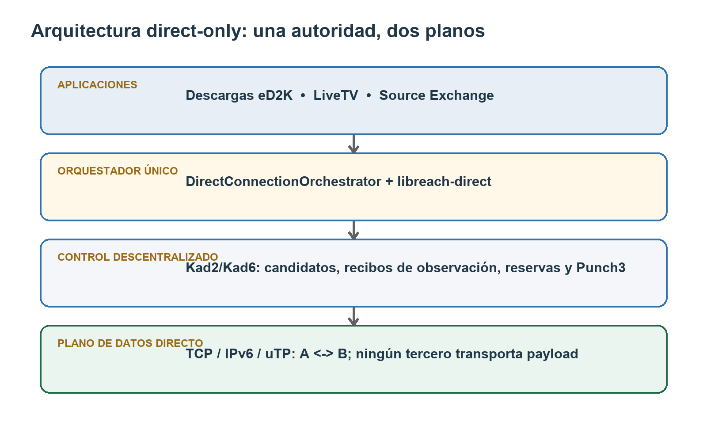
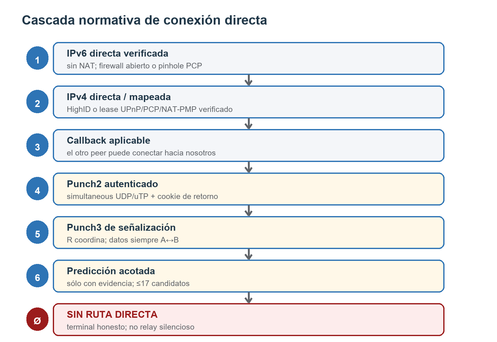
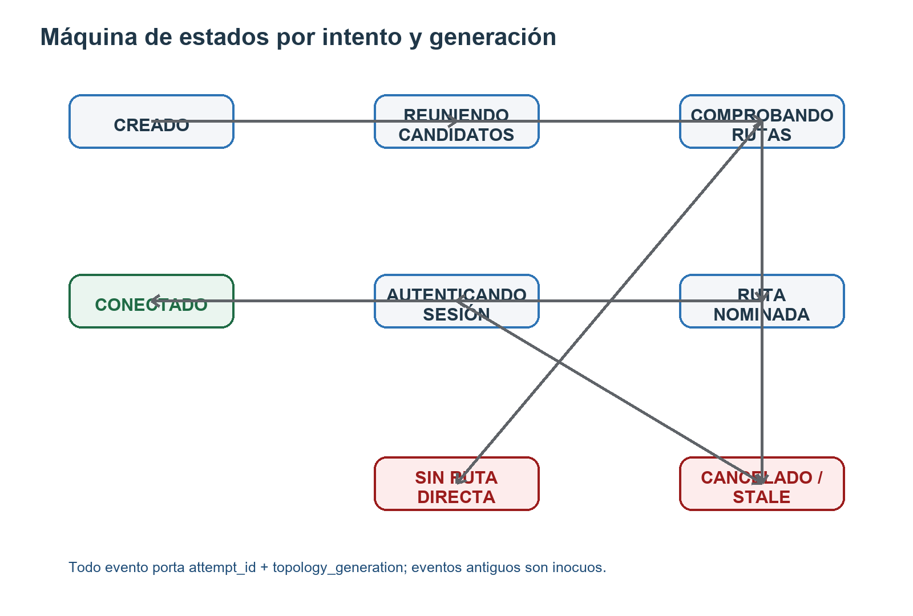
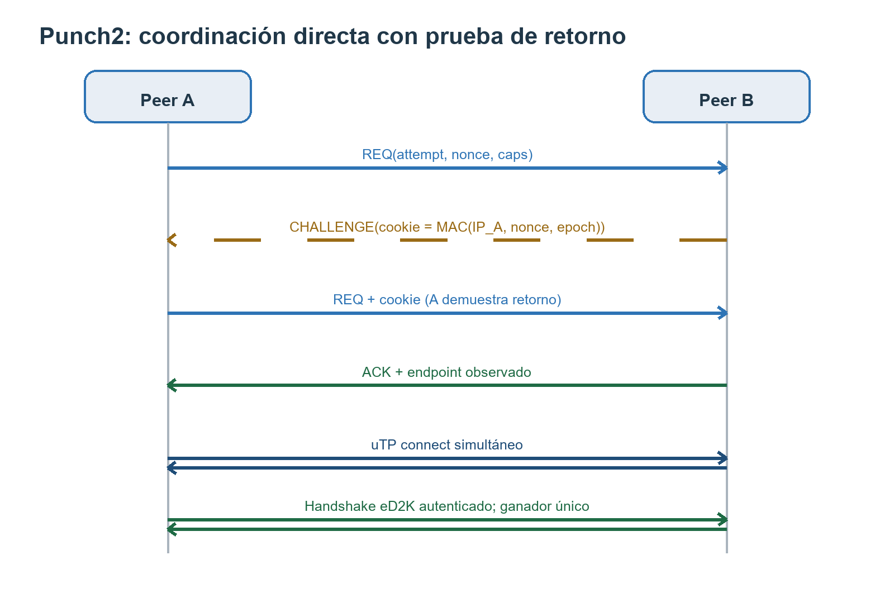
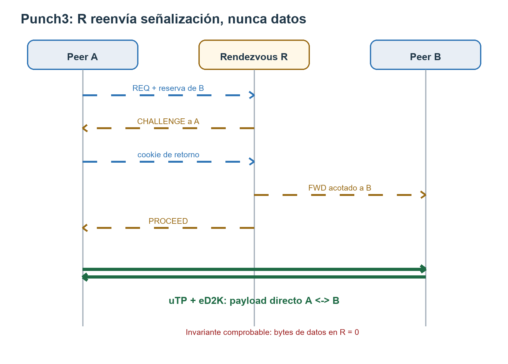

TESIS TÉCNICA CONSOLIDADA

Conectividad directa LowID↔LowID

sin relay de datos y con coordinación 100 % descentralizada

*Arquitectura, protocolo, seguridad, integración y validación\
sobre la base de código eMule eSE 9.1*

Revisión 2.0 · investigación, arquitectura y diseño implementable

Base auditada: workspace del 26 de julio de 2026

Objetivo: núcleo directo para v9.1 y extensiones experimentales posteriores

*Consolidación de tres aportaciones: tesis técnica inicial, arquitectura externa «LowID a HighID» y revisión cuantitativa 2023–2026.*

# Nota metodológica y estado de la base

> **Hallazgo de baseline.** El encargo denomina la base «v9.1 RC1», pero el workspace auditado identifica el binario como 9.1.0-beta.2 en srchybrid/Version.h y Git sólo contiene el tag v0.70b-eSE9.1.0-beta.1. Por rigor, esta tesis describe la fotografía real del árbol del 26 de julio de 2026 y define el rebase obligatorio sobre el commit RC1 que finalmente se congele. No se atribuye a RC1 evidencia que hoy no existe.

La revisión consolidada cruza tres aportaciones documentales con la inspección de la implementación nativa, los gates focalizados y fuentes primarias de NAT traversal. La tesis inicial aporta el modelo direct-only y la auditoría del árbol; la especificación «Descentralización de Redes P2P: LowID a HighID» aporta DCO, witnesses, PCP, Punch3, DVL y verificación tripartita; la revisión cuantitativa 2023–2026 aporta mediciones DCUtR y el análisis probabilístico del birthday punching. Las afirmaciones incompatibles con RFC, con el código o con la física de red se corrigen en vez de heredarse.

Durante la auditoría se ejecutaron tres puertas de calidad. libreach completó 206 comprobaciones (103 codec, 43 façade, 34 cascada y 26 actuador) sin fallos; el gate standalone de srchybrid incluyó 14 pruebas de cookie, además de sus regresiones, sin fallos; y libnatmap superó su contrato, máquina de estados, codecs, leases, cadena NAT y ownership, incluyendo 182.789 comprobaciones de transición. Estos resultados demuestran que la base pura es sólida; no equivalen a conectividad física entre dos LowID ni a certificación RC.

# Resumen

Esta tesis consolidada sustituye el rechazo binario LowID→LowID por una negociación de rutas directas, descentralizada y con un único propietario de estado. El núcleo mínimo prioriza IPv6, IPv4 mapeada o verificada, callback aplicable y Punch2 exacto sobre el mismo socket uTP. Punch3 de señalización, predicción y birthday punching quedan como extensiones medidas y separadas. Kad descubre y coordina; jamás transporta bloques del archivo. Cuando no existe un par de candidatos compatible, el resultado correcto es DIRECT_UNREACHABLE.

La contribución principal no es un truco aislado, sino una composición escalonada: descriptores y recibos distribuidos para conocer candidatos; cookies stateless; uTP autenticado antes de aceptar frames eD2K; un árbitro single-winner; y, solo si la evidencia clasifica una pareja EIM↔EDM, un experimento birthday con presupuesto adaptativo. La misma autoridad gobierna descargas y, posteriormente, LiveTV. El protocolo de partes, hashes, créditos y colas permanece intacto una vez establecido el stream.

El resultado esperado es una mejora sustancial, pero el 70 % no se presenta como garantía de eMule. Una campaña de 4,4 millones de intentos DCUtR midió 70 % ± 7,1 % en la etapa de hole punching, condicionado a que la reserva de señalización y el descubrimiento público ya hubieran funcionado. Ese dato justifica un objetivo experimental, no una extrapolación directa. Dos NAT dependientes del destino, sin IPv6 ni mapping explícito, siguen pudiendo carecer de ruta física.

*Tesis central: LowID debe dejar de ser una identidad y convertirse en una observación temporal. La unidad de decisión no es el cliente, sino la ruta verificable de una generación concreta.*

# Abstract

This consolidated thesis designs a decentralized, data-relay-free method for direct transfer between two eMule eSE peers classified as LowID. Its minimum core uses verified IPv6 and IPv4 candidates, explicit mappings, exact Punch2, one shared UDP/uTP socket, peer authentication and a single-winner orchestrator. Rendezvous signaling, bounded prediction and asymmetric birthday punching are isolated as later experiments. Large-scale DCUtR results provide an external conditional benchmark, not an eMule success guarantee. If no direct path exists, the protocol terminates honestly with DIRECT_UNREACHABLE.

## Palabras clave

eMule; eD2K; Kad; LowID; NAT traversal; hole punching; uTP; IPv6; PCP; NAT-PMP; UPnP IGD; rendezvous; DCUtR; birthday punching; conectividad directa; seguridad anti-reflexión.

# Índice de capítulos

- 1\. Planteamiento del problema y alcance.

- 2\. Anatomía del LowID y límites físicos.

- 3\. Auditoría de la base de código 9.1.

- 4\. Requisitos, invariantes y modelo de éxito.

- 5\. Arquitectura propuesta: Direct Reachability Fabric.

- 6\. Descubrimiento descentralizado de candidatos.

- 7\. Vector de reachability y wire propuesto.

- 8\. Selector único y máquina de estados.

- 9\. Punch2 autenticado.

- 10\. Punch3 sin relay de datos.

- 11\. NAT adverso: perfil, predicción y colisión asimétrica.

- 12\. Transporte y transferencia eD2K/LiveTV.

- 13\. Identidad, criptografía y amenazas.

- 14\. Compatibilidad y migración.

- 15\. Plan de implementación sobre el árbol actual.

- 16\. Programa de pruebas y evidencia.

- 17\. Operación, métricas y experiencia de usuario.

- 18\. Viabilidad, riesgos y conclusión.

- 19\. Consolidación de las tres tesis y arquitectura revisada.

- Apéndices: wire, estados, pruebas, trazabilidad, bibliografía, auditoría de ideas y protocolo experimental.

# Glosario mínimo

| **Término** | **Definición operativa en esta tesis** |
|:---|:---|
| LowID | Observación de que una ruta IPv4/TCP entrante clásica no está verificada; no es identidad permanente. |
| Ruta directa | Camino cuyos paquetes de datos viajan exclusivamente entre A y B, aunque exista señalización por terceros. |
| Rendezvous R | Peer eSE que conserva una reserva y reenvía mensajes de coordinación acotados; no transporta payload. |
| Candidato | Endpoint y transporte potencial, con origen, generación, expiración y evidencia. |
| Recibo de observación | Aserción efímera de un witness sobre la IP:puerto de origen que ha visto. |
| Punch2 | Coordinación bilateral para abrir mappings/filters y establecer uTP directo. |
| Punch3 | Coordinación A–R–B cuando B mantiene una ruta viva a R; el transporte final sigue siendo A–B. |
| Generación | Versión monotónica de la topología local o del endpoint del peer; invalida eventos antiguos. |
| Single-winner | Regla por la que una sola ruta confirmada puede poseer la sesión y la contabilidad. |

Tabla 1. Vocabulario normativo del documento.

# 1. Planteamiento del problema y alcance

## 1.1. El problema que realmente hay que resolver

En eMule clásico, HighID y LowID condensan demasiadas propiedades en un único resultado. HighID significa, de forma aproximada, que un servidor ha podido iniciar una conexión TCP hacia el puerto anunciado. LowID significa que esa comprobación no ha producido evidencia positiva. El salto lógico problemático aparece cuando el cliente transforma «no se ha verificado esta entrada IPv4/TCP» en «este peer no es alcanzable». Esa inferencia era razonable en un protocolo dominado por TCP, IPv4 y callbacks centralizados, pero deja de ser correcta en una base que ya dispone de IPv6, UDP verificado, uTP, mapeos explícitos y Kad como plano de señalización.

Dos clientes LowID pueden estar en situaciones radicalmente distintas. Uno puede tener IPv6 global con firewall abierto, otro puede haber obtenido un mapping PCP válido, ambos pueden estar detrás de NAT con endpoint-independent mapping, o uno puede aceptar un callback sobre una familia distinta. También pueden estar en la situación contraria: dos CGNAT con mapeo y filtrado dependientes del destino, sin IPv6 y sin control de gateway. El mismo rótulo LowID cubre tanto un caso fácil como un caso físicamente insoluble sin un tercero que transporte datos.

> **Pregunta de investigación.** ¿Cómo convertir la conectividad LowID↔LowID en un proceso de descubrimiento, comprobación y nominación de rutas directas, usando exclusivamente coordinación descentralizada y sin permitir que un tercero transporte los bloques del archivo?

## 1.2. Hipótesis

La hipótesis es que la mayoría de los rechazos evitables no requiere un relay, sino una representación más rica de reachability y coordinación temporal. Si cada peer publica capacidades verificadas, candidatos efímeros, reservas de rendezvous y una generación de topología; si ambos ejecutan checks correlacionados desde el mismo socket UDP; y si un árbitro único decide qué transporte gana, entonces muchas parejas LowID pueden establecer una sesión uTP directa. La transferencia posterior utiliza el protocolo eD2K existente y conserva hashes, créditos, colas y reanudación.

La hipótesis incluye una negación importante: no existe un algoritmo que garantice conectividad directa cuando la red no ofrece ningún par de endpoints mutuamente alcanzable. Un diseño serio debe maximizar éxitos, demostrar la ausencia de relay y cerrar de forma acotada los casos imposibles. La métrica correcta no es «100 % de LowID conectados», sino «100 % de rutas disponibles intentadas de forma segura, sin falsos positivos ni tráfico de datos por terceros».

## 1.3. Alcance positivo

- Descubrimiento de candidatos host, IPv6, mapeados y reflexivos mediante la red Kad.

- Selección única para descargas eD2K y LiveTV.

- Punch2 con cookie stateless, simultaneidad y confirmación de transporte.

- Punch3 con peers de rendezvous elegidos de forma distribuida y reservas efímeras.

- Predicción limitada a candidatos derivados del propio endpoint observado.

- Transporte directo TCP o uTP con autenticación de la sesión antes de aceptar datos.

- Enlace virtual de aplicación opcional para estabilizar identidad, multiplexación y rebinding.

- Compatibilidad aditiva con eMule 0.70b y versiones eSE sin el nuevo protocolo.

- Métricas locales, evidencia reproducible y un terminal explícito sin ruta directa.

## 1.4. Exclusiones

- TURN, KRP, buddy relay de datos, onion exit o cualquier reenvío del payload.

- Una VPN L2 que exponga el sistema operativo, SMB, descubrimiento LAN o broadcast.

- Escaneo de rangos de puertos o direcciones que no procedan del propio peer.

- Promoción automática a HighID global tras un éxito puntual de punching.

- Cambiar KadID, user hash o identidad de crédito para representar endpoints.

- Telemetría central obligatoria o servicio STUN central operado por el proyecto.

- Prometer éxito con todos los NAT, CGNAT, firewalls empresariales o redes móviles.

## 1.5. Criterio de descentralización

«100 % descentralizado» no puede significar ausencia absoluta de terceros: Kad ya requiere otros nodos para publicar fuentes, observar direcciones y entregar mensajes. En esta tesis significa que no existe una autoridad fija, un servidor obligatorio ni un proveedor que concentre estado. Los witnesses y rendezvous son peers ordinarios, rotatorios, sustituibles y elegidos por reglas públicas. Ninguno es necesario durante la transferencia una vez establecida la ruta. El sistema sigue funcionando mientras exista una población Kad suficiente, sin dominio, cuenta o infraestructura propia.

La propiedad se verifica en dos planos. En el plano de control se permiten mensajes pequeños, autenticados, rate-limited y sin payload. En el plano de datos sólo se acepta una socket cuyo peer remoto sea A o B. Los contadores de bytes de un nodo R deben permanecer en cero para clases eD2K de archivo o LiveTV. Una implementación que no pueda demostrar esta separación no cumple la tesis.

# 2. Anatomía del LowID y límites físicos

## 2.1. Mapping, filtering y reachability

El comportamiento de NAT debe describirse por dimensiones independientes. El mapping decide qué endpoint público asigna el traductor a un socket interno; el filtering decide de qué remotos acepta paquetes; la preservación de puerto indica si el puerto externo tiende a conservarse; el hairpinning permite que dos hosts detrás del mismo NAT usen sus endpoints externos; y los timers determinan cuánto dura el estado. Las etiquetas históricas «cone» y «symmetric» son insuficientes para diseñar una máquina de estados fiable.

El hole punching funciona bien cuando el mapping es independiente del endpoint y el filtrado se abre después de tráfico saliente compatible. Falla cuando cada destino produce un puerto externo impredecible o cuando el firewall exige una relación que ninguno de los peers puede crear a tiempo. RFC 5128 documenta precisamente que una fracción de NAT con endpoint-dependent mapping no soporta el mecanismo. RFC 4787 y sus actualizaciones recomiendan comportamientos más amigables, pero una aplicación no puede presuponer que todos los equipos desplegados los cumplen.

## 2.2. Condición formal de posibilidad

Sea C_A el conjunto de candidatos que A puede emitir o escuchar y C_B el conjunto equivalente de B. Existe una ruta directa si y sólo si existe al menos un par (a,b)∈C_A×C_B para el que los paquetes A→b crean o atraviesan el estado de red necesario y los paquetes B→a hacen lo mismo dentro de sus ventanas temporales. La señalización puede sincronizar la prueba y revelar endpoints; no puede alterar una política de filtrado que prohíba ambos sentidos.

DIRECT_POSSIBLE(A, B) = ∃ (a, b):\
outbound(A, b) ∧ outbound(B, a)\
∧ filter_A_allows(B, a)\
∧ filter_B_allows(A, b)\
∧ same_generation(a, b)\
∧ overlap(check_window_A, check_window_B)

Si la expresión es falsa para todos los pares, un overlay virtual tampoco resuelve el problema: el túnel del overlay necesita exactamente uno de esos pares. Sólo un relay con endpoint público podría introducir un camino nuevo. Como el requisito lo prohíbe, el resultado correcto es DIRECT_UNREACHABLE, acompañado del motivo más específico que la evidencia permita.

## 2.3. Matriz de topologías

| **Topología A/B** | **Ruta esperable** | **Probabilidad cualitativa** | **Terminal honesto** |
|:--:|:---|:---|:---|
| IPv6 global en uno o ambos | Direct v6 o callback v6 | Alta si el firewall permite el pinhole | v6_filter_blocked |
| UPnP/PCP/NAT-PMP verificado | Direct v4 mapped | Alta mientras el lease siga vigente | mapping_unverified_or_expired |
| EIM + filtrado compatible | Punch2 uTP | Frecuentemente viable | punch2_timeout |
| Mismo NAT con hairpinning | Direct/reflexivo o candidato LAN | Alta con detección correcta | hairpin_unsupported |
| Un peer mantiene reserva con R | Punch3 y uTP A↔B | Mejora la sincronización | rdv_unavailable |
| EDM con patrón estable | Predicción ≤17 candidatos | Viable sólo con evidencia | prediction_exhausted |
| EDM impredecible en ambos extremos | Ninguna sin mapping/IPv6 | Baja o nula | direct_impossible_without_relay |
| UDP bloqueado y TCP entrante cerrado | Callback si el otro es alcanzable | Dependiente del sentido | no_bidirectional_candidate |

Tabla 2. Consecuencias de la topología, sin promesas universales.

## 2.4. Por qué la LAN virtual no elimina los puertos

Una LAN virtual es una abstracción de direccionamiento y transporte. Puede asignar direcciones lógicas estables, encapsular múltiples flujos y recuperar una sesión tras cambiar el endpoint externo. Sin embargo, sus datagramas siguen saliendo por un socket UDP o una conexión TCP y, por tanto, atraviesan puertos, mappings y filtros. La frase correcta no es «no depender de puertos», sino «hacer que sólo la capa de reachability dependa de ellos y que el resto de eMule vea un enlace lógico estable».

> **Decisión de diseño.** Se propone un Direct Virtual Link (DVL) de nivel aplicación después de establecer la ruta. No se propone un adaptador TAP, una subred del sistema ni una VPN general. DVL no participa en candidate gathering y nunca justifica un falso éxito.

# 3. Auditoría de la base de código 9.1

## 3.1. Estado de versión y evidencia

La fotografía inspeccionada no es formalmente RC1. srchybrid/Version.h:36 declara 9.1.0-beta.2; el HEAD Git corresponde a una actualización de README posterior al tag v0.70b-eSE9.1.0-beta.1; y el árbol contiene numerosos cambios sin commit. Este detalle no invalida el diseño, pero impide afirmar que una línea o un gate pertenece al futuro RC1. El primer trabajo de implementación debe congelar un commit limpio, regenerar la trazabilidad y repetir todos los tests.

Los documentos del repositorio ya anticipan el objetivo 9.3: LowID deja de decidir, la cascada termina en «No alcanzable sin relay» y el rendezvous no puede actuar como proxy de datos. Esta tesis toma esa dirección como requisito, no como evidencia de que el runtime ya la cumpla. La auditoría encuentra una diferencia significativa entre biblioteca pura, wire publicado y flujo nativo.

## 3.2. Activos reutilizables

| **Componente** | **Capacidad existente** | **Valor para la tesis** |
|:--:|:---|:---|
| libreach | Codec v2, cascada, C ABI, handles con generación, actuador | Base del selector único y de la política testeable |
| libnatmap | Estados, leases, PCP/NAT-PMP, NAT chain y ownership | Candidatos mapped con origen y expiración |
| ReachabilityWire | Bridge entre host y codec | Punto de evolución hacia vector completo |
| Search.cpp | Publica TAG_ESE_REACH antes de HELLO | Permite elegir ruta desde el resultado de fuente |
| HolePunchCookie | Cookie stateless con pruebas golden | Piso anti-reflexión para Punch2/Punch3 |
| KademliaUDPListener | REQ/CHALLENGE/ACK y mensajes Punch3 | Plano de control distribuido ya conectado |
| UtpSocket | Expectations, límites, tie-break y transporte | Plano de datos directo con control de congestión |
| DirectReachabilityManager | Mapping + verificación por server/inbound | Fuente de verdad para direct v4 mapped |
| IPv6/Kad6 | Direcciones 128-bit, callback y transporte | Primera ruta de la cascada |

Tabla 3. Activos de la base que reducen el trabajo.

## 3.3. Flujo LowID actual

CUpDownClient::TryToConnect, en BaseClient.cpp:1680 y siguientes, conserva el hard-fail LowID→LowID cuando no detecta callback, IPv6 directa ni Punch2. El flujo intercala política, creación de sockets, callbacks clásicos, reintentos, predicción y escalado a Punch3. Esta concentración fue útil para evolucionar el cliente, pero dificulta probar que cada sesión tenga un único intento, una única generación y un único ganador.

CanUseEseHolePunch en BaseClient.cpp:113 exige NetLab activo, soporte objetivo, uTP listo, Kad conectado y endpoint IPv4/Kad válido. ShouldRetryEseNatTraversal añade cooldowns y, tras cuatro intentos, habilita una ventana para encontrar rendezvous. La implementación es deliberadamente conservadora, pero utiliza contadores y flags del objeto CUpDownClient como máquina de estados implícita. Los eventos de red no portan de manera uniforme attempt_id y topology_generation.

## 3.4. Punch2 y uTP existentes

KademliaUDPListener.cpp implementa envío simple y spray en torno al puerto observado. La variante moderna anuncia soporte de cookie; un emisor desconocido recibe un CHALLENGE y debe reemitir REQ con la cookie. El estado pendiente está acotado, los nonces usan CSPRNG y los resends tienen límite. Al recibir ACK se registra una expectation para que UtpSocket acepte el SYN del endpoint esperado. UtpSocket.cpp añade límites globales y por IP, TTL de expectations y arbitraje de apertura simultánea.

La seguridad esencial ya está esbozada: no basta con un datagrama; el endpoint debe coincidir con una expectation y la identidad se contrasta cuando existe contacto. No obstante, la relación ACK→socket→sesión eD2K se reparte entre estructuras globales, punteros host y estado del cliente. El diseño propuesto conserva el wire útil, pero mueve la correlación a un intento propiedad del orquestador.

## 3.5. Punch3 existente y su brecha

La base dispone de KADEMLIA3_HOLEPUNCH_REQ, FWD, CHALLENGE, PROCEED y ACK. R exige peers NetLab conectados, capacidad negociada y SecureIdent; desafía a A antes de reenviar; B sólo acepta un FWD de un rendezvous autenticado. Es una base valiosa y respeta conceptualmente que R coordine en lugar de transportar datos.

La brecha principal es la autoridad sobre R. El selector actual elige un peer conectado con capacidad RDV, pero no consume una reserva que B haya publicado y mantenido. Para que R reenvíe a B, R debe tener a ambos extremos conectados/autenticados en el momento adecuado. libreach ya modela RdvEntry con NodeID, endpoint, token y expiración, pero ReachabilityWire.cpp sólo codifica capFlags y sólo devuelve versión y caps al host. Search.cpp publica un vector sin anchors. El protocolo completo existe en piezas que todavía no forman un contrato extremo a extremo.

## 3.6. Dos selectores y una ruta de relay residual

libreach define DirectV6, DirectV4, Callback, Punch2W, Punch3W, Relay y Classic. Sin embargo, las búsquedas del árbol no muestran integración de reach_context en srchybrid: las suites prueban la biblioteca, no su autoridad sobre el cliente MFC. Descargas conservan la lógica en TryToConnect, mientras LiveStreamManager.cpp:3976 ejecuta su propio Direct→Punch2→Punch3→Relay. LiveStreamManager.h:695 incluye explícitamente REACH_RELAY. Esto contradice el producto direct-only y crea riesgo de doble conexión, doble métrica y políticas distintas.

> **Conclusión de auditoría.** No hay que inventar toda la conectividad: hay que completar el vector, convertir reservas en autoridad, integrar libreach como único propietario y eliminar cualquier éxito relay del build/política direct-only.

## 3.7. Gates ejecutados

| **Gate** | **Resultado observado** | **Qué demuestra** | **Qué no demuestra** |
|:--:|:---|:---|:---|
| libreach/make.bat | 206 PASS / 0 FAIL | Codec, C ABI, cascada y actuador puros | Integración MFC o NAT real |
| srchybrid/tests | Gate PASS; cookie 14/14 | Primitivas y políticas standalone | Interoperabilidad física Punch2/Punch3 |
| libnatmap/make.bat | Todos PASS; 182.789 checks de estado | Determinismo de mapping/lease/ownership | Soporte real de cada router |

Tabla 4. Evidencia focalizada producida durante la investigación.

# 4. Requisitos, invariantes y modelo de éxito

## 4.1. Requisitos funcionales

| **ID** | **Requisito** |
|:---|:---|
| DR-F01 | LowID no puede provocar un hard-fail si existe una ruta moderna aplicable. |
| DR-F02 | La misma cascada decide descargas, subidas, Source Exchange y LiveTV. |
| DR-F03 | La selección comienza con candidatos verificados y termina sin relay. |
| DR-F04 | Punch2 requiere return-routability y transporte uTP confirmado. |
| DR-F05 | Punch3 requiere reserva de B y autorización verificable de R. |
| DR-F06 | R no recibe, almacena ni reenvía payload de archivo o LiveTV. |
| DR-F07 | Predicción sólo sigue a evidencia y no supera 17 destinos por intento. |
| DR-F08 | Cambio de interfaz, IP, mapping o gateway crea nueva generación. |
| DR-F09 | La primera ruta autenticada cancela las demás de forma idempotente. |
| DR-F10 | Peer antiguo recibe únicamente formatos y opcodes que comprende. |
| DR-F11 | Kill switch retira capacidades y cancela intentos pendientes. |
| DR-F12 | DVL es opcional, posterior a la conexión y limitado al proceso eMule. |

Tabla 5. Requisitos funcionales de la solución.

## 4.2. Invariantes de seguridad y corrección

- Cada mensaje que muta estado se correlaciona con attempt_id, generation y rol.

- Un endpoint reflexivo es evidencia temporal, no identidad de cliente.

- KadID, user hash, node identity, file hash y socket handle son tipos distintos.

- Ningún paquete no autenticado puede crear estado pesado ni una respuesta amplificadora.

- Una reserva de rendezvous está ligada a R, B, endpoint observado, servicio, generación y expiración.

- Un ACK de hole punch no equivale a conexión; sólo el transporte autenticado puede ganar.

- El peer perdedor en una apertura simultánea cierra su socket sin cerrar la sesión ganadora.

- Bytes, créditos, slot y estadísticas se contabilizan exactamente una vez.

- El cierre, timeout, kill switch y callback tardío son idempotentes.

- Cuando direct-only está activo, no existe adaptador que pueda abrir una ruta relay.

- No se publican direcciones privadas salvo candidatos LAN con prueba de mismo dominio.

- Los logs y manifests sanitizan direcciones, tokens, nombres de archivos e identidades completas.

## 4.3. Definición de éxito

Una conexión se considera exitosa cuando existe una socket directa A↔B, el primer frame de sesión ha autenticado las identidades esperadas, la generación sigue vigente y el árbitro la ha nominado como ganadora. El recibo de CHALLENGE, PROCEED, ACK o SYN no es suficiente. La transferencia se considera exitosa cuando el hash eD2K final coincide, no hay bytes duplicados en contabilidad y una captura demuestra que ningún R transportó payload.

Un intento fallido también puede ser correcto. DIRECT_UNREACHABLE es PASS si se intentan todas las rutas aplicables dentro de presupuesto, no se violan límites, el motivo es coherente con la evidencia y el cliente conserva la fuente para reintento tras una nueva generación. Es FAIL si se declara éxito sin socket, si se omite una ruta válida, si se escanean puertos, si se usa un relay oculto o si el intento queda indefinido.

## 4.4. Presupuesto temporal orientativo

| **Escalón** | **Inicio** | **Budget inicial** | **Condición de avance** |
|:--:|:---|:---|:---|
| Direct v6 | inmediato | 0,4–1,2 s | connect error/timeout tipado |
| Direct v4/mapped | tras v6 o en paralelo controlado | 0,4–1,2 s | evidencia negativa |
| Callback | si A acepta inbound | 1–3 s | solicitud/timeout correlacionado |
| Punch2 | tras rutas directas | 3–5 s | ACK sin transporte no gana |
| Punch3 | con reserva vigente | 4–7 s | caída de R acotada |
| Predicción | sólo evidencia compatible | 3–6 s | máximo 17 candidatos |
| Terminal | deadline global | 10–20 s interactivo | sin ruta directa |

Tabla 6. Budgets de partida; deben calibrarse con RTT y laboratorio.

Estos valores no son constantes normativas hasta obtener datos físicos. El motor debe aceptar reloj inyectable y budgets por ruta. Una interfaz interactiva puede usar un deadline más corto; una fuente de descarga puede mantener memoria de ruta y reintentar tras cambios de topología sin bloquear la cola.

# 5. Arquitectura propuesta: Direct Reachability Fabric

Figura 1. Separación de aplicaciones, autoridad de conexión, control distribuido y datos directos.

## 5.1. Principio de autoridad única

La solución se organiza alrededor de DirectConnectionOrchestrator (DCO), un adaptador nativo sobre una variante direct-only de libreach. DCO es el único componente que conoce el orden de rutas, deadlines, attempt_id, generación, candidatos, reserva de R, estado de autenticación y ganador. CUpDownClient, DownloadQueue y LiveStreamManager solicitan una conexión y reciben un resultado; no deciden cuándo disparar Punch2, Punch3 o predicción.

La biblioteca conserva las propiedades que ya tiene: sin sockets, sin MFC, reloj y efectos inyectados, handles con generación y callbacks host. El host implementa acciones —abrir TCP/uTP, enviar control Kad, registrar expectation y cancelar—, pero no puede saltarse la política. Esta frontera permite model checking, fuzzing y pruebas de equivalencia entre cascada pura y runtime.

## 5.2. Componentes

| **Componente** | **Responsabilidad** | **No debe hacer** |
|:--:|:---|:---|
| CandidateGatherer | Reúne host, v6, mapped, reflexivo y LAN; asigna origen/TTL | Elegir ganador |
| WitnessManager | Solicita observaciones a peers Kad y valida recibos | Transportar datos |
| RdvReservationManager | Mantiene hasta tres reservas con R | Publicar tokens sin binding |
| libreach-direct | Orden, budgets, generación, single-winner y reason codes | Abrir sockets o usar relay |
| DCO host adapter | Materializa acciones y resuelve handles a objetos vivos | Guardar punteros dentro de la biblioteca |
| UtpTransportAdapter | Expectations, connect/accept, framing y flow control | Aceptar payload antes de auth |
| Direct Virtual Link | Dirección lógica y multiplexación post-connect | Crear conectividad o exponer la LAN |
| TransferSession | Reutiliza hello, secure ident, cola, bloques y hashes | Conocer NAT |

Tabla 7. Descomposición propuesta.

## 5.3. Planos y dependencias

El plano de observación produce facts: «W vio a B en IP:puerto durante epoch E». El plano de publicación transforma facts vigentes en un descriptor firmado y lo adjunta a una fuente Kad. El plano de selección construye pares de candidatos y decide la siguiente acción. El plano de coordinación sincroniza A, R y B. El plano de transporte confirma una socket. El plano eD2K continúa sin saber si la socket provino de TCP directo, mapping o uTP.

Download / LiveTV request\
│\
▼\
DirectConnectionOrchestrator\
├─ CandidateGatherer ── libnatmap / IPv6 / witness receipts\
├─ libreach-direct ──── route policy + state + winner\
├─ Kad control ──────── Punch2 / reservation / Punch3\
└─ TransportAdapter ─── TCP or uTP direct\
│\
▼\
Authenticated eD2K stream → existing block/chunk machinery

## 5.4. Direct-only como propiedad estructural

No basta con una preferencia «relay=false». La biblioteca de 9.3 debe compilar o configurarse con una RoutePolicy cuyo conjunto de rutas no contenga Relay. El enum puede conservar un valor reservado para compatibilidad ABI, pero NextApplicableLayer no debe devolverlo bajo DIRECT_ONLY. El host no registra callback de apertura relay. LiveStreamManager elimina REACH_RELAY y el terminal pasa a REACH_DIRECT_UNAVAILABLE. Los tests inspeccionan tanto la secuencia como los símbolos y adaptadores disponibles.

> **Regla de aceptación.** Un build direct-only falla el gate si cualquier ruta ganadora, contador o socket puede atribuirse a KRP, LiveTunnel, buddy relay, exit u otra tercera máquina.

# 6. Descubrimiento descentralizado de candidatos

## 6.1. Por qué hace falta observación externa

Un peer detrás de NAT conoce su IP privada y puerto interno, pero no siempre conoce el endpoint que el gateway asigna para un destino concreto. STUN resuelve esa observación mediante servidores públicos. La alternativa descentralizada es aprovechar peers Kad verificados como witnesses: B envía una solicitud desde el mismo socket UDP que usará para punching; W responde con la dirección y puerto de origen realmente observados. Ningún witness es privilegiado y la información caduca rápidamente.

Un solo witness no basta para inferir el comportamiento de mapping. B consulta de dos a cuatro peers con diversidad razonable de dirección o prefijo. Si todos ven el mismo endpoint, hay evidencia compatible con mapping independiente. Si observan puertos que siguen una secuencia pequeña, puede existir una hipótesis de delta. Si cada resultado es inconexo, el sistema evita predicción y conserva únicamente candidatos exactos para esos destinos o una reserva Punch3.

## 6.2. Selección de witnesses

- Sólo contactos Kad con IP verificada, versión/capacidad compatible y respuesta reciente.

- Selección pseudoaleatoria derivada de attempt seed para impedir elección manipulada por el remoto.

- Diversidad de /24 en IPv4 o /48 en IPv6 y, cuando exista dato local, diversidad aproximada de ASN.

- Máximo cuatro solicitudes por ciclo y cooldown por witness.

- Exclusión de la IP propia, target, rendezvous elegidos y contactos penalizados.

- Ningún requisito de disponibilidad individual: dos recibos coherentes bastan para publicar un candidato reflexivo de confianza media.

## 6.3. Recibo de observación

El recibo debe ser pequeño y no transferible indefinidamente. Contiene versión, witness NodeID, subject public-key hash, endpoint observado, transport, request_nonce, witness time bucket, expiry y firma. Si se desea mantener Kad2 sin una PKI nueva, el primer despliegue puede usar la identidad persistente ya introducida para Kad6 y SecureIdent como binding transitorio. La firma evita que B invente lo observado por W; la expiración evita tratar un mapping viejo como ruta actual.

ObservedEndpointReceiptV1 {\
version:u8 = 1\
transport:u8 = UDP\
witness_node_id:bytes16\
subject_key_hash:bytes32\
observed_address:CAddress\
observed_port:u16\
topology_generation:u64\
request_nonce:bytes16\
issued_bucket:u32\
expires_at:u32\
signature:bytes64\
}

## 6.4. Tipos de candidato

| **Tipo** | **Origen** | **Prioridad** | **Validez** | **Privacidad** |
|:--:|:---|:---|:---|:---|
| HOST_V6 | interfaz global + inbound evidence | 1 | hasta cambio de interfaz/prefijo | publicable a peers compatibles |
| MAPPED_V4 | UPnP/PCP/NAT-PMP + verificación | 2 | lease/generación | publicable con origen |
| DIRECT_V4 | HighID/server+inbound | 2 | evidencia vigente | clásico |
| SRFLX_UDP | recibo de witness | 4 | 20–120 s | sólo endpoint público |
| LAN | descubrimiento mismo dominio | 0 local | mientras la red coincida | nunca Kad público |
| RDV | reserva emitida por R | 5 | 30–180 s | token opaco |
| PREDICTED | modelo de deltas | 6 | sólo intento actual | no se publica |

Tabla 8. Catálogo de candidatos y política de exposición.

## 6.5. Reunión y poda

CandidateGatherer deduplica por familia, transporte, dirección, puerto y generación; nunca fusiona candidatos sólo por IP. Un mapping explícito prevalece sobre un recibo reflexivo idéntico porque posee lease y ownership. Un candidato con expiración pasada se elimina antes de formar pares. Al cambiar gateway, interfaz, IP pública, epoch NAT-PMP, lease PCP o dirección IPv6, la generación local aumenta y todos los checks anteriores se cancelan.

Los candidatos privados se prueban únicamente si A y B demuestran el mismo dominio local mediante LAN discovery o si la dirección es directamente enrutable desde la interfaz elegida. Publicar 192.168.x.x o ULA en Kad no aporta conectividad y filtra topología interna. DVL tampoco justifica esa publicación: sus direcciones lógicas sólo existen después de autenticar la sesión.

# 7. Vector de reachability y wire propuesto

## 7.1. Limitación del bridge actual

libreach ya permite hasta tres RdvEntry y conserva TLV desconocidos, pero EseEncodeReachVectorV2 sólo recibe capFlags y construye un vector sin anchors. EseDecodeReachVector sólo devuelve version y knownCaps. El host, por tanto, no puede publicar, conservar ni seleccionar reservas aunque el codec las comprenda. La primera evolución debe sustituir ese bridge reducido por una representación completa y con ownership explícito.

Como el wire de la futura RC1 debe congelarse, hay dos opciones. Si RC1 aún no ha congelado TAG_ESE_REACH v2, se completa v2 respetando el formato ya implementado. Si RC1 ya se ha distribuido con semántica parcial, se emite versión 3 y los clientes v2 rechazan el vector de forma segura, conservando los tags clásicos. No debe cambiarse silenciosamente el significado de un bit o de un anchor dentro de una versión ya prometida.

## 7.2. Descriptor de ruta

ReachabilityDescriptorV3 {\
version:u8\
cap_flags:u32\
topology_generation:u64\
valid_until:u32\
candidate_count:u8 // 0..8\
candidates\[\]: Candidate\
rdv_count:u8 // 0..3\
reservations\[\]: RdvReservation\
tlv_tail\[\]\
descriptor_signature:bytes64\
}

El descriptor publicado no necesita contener todos los recibos de witness; basta con los candidatos resultantes y, opcionalmente, hashes de evidencia que puedan solicitarse durante el check. Mantener el objeto por debajo de 255 bytes simplifica su uso como BSOB Kad. Si la firma y varios candidatos exceden ese límite, se publica un descriptor compacto y los detalles se obtienen mediante un mensaje Kad directo autenticado.

## 7.3. CandidateV1

| **Campo** | **Tamaño** | **Semántica** |
|:--:|:---|:---|
| kind | 1 B | v6, v4-direct, mapped, srflx, LAN o reservado |
| transport | 1 B | TCP o UDP/uTP |
| priority | 4 B | orden local; no autoridad del remoto |
| address | 6/18 B | CAddress canónica; nunca uint32 sintético para IPv6 |
| port | 2 B | puerto observado o concedido |
| source | 1 B | server, inbound, PCP, NAT-PMP, UPnP o witness |
| generation | 8 B | topología del publicador |
| expires_at | 4 B | cero sólo para datos que no caducan en sesión |
| evidence_digest | 8–16 B | correlación compacta de evidencia |

Tabla 9. Campos mínimos de un candidato.

## 7.4. Reserva de rendezvous

B mantiene una relación saliente y autenticada con R. R observa el endpoint de B y emite una reserva opaca. La reserva no es una orden para transportar datos; es un voucher para entregar como máximo una cantidad pequeña de señalización a B. Debe contener o autenticar de forma inseparable el NodeID de R, el hash de identidad de B, el endpoint observado, el servicio Punch3, generation, issued_at, expires_at, cuota y un identificador aleatorio. R puede verificarla sin base de datos pesada mediante MAC con secreto rotatorio, o puede mantener una tabla de soft state estrictamente acotada.

RdvReservationV1 {\
rdv_node_id:bytes16\
rdv_endpoint:CAddress+u16\
target_key_hash:bytes32\
target_observed_endpoint:CAddress+u16\
topology_generation:u64\
reservation_id:bytes16\
quota_class:u8\
expires_at:u32\
token:bytes16..32\
}

## 7.5. Capacidades

Las capacidades describen una superficie activa, no código compilado. PUNCH_2W sólo se anuncia con socket uTP listo, cookie operativa, identidad disponible y kill switch activo. PUNCH_3W exige además al menos una reserva válida; anunciar el bit sin R utilizable causa intentos inútiles. DVL se anuncia sólo como capacidad post-connect y nunca hace aplicable una ruta. MAPPED_V4 se deriva del snapshot verificado de DirectReachabilityManager, no de que el router haya respondido OK.

| **Capacidad** | **Precondición de emisión** | **Retirada inmediata** |
|:--:|:---|:---|
| V6_IN | inbound v6 observado en generación actual | cambio de prefijo/firewall |
| V4_TCP_IN | server evidence + inbound accept | IDCHANGE LowID o endpoint nuevo |
| MAPPED_V4 | lease + verificación externa | expiry, gateway epoch o cleanup |
| PUNCH_2W | uTP/cookie/Kad listos y consentimiento | kill switch o socket caído |
| PUNCH_3W | Punch2 + reserva R vigente | reserva expirada/R desconectado |
| PORT_MODEL | ≥2 observaciones coherentes | nueva generación o anomalía |
| DVL | framing, AEAD y multiplexor disponibles | fallo de crypto o política |

Tabla 10. Derivación dinámica de capacidades.

## 7.6. Compatibilidad del wire

TAG_ESE_REACH sigue siendo aditivo. Los tags clásicos de tipo de fuente, TCP port, buddy y encryption permanecen. Un peer 0.70b ignora el BSOB desconocido y aplica su comportamiento normal. Un eSE v2 que no comprende v3 debe ignorar el vector entero, no interpretar su prefijo como v2. El productor es estricto con reserved bits; el consumidor preserva TLV que no conoce, pero ningún bit desconocido habilita una ruta.

# 8. Selector único y máquina de estados

Figura 2. Orden direct-only: primero rutas verificadas, después coordinación y terminal honesto.

## 8.1. Orden de rutas

La cascada prioriza coste, fiabilidad y privacidad. IPv6 directa evita NAT y debe intentarse primero cuando el endpoint y la entrada están verificados. IPv4 directa y mapped comparten transporte, pero se conservan como route kinds distintos para diagnóstico y caducidad. Callback es útil cuando el sentido inverso sí tiene entrada. Punch2 y Punch3 abren rutas UDP. Predicción es el último recurso directo porque genera más datagramas y sólo es segura con evidencia. Relay no forma parte del conjunto.

No todas las etapas tienen que ser estrictamente secuenciales. Un Happy Eyeballs acotado puede solapar direct v6 y v4 tras una pequeña demora; también puede enviar checks a dos candidatos exactos. La regla single-winner sigue siendo absoluta: paralelismo controlado reduce latencia, pero no autoriza dos sesiones eD2K.

## 8.2. Máquina por intento

Figura 3. Ciclo de vida de un intento; generation convierte callbacks tardíos en no-ops.

| **Estado** | **Entrada válida** | **Salida/acción** | **Timeout** |
|:--:|:---|:---|:---|
| CREATED | solicitud de aplicación | captura snapshot/generación | inmediato |
| GATHERING | facts locales y recibos | candidate set congelado | acotado |
| CHECKING | route plan | acciones de transporte/control | por ruta |
| NOMINATED | socket candidata | cancelar losers; iniciar auth | corto |
| AUTHENTICATING | session init/hello | CONNECTED o rechazo | 2–5 s |
| CONNECTED | identidad y policy válidas | entregar stream a eD2K | sesión |
| DIRECT_UNREACHABLE | plan agotado | reason + memoria temporal | terminal |
| CANCELLED | kill/new generation/owner gone | cleanup idempotente | terminal |

Tabla 11. Máquina de estados normativa.

## 8.3. attempt_id y topology_generation

attempt_id es aleatorio o monotónico dentro del proceso y distingue dos intentos contra el mismo peer. topology_generation identifica el conjunto de endpoints que originó el plan. Ambos viajan en eventos host y mensajes nuevos. Si una respuesta coincide en nonce pero pertenece a otra generación, se registra como stale y no crea expectation. Si el objeto CUpDownClient se destruye, su handle de libreach incrementa generación y un callback tardío no puede resolverlo a un objeto reutilizado.

## 8.4. Árbitro single-winner

bool TryNominate(attempt, transport):\
if attempt.generation != topology.current: reject(STALE)\
if !transport.is_connected: reject(NOT_CONNECTED)\
if atomic_compare_exchange(attempt.winner, NONE, transport.id):\
cancel_all_except(transport.id)\
begin_session_auth(transport)\
return true\
close_loser_transport(transport)\
return false

La nominación inicial no entrega todavía payload: reserva la oportunidad de autenticar. Si la autenticación falla, el motor puede reabrir la cascada con las rutas restantes si el deadline lo permite. La contabilidad de ruta ganadora sólo se incrementa al entrar en CONNECTED. Este matiz evita que un ACK o un socket secuestrado infle estadísticas.

## 8.5. Memoria de ruta

El motor puede recordar durante minutos que un peer funcionó por direct v6, mapped o Punch2, pero la memoria es una prioridad, no una prueba. Antes de reutilizarla verifica generation, expiración y capability. Una memoria negativa contiene reason, endpoint digest y backoff; no bloquea una nueva generación. Debe existir un límite LRU global y por peer para impedir que una fuente hostil consuma memoria.

# 9. Punch2 autenticado

Figura 4. Punch2 sólo progresa tras prueba de retorno y termina en un transporte autenticado.

## 9.1. Reutilización del protocolo existente

La secuencia actual REQ→CHALLENGE→REQ+cookie→ACK es una buena base. La cookie se calcula con secreto local rotatorio, endpoint observado, nonce y epoch; por tanto el receptor no reserva estado para un emisor spoofed. La evolución añade attempt_id o un transaction digest y liga la expectation resultante a la identidad objetivo y a la generación, no sólo a IP:puerto.

A y B envían desde el mismo socket UDP que alimenta libutp. Cada outbound crea el estado NAT relevante. Tras probar retorno, ambos programan una ventana sincronizada con jitter determinista y abren uTP. El ACK informa que el control ha llegado; el uTP handshake informa que existe ruta; el session init informa que el remoto es el peer previsto. Sólo la tercera evidencia entrega la socket al protocolo eD2K.

## 9.2. Binding de la cookie

cookie = Trunc128(HMAC-SHA256(\
rotating_secret,\
protocol_version \|\| role \|\| source_ip \|\| source_port \|\|\
target_node_id \|\| attempt_nonce \|\| time_bucket\
))

Incluir puerto reduce replay entre mappings del mismo CGNAT, pero puede romperse si un middlebox cambia el puerto entre CHALLENGE y echo. La implementación debe medir este caso. Una política posible es cookie primaria ligada a IP:puerto y una segunda verificación estrictamente acotada ligada sólo a IP cuando existe identidad autenticada previa; nunca debe relajarse para remitentes desconocidos.

## 9.3. Estados y diagnósticos

| **Evidencia observada** | **Diagnóstico** | **Siguiente acción** |
|:--:|:---|:---|
| REQ enviado; nada recibido | request_or_path_lost | retry/backoff; otro candidato |
| CHALLENGE recibido; echo enviado | return_path_to_A_exists | esperar ACK/uTP |
| REQ+cookie válido en B | A_return_routable | seed expectation y ACK |
| ACK recibido; no uTP | control_ok_transport_failed | revisar mapping/filter |
| uTP connect; session auth falla | wrong_or_hostile_peer | cerrar y penalizar |
| uTP + auth | punch2_connected | nominar ganador |

Tabla 12. Diagnóstico basado en evidencia, no en un timeout genérico.

## 9.4. Límites

- Pending nonces globales y por peer; TTL máximo de 30 s como punto de partida.

- CHALLENGE resends limitados y token bucket por IP/prefijo.

- Expectations uTP con límite global, por IP y por attempt.

- Una sola familia de retransmisión controla control Kad y connect uTP.

- No más de un Punch2 activo por peer, archivo y generación; las aplicaciones comparten el intento.

- El error transitorio conserva la fuente sin rearmar un bucle de 5 s indefinido.

# 10. Punch3 sin relay de datos

Figura 5. R sólo entrega coordinación; la socket y los bytes pertenecen a A y B.

## 10.1. Qué resuelve Punch3

Punch2 presupone que A puede alcanzar el endpoint que conoce de B o que el mapping de B es reutilizable. Punch3 aprovecha una relación saliente viva B→R. Aunque A no alcance el endpoint publicado de B, R puede entregar a B una orden autenticada para que B emita hacia los candidatos de A. Esto crea el mapping/filtrado específico B→A en el momento correcto. A emite simultáneamente hacia los candidatos de B. R desaparece después de PROCEED.

Punch3 mejora sincronización y signalability; no derrota un mapping completamente impredecible en ambos extremos. Por eso se combina con receipts multi-witness y, sólo cuando existe patrón, candidatos predicted. El diseño evita presentar R como una solución mágica.

## 10.2. Preparación de B

- B elige hasta tres R entre peers verificados, consentidos y con UDP inbound.

- B mantiene keepalive de baja frecuencia desde el mismo socket Kad/uTP.

- Cada R emite una reserva ligada a B y al endpoint que observa.

- B publica las reservas en su descriptor, ordenadas por salud y expiración.

- B renueva antes del margen; al perder R retira la reserva en la siguiente publicación.

- La diversidad de R evita dependencia individual y reduce censura o caída accidental.

## 10.3. Secuencia completa

1.  A obtiene el descriptor de B y selecciona una reserva no expirada.

2.  A envía P3_REQ a R con reservation, candidates_A, attempt digest y prueba de identidad.

3.  R valida reserva, cuota y relación con B; desafía la return-routability de A.

4.  A devuelve la cookie; R reenvía a B un P3_FWD mínimo y envía P3_PROCEED a A.

5.  B valida que la reserva le pertenece, congela generation y emite checks a candidates_A.

6.  A emite checks a candidates_B; ambos aplican tie-break y autentican la socket uTP.

7.  A y B notifican opcionalmente P3_COMPLETE para liberar soft state; la expiración sigue siendo suficiente.

## 10.4. Autoridad de R

R no debe confiar en una IP de target proporcionada libremente por A. La reserva es la autoridad: demuestra que B aceptó a R, que R observó a B y que la cuota sigue vigente. R reenvía al objeto/sesión de B asociado a reservation_id, no a un endpoint arbitrario incluido en la petición. Así se elimina el uso de R como reflector o escáner.

La base actual exige que A y B sean peers conectados de R, una condición segura pero poco disponible. La reserva permite desacoplar el momento de publicación del momento de Punch3: B mantiene su relación, mientras A sólo necesita probar retorno y poseer un descriptor válido. R sigue siendo un peer ordinario y puede rechazar por carga.

## 10.5. Prueba de no-relay

| **Control** | **Assert bloqueante** |
|:---|:---|
| Namespaces | R sólo acepta opcodes P3 control; rechaza frames eD2K/Live payload |
| Tamaño | cada FWD está bajo un máximo pequeño; no existe fragmentación de payload |
| Contadores | rdv_control_bytes \> 0 permitido; rdv_data_bytes debe ser 0 |
| Socket graph | socket ganadora tiene remote endpoint de A/B, nunca R |
| Captura | tras CONNECTED no hay flujo volumétrico A–R o B–R |
| Kill R | retirar R después del connect no interrumpe transferencia |
| Build | no hay callback/adaptador relay registrado en RoutePolicy::DirectOnly |

Tabla 13. Evidencia necesaria para afirmar «sin relay».

## 10.6. Abuso y cuotas

R mantiene límites por origin key, target key, IP/prefijo y reserva. Una petición sin cookie nunca provoca FWD. Una reserva permite pocos intentos simultáneos y se revoca tras abuso. Las respuestas no superan el tamaño de la solicitud por un factor pequeño. R no conserva candidatos completos más allá del intento y nunca registra nombres de archivo. Los peers pueden declinar ser R sin perder capacidad de cliente.

# 11. NAT adverso: perfil, predicción y colisión asimétrica

## 11.1. De preferencia manual a evidencia tipada

La base permite EseHolePunchPortPredict y un spread configurable, desactivado por defecto. El problema no es el techo —±8 produce como máximo 17 puertos—, sino la condición de activación: una preferencia no demuestra que la topología admita predicción. El motor debe derivar un NatMappingEvidence a partir de observaciones de la misma generación y de fallos previos.

NatMappingEvidence {\
observations: \[(witness_digest, external_port, time)\]\
mapping_class: STABLE \| SEQUENTIAL \| SMALL_DELTA \| CHAOTIC \| UNKNOWN\
confidence: 0..100\
predicted_center:u16\
stride:i16\
max_candidates:u8 \<= 17\
}

## 11.2. Generación de candidatos

Con puertos p1…pn observados hacia witnesses distintos, el clasificador calcula deltas en orden temporal, dispersión y repeticiones. STABLE produce un único candidato. SEQUENTIAL puede producir una secuencia alrededor de pn con stride observado. SMALL_DELTA produce un abanico simétrico. CHAOTIC y UNKNOWN prohíben spray. El orden es determinista para que A y B puedan sincronizar checks y para reproducir el laboratorio.

Los destinos son siempre la IP pública observada del propio peer y puertos derivados de sus observaciones. No se prueban otras IP, no se atraviesan límites de 1–65535 y no se usan puertos privilegiados salvo que una observación exacta los justifique. El conjunto se invalida al recibir un nuevo receipt incoherente.

## 11.3. Política de paquetes

| **Clase** | **Candidatos** | **Reintentos** | **Condición** |
|:--:|:---|:---|:---|
| STABLE | 1–2 | hasta 2 con backoff | receipts iguales |
| SEQUENTIAL alta confianza | 3–9 | una ronda | ≥3 observaciones coherentes |
| SMALL_DELTA | 5–17 | una ronda | deltas acotados y Punch2 exacto falló |
| CHAOTIC | 0 predicted | ninguno | alta dispersión |
| UNKNOWN | 0 predicted | ninguno | evidencia insuficiente |

Tabla 14. Política anti-scan de predicción.

## 11.4. Rate limiting y backoff

El techo de 17 es por intento, no por llamada interna. Descargas y LiveTV no reciben presupuestos separados contra el mismo peer. Un token bucket global limita datagramas experimentales; buckets por peer y por IP/prefijo impiden Sybil barato detrás de un CGNAT. El refill usa reloj monotónico con protección frente a overflow. Tras agotar predicción se aplica backoff de minutos salvo nueva generación.

## 11.5. Cambio de decisión tras la evidencia 2023–2026

La tesis inicial descartaba el spray amplio del núcleo por su parecido con un escaneo, su coste y la ausencia de evidencia física. La revisión consolidada mantiene esa exclusión para el MVP, pero corrige una conclusión demasiado absoluta: cuando exactamente un extremo usa mapping dependiente del destino y el otro conserva un endpoint reutilizable, la paradoja del cumpleaños permite transformar una búsqueda lineal en una colisión entre dos conjuntos.

La técnica no equivale a «probar 256 puertos» con el Punch2 actual. El lado duro abre K sockets y crea K mappings salientes dirigidos al endpoint exacto del lado fácil. El lado fácil, desde ese mismo endpoint, prueba B puertos aleatorios de la IP pública del lado duro. Una colisión descubre una socket concreta; solo entonces se ejecutan CHALLENGE, ACK, uTP e identidad. El espacio previo de sondas no crea 256 sesiones eD2K ni 256 expectativas uTP.

## 11.6. Modelo probabilístico asimétrico

Para un espacio M de puertos y conjuntos sin reemplazo de tamaños K y B, la aproximación operativa es P(hit) ≈ 1 − exp(−K·B/M). Con K=256 mappings en el extremo duro, 174 sondas producen aproximadamente un 50 % de probabilidad; 256, cerca de 64 %; 1.024, cerca de 98 %; y 2.048, alrededor de 99,9 %. Son probabilidades de colisión bajo el modelo, no tasas observadas de transferencia eMule.

El resultado cambia radicalmente con dos extremos duros. Cada sonda adquiere además un origen público dependiente del destino y la colisión pasa a un espacio bidimensional. La estimación publicada por Tailscale para 256 aperturas frente a 2.048 sondas es del orden de 0,01 %; alcanzar 99,9 % exigiría aproximadamente 170.000 sondas por lado. Esta tesis lo considera impráctico e incompatible con una política responsable.

## 11.7. Escalado adaptativo, nunca global

- Nivel B0: Punch2 exacto; una pareja de endpoints y retransmisión normal.

- Nivel B1: 64 mappings y hasta 256 sondas; útil para validar la clasificación con coste limitado.

- Nivel B2: 128 mappings y hasta 512 sondas si B1 produjo evidencia coherente y no hay señales de bloqueo.

- Nivel B3: máximo 256 mappings y 1.024 sondas, solo en NetLab/opt-in y con deadline total no superior a 10–20 segundos.

- Abortar inmediatamente ante doble EDM, UDP bloqueado, cambio de IP, generación obsoleta, rate limit, rechazo del usuario o ambigüedad de identidad.

Los niveles son parámetros de laboratorio, no valores finales. Deben recalibrarse con mediciones de Windows, routers reales e IDS de operador. El plan conserva el límite de 17 candidatos para predicción secuencial; birthday punching es otro protocolo y otro presupuesto.

## 11.8. Implicación directa para el código actual

El árbol limita hoy el spray alrededor del puerto previsto a 17 datagramas. CUtpSocket también aplica presupuestos de expectativas globales y por IP. Elevar sin más ESE_HP_SPRAY_MAX de 8 a 128 mezclaría dos algoritmos, agotaría límites compartidos y multiplicaría pending state, nonces y búsquedas por endpoint. La implementación correcta necesita un BirthdayProbeEngine separado, propiedad del DCO.

- Un único AttemptId y una única TopologyGeneration para toda la ronda.

- Un capability token efímero obtenido por señalización Kad y ligado a las identidades, la IP objetivo, el rol y la expiración.

- Sondas compactas y verificables; sin reservar CUpDownClient, CUtpSocket ni estado por cada puerto probado.

- Socket ganador validado mediante cookie de return-routability; solo después se crea una expectativa uTP exacta.

- Muestreo CSPRNG sin reemplazo, una sola IP objetivo autorizada y token buckets globales, por peer y por prefijo.

- Cierre idempotente de todos los sockets perdedores y verificación de cero handles tras cada intento.

## 11.9. Línea roja de seguridad

La técnica se parece objetivamente a un escaneo de puertos. Solo es admisible si ambos peers han expresado capability y consentimiento, el destino es la IP autenticada del otro peer, la ventana es pequeña, el tráfico lleva un token no reutilizable y las cuotas no pueden ser elevadas por el remoto. No se permite usar a eMule para sondear una IP arbitraria, reenviar órdenes a terceros ni conservar históricos de puertos. El modo por defecto de la primera entrega permanece desactivado.

# 12. Transporte, mini‑VPN y transferencia eD2K/LiveTV

## 12.1. El transporte no debe reescribir eD2K

Una vez que TCP o uTP produce un byte stream fiable, el cliente debe reutilizar Hello, SecureIdent, queue ranking, petición de partes, compresión, hashes y créditos. El objetivo no es crear un protocolo de archivos nuevo. Se introduce una interfaz IClientByteTransport equivalente para que CClientReqSocket y CUtpSocket ofrezcan las mismas operaciones de lectura, escritura, cierre, backpressure y endpoint.

La socket uTP ya emplea control de congestión apto para transferencia sobre UDP. El adapter debe respetar callbacks de writable, buffers máximos y cierre; no puede asumir thread safety de libutp. La selección ocurre en el hilo propietario o mediante una cola acotada hacia él. Ningún callback de red mantiene punteros CUpDownClient dentro de libreach.

## 12.2. Direct Virtual Link: la mini‑VPN correcta

> **Respuesta a la idea de mini‑VPN.** Sí es útil como capa posterior al NAT traversal. DVL convierte la socket directa en un enlace privado estable para eMule, pero no crea la socket y no puede funcionar cuando la cascada termina sin ruta.

DVL es un micro-overlay L3/L4 dentro del proceso, no una LAN virtual del sistema. A y B derivan dos identificadores lógicos o direcciones ULA por sesión, establecen claves efímeras y multiplexan streams. El exterior puede cambiar de IP:puerto por rebinding; mientras el canal autentique un path challenge desde el nuevo endpoint, las direcciones lógicas y los stream IDs permanecen. Para DownloadQueue y LiveTV el peer no «cambia de puerto»: cambia el path subyacente de un enlace ya autenticado.

*DVL ofrece semántica de mini‑VPN sin ofrecer una VPN al sistema operativo: sólo eMule puede producir o consumir sus frames.*

## 12.3. Por qué no usar TAP/TUN o una LAN L2

| **Diseño** | **Ventaja** | **Riesgo/coste** | **Decisión** |
|:--:|:---|:---|:---|
| TAP/L2 | compatibilidad con protocolos LAN | ARP, broadcast, SMB, driver, privilegios y gran superficie | Rechazado |
| TUN/L3 del SO | direcciones virtuales y routing | puede enrutar procesos ajenos; firewall complejo | Rechazado por defecto |
| DVL en aplicación | identidad estable, cifrado, mux y rebinding | requiere framing propio limitado | Recomendado |
| Sin DVL | menor complejidad | cada transporte expone más detalles al host | Fallback compatible |

Tabla 15. Comparación de formas de «mini‑VPN».

## 12.4. Handshake DVL

DVL_INIT {\
version:u8\
attempt_id:bytes16\
topology_generation:u64\
initiator_node_key:bytes32\
initiator_ephemeral_x25519:bytes32\
expected_responder_key_hash:bytes32\
supported_ciphers:u16\
capabilities:u32\
transcript_signature:bytes64\
}\
\
DVL_ACCEPT {\
responder_ephemeral_x25519:bytes32\
selected_cipher:u16\
link_id:bytes16\
transcript_signature:bytes64\
}

Las claves de tráfico se derivan con HKDF sobre X25519 y un transcript que incluye identidades, attempt_id, generación, endpoints nominados, roles y capabilities. Se emplea un AEAD disponible en las dependencias del proyecto, con números de paquete y ventana anti-replay. Las claves son efímeras y se rekeyean por tiempo o volumen. El user hash de eMule no se convierte en clave criptográfica; se vincula mediante SecureIdent/identidad persistente dentro del transcript.

## 12.5. Framing y multiplexación

DvlFrameV1 {\
flags:u8\
link_id:bytes16\
packet_number:u64\
stream_id:u32\
frame_type:u8 // OPEN, DATA, ACK, CLOSE, PATH_CHALLENGE...\
payload_len:varint\
ciphertext:bytes\[payload_len\]\
auth_tag:bytes16\
}

Los stream IDs separan control eD2K, subida, descarga y LiveTV sin abrir sockets adicionales. Sin embargo, la primera versión debería ser conservadora: un stream de control y uno de datos por sesión, con límites de memoria y fairness. Multiplexar no debe permitir que LiveTV monopolice la cola o que una descarga grande bloquee Hello. El scheduler reutiliza prioridades existentes y aplica backpressure agregado.

## 12.6. Aislamiento de seguridad DVL

- No crea interfaz de red, ruta, DNS, ARP, DHCP ni entrada en el firewall de Windows.

- No acepta paquetes IP arbitrarios: sólo frame_type conocidos y mensajes eD2K/Live registrados.

- No ofrece acceso a localhost, WebServer, SMB, carpetas compartidas del SO o puertos del host.

- Cada link está ligado a un peer y a una sesión; no hay forwarding entre links.

- Los stream IDs tienen cuotas, ventanas y lifecycle independientes.

- Un frame desconocido, sobredimensionado o fuera de replay window cierra sólo el link afectado.

- La clave de sesión no se persiste y los logs no guardan material criptográfico.

- El modo puede desactivarse; la transferencia sigue sobre el stream uTP clásico.

## 12.7. Rebinding y migración de path

Si cambia el endpoint durante una transferencia, un datagrama autenticado desde una dirección nueva no debe migrar automáticamente el link. El receptor envía PATH_CHALLENGE al nuevo endpoint y sólo lo promueve tras PATH_RESPONSE válido, manteniendo el path antiguo durante una ventana. La generación de conectividad cambia, pero la identidad DVL puede continuar si la prueba ocurre dentro de la política. Si no, DCO inicia una nueva cascada y reanuda la sesión eD2K desde bloques confirmados.

## 12.8. Exactly-once en subida, descarga y LiveTV

El objeto lógico de sesión posee slot, créditos y contadores. Los transportes son candidatos reemplazables. Cuando dos sockets aparecen por apertura simultánea, el tie-break usa un valor estable derivado de node keys y attempt_id, no el orden local de callbacks. El loser no crea una segunda CUpDownClient ni un segundo slot. Los bytes se atribuyen después de autenticación y deduplicación por stream sequence.

LiveTV consume el mismo link o transport adapter, pero mantiene su framing y validación de chunks. Se elimina TickReachabilitySelector como autoridad. La pérdida de R después de conectar no afecta el stream. Si DVL multiplexa archivo y LiveTV, el scheduler garantiza una clase interactiva limitada y una clase bulk congestion-controlled.

# 13. Identidad, criptografía y modelo de amenazas

La conexión directa no es segura por el mero hecho de no usar un relay. De hecho, al eliminar un intermediario estable se trasladan más responsabilidades a los extremos: deben autenticar la identidad remota, demostrar retorno desde el endpoint anunciado, limitar la amplificación, rechazar replays y distinguir un cambio legítimo de ruta de un secuestro. La arquitectura propuesta trata la seguridad como condición de nominación de ruta, no como un adorno añadido después de abrir el socket.

## 13.1. Separación de identidades

Conviene separar cuatro conceptos que hoy tienden a mezclarse: identidad persistente del usuario, clave de sesión, endpoint de red y referencia temporal de intento. La identidad persistente sirve para reconocer al peer y conservar el modelo de créditos; la clave efímera protege una conexión concreta; el endpoint sólo describe por dónde se alcanza al peer en una generación de topología; attempt_id enlaza todas las señales de un mismo intento. Ninguno de ellos debe sustituir a los demás.

| **Objeto** | **Duración** | **Uso** | **No debe usarse para** |
|:--:|:---|:---|:---|
| Identidad persistente | larga | autenticación, reputación y continuidad | derivar directamente claves AEAD |
| Clave efímera | una sesión | cifrado e integridad | identificar permanentemente al usuario |
| Endpoint | segundos/minutos | enviar checks y datos | afirmar identidad |
| attempt_id | un intento | correlación y anti-confusión | ser secreto |
| topology_generation | una época de red | invalidar evidencia obsoleta | orden global distribuido |

Tabla 16. Dominios de identidad y vigencia.

## 13.2. Objetivos criptográficos

- Autenticación mutua antes de atribuir bytes, créditos, slot o estado conectado.

- Confidencialidad e integridad del DVL y de cualquier señal que transporte metadatos sensibles.

- Forward secrecy mediante material efímero por sesión.

- Vinculación del transcript a roles, attempt_id, generación, candidatos nominados y capacidades negociadas.

- Protección anti-replay mediante nonces, expiración y números de paquete monotónicos.

- Agilidad de algoritmos limitada a suites explícitamente permitidas, sin negociación que admita downgrade silencioso.

La especificación no debe prometer un algoritmo sólo porque exista en una dependencia. La implementación elegirá una suite AEAD y un intercambio de claves disponibles en Crypto++ o mbedTLS, confirmará su configuración y añadirá vectores de prueba. X25519 más HKDF y una AEAD moderna constituyen una referencia razonable, pero la decisión final debe quedar congelada en una revisión criptográfica y no repartida entre varios módulos.

## 13.3. Amenazas y mitigaciones

| **Amenaza** | **Efecto buscado** | **Mitigación principal** | **Evidencia exigida** |
|:--:|:---|:---|:---|
| Endpoint falso | hacer enviar tráfico a una víctima | cookie de retorno y límite de amplificación | captura: salida previa menor o igual que entrada |
| Replay de reserva | reabrir una ruta caducada | token ligado a peer, R, época y expiración | test con token usado, vencido y de otro R |
| R malicioso | mentir, rastrear o bloquear | varios R, pin de identidad y cero payload | sesión continúa al caer R |
| Sybil de testigos | falsear clasificación NAT | diversidad de prefijos/identidades y confianza local | simulación con observaciones contradictorias |
| Reflexión/amplificación | DDoS a tercero | challenge antes de forward y respuestas acotadas | ratio de bytes por origen |
| Flood de intentos | agotar memoria/CPU | cuotas por IP, peer, R y tiempo | stress con tablas acotadas |
| Downgrade | forzar ruta o cifrado débil | capabilities firmadas y transcript completo | mutación de bits aborta handshake |
| Secuestro por rebinding | mover el flujo a otro endpoint | PATH_CHALLENGE autenticado | nuevo endpoint no recibe datos antes de probar retorno |
| Inyección DVL | crear frames o streams arbitrarios | AEAD, replay window y registro cerrado | fuzz de frame_type y longitudes |
| Fuga de LAN | acceso a servicios del host | sin TUN/TAP, routing ni sockets genéricos | auditoría de sockets y prueba negativa SMB |
| Análisis de tráfico | inferir relaciones/volumen | reservas cortas y metadatos mínimos | retención documentada; no se promete anonimato |

Tabla 17. Modelo de amenazas resumido.

## 13.4. Seguridad del rendezvous distribuido

Un nodo R no es de confianza para el contenido ni para la identidad final. Su función se limita a conservar una reserva pequeña y enviar una señal acotada a B porque B mantiene una asociación saliente con él. R valida el token que él mismo emitió, exige a A una prueba de retorno y aplica cuotas antes de reenviar. La autenticación A-B ocurre al establecer el transporte; una señal de R jamás equivale a conexión autenticada.

Para reducir correlación y dependencia, B mantiene dos o tres reservas rotatorias en peers Kad distintos. No publica una lista histórica: sólo anclas activas de vida corta. La selección evita que todas pertenezcan al mismo prefijo o identidad, y el fallo de una ancla no impide probar otra. Un R puede negar servicio, pero no leer ni modificar el payload porque nunca lo transporta.

> **Límite de privacidad.** El diseño es descentralizado y extremo a extremo, pero no anónimo. Los peers que actúan como testigos o rendezvous pueden observar IP, momento y cierta relación temporal. La UI y la documentación no deben vender la solución como ocultación de identidad.

## 13.5. Política de recursos y abuso

Todas las estructuras temporales deben tener tamaño máximo y eliminación determinista. Cookies pueden ser stateless; reservas y expectations necesitan cuotas globales y por origen; los checks deben emplear jitter y backoff. Cuando se alcanza un límite, el nodo responde de forma mínima o descarta, sin crear una entrada adicional. Los límites se configuran por compilación o preferencias avanzadas, pero el protocolo no debe permitir que el remoto los amplíe.

SecurityBudget {\
max_active_attempts_global\
max_attempts_per_source_prefix\
max_reservations_per_peer\
max_forwards_per_token\
max_expectations\
max_candidate_checks_per_attempt\
max_dvl_streams\
max_reassembly_bytes_per_link\
}

# 14. Compatibilidad, negociación y migración

La transición no puede partir la red en dos. Un cliente nuevo seguirá intercambiando Hello, fuentes y bloques con clientes clásicos; las extensiones directas sólo se activan cuando ambos extremos anuncian capacidades compatibles. La ausencia de una extensión significa comportamiento legado, no error. La regla esencial es que una ruta novedosa nunca cambie el significado de los mensajes antiguos.

## 14.1. Matriz de interoperabilidad

| **Peer local** | **Peer remoto** | **Intercambio posible** | **Comportamiento** |
|:--:|:---|:---|:---|
| v9.1 actual | 0.70b / antiguo | rutas clásicas compatibles | ignora extensiones desconocidas |
| v9.1 actual | eSE 8.1 | capacidades comunes | sin asumir vector completo |
| nuevo direct-only | v9.1 actual | Punch2/Punch3 existentes si coinciden | desactiva DVL y campos no negociados |
| nuevo direct-only | nuevo direct-only | cascada completa y DVL opcional | política sin relay |
| nuevo direct-only | peer con relay capability | sólo rutas directas comunes | capacidad relay se ignora y no se ejecuta |

Tabla 18. Interoperabilidad prevista.

## 14.2. Evolución del ReachVector

El bridge actual sólo proyecta capFlags. La migración exige una representación host que conserve versión, candidatos, anclas, expiración, evidencia y TLV desconocidos que deban reenviarse. Si el wire v2 ya está congelado y puede expresar todo ello, debe completarse su bridge. Si no puede hacerlo sin ambigüedad, se crea v3 con decodificación estricta y fallback a v2. No se reutiliza un bit con otro significado.

ReachVectorV3 {\
version\
capability_flags\
topology_generation\
candidates\[bounded\]\
rendezvous_anchors\[0..3\]\
observations\[bounded\]\
extensions_tlv\[bounded\]\
authentication_tag_or_signature\
}

## 14.3. Feature gates y reversibilidad

- Gate independiente para publicar ReachVector completo.

- Gate para reservas Punch3 y para actuar como R; ambos desactivables sin borrar compatibilidad básica.

- Gate para predicción, siempre opt-in hasta reunir evidencia física suficiente.

- Gate separado para DVL; desactivarlo conserva el transporte uTP directo.

- Kill switch de direct traversal que vuelve al comportamiento estable sin seleccionar relay.

- Contadores por gate para poder comparar cohortes y detectar regresiones.

La reversión no debe requerir cambiar formatos persistentes. Las reservas caducan, las claves DVL no se guardan y los ReachVector tienen vida corta. Así, desactivar una función detiene nuevos intentos sin dejar estado incompatible en disco.

## 14.4. Modelo de UI

La UI debería abandonar la equivalencia simplista «HighID = funciona, LowID = no funciona». Conviene mostrar una capacidad concreta y temporal: directo IPv6, mapeado, Punch2, Punch3, predicción experimental, conectando o directo no alcanzable. La palabra «garantizado» no aparece. En modo avanzado se puede exponer la última razón de fallo y un identificador de diagnóstico que no revele tokens ni endpoints completos.

| **Estado visible** | **Significado** | **Acción sugerida** |
|:--:|:---|:---|
| Directo | existe path autenticado A-B | ninguna |
| Preparando conexión directa | se reúnen/proban candidatos | esperar |
| Conectividad limitada | aún no hay combinación válida | activar IPv6 o mapeo si es posible |
| Directo no alcanzable | se agotó la política sin relay | reintentar tras cambio de red |
| Enlace seguro de aplicación | DVL activo sobre path directo | opcional; no es una LAN del sistema |

Tabla 19. Estados propuestos para usuario.

# 15. Plan de implementación sobre v9.1

La referencia verbal es «v9.1 RC1», pero el workspace auditado el 26 de julio de 2026 declara 9.1.0-beta.2 en srchybrid/Version.h y contiene cambios no confirmados. Por tanto, la primera tarea no es programar: es identificar el commit real de RC1, etiquetarlo y reaplicar esta trazabilidad. El plan siguiente usa los archivos observados como mapa, no como afirmación de que la rama ya sea RC1.

## 15.1. Principio de entrega incremental

Cada fase termina con una capacidad utilizable y reversible. Se evita una reescritura masiva que cambie descubrimiento, señalización, transporte y UI en un único salto. Las pruebas de wire y estado se fijan antes de conectar el módulo al tráfico real. Después se integra descarga y, sólo cuando comparte exactamente la misma autoridad, LiveTV.

## 15.2. Paquetes de trabajo

| **PT** | **Resultado** | **Archivos principales** | **Criterio de salida** |
|:--:|:---|:---|:---|
| PT0 | baseline RC1 reproducible | Version.h, solución, CI, manifiesto | commit/tag y tests repetibles |
| PT1 | ReachVector completo | ReachabilityWire.cpp, libkad6, Search.cpp | round-trip de campos y TLV |
| PT2 | motor direct-only | libreach/reach_types.h, reach_cascade.cpp | Relay imposible; UNREACHABLE explícito |
| PT3 | autoridad DCO única | BaseClient.cpp, ClientReqSocket, UtpSocket | un intento, un ganador, una sesión |
| PT4 | witness + reservas R | KademliaUDPListener.cpp, Kad state | tokens acotados y rotación |
| PT5 | Punch2/Punch3 formalizados | Kad listener, uTP expectations | ACK no equivale a éxito |
| PT6 | predicción por evidencia | libreach, preferencias, NetLab | spray sólo con clasificación válida |
| PT7 | integración descarga/LiveTV | LiveStreamManager.cpp/.h | sin selector ni relay paralelos |
| PT8 | DVL opcional | nuevo módulo dvl, adapters | aislamiento, AEAD, rebinding |
| PT9 | harness y piloto | tests, scripts, telemetría local | matriz física y soak aprobados |

Tabla 20. Paquetes de trabajo propuestos.

## 15.3. Cambios concretos por subsistema

| **Área actual** | **Hallazgo** | **Cambio propuesto** |
|:--:|:---|:---|
| libreach/reach_types.h | incluye capacidades y capa Relay | crear perfil direct-only y terminal DirectUnreachable |
| libreach/reach_cascade.cpp | cascada permite Relay | eliminar esa transición del producto objetivo |
| ReachabilityWire.cpp | host recibe básicamente capFlags | proyectar vector completo, límites y errores tipados |
| Search.cpp | publica/consume capacidades parciales | publicar candidatos y anclas con expiración |
| BaseClient.cpp | decisión LowID distribuida y ad hoc | delegar en DCO; conservar adapter de sesión |
| KademliaUDPListener.cpp | Punch2/3 ya señalizan | extraer máquina de intentos y reservas verificables |
| UtpSocket.cpp | expectations y tie-break útiles | ligarlos a attempt_id, generación e identidad |
| LiveStreamManager.cpp/.h | selector separado y REACH_RELAY | usar DCO; eliminar autoridad duplicada y relay |
| DirectReachabilityManager.cpp | mapeo/CGNAT ya detectados | emitir candidatos/evidencia hacia gatherer |
| Preferences.cpp | predicción/Punch3 son flags | migrar a policy + consentimiento + kill switch |
| libnatmap | leases y ownership probados | adapter de candidatos mapeados |
| libkad6 | identidad y wire reutilizables | anclas, recibos y extensiones acotadas |

Tabla 21. Trazabilidad sobre el código auditado.

## 15.4. API de la autoridad única

class DirectConnectionOrchestrator {\
AttemptId Connect(PeerIdentity peer, ServiceKind service,\
DirectPolicy policy, SessionHandle session);\
void OnLocalCandidate(Candidate c, TopologyGeneration g);\
void OnRemoteReachVector(PeerIdentity peer, ReachVector v);\
void OnSignal(AuthenticatedSignal s);\
void OnTransportReady(AttemptId id, TransportHandle t,\
CandidatePair pair);\
void OnTransportFailed(AttemptId id, FailureReason why);\
void Cancel(AttemptId id);\
};

La sesión eD2K no vuelve a decidir rutas. Solicita Connect, recibe eventos y adopta un TransportHandle autenticado. DCO es propietario de timers, generación, checks, nomination y single-winner. Los adapters de uTP, TCP, Kad y natmap traducen eventos; no mantienen una segunda verdad.

## 15.5. Algoritmo de selección

connect(peer):\
g = current_topology_generation()\
local = gather_candidates(g)\
remote = obtain_verified_reach_vector(peer)\
pairs = rank_compatible_pairs(local, remote, policy=direct_only)\
run_bounded_checks(direct_v6, direct_v4, mapped_v4)\
if no winner: try_callback_if_semantically_direct()\
if no winner: run_punch2()\
if no winner: run_punch3_using_rotating_anchors()\
if no winner and typed_prediction_evidence: run_bounded_prediction()\
if authenticated_transport_winner: attach_once_to_session()\
else: return DIRECT_UNREACHABLE(reason_chain)

Dentro de una etapa pueden ejecutarse checks en paralelo con límites estrictos; entre etapas se conserva una preferencia explicable. La política evita esperar varios timeouts seriales cuando IPv6 y IPv4 directos pueden probarse de forma controlada. El ranking no acepta un par sólo por recibir tráfico: exige respuesta correlacionada y autenticación.

## 15.6. Estimación y dependencias

El plan de desarrollo existente estima alrededor de 93 jornadas-persona y 651 horas para la línea v9.3 de reachability y pruebas. Esa cifra es una referencia interna, no un compromiso. La consolidación DCO, el hardening de wire y el DVL añaden incertidumbre. Una planificación realista separaría el núcleo directo, que puede pilotarse sin DVL, de la micro-VPN opcional. Con dos personas familiarizadas con Kad/uTP, revisión cruzada y acceso a laboratorios físicos, el calendario depende más de la matriz de NAT que del volumen de código.

> **Decisión de alcance.** No bloquear el primer piloto directo por DVL. Primero demostrar conectividad, identidad y exactamente-un-ganador sobre uTP. Introducir DVL después, detrás de un gate, porque mejora continuidad y aislamiento pero no aumenta el conjunto de NAT atravesables.

# 16. Estrategia de verificación

Una suite de unidad puede demostrar parsers, cookies y transiciones; no puede demostrar el comportamiento de routers domésticos, CGNAT, firewalls o redes móviles. La aceptación requiere tres niveles: pruebas deterministas, laboratorio de red controlado y evidencia física reproducible. Un resultado sólo se considera éxito cuando hay payload A-B, autenticado e íntegro, y la captura acredita que R no lo transportó.

## 16.1. Baseline ejecutado

| **Componente** | **Resultado observado** | **Qué demuestra** | **Qué no demuestra** |
|:--:|:---|:---|:---|
| libreach | 206 PASS, 0 FAIL | codec, facade, cascade y actuator | NAT físico o integración host completa |
| srchybrid/tests | suites standalone PASS; cookie 14/14 | primitivas y regresiones locales | conexión entre dos ISP |
| libnatmap | suites PASS; máquina de estados 182789 casos | leases, codecs y ownership | que un gateway real acepte mappings |

Tabla 22. Evidencia de baseline obtenida durante la auditoría.

Estos resultados deben almacenarse con compilador, arquitectura, commit y fecha. No son una certificación del diseño propuesto, pero reducen el riesgo de partir de primitivas rotas. La nueva implementación añadirá resultados equivalentes por cada fase.

## 16.2. Harness determinista

El harness mínimo contiene A, B, dos testigos W, tres rendezvous R opcionales y gateways NAT programables. El reloj, los nonces de test y la pérdida se controlan para reproducir carreras. Cada escenario produce un manifiesto de topología, log estructurado, pcap por enlace, hash del artefacto transferido y reason chain final.

| **Dimensión** | **Valores mínimos** |
|:---|:---|
| Familia | IPv6 global; IPv4 público; dual-stack; IPv4 tras CGNAT |
| Mapping UDP | endpoint-independent; address-dependent; address-and-port-dependent; aleatorio |
| Filtering | endpoint-independent; address-dependent; address-and-port-dependent |
| Timeout | corto, medio, largo; rebinding durante transferencia |
| Firewall | entrante permitido por estado; UDP bloqueado; IPv6 con pinhole explícito |
| Pérdida/red | 0%, 1%, 5%; reordenación; RTT 20/100/400 ms |
| Compatibilidad | antiguo-nuevo; nuevo-antiguo; nuevo-nuevo |
| Servicio | archivo, control, LiveTV y DVL multiplexado |

Tabla 23. Dimensiones de la matriz determinista.

## 16.3. Escenarios de aceptación funcional

| **ID** | **Escenario** | **Resultado esperado** |
|:--:|:---|:---|
| F01 | A y B con IPv6 global y firewall stateful | directo IPv6; sin Punch ni R |
| F02 | A público, B LowID con mapeo PCP/UPnP | candidato mapped; lease renovada |
| F03 | dos EIM compatibles | Punch2 gana; un solo socket se adopta |
| F04 | B mantiene reserva con R | Punch3 señaliza; payload fluye A-B |
| F05 | mapeo secuencial estable probado | spray acotado máximo; endpoint ganador registrado |
| F06 | mapping caótico y firewall estricto | DIRECT_UNREACHABLE sin relay ni escaneo |
| F07 | dos paths se conectan a la vez | single-winner; sin doble slot/crédito |
| F08 | cambio Wi-Fi durante DVL | PATH_CHALLENGE o reanudación limpia |
| F09 | R cae tras establecer | transferencia continúa sin R |
| F10 | peer antiguo | interoperabilidad clásica, sin mensajes obligatorios nuevos |

Tabla 24. Casos funcionales prioritarios.

## 16.4. Pruebas de transferencia

- Archivo de al menos 4 GiB con verificación de hash final y reanudación desde bloques confirmados.

- Cien ciclos de conectar, cancelar y reconectar para detectar sockets o expectations huérfanos.

- Transferencia bidireccional simultánea con contabilización exacta de créditos y bytes.

- LiveTV sostenido durante dos horas con bitrate objetivo, pérdida y cambio de path.

- Soak de 24 horas con renovación de mapping, reservas rotatorias y cambios de dirección.

- Presión de memoria con máximos de peers, candidatos, reassembly y streams DVL.

Los umbrales exactos de throughput no deben fijarse sin medir el hardware y la línea base. Sí deben fijarse propiedades: cero corrupción, cero doble atribución, memoria acotada, ausencia de deadlock y recuperación dentro de un presupuesto definido por escenario.

## 16.5. Pruebas de seguridad y robustez

- Fuzzing de ReachVector, TLV, cookies, tokens, mensajes Punch y frames DVL.

- Replays cruzando peer, attempt_id, R y topology_generation.

- Tokens truncados, extendidos, expirados, reutilizados o emitidos por otra identidad.

- Floods con IP spoofing en el harness para medir amplificación y tablas.

- R malicioso que reordena, duplica, modifica o retiene señales.

- Downgrade de capabilities y suites criptográficas.

- Inyección desde un endpoint nuevo antes y después de PATH_CHALLENGE.

- Verificación de que ningún frame DVL alcanza sockets arbitrarios, loopback o LAN.

- Análisis estático y sanitizers sobre parsers y ownership de buffers.

## 16.6. Prueba física y diversidad real

El laboratorio físico debe incluir al menos dos routers domésticos de fabricantes distintos, una línea con CGNAT, una conexión móvil, una red IPv6, una red corporativa o restrictiva y un escenario con doble NAT. A y B se sitúan en ubicaciones independientes; R y testigos usan terceros peers controlados, nunca máquinas que reenvíen payload. Las capturas se toman en A, B y R para poder demostrar el trayecto.

> **Criterio de verdad.** Un icono verde o un ACK de Punch no es evidencia de transferencia directa. La evidencia mínima combina handshake autenticado, bytes de payload verificados, endpoints A-B en captura y ausencia de esos bytes en R.

## 16.7. Quality gates

| **Gate**        | **Condición de promoción**                              |
|:----------------|:--------------------------------------------------------|
| G0 Wire         | round-trip, límites, compatibilidad y fuzz sin crash    |
| G1 Estado       | transiciones deterministas, cancelación y single-winner |
| G2 Señalización | cookies/tokens acotados; R sin payload                  |
| G3 Transporte   | archivo íntegro, reanudación y créditos exactos         |
| G4 Seguridad    | amenazas prioritarias con prueba negativa               |
| G5 Física       | matriz mínima reproducible en redes independientes      |
| G6 Piloto       | telemetría local estable y kill switch probado          |
| G7 DVL          | aislamiento, AEAD, replay, rebinding y compatibilidad   |

Tabla 25. Gates de calidad.

# 17. Observabilidad, operación y experiencia de usuario

La conectividad distribuida falla por combinaciones, no por una sola causa. Sin observabilidad se convierte en una sucesión de timeouts inexplicables. Cada intento debe producir un rastro estructurado local, acotado y correlacionado, suficiente para responder qué se probó, qué evidencia autorizó cada etapa y por qué terminó.

## 17.1. Registro estructurado

ReachEvent {\
monotonic_time\
attempt_id\
peer_id_hash_redacted\
topology_generation\
stage\
candidate_pair_id\
event\
reason_code\
counters\
}

Por defecto se registran tipos, tiempos y códigos, no direcciones completas, tokens, claves ni hashes de archivo. Un paquete de diagnóstico ampliado requiere acción explícita del usuario, redacta secretos y declara qué contiene. No se añade telemetría central como requisito del sistema descentralizado; las métricas agregadas para desarrollo sólo pueden ser opt-in y no condicionan el protocolo.

## 17.2. Métricas locales

| **Métrica** | **Finalidad** |
|:---|:---|
| attempts_by_stage | localizar la etapa que concentra fallos |
| time_to_first_authenticated_byte | medir experiencia real, no sólo handshake |
| candidate_checks_sent/received | detectar tormentas o filtros |
| punch2/punch3_success | comparar rutas con contexto NAT |
| prediction_width | probar que el spray permanece acotado |
| single_winner_conflicts | detectar carreras |
| rdv_payload_bytes | debe ser siempre cero |
| dvl_rebinds/rekeys/replays | vigilar continuidad y ataques |
| direct_unreachable_reason | hacer el fallo accionable |

Tabla 26. Métricas locales esenciales.

## 17.3. Diagnóstico sin engañar

El panel avanzado puede mostrar una línea temporal de etapas y una recomendación: «IPv6 disponible pero firewall sin pinhole», «mapping observado cambia por destino», «no hay reserva vigente» o «UDP bloqueado». Debe distinguir observación de inferencia. Por ejemplo, dos puertos consecutivos son indicio, no prueba universal de predicción.

*Estado recomendado: «No se encontró una ruta directa compatible. Por política, eMule no usó un servidor de retransmisión. La transferencia podrá reintentarse si cambia la red, aparece IPv6 o se obtiene un mapeo de puerto.»*

## 17.4. Controles de usuario

- Conectividad directa automática: activa las rutas estables y verificadas.

- Técnicas experimentales de NAT: opt-in para predicción y heurísticas.

- Participar como rendezvous de señalización: opt-in o política explícita, con ancho de banda de payload igual a cero.

- Enlace virtual seguro de aplicación: opt-in durante piloto; nunca crea una LAN del sistema.

- Botón de restablecer estado temporal: cancela intentos y reservas sin borrar identidad o créditos.

- Exportar diagnóstico redactado: vista previa antes de guardar o compartir.

# 18. Viabilidad, límites y recomendación

La propuesta tiene pies y cabeza. Las piezas principales ya existen en el proyecto: uTP, Kad, señales Punch2/Punch3, cookies, expectativas, mapeo de puertos, IPv6, libnatmap y un motor libreach con pruebas. El trabajo decisivo no es inventar una VPN completa, sino convertir esas piezas en una única máquina de conectividad, publicar evidencia suficiente y demostrarla contra redes reales.

## 18.1. Qué sí puede prometerse

- Que nunca se seleccionará ni transportará payload por un relay en la edición direct-only.

- Que se agotará una cascada finita y explicable de rutas directas compatibles.

- Que R y los testigos son peers reemplazables y no autoridades centrales.

- Que un éxito significa transporte A-B autenticado y payload verificado.

- Que la mini-VPN, si se habilita, está confinada a eMule y no expone la LAN.

- Que un fallo termina con una razón explícita y sin escaneo ilimitado.

## 18.2. Qué no puede prometerse

- Conectividad universal entre cualquier par de NAT o firewall sin relay.

- Atravesar una política de red que bloquee todos los transportes disponibles.

- Mantener una IP/puerto físico estable cuando el operador los cambia.

- Anonimato frente a peers, ISP, testigos o rendezvous.

- Que DVL cree conectividad antes de existir un path directo.

- Que una simulación sustituya a la evidencia física multi-ISP.

Esta limitación no es un defecto de implementación: dos extremos que sólo pueden iniciar conexiones salientes y cuyos NAT asignan y filtran endpoints de forma incompatible pueden carecer de un camino bidireccional. Si además se prohíbe retransmitir payload, la respuesta correcta es DIRECT_UNREACHABLE. Ocultarlo produciría una promesa falsa y haría imposible diagnosticar la red.

## 18.3. Riesgos de proyecto

| **Riesgo** | **Probabilidad** | **Impacto** | **Respuesta** |
|:--:|:---|:---|:---|
| bridge incompleto conserva sólo caps | alta | alto | PT1 antes de integración |
| doble autoridad descarga/LiveTV | alta | alto | DCO único y eliminación de selector |
| Punch3 depende de estado ad hoc | media-alta | alto | reservas tipadas y máquina formal |
| predicción causa tráfico abusivo | media | alto | evidencia + máximo 17 + opt-in |
| DVL amplía alcance | media | medio-alto | fase separada, sin TUN/TAP |
| compatibilidad wire | media | alto | versionado, límites y fixtures antiguos |
| pruebas sólo simuladas | alta | alto | gate físico obligatorio |
| expectativas de «siempre conecta» | alta | alto | contrato direct-only honesto |

Tabla 27. Registro inicial de riesgos.

## 18.4. Recomendación ejecutiva

Se recomienda aprobar tres entregas encadenadas. La primera es el «Direct Connectivity Core»: DCO, snapshots, IPv6/mapped/callback, Punch2 exacto, uTP provisional, identidad y primer bloque válido. La segunda es «Advanced Traversal»: witnesses ampliados, Punch3 de señalización, predicción acotada y birthday punching asimétrico bajo gate experimental. La tercera es «Direct Virtual Link», opcional y posterior. TUN/TAP, puente Ethernet y LAN virtual del sistema quedan fuera.

El hito de producto no será «dos LowID siempre conectan», sino «dos peers usan el mejor camino directo verificable; si existe, transfieren con exactamente una sesión; si no existe, fallan de forma segura, observable y sin relay». Esa formulación es técnicamente defendible, medible y coherente con la descentralización exigida.

## 18.5. Conclusión

LowID debe dejar de ser una categoría binaria y convertirse en un vector de posibilidades. IPv6 y mappings explícitos crean candidatos; Punch2 coordina mappings compatibles; Punch3 mejora signalability y temporización; la predicción cubre secuencias estables; y birthday punching puede recuperar parte del caso EIM↔EDM. Ninguna pieza derrota dos fronteras cerradas, pero la cascada revisada amplía la cobertura sin quebrar la regla de cero relay de datos.

La mini-VPN es útil como capa superior: estabiliza la identidad del enlace, cifra, multiplexa y sobrevive a ciertos cambios de path. No es la llave que abre el NAT. Por eso debe construirse después del núcleo directo y permanecer confinada al proceso. Con esa separación, la idea deja de parecer una LAN improvisada y se convierte en un canal aplicativo pequeño, auditable y compatible con la arquitectura de eMule.

# 19. Consolidación de las tres tesis y arquitectura revisada

## 19.1. Método de consolidación

La consolidación no consiste en sumar funciones. Cada propuesta se somete a cuatro filtros: compatibilidad con la física de NAT/firewall; encaje con el árbol v9.1 auditado; seguridad frente a reflexión, escaneo y agotamiento; y existencia de una prueba capaz de falsarla. Una idea entra en el núcleo solo cuando supera los cuatro. Si promete valor pero aún depende de supuestos no medidos, se mueve a fase experimental. Si solo actúa después de existir una socket, se clasifica como continuidad y no como reachability.

| **Fuente** | **Aportación útil** | **Corrección necesaria** | **Destino** |
|----|----|----|----|
| Tesis técnica inicial | Auditoría del código, direct-only, DCO, seguridad, pruebas y límite físico. | Separar mejor el MVP de Punch3, predicción y DVL. | Base normativa. |
| Arquitectura «LowID a HighID» | LowID temporal, CandidateGatherer, witnesses, PCP, DVL y PCAP tripartita. | PCP no está universalmente desplegado; Punch3 no crea una ruta; 512×512 no es una política viable. | Integración selectiva. |
| Revisión cuantitativa 2023–2026 | DCUtR a gran escala, first-attempt success y birthday punching asimétrico. | Los porcentajes son condicionales y la población IPFS no representa eMule. | Benchmark y fase experimental. |

Tabla 28. Aportación de las tres fuentes y decisión consolidada.

## 19.2. Qué cambia realmente

- Se refuerza IPv6-first, pero sin confundir adopción individual con probabilidad bilateral ni con firewall abierto.

- Se conserva PCP como creador de candidato cuando el gateway o el operador exponen un servidor; no se presupone que una petición al primer salto atraviese el CGNAT.

- Punch3 se redefine como mecanismo de señalización, entrega y sincronización. Puede activar la salida de B hacia A, pero no hace predecible un mapping EDM↔EDM.

- El birthday punching deja de estar descartado por principio y pasa a una extensión EIM↔EDM, desactivada por defecto y con motor propio.

- DVL se conserva para cifrado, multiplexación y migración una vez que existe transporte; no se contabiliza como aumento de reachability.

- La prueba de no-relay exige cero bytes de archivo o LiveTV en R, no cero payload IP total: los mensajes de control contienen necesariamente algunos bytes.

- Las PCAP se correlacionan por tupla, intento, números de protocolo y ventana temporal; no se exigen timestamps idénticos entre relojes independientes.

## 19.3. Evidencia cuantitativa y límites de inferencia

La campaña DCUtR publicada en 2026 reunió más de 4,4 millones de intentos, más de 85.000 redes y 167 países. Su resultado central es un 70 % ± 7,1 % para la etapa de hole punching cuando ya habían funcionado la reserva relay de señalización y el descubrimiento de la dirección pública. Además, 97,6 % de las conexiones que finalmente tuvieron éxito lo hicieron en el primer intento. La escala hace que sea el mejor benchmark externo disponible, pero su condicionamiento impide traducir «70 %» por «70 % de todos los LowID de eMule».

DCUtR usa una conexión relay previa para coordinar; nuestra política admite terceros en el plano de control, pero no payload de archivo. Kad y una reserva Punch3 pueden sustituir esa función de señalización, aunque esa equivalencia debe medirse. La distribución de NAT, sistemas operativos, puertos y ritmos de IPFS tampoco coincide necesariamente con eMule. Por ello el dato establece una hipótesis de producto y un diseño experimental, no una promesa.

| **Evidencia** | **Escala** | **Sí permite afirmar** | **No permite afirmar** |
|----|----|----|----|
| Pruebas libreach/libnatmap/cookies | Unidad y modelo | Códecs, transiciones e invariantes. | Éxito físico tras CGNAT. |
| DCUtR 2026 | 4,4 M intentos | Benchmark condicional de hole punching. | Tasa global de eMule. |
| Modelo birthday | Matemático/laboratorio | Probabilidad bajo supuestos K, B y M. | Que un ISP aceptará el patrón. |
| Piloto eMule | Redes reales | Tasa de la cohorte medida. | Universalidad fuera de la muestra. |
| PCAP tripartita | Una sesión | Trayecto A↔B y ausencia de archivo en R. | Cobertura estadística. |

Tabla 29. Jerarquía de evidencia aplicada a la tesis consolidada.

## 19.4. Modelo correcto del porcentaje

La métrica global debe descomponerse. Sea S la señalización disponible, D el descubrimiento de candidatos, P la existencia de una ruta física compatible, I la capacidad de la implementación para abrirla y A la autenticación/transferencia. Entonces:

P(transferencia directa) = P(S∩D) · P(P \| S,D) · P(I \| P) · P(A \| I)

El objetivo del 70 % se publica siempre con denominador. La tasa global incluye todos los intentos LowID↔LowID elegibles. La tasa condicional incluye solo intentos con señalización y candidatos. La cobertura física estima cuántas parejas tenían alguna ruta directa. La fiabilidad de implementación mide cuántas rutas aplicables abrió eMule. Mezclarlas haría imposible saber si falla el mundo, el clasificador o el código.

| **Métrica** | **Numerador** | **Denominador** | **Uso** |
|----|----|----|----|
| global_direct_rate | Primer bloque válido directo. | Todos los intentos LowID↔LowID iniciados. | Resultado de producto. |
| conditional_punch_rate | Transporte directo autenticado. | Intentos con señalización y candidatos válidos. | Comparación con DCUtR. |
| path_coverage | Parejas con al menos una ruta aplicable. | Parejas clasificadas con evidencia suficiente. | Límite físico de la cohorte. |
| route_reliability | Éxitos por route kind. | Intentos de esa route kind. | Depuración y ranking. |
| first_attempt_rate | Éxitos en ronda 1. | Éxitos totales. | Coste y experiencia. |

Tabla 30. Métricas obligatorias para cualquier afirmación porcentual.

## 19.5. Cascada revisada por fases

La arquitectura completa mantiene una sola autoridad, pero no activa todas las técnicas en la primera entrega. La separación evita que una extensión experimental altere el significado de éxito del núcleo y permite comparar cohortes.

| **Fase** | **Rutas** | **Condición de entrada** | **Terminal** |
|----|----|----|----|
| MVP Direct Core | IPv6, direct/mapped IPv4, callback aplicable, Punch2 exacto. | Candidatos verificados; capability básica. | DIRECT_UNREACHABLE_CORE |
| Advanced Traversal A | Witness multiobservación, Punch3, half-RTT, predicción ≤17. | MVP estable y laboratorio de señalización. | DIRECT_UNREACHABLE_ADV |
| Advanced Traversal B | Birthday EIM↔EDM adaptativo. | Clasificación suficiente, consentimiento y NetLab. | BIRTHDAY_NOT_APPLICABLE/FAILED |
| Continuidad | DVL, migración y multiplexación. | Socket A↔B ya autenticada. | LINK_CLOSED |

Tabla 31. Fases de producto y frontera de activación.

## 19.6. Núcleo mínimo definitivo

El MVP ejecuta una secuencia pequeña: gather de snapshots; ranking de pares; IPv6 y mappings verificados; callback cuando uno de los sentidos es realmente entrante; Punch2 exacto; CHALLENGE/ACK como hechos de control; expectativa uTP exacta; socket provisional; Hello/SecureIdent; nominación single-winner; y primer bloque eD2K válido. Un ACK, un SYN o UTP_STATE_CONNECT no son éxito de transferencia.

El DCO es la única autoridad. CUpDownClient solicita conexión y conserva la semántica de aplicación; KademliaUDPListener analiza mensajes; CClientUDPSocket envía/recibe en el mismo socket; CUtpSocket entrega un transporte provisional. Todo callback porta AttemptId y TopologyGeneration. Un cambio de interfaz, gateway, lease, IP o epoch invalida el intento.

| **Componente** | **Cambio obligatorio** | **Criterio de aceptación** |
|----|----|----|
| CUpDownClient | Eliminar hard-fail previo y delegar al DCO. | Un AttemptHandle; ninguna cascada paralela. |
| ReachabilityWire/Search | Snapshot completo, TTL, evidencia y caps. | No perder anchors/campos futuros; no publicar candidato no verificado. |
| KademliaUDPListener | Pending por handle; ACK como evento. | No contar éxito antes de uTP+identidad. |
| CClientUDPSocket/CUtpSocket | Mismo socket, exact expectation y provisional adoption. | Sin fallback de autoridad por IP/ventana. |
| libreach | Perfil DirectOnlyV1 y terminal honesto. | Relay/Punch3/predicción ausentes del MVP. |
| Consumidores | Descarga primero; LiveTV después sobre la misma sesión. | Ningún selector oculto con REACH_RELAY. |

Tabla 32. Cambios mínimos sobre el árbol auditado.

## 19.7. Punch3 revisado

Punch3 resuelve el problema de avisar a B cuando B solo mantiene salidas y de coordinar el momento en que ambos peers crean estado. R puede estimar RTT a cada extremo y ordenar el inicio con compensación aproximada de medio RTT, siguiendo la intuición de DCUtR. Esa precisión mejora la superposición de ventanas, pero no modifica la función de mapping del NAT.

R admite exclusivamente mensajes de reserva, prueba de retorno, FWD y PROCEED, todos con cuotas y expiración. Las PCAP de R pueden contener payload de estos mensajes de control; la invariante correcta es rdv_file_payload_bytes == 0 y rdv_livetv_payload_bytes == 0. Tras nominar la socket, R no forma parte del trayecto de datos.

## 19.8. PCP, IPv6 y creación real de camino

UPnP IGD y NAT-PMP suelen actuar en el CPE local. PCP puede controlar NAT o firewall y el RFC contempla despliegues en CGN, pero el cliente necesita descubrir o alcanzar un servidor PCP del operador; enviar MAP al gateway doméstico no atraviesa mágicamente otro traductor. PREFER_FAILURE se reserva para casos con necesidad real de puerto exacto y no debe ser la política normal. FILTER expresa peers remotos concretos; no debe convertirse en una regla genérica para «rangos Kad». Cada mapping se verifica desde fuera antes de publicarlo.

IPv6 elimina NAT, no el firewall. Un candidato HOST_V6 solo recibe máxima prioridad si es global, pertenece a la generación actual y ha sido verificado o existe un pinhole autorizado. Una cifra global de adopción de IPv6 no equivale a la probabilidad de que ambos peers de una pareja eMule tengan IPv6 compatible y entrada permitida.

## 19.9. BirthdayProbeEngine: frontera de diseño

El motor experimental opera fuera de la tabla normal de expectativas. El lado duro abre un pool acotado de sockets UDP y los dirige al endpoint fácil para crear mappings. El lado fácil genera una permutación CSPRNG del dominio de puertos y emite sondas autenticables a la única IP consentida. Cuando un socket del pool recibe una sonda válida, el motor congela ese índice, responde desde la misma socket y ejecuta la cookie. Los demás sockets se cierran; entonces, y solo entonces, se registra una expectativa uTP exacta.

El motor no puede aceptar IP objetivo suministrada sin binding de identidad, no puede preasignar cientos de CUpDownClient, no puede compartir presupuesto con tráfico Kad normal y no puede reintentar indefinidamente. El remote capability indica soporte, nunca amplía los límites locales. Las preferencias por defecto mantienen maxK=0 fuera de NetLab hasta superar las pruebas de abuso y el piloto.

| **Nivel** | **K mappings** | **B sondas** | **P(hit) aprox.** | **Política** |
|----|----|----|----|----|
| B0 | 1 | 1 | ≈0,0015 % | Punch2 exacto. |
| B1 | 64 | 256 | ≈22 % | Validación barata; parar ante contradicción. |
| B2 | 128 | 512 | ≈63 % | Solo clasificación EIM↔EDM estable. |
| B3 | 256 | 1.024 | ≈98 % | Máximo experimental; ≤100 sondas/s. |
| Doble duro | — | — | Impráctica | No ejecutar. |

Tabla 33. Escalones matemáticos candidatos para el laboratorio birthday.

## 19.10. Seguridad y privacidad revisadas

- Consentimiento bilateral por capability y policy local; NetLab no se activa remotamente.

- Token efímero ligado a AttemptId, PeerKey, roles, IP objetivo, generación y expiración.

- Prueba de return-routability antes de reservar estado costoso o entregar uTP.

- Cuotas globales, por peer, por IP/prefijo y por rendezvous; jitter y backoff.

- Cero direccionamiento privado publicado globalmente y cero acceso a servicios LAN.

- Logs exportables sin IP completa, tokens, claves ni historial de puertos.

- Kill switch que impide nuevos intentos y drena recursos en tiempo acotado.

- Ningún nodo de control puede elegir una tercera IP como víctima.

## 19.11. Programa de prueba que puede refutar la tesis

La demostración física necesita al menos A, B y, cuando exista, R. Se capturan tuplas, AttemptId, secuencia Punch/uTP, Hello/SecureIdent y hashes de bloques. La correlación usa una ventana de tiempo y campos de protocolo; dos relojes no tienen que producir timestamps idénticos. Un PASS requiere endpoint A↔B, identidad esperada, primer bloque válido, hash final correcto, un solo ganador y cero payload de archivo/LiveTV en R.

Para el porcentaje, cada celda de topología ejecuta al menos 30 intentos por sentido en momentos distintos, informa intervalo de confianza y conserva los fallos. Las celdas mínimas son EIM/EIM, EIM/EDM, EDM/EDM, doble NAT estable, CGNAT móvil, IPv6 dual-stack, PCP real si está disponible, UDP bloqueado y cambio de topología. La tesis queda refutada en una celda si declara éxito sin primer bloque, si atribuye a eMule una ruta inexistente o si R transporta datos del archivo.

| **Gate** | **PASS** | **FAIL concluyente** |
|----|----|----|
| Arquitectura | DCO único; direct-only en MVP. | Ruta o contador paralelo fuera del DCO. |
| Transporte | Mismo socket; exact expectation; un ganador. | Atribución por IP/ventana o doble sesión. |
| Identidad | Hello/SecureIdent antes de datos. | ACK/uTP contabilizado como transferencia. |
| No-relay | Cero bytes de archivo/LiveTV en R. | Un bloque o frame multimedia atraviesa R. |
| Birthday | Solo EIM↔EDM, cuotas y cleanup total. | Sondeo arbitrario, doble EDM o estado por sonda. |
| Estadística | Denominador, cohorte e intervalo publicados. | «70 %» sin prerequisitos ni muestra. |

Tabla 34. Gates de aceptación de la revisión consolidada.

## 19.12. Tesis consolidada

La red no necesita fingir que dos LowID comparten una LAN. Necesita descubrir qué rutas existen, crearlas cuando el gateway lo permite, coordinarlas cuando el NAT es compatible, probar de forma acotada el caso asimétrico difícil y reconocer con precisión cuándo no hay camino. La descentralización se conserva porque los terceros solo descubren o señalizan; los datos pertenecen siempre a A y B.

# Apéndice A. Secuencias normativas

## A.1. Punch2 directo

A -\> B_endpoint : PUNCH2_REQ(attempt, nonceA, cookie?)\
B -\> A_endpoint : PUNCH2_CHALLENGE(attempt, nonceA, cookieB)\
A -\> B_endpoint : PUNCH2_ACK(attempt, cookieB, nonceA)\
A \<-\> B : uTP simultaneous-open / checks correlacionados\
A \<-\> B : autenticación de sesión\
DCO : nomina exactamente un transporte\
A \<-\> B : payload directo

El challenge demuestra que A puede recibir en el endpoint observado; el ACK autoriza a B a reservar estado acotado. Ninguno demuestra identidad final. Si uTP o la autenticación fallan, el intento no se marca conectado.

## A.2. Punch3 con rendezvous sin payload

B -\> R : RDV_RESERVE(B_key, generation, service, lifetime)\
R -\> B : RDV_TOKEN(R_key, B_key, observed_B, expiry, quota, signature)\
B -\> Kad/peer A : ReachVector(anchor=R, token_ref, expiry)\
A -\> R : PUNCH3_REQ(token, attempt, A_key, nonceA)\
R -\> A : RETURN_CHALLENGE(cookieR)\
A -\> R : RETURN_PROOF(cookieR)\
R -\> B : PUNCH3_FWD(attempt, verified_A_endpoint, nonceA)\
R -\> A : PUNCH3_PROCEED(observed_B_hint)\
A \<-\> B : checks/uTP/auth/payload DIRECTOS\
R : cero bytes de payload

## A.3. DVL sobre transporte directo

A \<-\> B : transporte directo autenticado\
A -\> B : DVL_INIT(ephemeralA, transcriptA, signatureA)\
B -\> A : DVL_ACCEPT(ephemeralB, suite, link_id, signatureB)\
A \<-\> B : key confirmation\
A \<-\> B : encrypted frames(stream_id, packet_number)\
A \<-\> B : optional PATH_CHALLENGE/PATH_RESPONSE\
A \<-\> B : CLOSE or rekey

# Apéndice B. Estados y códigos de razón

| **Estado** | **Entrada válida** | **Salida válida** | **Invariante** |
|:--:|:---|:---|:---|
| CREATED | Connect | GATHERING/CANCELLED | attempt_id único |
| GATHERING | candidatos/evidencia | CHECKING/UNREACHABLE/CANCELLED | misma generación |
| CHECKING | pares ordenados | NOMINATED/UNREACHABLE/CANCELLED | checks acotados |
| NOMINATED | par con retorno | AUTHENTICATING/FAILED | un candidato provisional |
| AUTHENTICATING | transporte listo | CONNECTED/FAILED | identidad aún no atribuida |
| CONNECTED | auth correcta | CLOSED/MIGRATING | exactamente un ganador |
| DIRECT_UNREACHABLE | cascada agotada | terminal/retry nuevo | no relay |
| CANCELLED | cancelación/generación nueva | terminal | callbacks tardíos ignorados |

Tabla 35. Máquina de estados normativa.

| **Código**               | **Descripción**                              |
|:-------------------------|:---------------------------------------------|
| NO_REMOTE_VECTOR         | no se obtuvo información utilizable del peer |
| NO_COMPATIBLE_PAIR       | no existe par local/remoto compatible        |
| DIRECT_TIMEOUT           | checks directos agotados                     |
| MAPPING_FAILED           | PCP/NAT-PMP/UPnP no creó o renovó lease      |
| PUNCH2_FILTERED          | señalización o apertura simultánea filtrada  |
| NO_RDV_ANCHOR            | peer sin reserva vigente                     |
| RDV_TOKEN_REJECTED       | token inválido, vencido o sin cuota          |
| PUNCH3_NO_PATH           | señal llegó pero A-B no abrió path           |
| PREDICTION_NOT_JUSTIFIED | evidencia insuficiente o contradictoria      |
| PREDICTION_EXHAUSTED     | ventana acotada agotada                      |
| AUTH_FAILED              | transporte existe pero identidad no coincide |
| TOPOLOGY_CHANGED         | resultado obsoleto por nueva generación      |
| POLICY_DISABLED          | ruta desactivada por configuración           |
| DIRECT_UNREACHABLE       | terminal agregado; no se utilizó relay       |

Tabla 36. Códigos de razón mínimos.

# Apéndice C. Contrato direct-only verificable

La ausencia de relay debe comprobarse estructuralmente, no sólo por una preferencia. El perfil de producción no registra un RelayTransportAdapter; la cascada no contiene una transición a relay; LiveTV no conserva REACH_RELAY; las métricas de R contabilizan únicamente señalización; los tests inspeccionan sockets y capturas. Un símbolo legado puede conservarse temporalmente para decodificar capacidades de peers antiguos, pero no puede convertirse en ruta ejecutable.

- Búsqueda estática y revisión de factories: cero construcción de relay en el perfil direct-only.

- Test de política: toda cascada finita termina en CONNECTED o DIRECT_UNREACHABLE.

- Test de red: bloquear A-B hace fallar; nunca aparece payload A-R-B.

- Contador rdv_payload_bytes fijado a cero y aserción en debug.

- Captura tripartita firmada por el manifiesto de prueba.

- UI y documentación describen señalización, no retransmisión.

# Apéndice D. Trazabilidad de requisitos

| **Req.** | **Implementación** | **Prueba principal** |
|:--:|:---|:---|
| R1 cero relay | RoutePolicy + ausencia de adapter | G2/G5 y captura tripartita |
| R2 descentralizado | Kad witnesses/R rotatorios | caída y sustitución de R |
| R3 identidad | handshake ligado a peer/attempt | replay y peer cruzado |
| R4 single-winner | DCO atomic nomination | carrera de dos transports |
| R5 wire completo | ReachVector bridge | round-trip y fixtures |
| R6 NAT evidence | WitnessManager | matriz de mappings |
| R7 predicción acotada | policy máximo 17 | conteo de endpoints |
| R8 transferencia íntegra | SessionHandle/transport adapter | 4 GiB + hash + resume |
| R9 LiveTV común | DCO único | stream sostenido y sin selector |
| R10 DVL aislado | sin TUN/TAP; registry cerrado | pruebas negativas LAN |
| R11 observabilidad | ReachEvent/reason chain | manifiesto reproducible |
| R12 compatibilidad | gates/versionado | matriz antiguo/nuevo |

Tabla 37. Matriz de trazabilidad.

# Apéndice E. Fuentes y bibliografía

## E.1. Código y documentos internos auditados

- srchybrid/Version.h: versión declarada del workspace.

- libreach/include/reach_types.h y libreach/src/reach_cascade.cpp: tipos, capacidades y cascada.

- srchybrid/ReachabilityWire.cpp: bridge C++/wire del ReachVector.

- srchybrid/Search.cpp: publicación y consumo de la etiqueta ESE_REACH.

- srchybrid/BaseClient.cpp: decisión de conexión LowID, Punch2 y Punch3.

- srchybrid/Kademlia/net/KademliaUDPListener.cpp: cookies, Punch2, rendezvous y Punch3.

- srchybrid/UtpSocket.cpp: aceptación uTP, expectations y simultaneous-open.

- srchybrid/LiveStreamManager.cpp y .h: selector paralelo y ruta REACH_RELAY.

- srchybrid/DirectReachabilityManager.cpp: mapeos y detección CGNAT.

- srchybrid/Preferences.cpp: gates experimentales de predicción y Punch3.

- libnatmap y libkad6: estado de mappings, leases, identidad y wire.

- docs/V9.3_DEVELOPMENT_AND_TEST_PLAN.md: línea de trabajo y estimación interna.

- docs/V9_RELEASE_SPECIFICATION.md: alcance, límites y política sin relay.

## E.2. Estándares y especificaciones primarias

Ford, Srisuresh y Kegel. «Peer-to-Peer Communication Across Network Address Translators». RFC 5128, 2008. https://www.rfc-editor.org/info/rfc5128

Audet y Jennings. «Network Address Translation (NAT) Behavioral Requirements for Unicast UDP». RFC 4787, 2007. https://www.rfc-editor.org/info/rfc4787

Penno et al. «Updates to Network Address Translation (NAT) Behavioral Requirements». RFC 7857, 2016. https://www.rfc-editor.org/info/rfc7857

Keränen, Holmberg y Rosenberg. «Interactive Connectivity Establishment (ICE): A Protocol for Network Address Translator Traversal». RFC 8445, 2018. https://www.rfc-editor.org/info/rfc8445

Petit-Huguenin et al. «Session Traversal Utilities for NAT (STUN)». RFC 8489, 2020. https://www.rfc-editor.org/info/rfc8489

Wing et al. «Port Control Protocol (PCP)». RFC 6887, 2013. https://www.rfc-editor.org/info/rfc6887

Cheshire y Krochmal. «NAT Port Mapping Protocol (NAT-PMP)». RFC 6886, 2013. https://www.rfc-editor.org/info/rfc6886

Woodyatt. «Recommended Simple Security Capabilities in Customer Premises Equipment for Providing Residential IPv6 Internet Service». RFC 6092, 2011. https://www.rfc-editor.org/info/rfc6092

Eddy, ed. «Transmission Control Protocol (TCP)». RFC 9293, 2022. https://www.rfc-editor.org/info/rfc9293

Rosenberg et al. «TCP Candidates with Interactive Connectivity Establishment (ICE)». RFC 6544, 2012. https://www.rfc-editor.org/info/rfc6544

Eggert, Fairhurst y Shepherd. «UDP Usage Guidelines». RFC 8085, 2017. https://www.rfc-editor.org/info/rfc8085

BitTorrent Enhancement Proposal 29. «uTorrent transport protocol». https://bittorrent.org/beps/bep_0029.html

MacDonald y Lowekamp. «NAT Behavior Discovery Using STUN». RFC 5780, Experimental, 2010. https://www.rfc-editor.org/info/rfc5780

Sun et al. «Port Control Protocol (PCP) Extension for Port-Set Allocation». RFC 7753, 2016. https://www.rfc-editor.org/info/rfc7753

Iyengar y Thomson. «QUIC: A UDP-Based Multiplexed and Secure Transport». RFC 9000, 2021. https://www.rfc-editor.org/rfc/rfc9000.html

## E.3. Nota metodológica

Las RFC se emplean como referencia de comportamiento y terminología, no como copia literal de ICE/TURN. Esta propuesta toma gathering, checks, nomination y tratamiento de NAT, pero excluye TURN y cualquier relay de payload por decisión de producto. Los testigos Kad sustituyen a un servicio STUN central para observación distribuida, y las anclas R realizan sólo rendezvous. Toda desviación deberá quedar documentada y probada.

# Apéndice F. Soluciones creativas para escenarios extremos

Este apéndice responde a cuatro obstáculos concretos: CGNAT o NAT simétricos incompatibles, firewalls que bloquean la entrada, descubrimiento del endpoint público y ausencia total de camino directo. La creatividad se somete a una regla severa: una idea sólo se acepta si puede dibujarse el trayecto de cada paquete, identificar qué dispositivo crea el estado y demostrar que ningún tercero transporta payload.

## F.1. Escalera de creación de candidatos

En lugar de preguntar «¿cómo atravesamos el NAT?», DCO pregunta «¿qué entidad puede crear legítimamente un candidato entrante verificable?». La respuesta se busca en este orden: interfaz global, firewall local, gateway doméstico, gateway ascendente y, sólo después, comportamiento implícito del NAT. Este orden favorece contratos explícitos frente a inferencias frágiles.

| **Mecanismo** | **Quién crea el camino** | **Sirve frente a** | **Límite** |
|:--:|:---|:---|:---|
| IPv6 global + pinhole | host/CPE mediante salida o PCP | CGNAT IPv4 y muchos NAT simétricos | requiere IPv6 extremo a extremo |
| PCP MAP en CGN | CGN del operador | CGNAT y filtro entrante | el operador debe exponer PCP |
| PCP encadenado | CPE y NAT ascendente | doble NAT administrable | cada capa debe cooperar |
| UPnP IGD/NAT-PMP | gateway local | NAT doméstico | no controla por sí solo un CGN |
| Punch2 UDP | ambos extremos al enviar | EIM y filtros compatibles | falla con mappings impredecibles |
| TCP simultaneous-open | ambos SYN crean estado | UDP bloqueado, TCP compatible | stacks/NAT no siempre lo soportan |
| Predicción acotada | ambos NAT al asignar puertos | ciertos EDM secuenciales | experimental y sensible a carga |
| Cambio de interfaz | usuario/OS/ISP | topología sin camino actual | no es transparente ni garantizable |

Tabla 38. Mecanismos que crean candidatos reales.

## F.2. Solución propuesta para CGNAT

La primera solución no es perforar a ciegas, sino solicitar al dispositivo que controla la traducción una lease explícita. RFC 6887 diseñó PCP para NAT pequeños, CGN y firewalls. El cliente envía MAP desde la dirección afectada, recibe IP/puerto externo y lifetime, publica ese candidato y lo renueva. Si hay doble NAT, el CPE puede actuar además como cliente PCP del upstream; la transacción se considera completa únicamente cuando el endpoint final ya no es privado ni 100.64.0.0/10.

Esta vía encaja de forma excepcionalmente buena con la base actual: libnatmap ya modela MapperKind::Pcp, leases, ownership nonce, CGNAT, hasta varias capas y PORT_SET; el codec MAP y sus pruebas existen. Sin embargo, el README declara que la integración de red productiva sigue desactivada hasta D1. El trabajo no es reinventar PCP, sino terminar el adapter, descubrimiento de servidor, errores, renovación, rollback e inbound proof.

> **Idea creativa verificada: «lease de oportunidad en el CGN».** Al detectar 100.64.0.0/10, intentar PCP contra el servidor aprendido por la interfaz o política del operador; si responde, solicitar una lease corta para el mismo socket uTP. Sólo se anuncia después de un probe entrante firmado. RFC 6888 recomienda que los CGN ofrezcan control explícito y RFC 6887 contempla expresamente CGN, pero la disponibilidad real depende del ISP y debe medirse.

PORT_SET puede reservar un bloque pequeño cuando el operador lo permita. No debe usarse como spray indiscriminado: su valor es entregar varios candidatos ya autorizados con una sola lease eficiente, o descubrir una asignación por bloques en CGN stateless. El tamaño por defecto debería ser uno; ampliar a cuatro u ocho exige razón, cuota e inbound proof. El código actual ya decodifica la opción, por lo que puede probarse sin cambiar el resto del wire.

## F.3. Solución para NAT simétrico sin PCP

Un endpoint observado por W no es necesariamente el endpoint que el NAT asignará hacia B. RFC 5128 explica que el hole punching deja de ser predecible cuando el mapping no es independiente del destino. La única técnica directa residual es caracterizar la función de asignación y probar una ventana pequeña, siempre que varias observaciones indiquen una secuencia estable.

observations = query_distinct_witnesses(same_udp_socket)\
model = classify_mapping(observations)\
if model == ENDPOINT_INDEPENDENT:\
publish(observed_endpoint)\
elif model in {SEQUENTIAL, FIXED_DELTA} and confidence \>= threshold:\
publish(prediction_evidence)\
authorize_bounded_window(max_endpoints=17)\
else:\
forbid_prediction(PREDICTION_NOT_JUSTIFIED)

La ventana de 17 ya coincide con el máximo derivado del spread ±8 en el código actual. La mejora es semántica: deja de ser una preferencia general y se convierte en permiso producido por evidencia tipada, ligado a IP pública, socket, generación y tiempo. Dos observaciones consecutivas no bastan si provienen del mismo witness o si otro proceso puede consumir puertos entre medias.

> **Resultado de la verificación.** La predicción no es una solución universal. RFC 5128 enumera fallos por asignación no secuencial, puertos ocupados, carga y NAT anidados. Se conserva como último intento experimental; si el modelo es aleatorio o contradictorio, el sistema debe parar.

## F.4. Firewalls que bloquean todo lo entrante

Hay que precisar «entrante». Un firewall stateful normalmente bloquea paquetes no solicitados, pero acepta respuestas que coinciden con tráfico saliente. En ese caso ambos peers pueden crear estado a la vez: Punch2 para UDP o TCP simultaneous-open. RFC 6544 formaliza candidatos TCP activos, pasivos y simultaneous-open; RFC 5382 exige a los NAT TCP conformes mapping independiente para que las técnicas peer-to-peer sean consistentes.

La alternativa más limpia es un pinhole explícito. PCP MAP sirve tanto para NAT como para firewall IPv4/IPv6. En IPv6, la ausencia de NAT no elimina el filtro: RFC 6092 describe que la entrada se admite cuando fue solicitada desde dentro o coincide con una excepción. El FirewallProberV6 del workspace ya usa PCP MAP para TCP/UDP, renueva leases y confirma entrada; debe conectarse al CandidateGatherer y a la generación de topología.

| **Política observada** | **Intento permitido** | **Veredicto** |
|:--:|:---|:---|
| UDP saliente y respuestas | Punch2/uTP coordinado | viable si NAT/filter coinciden |
| UDP bloqueado; TCP directo saliente | TCP simultaneous-open | viable parcial; laboratorio obligatorio |
| sólo destinos TCP 80/443 | S-O usando puerto remoto permitido | posible sólo si se permite IP peer y protocolo |
| sólo proxy HTTP autenticado | ningún directo | el proxy sería relay de payload |
| IP bloqueado salvo allowlist | pinhole/regla administrada | requiere cambiar política |
| sin respuestas a salida | ninguno | no existe conectividad IP útil |

Tabla 39. Firewall: interpretación operativa.

No se recomienda camuflar eMule como DNS, ICMP, HTTPS o tráfico de otro protocolo para evadir una política. Además de ser frágil y potencialmente abusivo, si el tráfico debe atravesar un proxy o gateway aplicativo, ese dispositivo se convierte materialmente en relay. La solución legítima es crear una excepción autorizada o declarar la ruta inalcanzable.

## F.5. Descubrir la dirección pública sin servidor central

Se propone un servicio «Kad Witness Receipt». Un peer elige de dos a cuatro nodos Kad con identidades y prefijos diversos, envía una consulta desde el mismo socket que usará para uTP y recibe un recibo temporal del endpoint observado. El recibo liga endpoint, transport, witness, timestamp, topology_generation y challenge. No transporta datos y no decide por autoridad: DCO compara varias observaciones.

WitnessReceipt {\
witness_node_id\
subject_node_key_hash\
observed_ip, observed_port, transport\
request_nonce\
observed_time, expires_at\
topology_generation\
witness_signature\
}

La técnica reproduce de forma distribuida la propiedad esencial de un Binding response: un tercero externo informa qué origen observó. RFC 5780 muestra que varias direcciones y puertos permiten clasificar mapping y filtering, pero advierte que el comportamiento puede cambiar bajo carga. Por eso los recibos expiran pronto y nunca convierten una clasificación en garantía.

B publica en Kad un ReachVector firmado con candidatos y, cuando procede, referencias a recibos o anclas R. A descubre a B por su clave/archivo como ya hace la red distribuida. Los nodos que almacenan el descriptor son indexadores temporales, no rutas de payload. Para reducir tracking, se publican hashes y expiraciones, no un historial de IP.

> **Regla crítica.** En mapping dependiente del destino, el endpoint visto por W sólo describe B-\>W. No se publica como candidato B-\>A salvo que haya PCP/MAP, inbound proof o evidencia de mapping independiente. Sirve para clasificar y predecir, no para inventar estabilidad.

## F.6. Creación de camino por cambio de topología

Cuando no existe ninguna pareja de candidatos, la única forma de crear conectividad directa es cambiar el grafo de red. El software puede detectar y proponer cambios legítimos, pero no simular que el camino apareció. Se definen acciones de recuperación ordenadas por coste y control del usuario.

| **Acción** | **Cambio real** | **Automatización** | **Uso recomendado** |
|:--:|:---|:---|:---|
| Activar IPv6 disponible | añade ruta global | alta si SO/CPE ya lo ofrecen | primera opción |
| Crear lease/pinhole | modifica NAT/firewall autorizado | alta con PCP/UPnP/NAT-PMP | primera opción |
| Cambiar a otra NIC | añade otra red/NAT | media; requiere consentimiento | reintento guiado |
| Hotspot móvil | cambia ISP y mapping | baja desde eMule | recuperación manual |
| Wi-Fi Direct/LAN local | crea enlace físico local | baja y sólo proximidad | modo futuro separado |
| Regla manual de router | crea forwarding estable | asistente, no automática | último recurso administrado |
| Esperar cambio de red | nueva generación temporal | alta | cola persistente y reintento |

Tabla 40. Acciones que sí cambian la topología.

Una posibilidad creativa para equipos próximos es un transport adapter de proximidad (Wi-Fi Direct o LAN local) que entregue el mismo TransportHandle a DCO. Sería realmente directo y no dependería de Internet, pero no resuelve peers remotos y exige otro modelo de permisos. No debe mezclarse con la primera versión.

## F.7. Continuidad una vez creado el primer camino

Una vez establecido un camino, DVL sí puede evitar que pequeños cambios lo destruyan. Usa un link_id independiente de IP/puerto y valida un endpoint nuevo antes de migrar. Esta idea coincide con la separación de identidad y path de QUIC: los connection IDs permiten sobrevivir a NAT rebinding, pero el handshake inicial necesita un path estable. DVL puede adoptar ese patrón sin afirmar que QUIC o una VPN atraviesan por sí solos el NAT.

También puede conservar varios candidatos directos ya validados: IPv6 y mapped IPv4, por ejemplo. Si el activo falla, DCO prueba el alternativo y DVL reanuda streams. Esto es resiliencia multipath controlada, no relay; cada path termina en A y B.

## F.8. Ideas descartadas tras verificación

| **Idea** | **Por qué parece útil** | **Por qué se descarta** |
|:--:|:---|:---|
| VPN TUN/TAP entre peers | IPs virtuales estables | necesita primero el mismo path y expone routing del SO |
| QUIC como perforador mágico | UDP, cifrado y migration | migration empieza después del handshake |
| WebRTC completo | ICE automatiza candidatos | TURN sería relay; sin TURN conserva los mismos límites |
| Proxy HTTPS del ISP | casi siempre accesible | transporta bytes de terceros: relay |
| DHT con chunks | no requiere simultaneidad | store-and-forward es relay diferido |
| DNS/ICMP tunneling | puede cruzar filtros | evasión, baja capacidad e intermediación |
| Broadcast de Internet | evita conocer dirección | no existe alcance global aplicable |
| Escaneo masivo de puertos | podría acertar mapping | abuso, coste y probabilidad incontrolables |
| R reenvía sólo si falla directo | mejora tasa de éxito | sigue siendo relay aunque sea ocasional |

Tabla 41. Creatividad refutada o fuera de política.

## F.9. Matriz de falsación

Cada propuesta se prueba intentando demostrar que es falsa. No basta observar un éxito: hay que alterar la premisa que supuestamente lo causa y comprobar que el resultado cambia como predice el modelo.

| **Hipótesis** | **Prueba positiva** | **Prueba de falsación** | **Decisión** |
|:--:|:---|:---|:---|
| PCP abre CGN | lease + inbound proof | denegar PCP o insertar CGN no controlado | viable condicional |
| Witness descubre candidato | mismo endpoint en varios destinos | EDM asigna uno distinto hacia A | candidato sólo con EIM |
| Predicción cubre NAT | delta estable bajo reposo | carga paralela roba puertos | experimental/acotada |
| TCP S-O cruza filtro | SYN simultáneos y auth | NAT envía RST o no reutiliza mapping | fallback, no garantía |
| DVL sobrevive rebinding | PATH_RESPONSE válido | spoof de endpoint sin respuesta | útil post-conexión |
| R no es relay | pcap muestra sólo control | buscar hash de payload en R | gate: cero coincidencias |
| No hay path | todas las parejas fallan | activar IPv6/lease y repetir | UNREACHABLE hasta cambiar grafo |

Tabla 42. Verificación de las ideas creativas.

## F.10. Cascada revisada

1 Reunir NIC y candidatos IPv6/IPv4.\
2 Solicitar y verificar mapping/pinhole: PCP, UPnP IGD o NAT-PMP.\
3 Si existe servidor PCP del operador, solicitar MAP upstream; no asumir su despliegue.\
4 Obtener observaciones Kad y clasificar mapping/filtering con caducidad.\
5 Publicar ReachVector con candidatos verificables.\
6 Probar IPv6 y mapped/direct IPv4 en paralelo controlado.\
7 Probar Punch2 exacto y autenticar uTP.\
8 En fase avanzada, Punch3 de señalización y ajuste half-RTT.\
9 Si hay patrón secuencial, predicción máxima de 17 endpoints.\
10 Si la pareja es EIM↔EDM, birthday adaptativo bajo consentimiento y cuotas.\
11 Autenticar, nominar un ganador y transferir el primer bloque válido.\
12 Si falla, DIRECT_UNREACHABLE; nunca insertar relay de datos.

Esta cascada es más creativa que confiar únicamente en hole punching porque intenta primero crear contratos explícitos con cada middlebox y explota varias familias, transportes e interfaces. A la vez es verificable: cada escalón produce una lease, recibo, challenge o captura concreta. Su límite permanece honesto: si ninguna entidad puede crear o autorizar una arista A-B, el software no puede fabricarla mediante encapsulación.

# Apéndice G. Auditoría de las 100 ideas aportadas

Las cien propuestas se evalúan como piezas, no como eslóganes. «Integrar» significa que aumenta directamente la probabilidad de ruta y encaja con el árbol actual. «Laboratorio» significa que puede funcionar en un subconjunto medible y requiere gate experimental. «Principio» indica que se copia una idea arquitectónica sin incorporar el stack completo. «Local/especial» es directo pero sólo bajo proximidad, control administrativo o hardware. «Descartar» identifica relay de payload, evasión insegura, duplicación o una técnica que presupone el camino que pretende crear.

| **Clase** | **Significado** |
|:---|:---|
| INTEGRAR | pieza de la cascada direct-only propuesta |
| LAB | hipótesis válida pero acotada; nunca activación general |
| PRINCIPIO | adoptar patrón o formato, no añadir la dependencia completa |
| LOCAL | útil sólo en LAN, proximidad, red propia o escenario administrado |
| POST-PATH | mejora transporte/continuidad después de abrir el camino |
| DESCARTAR | no crea ruta, usa relay de payload o degrada seguridad/operación |

Tabla 43. Leyenda de clasificación.

## G.1. NAT traversal y hole punching (1-18)

| **ID** | **Idea** | **Clase** | **Evaluación y uso** |
|:--:|:---|:---|:---|
| 1 | UDP hole punching | INTEGRAR | Punch2 desde el mismo socket uTP; cookies y checks autenticados. |
| 2 | TCP simultaneous-open | LAB | fallback cuando UDP está bloqueado; RFC 5382/6544 y matriz real de stacks. |
| 3 | Predicción simétrica | LAB | sólo con evidencia multi-witness, generación y ventana máxima 17. |
| 4 | ICE | PRINCIPIO | copiar gathering, pares, checks y nomination; excluir TURN y SDP innecesario. |
| 5 | Port-hopping coordinado | DESCARTAR | seudoazar compartido no predice asignación NAT y parece escaneo; sustituir por ventana evidenciada. |
| 6 | Keep-alive UDP | INTEGRAR | mantiene una binding existente; intervalo aprendido/acotado, no abre por sí solo. |
| 7 | QUIC sobre UDP | POST-PATH | mux, cifrado y migración útiles; no sustituye al primer punch ni a uTP sin coste alto. |
| 8 | SCTP sobre UDP | POST-PATH | multiplexa, pero añade otro stack; DVL/uTP ya cubren la necesidad con menor integración. |
| 9 | NAT hairpinning | INTEGRAR | probar candidato público y privado si comparten NAT; no asumir que todo CGN permite hairpin. |
| 10 | IPv6 nativo | INTEGRAR | primera ruta; exige pinhole/firewall e inbound proof, aunque no haya NAT. |
| 11 | NTP al milisegundo | DESCARTAR | no hace falta reloj absoluto; Punch3 coordina por mensajes, RTT y ventanas monotónicas. |
| 12 | mDNS | LOCAL | descubrimiento en el mismo dominio multicast; no abre Internet ni área metropolitana. |
| 13 | TCP Fast Open | POST-PATH | reduce RTT tras cookie TFO; payload en SYN no hace que un NAT lo acepte. |
| 14 | Subconexiones UDP paralelas | LAB | checks paralelos sólo sobre candidatos justificados y con presupuesto; no decenas arbitrarias. |
| 15 | MTU reducido | POST-PATH | evita fragmentación de handshake/datos; usar PMTU conservador, no aumenta reachability. |
| 16 | STUN descentralizado | INTEGRAR | Kad Witness Receipts desde el socket real; varios peers y expiración corta. |
| 17 | SO_REUSEPORT | PRINCIPIO | preservar puerto señalización/datos con ownership claro; Windows requiere semántica equivalente segura. |
| 18 | Rotación TCP rápida | DESCARTAR | burlar rate limits es contraproducente; TIME_WAIT/RST reducen éxito y elevan abuso. |

Tabla 44. Evaluación de las ideas 1-18.

## G.2. Routers y gateways (19-32)

| **ID** | **Idea** | **Clase** | **Evaluación y uso** |
|:--:|:---|:---|:---|
| 19 | UPnP IGD | INTEGRAR | lease local con ownership, renovación, borrado y verificación externa. |
| 20 | NAT-PMP | INTEGRAR | candidato mapeado local; ya modelado en libnatmap. |
| 21 | PCP | INTEGRAR | la opción más fuerte para CGN/firewall; MAP, cadena upstream y PORT_SET limitado. |
| 22 | SOAP UPnP v2 | INTEGRAR | es el wire de IGD, no «inyección»; mensajes normativos, validados y sin comandos arbitrarios. |
| 23 | API del router | LOCAL | sólo plugins explícitos y credenciales del usuario; no scraping universal ni claves almacenadas inseguras. |
| 24 | IPv6FirewallControl | INTEGRAR | pinhole temporal y verificado; preferir PCP cuando exista contrato equivalente. |
| 25 | DMZ temporal | DESCARTAR | expone todos los servicios del host y deja rollback incierto; riesgo desproporcionado. |
| 26 | TR-064 | LOCAL | válido sólo con API LAN autenticada/documentada; superficie y variabilidad grandes. |
| 27 | Clonar MAC | DESCARTAR | conflicto de identidad LAN, no hereda necesariamente NAT y puede cortar al otro dispositivo. |
| 28 | iptables/nftables | LOCAL | útil si el host es gateway y el administrador lo autoriza; no cambia el CGN upstream. |
| 29 | Abusar de ALG | DESCARTAR | evasión frágil; ALGs reescriben tráfico y abren vulnerabilidades. |
| 30 | HNCP | LOCAL | posible coordinación de red doméstica multinodo, pero no ruta Internet universal. |
| 31 | SNMP SET | LOCAL | sólo equipo administrado, autenticado y con modelo específico; nunca comunidad por defecto. |
| 32 | Reiniciar módem | DESCARTAR | disruptivo, no garantiza salir de CGN y puede empeorar dirección/estado. |

Tabla 45. Evaluación de las ideas 19-32.

## G.3. VPN y overlays mesh (33-46)

| **ID** | **Idea** | **Clase** | **Evaluación y uso** |
|:--:|:---|:---|:---|
| 33 | Yggdrasil | DESCARTAR | overlay enrutado: peers intermedios pueden transportar payload; TUN y stack adicional. |
| 34 | cjdns | DESCARTAR | malla cifrada pero el routing usa terceros; viola cero relay de datos. |
| 35 | ZeroTier Moon | DESCARTAR | roots/moons ayudan a localizar; paths relayed siguen posibles y exige infraestructura externa. |
| 36 | Tailscale/Headscale | DESCARTAR | DERP es relay explícito cuando falla el directo; WireGuard no elimina esa dependencia. |
| 37 | Tinc full mesh | PRINCIPIO | identidad y enlaces útiles, pero cada túnel directo sigue necesitando traversal previo. |
| 38 | Hyperswarm/Holepunch | PRINCIPIO | estudiar DHT, holepunch y UDX; no sustituir Kad/uTP sin benchmark y auditoría. |
| 39 | libp2p AutoNAT/DCUtR | PRINCIPIO | adoptar AutoNAT y Sync; DCUtR real parte de una conexión relayed, que aquí se reemplaza por Punch3 señal-only. |
| 40 | WireGuard P2P | POST-PATH | micro-VPN segura una vez conocido/abierto endpoint; no crea el primer camino. |
| 41 | Tox | PRINCIPIO | DHT/introducers son referencias; su stack y fallbacks no garantizan cero relay. |
| 42 | OpenVPN P2P | POST-PATH | túnel después del socket; demasiado amplio frente a DVL de aplicación. |
| 43 | I2P | DESCARTAR | sus túneles y routers intermedios transportan mensajes; es relay multi-hop por diseño. |
| 44 | BATMAN-adv | LOCAL | válido en malla L2 propia; nodos intermedios reenvían y no resuelve Internet remoto. |
| 45 | Babel | LOCAL | calcula rutas en una red controlada; no atraviesa NAT sin enlaces existentes. |
| 46 | GNUnet | PRINCIPIO | comparar selección multi-transport; overlays pueden reenviar payload y añaden gran dependencia. |

Tabla 46. Evaluación de las ideas 33-46.

## G.4. Señalización descentralizada (47-60)

| **ID** | **Idea** | **Clase** | **Evaluación y uso** |
|:--:|:---|:---|:---|
| 47 | Kad DHT | INTEGRAR | canal natural para ReachVector, anclas y recibos firmados de vida corta. |
| 48 | Nostr | DESCARTAR | los relés de publicación son infraestructura adicional; privacidad y latencia peores que Kad. |
| 49 | IPFS PubSub | DESCARTAR | duplica DHT/gossip y hace que otros peers transporten la señal por una red ajena. |
| 50 | Blockchain | DESCARTAR | latencia, coste, permanencia y fuga pública incompatibles con endpoints efímeros. |
| 51 | DDNS | LOCAL | sirve con dominio/control externo y endpoint estable; no es descentralizado ni resuelve puerto EDM. |
| 52 | Matrix | DESCARTAR | servidores federados transportan control y añaden cuenta/dependencia innecesaria. |
| 53 | Scuttlebutt | DESCARTAR | replicación asíncrona demasiado lenta y pesada para un punch temporal. |
| 54 | Whisper/Waku | DESCARTAR | otra red de transporte, coste operativo y metadatos; Kad ya cubre rendezvous. |
| 55 | DNS TXT | LOCAL | API/servidor DNS central, TTL y fugas; sólo diagnóstico administrado. |
| 56 | ActivityPub | DESCARTAR | federación HTTP no da temporización ni observación del socket de datos. |
| 57 | GunDB | DESCARTAR | dependencia de peers/relays web sin ventaja sobre Kad. |
| 58 | BEP 10/11 PEX | PRINCIPIO | intercambio de candidatos entre peers ya conectados; adaptar a Source Exchange, no importar BitTorrent. |
| 59 | Push descentralizado | DESCARTAR | el servicio push actúa como infraestructura de entrega y no observa mapping de datos. |
| 60 | ENS | DESCARTAR | estado público, lento, costoso y permanente; inapropiado para IP/puerto temporal. |

Tabla 47. Evaluación de las ideas 47-60.

## G.5. Paquetes y sockets de bajo nivel (61-75)

| **ID** | **Idea** | **Clase** | **Evaluación y uso** |
|:--:|:---|:---|:---|
| 61 | Túnel ICMP | DESCARTAR | frecuentemente filtrado/rate-limited, privilegios raw y evasión de política. |
| 62 | Timestamp TCP como canal | DESCARTAR | middleboxes pueden normalizarlo; canal encubierto, mínimo e inseguro. |
| 63 | DNS directo | DESCARTAR | para recibir consultas sigue necesitando puerto alcanzable; no resuelve el NAT. |
| 64 | FIN/RST spoofing | DESCARTAR | falsear estado puede cerrar mappings, rompe TCP y facilita abuso. |
| 65 | eBPF/XDP | LOCAL | puede optimizar/filtrar en Linux local; no actúa antes del firewall o NAT upstream. |
| 66 | TCP window como canal | DESCARTAR | afecta control de flujo y no crea dirección de retorno. |
| 67 | GRE | DESCARTAR | protocolo IP distinto suele fallar en NAT; necesita endpoints ya alcanzables. |
| 68 | IP-in-IP | DESCARTAR | misma limitación que GRE y sin multiplexación NAT por puerto. |
| 69 | TTL como canal | DESCARTAR | routers decrementan TTL; señal no fiable y sin ruta entrante. |
| 70 | Fragmentación para evadir | DESCARTAR | inseguro, bloqueado y contrario a robustez; nunca estrategia de traversal. |
| 71 | IPv4 Options | DESCARTAR | habitualmente filtradas o slow-path; no autorizan el flujo. |
| 72 | MPTCP/multihoming | PRINCIPIO | reunir candidatos de Ethernet/móvil sí; MPTCP sólo agrega subflujos que ya tienen path. |
| 73 | NDIS/WinPcap | DESCARTAR | evita parte del stack local, no el CPE/CGN; requiere privilegios y aumenta ataque. |
| 74 | IPv6 Flow Label | DESCARTAR | no es canal aplicativo fiable y no abre el firewall. |
| 75 | ECN como señal | DESCARTAR | bits pueden cambiar en red; capacidad ínfima y presupone paquetes entregables. |

Tabla 48. Evaluación de las ideas 61-75.

## G.6. Capa física y proximidad (76-88)

| **ID** | **Idea** | **Clase** | **Evaluación y uso** |
|:--:|:---|:---|:---|
| 76 | Wi-Fi Direct | LOCAL | crea una arista real y directa entre equipos próximos; adapter futuro separado. |
| 77 | Wi-Fi ad-hoc | LOCAL | válido en proximidad y hardware compatible; configuración/seguridad complejas. |
| 78 | 802.11s | LOCAL | malla real; nodos intermedios reenvían si hay más de un salto. |
| 79 | Antenas directivas | LOCAL | enlace físico directo viable con línea de vista y regulación; fuera del software. |
| 80 | Bluetooth PAN | LOCAL | directo de corto alcance y bajo rendimiento; útil para control/archivos pequeños. |
| 81 | PLC/HomePlug | LOCAL | enlace LAN si comparten instalación compatible; no aplica a Internet remoto. |
| 82 | LoRa USB | LOCAL | muy baja tasa y obligaciones regulatorias; sólo señalización/objetos pequeños. |
| 83 | SDR | LOCAL | posible técnicamente, pero hardware, espectro, legalidad y seguridad lo excluyen del producto. |
| 84 | Ethernet directo | LOCAL | solución robusta y real si hay proximidad física. |
| 85 | Óptico FSO | LOCAL | enlace real con línea de vista; proyecto de telecomunicaciones, no feature eMule. |
| 86 | USB networking | LOCAL | NIC virtual directa entre equipos físicamente unidos. |
| 87 | Serie/PPP | LOCAL | directo y verificable, pero velocidad y hardware lo hacen diagnóstico/nicho. |
| 88 | PLC HF mesh | LOCAL | otra capa física administrada; puede implicar forwarding de terceros. |

Tabla 49. Evaluación de las ideas 76-88.

## G.7. Migración e infraestructura (89-100)

| **ID** | **Idea** | **Clase** | **Evaluación y uso** |
|:--:|:---|:---|:---|
| 89 | Tor onion service | DESCARTAR | el payload cruza varios relays Tor; cifrado E2E no cambia esa topología. |
| 90 | BGP propio | LOCAL | directo con ASN/prefijo y operación de red; imposible como capacidad general de cliente. |
| 91 | Teredo | DESCARTAR | usa servidores/relays, es poco fiable y abre riesgos de túnel; no cumple cero relay. |
| 92 | 6to4 | DESCARTAR | requiere IPv4 pública y relays 6to4; está desaconsejado/deprecado. |
| 93 | ISATAP | LOCAL | intra-site; no opera entre lados opuestos de un NAT. |
| 94 | WebRTC DataChannel | PRINCIPIO | ICE + SCTP/DTLS directos son referencia; TURN se excluye y no mejora límites físicos. |
| 95 | SSH inverso directo | DESCARTAR | requiere que uno ya sea alcanzable; es una aplicación sobre la ruta, no traversal. |
| 96 | UPnP disparado por evento | INTEGRAR | regenerar leases al cambiar generación, desde user mode; eBPF no es necesario en Windows. |
| 97 | Puertos de consola | DESCARTAR | un número conocido no obtiene permiso; apropiarse de mappings crea conflictos. |
| 98 | L2TP/IPsec host-host | POST-PATH | seguridad/túnel después de reachability; DVL es más pequeño y controlable. |
| 99 | OpenDHT + RTT | PRINCIPIO | RTT ayuda a temporización, pero Kad ya da DHT; no «intercepta» ventanas NAT. |
| 100 | DCUtR | PRINCIPIO | copiar Connect/Sync/RTT; reemplazar la conexión relay por reservas Punch3 que sólo reenvían control. |

Tabla 50. Evaluación de las ideas 89-100.

## G.8. Síntesis: la combinación que sí merece construirse

La combinación ganadora es una cadena de piezas compatibles: ICE como patrón de control; IPv6 primero; UPnP/NAT-PMP/PCP y pinhole como creación explícita; Kad como publicación y observación; Punch2 exacto; mismo socket uTP; identidad antes de datos; Punch3 como signalability posterior; predicción solo tras evidencia; birthday solo para EIM↔EDM; keep-alives adaptativos; multihoming; y DVL únicamente como continuidad post-path.

SYNTHESIS = {\
core: DCO + verified_candidates + exact_Punch2 + uTP_identity,\
discovery: Kad_ReachVector + expiring_observations,\
explicit_path: IPv6_pinhole \| PCP_if_deployed \| UPnP \| NAT_PMP,\
advanced_signal: Punch3_control_only,\
experimental: Prediction(max=17) \| Birthday(EIM_to_EDM, maxK=256),\
continuity: optional_DVL_after_path,\
data_relay: forbidden,\
terminal: DIRECT_UNREACHABLE\
}

Los overlays, túneles y canales encubiertos no se añaden porque o bien presuponen una conexión, o bien enrutan el payload por terceros, o bien intentan evadir una política. Las tecnologías físicas se conservan como futura familia de TransportAdapter de proximidad, no como respuesta al LowID remoto. Así, las cien ideas sí producen algo nuevo: no una colección de hacks, sino una frontera comprobada entre creación de path, señalización, continuidad y relay.

## G.9. Fuentes primarias adicionales de contraste

- RFC 5382, requisitos de NAT para TCP y simultaneous-open: https://www.rfc-editor.org/info/rfc5382

- RFC 7753, extensión PCP PORT_SET: https://www.rfc-editor.org/info/rfc7753

- RFC 7059, comparación operativa de túneles IPv6 y compatibilidad NAT: https://www.rfc-editor.org/info/rfc7059

- RFC 4380, arquitectura Teredo y relays: https://www.rfc-editor.org/info/rfc4380

- RFC 9099, seguridad operacional IPv6, 6to4 y Teredo: https://www.rfc-editor.org/info/rfc9099

- libp2p, especificación y flujo DCUtR: https://libp2p.io/docs/dcutr/

- libp2p, hole punching/AutoNAT/Circuit Relay: https://libp2p.io/docs/hole-punching/

- Tailscale, tipos de conexión directa y DERP: https://tailscale.com/docs/reference/connection-types

- ZeroTier, roots y moons: https://docs.zerotier.com/roots/

- Yggdrasil, overlay IPv6 cifrado: https://github.com/yggdrasil-network/yggdrasil-go

- I2P, transports e introducers: https://geti2p.net/en/docs/transport

# Apéndice H. Protocolo experimental de colisión asimétrica

Este apéndice especifica el mínimo necesario para investigar birthday punching sin alterar Punch2 ni los límites uTP existentes. No forma parte del MVP y no concede compatibilidad automática a peers que solo anuncian Punch2.

## H.1. Condiciones de aplicabilidad

- Ambos peers poseen señalización Kad viva e identidades correlacionables.

- El clasificador aporta evidencia compatible con exactamente un lado EIM/fácil y un lado EDM/duro.

- UDP saliente y retorno están permitidos en ambos extremos.

- El lado fácil conserva un endpoint estable durante toda la ronda.

- La IP pública del lado duro es conocida, aunque sus puertos sean dependientes del destino.

- Ambos anuncian CAP_BIRTHDAY_V1 y la política local permite la fase experimental.

## H.2. Mensajes propuestos

Los mensajes son conceptuales; los tamaños definitivos se congelan tras model checking y fuzzing. Todos incluyen versión y tag de intento. El token de capacidad no es una identidad: autoriza una ronda muy concreta y expira.

BHP_OFFER {version, attempt_tag, hard_peer, easy_peer, hard_public_ip,\
topology_generation, max_k, max_b, expires, capability_token}\
BHP_ACCEPT {attempt_tag, selected_k, selected_b, easy_endpoint, nonce_e}\
BHP_PROBE {attempt_tag, probe_seq, nonce_e, token_tag}\
BHP_HIT {attempt_tag, probe_seq, socket_index, cookie_h, nonce_h}\
BHP_ACK {attempt_tag, cookie_h, nonce_h, nonce_e}\
BHP_ABORT {attempt_tag, reason_code}

## H.3. Máquina de estados

DISABLED → CLASSIFIED → OFFERED → ACCEPTED → OPENING_POOL → PROBING → HIT_PENDING → RETURN_VERIFIED → UTP_PROVISIONAL → IDENTITY_VERIFIED → NOMINATED. Cualquier timeout, cambio de generación, exceso de cuota o mensaje inconsistente conduce a ABORTING → CLOSED. Los eventos de una generación antigua son no-ops y no reabren el intento.

## H.4. Algoritmo del lado duro

1.  Reserva una cuota única para toda la ronda; si no cabe K, negocia un nivel inferior o aborta.

2.  Crea K sockets no bloqueantes y envía un datagrama mínimo desde cada una al easy_endpoint exacto.

3.  Mantiene un array compacto socket_index→descriptor; no crea expectations uTP ni objetos de cliente.

4.  Acepta BHP_PROBE solo desde la IP/puerto fácil acordados y con token_tag válido.

5.  El primer hit válido bloquea la ronda; responde BHP_HIT desde esa misma socket y cierra gradualmente las perdedoras.

6.  Tras BHP_ACK válido registra una única expectativa uTP exacta y entrega eventos al DCO.

## H.5. Algoritmo del lado fácil

1.  Genera mediante CSPRNG una secuencia sin reemplazo del dominio de puertos permitido.

2.  Emite como máximo B sondas desde el easy_endpoint acordado y a una tasa local limitada.

3.  No acepta redirecciones de IP, rangos ni listas de terceros recibidas del remoto.

4.  Al recibir BHP_HIT valida attempt, nonces, source IP y expiry; devuelve BHP_ACK.

5.  Detiene el probing cuando el DCO confirma return-routability o cuando vence el deadline.

## H.6. Reason codes adicionales

- BIRTHDAY_DISABLED

- BIRTHDAY_CAPABILITY_MISSING

- BIRTHDAY_CLASSIFICATION_INSUFFICIENT

- BIRTHDAY_DOUBLE_HARD

- BIRTHDAY_UDP_BLOCKED

- BIRTHDAY_BUDGET_DENIED

- BIRTHDAY_NO_COLLISION

- BIRTHDAY_TOKEN_INVALID

- BIRTHDAY_TOPOLOGY_STALE

- BIRTHDAY_HIT_AUTH_FAILED

- BIRTHDAY_RESOURCE_LEAK

## H.7. Pruebas específicas

- Modelo de probabilidad: comparar distribución observada con 1−exp(−KB/M) sin exigir coincidencia exacta en muestras pequeñas.

- Propiedad no-target: ninguna sonda sale hacia IP distinta de la ligada al intento.

- Propiedad no-state-per-probe: memoria del receptor permanece O(K)+O(1), no O(B).

- Fuzz de todos los mensajes y de cada transición con nonce/token/cookie incorrectos.

- Cancelación durante cada punto de apertura y cierre; cero sockets tras 100 ciclos.

- IDS/firewall: medir bloqueo, ICMP, throttling y degradación; abortar sin escalado si aparecen.

- Comparación A/B: Punch2 exacto frente a B1/B2/B3 en la misma topología.

- Doble EDM: comprobar que el clasificador impide iniciar la ronda.

## H.8. Criterio para promoción fuera de NetLab

La función no se promueve por alcanzar una probabilidad teórica. Requiere una mejora neta estadísticamente defendible sobre Punch2 en EIM↔EDM, ausencia de incidentes de abuso, tasa de bloqueo aceptable, consumo limitado en hardware modesto, cero regresiones Kad/uTP y revisión independiente del wire. Incluso entonces debe conservar kill switch y presupuestos locales.

## H.9. Fuentes incorporadas en la revisión 2.0

1.  Large-Scale Measurement of NAT Traversal for the Decentralized Web: A Case Study of DCUtR in IPFS. arXiv:2604.12484, 2026. https://arxiv.org/abs/2604.12484

2.  Anderson, David. «How NAT traversal works». Tailscale, 2020. https://tailscale.com/blog/how-nat-traversal-works

3.  Extended UDP Multiple Hole Punching Method to Traverse Large Scale NATs. ICSNC 2023. https://personales.upv.es/thinkmind/dl/conferences/icsnc/icsnc_2023/icsnc_2023_1_10_20010.pdf

4.  BEP 55: Holepunch extension. BitTorrent Enhancement Proposals. https://www.bittorrent.org/beps/bep_0055.html

5.  RFC 8445: Interactive Connectivity Establishment (ICE). https://www.rfc-editor.org/info/rfc8445

6.  RFC 9000: QUIC: A UDP-Based Multiplexed and Secure Transport. https://www.rfc-editor.org/info/rfc9000

7.  Especificación «Descentralización de Redes P2P: LowID a HighID», documento aportado para consolidación. https://docs.google.com/document/d/17ZqkeQKij6EhK3DI2nXrGSikhiImsOLi6eknCrRY41Q

8.  «Breaking the LowID-to-LowID Barrier in eMule/eD2K/Kad», artefacto secundario aportado para contraste. https://claude.ai/public/artifacts/1d06c9eb-afc3-441e-ad87-f2279b549315
